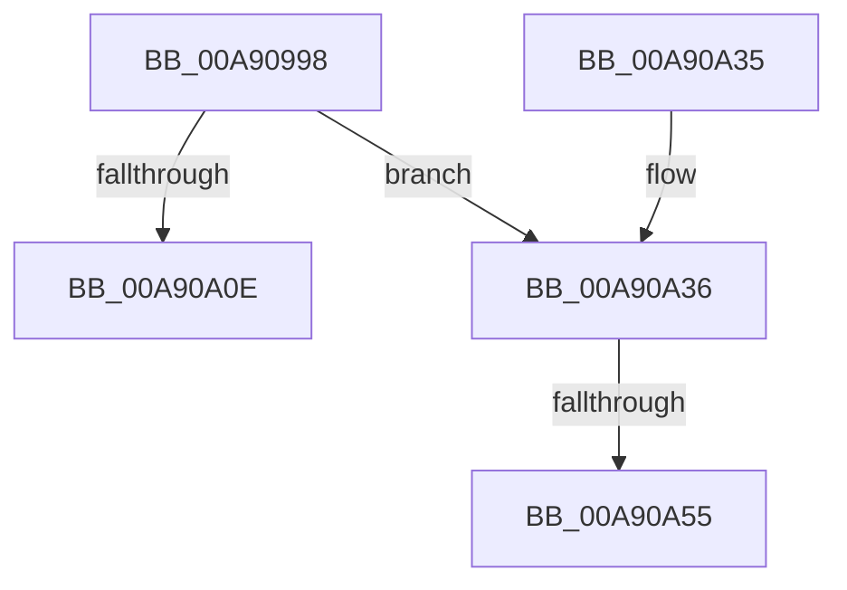

# IopBootLog

- RVA: `0x00A90998`–`0x00A90A5E` (길이 `198` bytes)
- VA: `0x0000000140A90998`
- 실행 섹션: `PAGE`
- PDB 이름 있음: `예`; PDB Function 태그: `예`
- unwind 정보 RVA: `0x000B8F0C`
- 디코드: `47`개 명령, `198/198` bytes 표시
- 미해석 바이트: `0` (있으면 어셈블리에 `.byte`로 보존)

> 이 문서는 커널 이미지의 기계어와 PDB 기호를 분석해 생성했습니다. 4번과 5번은 함수 원형과 자료형을 바이너리 사용 방식에서 추정한 C 해석이며 원본 소스 복구 결과는 아닙니다.

## 1. Dependencies

- 직접 호출 지점: **2**; 고유 호출 대상: **2**
- 직접 호출자로 확인된 함수: **4**
- RIP 상대 이미지 참조: **2**

### Outgoing calls
- `0x00A90A18` → [_security_check_cookie](../../text/6A/_security_check_cookie_function_006AC640.md) (function, `0x006AC640`)
- `0x00A90A3C` → [ExAcquireResourceExclusiveLite](../../text/21/ExAcquireResourceExclusiveLite_function_00214E20.md) (function, `0x00214E20`)

### Direct callers
- [IopBootLogDriver](../../text/59/IopBootLogDriver_function_00596F70.md) at `0x00596F7A`
- [IopLoadDriver](../99/IopLoadDriver_function_00997B54.md) at `0x00997E70`
- [IopLoadDriver](../99/IopLoadDriver_function_00997B54.md) at `0x0099834B`
- [IopLoadDriver](../99/IopLoadDriver_function_00997B54.md) at `0x00998361`
- [IopLoadDriver](../99/IopLoadDriver_function_00997B54.md) at `0x0099847C`
- [sub_00B2CB5C](../B2/Unknown_function_00B2CB5C.md) at `0x00B2CBF8`
- [sub_00B3807C](../B3/Unknown_function_00B3807C.md) at `0x00B381CC`
- [sub_00B3807C](../B3/Unknown_function_00B3807C.md) at `0x00B38207`

### Static image references
- `0x00A909B5` → RVA `0x00E0A740` (`.data`; read)
- `0x00A909E4` → RVA `0x00FD8028` (`PAGEDATA`; read)

## 2. Other-region calls and transfers

- 다른 실행 섹션으로 향하는 call: **2**
  - `0x00A90A18` → [_security_check_cookie](../../text/6A/_security_check_cookie_function_006AC640.md) (`PAGE` → `.text`)
  - `0x00A90A3C` → [ExAcquireResourceExclusiveLite](../../text/21/ExAcquireResourceExclusiveLite_function_00214E20.md) (`PAGE` → `.text`)
- call이 아닌 외부 분기/꼬리 이동: **2**
  - `0x00A90A4F` → [sub_00B46996](../B4/Unknown_function_00B46996.md) (`tail-transfer`)
  - `0x00A90A59` → [sub_00B46996](../B4/Unknown_function_00B46996.md) (`tail-transfer`)

## 3. Assembly (complete function range)

```asm
00A90998  48 89 5C 24 10                  mov qword ptr [rsp + 0x10], rbx
00A9099D  48 89 74 24 18                  mov qword ptr [rsp + 0x18], rsi
00A909A2  55                              push rbp
00A909A3  57                              push rdi
00A909A4  41 56                           push r14
00A909A6  48 8D AC 24 70 FC FF FF         lea rbp, [rsp - 0x390]
00A909AE  48 81 EC 90 04 00 00            sub rsp, 0x490
00A909B5  48 8B 05 84 9D 37 00            mov rax, qword ptr [rip + 0x379d84]
00A909BC  48 33 C4                        xor rax, rsp
00A909BF  48 89 85 80 03 00 00            mov qword ptr [rbp + 0x380], rax
00A909C6  0F 57 C0                        xorps xmm0, xmm0
00A909C9  48 C7 44 24 30 00 00 00 01      mov qword ptr [rsp + 0x30], 0x1000000
00A909D2  0F 57 C9                        xorps xmm1, xmm1
00A909D5  48 8D 85 80 01 00 00            lea rax, [rbp + 0x180]
00A909DC  48 8B F9                        mov rdi, rcx
00A909DF  48 89 44 24 38                  mov qword ptr [rsp + 0x38], rax
00A909E4  48 8B 0D 3D 76 54 00            mov rcx, qword ptr [rip + 0x54763d]
00A909EB  33 F6                           xor esi, esi
00A909ED  8A DA                           mov bl, dl
00A909EF  41 BE 00 01 00 00               mov r14d, 0x100
00A909F5  0F 11 44 24 60                  movups xmmword ptr [rsp + 0x60], xmm0
00A909FA  0F 11 4C 24 70                  movups xmmword ptr [rsp + 0x70], xmm1
00A909FF  0F 11 44 24 50                  movups xmmword ptr [rsp + 0x50], xmm0
00A90A04  0F 11 4C 24 40                  movups xmmword ptr [rsp + 0x40], xmm1
00A90A09  48 85 C9                        test rcx, rcx
00A90A0C  75 28                           jne 0x140a90a36
00A90A0E  48 8B 8D 80 03 00 00            mov rcx, qword ptr [rbp + 0x380]
00A90A15  48 33 CC                        xor rcx, rsp
00A90A18  E8 23 BC C1 FF                  call 0x1406ac640
00A90A1D  4C 8D 9C 24 90 04 00 00         lea r11, [rsp + 0x490]
00A90A25  49 8B 5B 28                     mov rbx, qword ptr [r11 + 0x28]
00A90A29  49 8B 73 30                     mov rsi, qword ptr [r11 + 0x30]
00A90A2D  49 8B E3                        mov rsp, r11
00A90A30  41 5E                           pop r14
00A90A32  5F                              pop rdi
00A90A33  5D                              pop rbp
00A90A34  C3                              ret
00A90A35  CC                              int3
00A90A36  48 83 C1 40                     add rcx, 0x40
00A90A3A  B2 01                           mov dl, 1
00A90A3C  E8 DF 43 78 FF                  call 0x140214e20
00A90A41  48 8B 15 E0 75 54 00            mov rdx, qword ptr [rip + 0x5475e0]
00A90A48  48 8D 4C 24 30                  lea rcx, [rsp + 0x30]
00A90A4D  84 DB                           test bl, bl
00A90A4F  0F 85 41 5F 0B 00               jne 0x140b46996
00A90A55  48 83 C2 10                     add rdx, 0x10
00A90A59  E9 38 5F 0B 00                  jmp 0x140b46996
```

## 4. C-style interpretation (structured pseudocode)

```c
__int64 __fastcall IopBootLog(__int64 a1, unsigned __int8 a2)
{
    __int64 result;
    __int64 v_rsi;
    __int64 v_rsp;
    unsigned __int64 v_stack_m18;
    unsigned __int64 v_stack_m228;
    unsigned __int64 v_stack_m28;
    unsigned __int64 v_stack_m3A8;
    unsigned __int64 v_stack_m438;
    unsigned __int64 v_stack_m448;
    unsigned __int64 v_stack_m458;
    unsigned __int64 v_stack_m460;
    unsigned __int64 v_stack_m468;
    unsigned __int64 v_stack_m470;
    unsigned __int64 v_stack_m478;
    unsigned __int64 v_stack_p10;
    unsigned __int64 v_stack_p18;

    v_stack_p10 = v_rbx;
    v_stack_p18 = v_rsi;
    v_rsp = (v_rsp) - (0x490ULL);
    result = (*(unsigned __int64 *)(v_rip + 3644804)) ^ (v_rsp);
    v_stack_m28 = result;
    v_stack_m478 = 0x1000000ULL;
    v_stack_m470 = v_stack_m228;
    v_rsi = 0;
    v_stack_m448 = v_xmm0;
    v_stack_m438 = v_xmm1;
    v_stack_m458 = v_xmm0;
    v_stack_m468 = v_xmm1;
    if (*(unsigned __int64 *)(v_rip + 5535293) != 0) goto loc_00A90A36;
    a1 = (v_stack_m28) ^ (v_rsp);
    result = _security_check_cookie(a1, a2, a3, a4);
    return result;
loc_00A90A36:
    a1 = (a1) + (64);
    result = ExAcquireResourceExclusiveLite(a1, 1, a3, a4);
    a2 = (*(unsigned __int64 *)(v_rip + 5535200)) + (16);
}
```

## 5. (Beta) C Style

```c
int64_t IopBootLog(int64_t Arg1, uint8_t Arg2)
{
    int64_t result;
    int64_t local_rsi;
    int64_t local_rsp;
    uint64_t v_stack_m18;
    uint64_t v_stack_m228;
    uint64_t v_stack_m28;
    uint64_t v_stack_m3A8;
    uint64_t v_stack_m438;
    uint64_t v_stack_m448;
    uint64_t v_stack_m458;
    uint64_t v_stack_m460;
    uint64_t v_stack_m468;
    uint64_t v_stack_m470;
    uint64_t v_stack_m478;
    uint64_t v_stack_p10;
    uint64_t v_stack_p18;

    v_stack_p10 = local_rbx;
    v_stack_p18 = local_rsi;
    local_rsp = (local_rsp) - (0x490ULL);
    result = (*(uint64_t *)(v_rip + 0x379D84)) ^ (local_rsp);
    v_stack_m28 = result;
    v_stack_m478 = 0x1000000ULL;
    v_stack_m470 = v_stack_m228;
    local_rsi = 0;
    v_stack_m448 = v_xmm0;
    v_stack_m438 = v_xmm1;
    v_stack_m458 = v_xmm0;
    v_stack_m468 = v_xmm1;
    if (*(uint64_t *)(v_rip + 0x54763D) != 0) goto loc_00A90A36;
    Arg1 = (v_stack_m28) ^ (local_rsp);
    result = _security_check_cookie(Arg1, Arg2, a3, a4);
    return result;
loc_00A90A36:
    Arg1 = (Arg1) + (64);
    result = ExAcquireResourceExclusiveLite(Arg1, 1, a3, a4);
    Arg2 = (*(uint64_t *)(v_rip + 0x5475E0)) + (16);
}
```

## 6. Execution-region graph

[열기: 2D/3D 그래프와 함수 탐색 컨트롤 패널](../../../control-panel.html?section=page&rva=0x00A90998&view=graph)

- 2D 그래프는 위에서 아래로 흐르고, 3D 그래프는 빈 공간을 드래그해 회전합니다. Shift+드래그는 이동, 휠은 확대·축소, 함수 노드 선택은 대상 보고서 이동입니다.

### Static fallback


