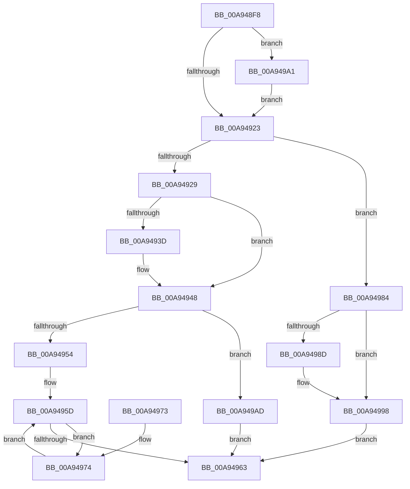

# IopCancelAlertedRequest

- RVA: `0x00A948F8`–`0x00A949C5` (길이 `205` bytes)
- VA: `0x0000000140A948F8`
- 실행 섹션: `PAGE`
- PDB 이름 있음: `예`; PDB Function 태그: `아니요`
- unwind 정보 RVA: `0x000B95D0`
- 디코드: `57`개 명령, `205/205` bytes 표시
- 미해석 바이트: `0` (있으면 어셈블리에 `.byte`로 보존)

> 이 문서는 커널 이미지의 기계어와 PDB 기호를 분석해 생성했습니다. 4번과 5번은 함수 원형과 자료형을 바이너리 사용 방식에서 추정한 C 해석이며 원본 소스 복구 결과는 아닙니다.

## 1. Dependencies

- 직접 호출 지점: **6**; 고유 호출 대상: **5**
- 직접 호출자로 확인된 함수: **7**
- RIP 상대 이미지 참조: **1**

### Outgoing calls
- `0x00A9492C` → [IoCancelIrp](../../text/27/IoCancelIrp_function_002720E0.md) (function, `0x002720E0`)
- `0x00A94943` → [KiLowerIrqlProcessIrqlFlags](../../text/4F/KiLowerIrqlProcessIrqlFlags_function_004F5698.md) (function, `0x004F5698`)
- `0x00A9497D` → [KeDelayExecutionThread](../../text/20/KeDelayExecutionThread_function_00209550.md) (function, `0x00209550`)
- `0x00A94993` → [KiLowerIrqlProcessIrqlFlags](../../text/4F/KiLowerIrqlProcessIrqlFlags_function_004F5698.md) (function, `0x004F5698`)
- `0x00A949A3` → [KiRaiseIrqlProcessIrqlFlags](../../text/4F/KiRaiseIrqlProcessIrqlFlags_function_004F56FC.md) (function, `0x004F56FC`)
- `0x00A949BE` → [KeWaitForSingleObject](../../text/20/KeWaitForSingleObject_function_0020E6B0.md) (function, `0x0020E6B0`)

### Direct callers
- [NtSetInformationFile](../../text/29/NtSetInformationFile_function_0029C5E0.md) at `0x0029D511`
- [IopWaitForSynchronousIo](../../text/29/IopWaitForSynchronousIo_function_0029D6D0.md) at `0x0029D7C0`
- [IopWaitForSynchronousIoEvent](../../text/43/IopWaitForSynchronousIoEvent_function_0043F0F0.md) at `0x0043F1D5`
- [IoSetInformation](../71/IoSetInformation_function_0071DBF0.md) at `0x0071DF2A`
- [IopParseDevice](../89/IopParseDevice_function_0089E510.md) at `0x008A05C3`
- [IopSynchronousApiServiceTail](../8A/IopSynchronousApiServiceTail_function_008ACE3C.md) at `0x008ACEC6`
- [NtQueryInformationFile](../8A/NtQueryInformationFile_function_008AD630.md) at `0x008ADE41`
- [NtQueryInformationFile](../8A/NtQueryInformationFile_function_008AD630.md) at `0x008AE428`

### Static image references
- `0x00A9491A` → RVA `0x00FC6D20` (`ALMOSTRO`; read)

## 2. Other-region calls and transfers

- 다른 실행 섹션으로 향하는 call: **6**
  - `0x00A9492C` → [IoCancelIrp](../../text/27/IoCancelIrp_function_002720E0.md) (`PAGE` → `.text`)
  - `0x00A94943` → [KiLowerIrqlProcessIrqlFlags](../../text/4F/KiLowerIrqlProcessIrqlFlags_function_004F5698.md) (`PAGE` → `.text`)
  - `0x00A9497D` → [KeDelayExecutionThread](../../text/20/KeDelayExecutionThread_function_00209550.md) (`PAGE` → `.text`)
  - `0x00A94993` → [KiLowerIrqlProcessIrqlFlags](../../text/4F/KiLowerIrqlProcessIrqlFlags_function_004F5698.md) (`PAGE` → `.text`)
  - `0x00A949A3` → [KiRaiseIrqlProcessIrqlFlags](../../text/4F/KiRaiseIrqlProcessIrqlFlags_function_004F56FC.md) (`PAGE` → `.text`)
  - `0x00A949BE` → [KeWaitForSingleObject](../../text/20/KeWaitForSingleObject_function_0020E6B0.md) (`PAGE` → `.text`)
- 별도 외부 분기/꼬리 이동을 확인하지 못했습니다.

## 3. Assembly (complete function range)

```asm
00A948F8  48 89 5C 24 10                  mov qword ptr [rsp + 0x10], rbx
00A948FD  48 89 74 24 18                  mov qword ptr [rsp + 0x18], rsi
00A94902  57                              push rdi
00A94903  48 83 EC 30                     sub rsp, 0x30
00A94907  48 8B F2                        mov rsi, rdx
00A9490A  48 8B F9                        mov rdi, rcx
00A9490D  44 0F 20 C3                     mov rbx, cr8
00A94911  BA 01 00 00 00                  mov edx, 1
00A94916  44 0F 22 C2                     mov cr8, rdx
00A9491A  83 3D FF 23 53 00 00            cmp dword ptr [rip + 0x5323ff], 0
00A94921  75 7E                           jne 0x140a949a1
00A94923  83 7F 04 00                     cmp dword ptr [rdi + 4], 0
00A94927  75 5B                           jne 0x140a94984
00A94929  48 8B CE                        mov rcx, rsi
00A9492C  E8 AF D7 7D FF                  call 0x1402720e0
00A94931  83 3D E8 23 53 00 00            cmp dword ptr [rip + 0x5323e8], 0
00A94938  40 8A F0                        mov sil, al
00A9493B  74 0B                           je 0x140a94948
00A9493D  44 0F 20 C1                     mov rcx, cr8
00A94941  8A D3                           mov dl, bl
00A94943  E8 50 0D A6 FF                  call 0x1404f5698
00A94948  0F B6 CB                        movzx ecx, bl
00A9494B  44 0F 22 C1                     mov cr8, rcx
00A9494F  40 84 F6                        test sil, sil
00A94952  74 59                           je 0x140a949ad
00A94954  48 C7 44 24 40 60 79 FE FF      mov qword ptr [rsp + 0x40], 0xfffffffffffe7960
00A9495D  83 7F 04 00                     cmp dword ptr [rdi + 4], 0
00A94961  74 11                           je 0x140a94974
00A94963  48 8B 5C 24 48                  mov rbx, qword ptr [rsp + 0x48]
00A94968  48 8B 74 24 50                  mov rsi, qword ptr [rsp + 0x50]
00A9496D  48 83 C4 30                     add rsp, 0x30
00A94971  5F                              pop rdi
00A94972  C3                              ret
00A94973  CC                              int3
00A94974  4C 8D 44 24 40                  lea r8, [rsp + 0x40]
00A94979  33 D2                           xor edx, edx
00A9497B  33 C9                           xor ecx, ecx
00A9497D  E8 CE 4B 77 FF                  call 0x140209550
00A94982  EB D9                           jmp 0x140a9495d
00A94984  83 3D 95 23 53 00 00            cmp dword ptr [rip + 0x532395], 0
00A9498B  74 0B                           je 0x140a94998
00A9498D  44 0F 20 C1                     mov rcx, cr8
00A94991  8A D3                           mov dl, bl
00A94993  E8 00 0D A6 FF                  call 0x1404f5698
00A94998  0F B6 C3                        movzx eax, bl
00A9499B  44 0F 22 C0                     mov cr8, rax
00A9499F  EB C2                           jmp 0x140a94963
00A949A1  8A CB                           mov cl, bl
00A949A3  E8 54 0D A6 FF                  call 0x1404f56fc
00A949A8  E9 76 FF FF FF                  jmp 0x140a94923
00A949AD  48 83 64 24 20 00               and qword ptr [rsp + 0x20], 0
00A949B3  45 33 C9                        xor r9d, r9d
00A949B6  45 33 C0                        xor r8d, r8d
00A949B9  33 D2                           xor edx, edx
00A949BB  48 8B CF                        mov rcx, rdi
00A949BE  E8 ED 9C 77 FF                  call 0x14020e6b0
00A949C3  EB 9E                           jmp 0x140a94963
```

## 4. C-style interpretation (structured pseudocode)

```c
__int64 __fastcall IopCancelAlertedRequest(__int64 a1, __int64 a2, __int64 a3, int a4)
{
    __int64 result;
    __int64 v_rsp;
    unsigned __int64 v_stack_p10;
    unsigned __int64 v_stack_p18;
    unsigned __int64 v_stack_p20;
    unsigned __int64 v_stack_p40;
    unsigned __int64 v_stack_p8;

    v_stack_p10 = v_rbx;
    v_stack_p18 = v_rsi;
    v_rsp = (v_rsp) - (48);
    if ((*(unsigned int *)(v_rip + 5448703)) != 0) goto loc_00A949A1;
loc_00A94923:
    if ((*(unsigned int *)(a1 + 4)) != 0) goto loc_00A94984;
    result = IoCancelIrp(a2, 1, a3, a4);
    if ((*(unsigned int *)(v_rip + 5448680)) != 0) {
        a1 = 1;
        a2 = (unsigned __int8)(v_cr8);
        result = KiLowerIrqlProcessIrqlFlags(a1, a2, a3, a4);
    }
    if ((unsigned __int8)((unsigned __int8)(result)) == 0) goto loc_00A949AD;
    v_stack_p8 = 0xFFFFFFFFFFFE7960ULL;
loc_00A9495D:
    if ((*(unsigned int *)(a1 + 4)) == 0) goto loc_00A94974;
loc_00A94963:
    v_rsp = (v_rsp) + (48);
    return result;
loc_00A94974:
    a2 = 0;
    a1 = 0;
    result = KeDelayExecutionThread(a1, a2, v_stack_p40, a4);
    goto loc_00A9495D;
loc_00A94984:
    if ((*(unsigned int *)(v_rip + 5448597)) != 0) {
        a1 = (unsigned __int8)(v_cr8);
        a2 = (unsigned __int8)(v_stack_p10);
        result = KiLowerIrqlProcessIrqlFlags(a1, a2, v_stack_p40, a4);
    }
    goto loc_00A94963;
loc_00A949A1:
    result = KiRaiseIrqlProcessIrqlFlags((unsigned __int8)(v_stack_p10), a2, v_stack_p40, a4);
    goto loc_00A94923;
loc_00A949AD:
    a4 = 0;
    a3 = 0;
    a2 = 0;
    result = KeWaitForSingleObject(a1, a2, a3, a4);
    goto loc_00A94963;
}
```

## 5. (Beta) C Style

```c
int64_t IopCancelAlertedRequest(void *Arg1, int64_t Arg2, int64_t Arg3, int32_t Arg4)
{
    uint8_t *arg1 = (uint8_t *)Arg1;

    int64_t result;
    int64_t local_rsp;
    uint64_t v_stack_p10;
    uint64_t v_stack_p18;
    uint64_t v_stack_p20;
    uint64_t v_stack_p40;
    uint64_t v_stack_p8;

    v_stack_p10 = local_rbx;
    v_stack_p18 = local_rsi;
    local_rsp = (local_rsp) - (48);
    if ((*(uint32_t *)(v_rip + 0x5323FF)) != 0) goto loc_00A949A1;
loc_00A94923:
    if ((*(uint32_t *)(arg1 + 0x4)) != 0) goto loc_00A94984;
    result = IoCancelIrp(Arg2, 1, Arg3, Arg4);
    if ((*(uint32_t *)(v_rip + 0x5323E8)) != 0) {
        Arg1 = 1;
        Arg2 = (uint8_t)(v_cr8);
        result = KiLowerIrqlProcessIrqlFlags(Arg1, Arg2, Arg3, Arg4);
    }
    if ((uint8_t)((uint8_t)(result)) == 0) goto loc_00A949AD;
    v_stack_p8 = 0xFFFFFFFFFFFE7960ULL;
loc_00A9495D:
    if ((*(uint32_t *)(arg1 + 0x4)) == 0) goto loc_00A94974;
loc_00A94963:
    local_rsp = (local_rsp) + (48);
    return result;
loc_00A94974:
    Arg2 = 0;
    Arg1 = 0;
    result = KeDelayExecutionThread(Arg1, Arg2, v_stack_p40, Arg4);
    goto loc_00A9495D;
loc_00A94984:
    if ((*(uint32_t *)(v_rip + 0x532395)) != 0) {
        Arg1 = (uint8_t)(v_cr8);
        Arg2 = (uint8_t)(v_stack_p10);
        result = KiLowerIrqlProcessIrqlFlags(Arg1, Arg2, v_stack_p40, Arg4);
    }
    goto loc_00A94963;
loc_00A949A1:
    result = KiRaiseIrqlProcessIrqlFlags((uint8_t)(v_stack_p10), Arg2, v_stack_p40, Arg4);
    goto loc_00A94923;
loc_00A949AD:
    Arg4 = 0;
    Arg3 = 0;
    Arg2 = 0;
    result = KeWaitForSingleObject(Arg1, Arg2, Arg3, Arg4);
    goto loc_00A94963;
}
```

### 관측된 메모리 오프셋

구조체 형식이 확인되지 않은 접근은 인자 기준의 오프셋으로만 기록했습니다.

| 기준 인자 | 오프셋 표현 | 폭 (bit) | 접근 |
|---|---:|---:|---|
| `Arg1` | `+ 0x4` | `32` | `R` |

## 6. Execution-region graph

[열기: 2D/3D 그래프와 함수 탐색 컨트롤 패널](../../../control-panel.html?section=page&rva=0x00A948F8&view=graph)

- 2D 그래프는 위에서 아래로 흐르고, 3D 그래프는 빈 공간을 드래그해 회전합니다. Shift+드래그는 이동, 휠은 확대·축소, 함수 노드 선택은 대상 보고서 이동입니다.

### Static fallback


