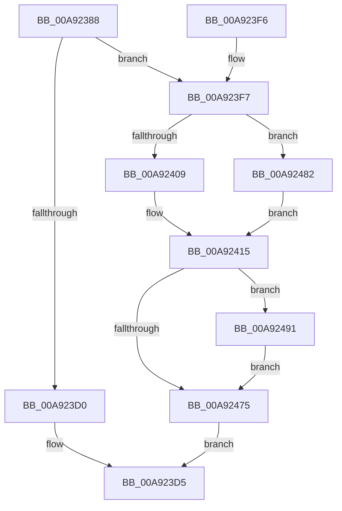

# IopFilterResourceRequirementsCall

- RVA: `0x00A92388`–`0x00A924AF` (길이 `295` bytes)
- VA: `0x0000000140A92388`
- 실행 섹션: `PAGE`
- PDB 이름 있음: `예`; PDB Function 태그: `아니요`
- unwind 정보 RVA: `0x000B9384`
- 디코드: `77`개 명령, `295/295` bytes 표시
- 미해석 바이트: `0` (있으면 어셈블리에 `.byte`로 보존)

> 이 문서는 커널 이미지의 기계어와 PDB 기호를 분석해 생성했습니다. 4번과 5번은 함수 원형과 자료형을 바이너리 사용 방식에서 추정한 C 해석이며 원본 소스 복구 결과는 아닙니다.

## 1. Dependencies

- 직접 호출 지점: **8**; 고유 호출 대상: **8**
- 직접 호출자로 확인된 함수: **1**
- RIP 상대 이미지 참조: **0**

### Outgoing calls
- `0x00A923B6` → [IoGetAttachedDeviceReference](../../text/41/IoGetAttachedDeviceReference_function_0041D940.md) (function, `0x0041D940`)
- `0x00A923C3` → [IoAllocateIrp](../../text/20/IoAllocateIrp_function_002065D0.md) (function, `0x002065D0`)
- `0x00A923D8` → [ObfDereferenceObject](../../text/2F/ObfDereferenceObject_function_002F9350.md) (function, `0x002F9350`)
- `0x00A923FF` → [IovUtilWatermarkIrp](../../text/48/IovUtilWatermarkIrp_function_0048E1A4.md) (function, `0x0048E1A4`)
- `0x00A92421` → [KeInitializeEvent](../../text/40/KeInitializeEvent_function_0040DD10.md) (function, `0x0040DD10`)
- `0x00A9244B` → [IopQueueThreadIrp](../../text/20/IopQueueThreadIrp_function_002075C0.md) (function, `0x002075C0`)
- `0x00A92467` → [IofCallDriver](../../text/29/IofCallDriver_function_0029B4B0.md) (function, `0x0029B4B0`)
- `0x00A924A4` → [KeWaitForSingleObject](../../text/20/KeWaitForSingleObject_function_0020E6B0.md) (function, `0x0020E6B0`)

### Direct callers
- [IopQueryDeviceResources](../8F/IopQueryDeviceResources_function_008FC344.md) at `0x008FC4D4`

### Static image references
- 디코드된 RIP-relative 메모리 참조가 없습니다.

## 2. Other-region calls and transfers

- 다른 실행 섹션으로 향하는 call: **8**
  - `0x00A923B6` → [IoGetAttachedDeviceReference](../../text/41/IoGetAttachedDeviceReference_function_0041D940.md) (`PAGE` → `.text`)
  - `0x00A923C3` → [IoAllocateIrp](../../text/20/IoAllocateIrp_function_002065D0.md) (`PAGE` → `.text`)
  - `0x00A923D8` → [ObfDereferenceObject](../../text/2F/ObfDereferenceObject_function_002F9350.md) (`PAGE` → `.text`)
  - `0x00A923FF` → [IovUtilWatermarkIrp](../../text/48/IovUtilWatermarkIrp_function_0048E1A4.md) (`PAGE` → `.text`)
  - `0x00A92421` → [KeInitializeEvent](../../text/40/KeInitializeEvent_function_0040DD10.md) (`PAGE` → `.text`)
  - `0x00A9244B` → [IopQueueThreadIrp](../../text/20/IopQueueThreadIrp_function_002075C0.md) (`PAGE` → `.text`)
  - `0x00A92467` → [IofCallDriver](../../text/29/IofCallDriver_function_0029B4B0.md) (`PAGE` → `.text`)
  - `0x00A924A4` → [KeWaitForSingleObject](../../text/20/KeWaitForSingleObject_function_0020E6B0.md) (`PAGE` → `.text`)
- 별도 외부 분기/꼬리 이동을 확인하지 못했습니다.

## 3. Assembly (complete function range)

```asm
00A92388  4C 8B DC                        mov r11, rsp
00A9238B  49 89 5B 08                     mov qword ptr [r11 + 8], rbx
00A9238F  49 89 73 10                     mov qword ptr [r11 + 0x10], rsi
00A92393  49 89 7B 18                     mov qword ptr [r11 + 0x18], rdi
00A92397  41 56                           push r14
00A92399  48 83 EC 60                     sub rsp, 0x60
00A9239D  0F 57 C0                        xorps xmm0, xmm0
00A923A0  33 C0                           xor eax, eax
00A923A2  0F 11 44 24 40                  movups xmmword ptr [rsp + 0x40], xmm0
00A923A7  49 89 43 E8                     mov qword ptr [r11 - 0x18], rax
00A923AB  4D 8B F0                        mov r14, r8
00A923AE  48 8B FA                        mov rdi, rdx
00A923B1  0F 11 44 24 30                  movups xmmword ptr [rsp + 0x30], xmm0
00A923B6  E8 85 B5 98 FF                  call 0x14041d940
00A923BB  33 D2                           xor edx, edx
00A923BD  48 8B F0                        mov rsi, rax
00A923C0  8A 48 4C                        mov cl, byte ptr [rax + 0x4c]
00A923C3  E8 08 42 77 FF                  call 0x1402065d0
00A923C8  48 8B D8                        mov rbx, rax
00A923CB  48 85 C0                        test rax, rax
00A923CE  75 27                           jne 0x140a923f7
00A923D0  BB 9A 00 00 C0                  mov ebx, 0xc000009a
00A923D5  48 8B CE                        mov rcx, rsi
00A923D8  E8 73 6F 86 FF                  call 0x1402f9350
00A923DD  4C 8D 5C 24 60                  lea r11, [rsp + 0x60]
00A923E2  8B C3                           mov eax, ebx
00A923E4  49 8B 5B 10                     mov rbx, qword ptr [r11 + 0x10]
00A923E8  49 8B 73 18                     mov rsi, qword ptr [r11 + 0x18]
00A923EC  49 8B 7B 20                     mov rdi, qword ptr [r11 + 0x20]
00A923F0  49 8B E3                        mov rsp, r11
00A923F3  41 5E                           pop r14
00A923F5  C3                              ret
00A923F6  CC                              int3
00A923F7  BA 01 00 00 00                  mov edx, 1
00A923FC  48 8B CB                        mov rcx, rbx
00A923FF  E8 A0 BD 9F FF                  call 0x14048e1a4
00A92404  48 85 FF                        test rdi, rdi
00A92407  75 79                           jne 0x140a92482
00A92409  B8 BB 00 00 C0                  mov eax, 0xc00000bb
00A9240E  89 44 24 30                     mov dword ptr [rsp + 0x30], eax
00A92412  89 43 30                        mov dword ptr [rbx + 0x30], eax
00A92415  45 33 C0                        xor r8d, r8d
00A92418  48 8D 4C 24 40                  lea rcx, [rsp + 0x40]
00A9241D  41 8D 50 01                     lea edx, [r8 + 1]
00A92421  E8 EA B8 97 FF                  call 0x14040dd10
00A92426  48 8D 44 24 30                  lea rax, [rsp + 0x30]
00A9242B  48 8B CB                        mov rcx, rbx
00A9242E  48 89 43 48                     mov qword ptr [rbx + 0x48], rax
00A92432  48 8D 44 24 40                  lea rax, [rsp + 0x40]
00A92437  48 89 43 50                     mov qword ptr [rbx + 0x50], rax
00A9243B  65 48 8B 04 25 88 01 00 00      mov rax, qword ptr gs:[0x188]
00A92444  48 89 83 98 00 00 00            mov qword ptr [rbx + 0x98], rax
00A9244B  E8 70 51 77 FF                  call 0x1402075c0
00A92450  48 8B 83 B8 00 00 00            mov rax, qword ptr [rbx + 0xb8]
00A92457  48 8B D3                        mov rdx, rbx
00A9245A  48 8B CE                        mov rcx, rsi
00A9245D  66 C7 40 B8 1B 0D               mov word ptr [rax - 0x48], 0xd1b
00A92463  48 89 78 C0                     mov qword ptr [rax - 0x40], rdi
00A92467  E8 44 90 80 FF                  call 0x14029b4b0
00A9246C  8B D8                           mov ebx, eax
00A9246E  3D 03 01 00 00                  cmp eax, 0x103
00A92473  74 1C                           je 0x140a92491
00A92475  48 8B 44 24 38                  mov rax, qword ptr [rsp + 0x38]
00A9247A  49 89 06                        mov qword ptr [r14], rax
00A9247D  E9 53 FF FF FF                  jmp 0x140a923d5
00A92482  83 63 30 00                     and dword ptr [rbx + 0x30], 0
00A92486  48 89 7C 24 38                  mov qword ptr [rsp + 0x38], rdi
00A9248B  48 89 7B 38                     mov qword ptr [rbx + 0x38], rdi
00A9248F  EB 84                           jmp 0x140a92415
00A92491  48 83 64 24 20 00               and qword ptr [rsp + 0x20], 0
00A92497  48 8D 4C 24 40                  lea rcx, [rsp + 0x40]
00A9249C  45 33 C9                        xor r9d, r9d
00A9249F  45 33 C0                        xor r8d, r8d
00A924A2  33 D2                           xor edx, edx
00A924A4  E8 07 C2 77 FF                  call 0x14020e6b0
00A924A9  8B 5C 24 30                     mov ebx, dword ptr [rsp + 0x30]
00A924AD  EB C6                           jmp 0x140a92475
```

## 4. C-style interpretation (structured pseudocode)

```c
__int64 __fastcall IopFilterResourceRequirementsCall(__int64 a1, __int64 a2, __int64 a3, int a4)
{
    __int64 result;
    __int64 v_rsp;
    unsigned __int64 v_stack_m20;
    unsigned __int64 v_stack_m28;
    unsigned int v_stack_m30;
    unsigned __int64 v_stack_m38;
    unsigned __int64 v_stack_m40;
    unsigned __int64 v_stack_m8;

    *(unsigned __int64 *)(v_rsp + 8) = v_rbx;
    *(unsigned __int64 *)(v_rsp + 16) = v_rsi;
    *(unsigned __int64 *)(v_rsp + 24) = v_rdi;
    v_rsp = (v_rsp) - (96);
    result = 0;
    v_stack_m28 = v_xmm0;
    *(unsigned __int64 *)(v_rsp - 24) = 0;
    v_stack_m38 = v_xmm0;
    result = IoGetAttachedDeviceReference(a1, a2, a3, a4);
    a2 = 0;
    result = IoAllocateIrp(*(unsigned __int8 *)(result + 76), a2, a3, a4);
    if (result != 0) goto loc_00A923F7;
loc_00A923D5:
    result = ObfDereferenceObject(result, a2, a3, a4);
    return (unsigned int)((unsigned int)((unsigned int)(0xC000009AULL)));
loc_00A923F7:
    result = IovUtilWatermarkIrp(*(unsigned __int64 *)(v_stack_m8 + 16), 1, a3, a4);
    if (*(unsigned __int64 *)(v_stack_m8 + 32) != 0) goto loc_00A92482;
    v_stack_m30 = (unsigned int)((unsigned int)(0xC00000BBULL));
    *(unsigned int *)(*(unsigned __int64 *)(v_stack_m8 + 16) + 48) = (unsigned int)((unsigned int)(0xC00000BBULL));
loc_00A92415:
    a3 = 0;
    result = KeInitializeEvent(v_stack_m20, a3 + 1, a3, a4);
    *(unsigned __int64 *)(*(unsigned __int64 *)(v_stack_m8 + 16) + 72) = v_stack_m30;
    *(unsigned __int64 *)(*(unsigned __int64 *)(v_stack_m8 + 16) + 80) = v_stack_m20;
    *(unsigned __int64 *)(*(unsigned __int64 *)(v_stack_m8 + 16) + 152) = *(unsigned __int64 *)(gs_base + (0 + 392));
    result = IopQueueThreadIrp(*(unsigned __int64 *)(v_stack_m8 + 16), a3 + 1, a3, a4);
    *(unsigned __int16 *)(*(unsigned __int64 *)(*(unsigned __int64 *)(v_stack_m8 + 16) + 184) - 72) = 0xD1BULL;
    *(unsigned __int64 *)(*(unsigned __int64 *)(*(unsigned __int64 *)(v_stack_m8 + 16) + 184) - 64) = *(unsigned __int64 *)(v_stack_m8 + 32);
    result = IofCallDriver(*(unsigned __int64 *)(v_stack_m8 + 24), *(unsigned __int64 *)(v_stack_m8 + 16), a3, a4);
    if (((unsigned int)(result)) == 259) goto loc_00A92491;
loc_00A92475:
    *(unsigned __int64 *)(a3) = v_stack_m28;
    goto loc_00A923D5;
loc_00A92482:
    v_stack_m28 = *(unsigned __int64 *)(v_stack_m8 + 32);
    *(unsigned __int64 *)((unsigned int)((unsigned int)(result)) + 56) = *(unsigned __int64 *)(v_stack_m8 + 32);
    goto loc_00A92415;
loc_00A92491:
    a4 = 0;
    a3 = 0;
    a2 = 0;
    result = KeWaitForSingleObject(v_stack_m20, a2, a3, a4);
    goto loc_00A92475;
}
```

## 5. (Beta) C Style

```c
int64_t IopFilterResourceRequirementsCall(int64_t Arg1, int64_t Arg2, void *Arg3, int32_t Arg4)
{
    uint8_t *arg3 = (uint8_t *)Arg3;

    int64_t result;
    int64_t local_rsp;
    uint64_t v_stack_m20;
    uint64_t v_stack_m28;
    uint32_t v_stack_m30;
    uint64_t v_stack_m38;
    uint64_t v_stack_m40;
    uint64_t v_stack_m8;

    *(uint64_t *)(local_rsp + 0x8) = local_rbx;
    *(uint64_t *)(local_rsp + 0x10) = local_rsi;
    *(uint64_t *)(local_rsp + 0x18) = local_rdi;
    local_rsp = (local_rsp) - (96);
    result = 0;
    v_stack_m28 = v_xmm0;
    *(uint64_t *)(local_rsp - 0x18) = 0;
    v_stack_m38 = v_xmm0;
    result = IoGetAttachedDeviceReference(Arg1, Arg2, Arg3, Arg4);
    Arg2 = 0;
    result = IoAllocateIrp(*(uint8_t *)(result + 0x4C), Arg2, Arg3, Arg4);
    if (result != 0) goto loc_00A923F7;
loc_00A923D5:
    result = ObfDereferenceObject(result, Arg2, Arg3, Arg4);
    return (uint32_t)((uint32_t)((uint32_t)(0xC000009AULL)));
loc_00A923F7:
    result = IovUtilWatermarkIrp(*(uint64_t *)(v_stack_m8 + 0x10), 1, Arg3, Arg4);
    if (*(uint64_t *)(v_stack_m8 + 0x20) != 0) goto loc_00A92482;
    v_stack_m30 = (uint32_t)((uint32_t)(0xC00000BBULL));
    *(uint32_t *)(*(uint64_t *)(v_stack_m8 + 0x10) + 0x30) = (uint32_t)((uint32_t)(0xC00000BBULL));
loc_00A92415:
    Arg3 = 0;
    result = KeInitializeEvent(v_stack_m20, Arg3 + 1, Arg3, Arg4);
    *(uint64_t *)(*(uint64_t *)(v_stack_m8 + 0x10) + 0x48) = v_stack_m30;
    *(uint64_t *)(*(uint64_t *)(v_stack_m8 + 0x10) + 0x50) = v_stack_m20;
    *(uint64_t *)(*(uint64_t *)(v_stack_m8 + 0x10) + 0x98) = *(uint64_t *)(gs_base + (0 + 0x188));
    result = IopQueueThreadIrp(*(uint64_t *)(v_stack_m8 + 0x10), Arg3 + 1, Arg3, Arg4);
    *(uint16_t *)(*(uint64_t *)(*(uint64_t *)(v_stack_m8 + 0x10) + 0xB8) - 0x48) = 0xD1BULL;
    *(uint64_t *)(*(uint64_t *)(*(uint64_t *)(v_stack_m8 + 0x10) + 0xB8) - 0x40) = *(uint64_t *)(v_stack_m8 + 0x20);
    result = IofCallDriver(*(uint64_t *)(v_stack_m8 + 0x18), *(uint64_t *)(v_stack_m8 + 0x10), Arg3, Arg4);
    if (((uint32_t)(result)) == 259) goto loc_00A92491;
loc_00A92475:
    *(uint64_t *)(arg3) = v_stack_m28;
    goto loc_00A923D5;
loc_00A92482:
    v_stack_m28 = *(uint64_t *)(v_stack_m8 + 0x20);
    *(uint64_t *)((uint32_t)((uint32_t)(result)) + 0x38) = *(uint64_t *)(v_stack_m8 + 0x20);
    goto loc_00A92415;
loc_00A92491:
    Arg4 = 0;
    Arg3 = 0;
    Arg2 = 0;
    result = KeWaitForSingleObject(v_stack_m20, Arg2, Arg3, Arg4);
    goto loc_00A92475;
}
```

### 관측된 메모리 오프셋

구조체 형식이 확인되지 않은 접근은 인자 기준의 오프셋으로만 기록했습니다.

| 기준 인자 | 오프셋 표현 | 폭 (bit) | 접근 |
|---|---:|---:|---|
| `Arg3` | `+ 0x0` | `64` | `W` |

## 6. Execution-region graph

[열기: 2D/3D 그래프와 함수 탐색 컨트롤 패널](../../../control-panel.html?section=page&rva=0x00A92388&view=graph)

- 2D 그래프는 위에서 아래로 흐르고, 3D 그래프는 빈 공간을 드래그해 회전합니다. Shift+드래그는 이동, 휠은 확대·축소, 함수 노드 선택은 대상 보고서 이동입니다.

### Static fallback


