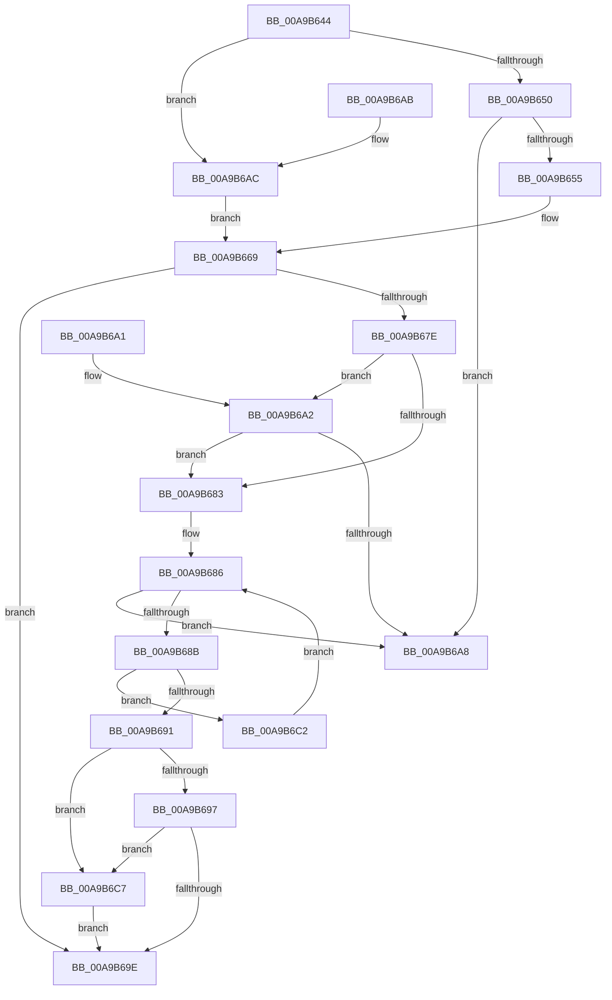

# IopFindResourceHandlerInfo

- RVA: `0x00A9B644`–`0x00A9B6CC` (길이 `136` bytes)
- VA: `0x0000000140A9B644`
- 실행 섹션: `PAGE`
- PDB 이름 있음: `예`; PDB Function 태그: `아니요`
- unwind 정보 RVA: `0x000DB714`
- 디코드: `42`개 명령, `136/136` bytes 표시
- 미해석 바이트: `0` (있으면 어셈블리에 `.byte`로 보존)

> 이 문서는 커널 이미지의 기계어와 PDB 기호를 분석해 생성했습니다. 4번과 5번은 함수 원형과 자료형을 바이너리 사용 방식에서 추정한 C 해석이며 원본 소스 복구 결과는 아닙니다.

## 1. Dependencies

- 직접 호출 지점: **0**; 고유 호출 대상: **0**
- 직접 호출자로 확인된 함수: **2**
- RIP 상대 이미지 참조: **0**

### Outgoing calls
- 직접 디코드된 call 명령이 없습니다.

### Direct callers
- [IoTranslateBusAddress](../../text/5A/IoTranslateBusAddress_function_005A5F60.md) at `0x005A6027`
- [IopSetupArbiterAndTranslators](../A8/IopSetupArbiterAndTranslators_function_00A82E68.md) at `0x00A83040`

### Static image references
- 디코드된 RIP-relative 메모리 참조가 없습니다.

## 2. Other-region calls and transfers

- 다른 실행 섹션으로 향하는 call: **0**
- 별도 외부 분기/꼬리 이동을 확인하지 못했습니다.

## 3. Assembly (complete function range)

```asm
00A9B644  49 83 21 00                     and qword ptr [r9], 0
00A9B648  4D 8B D9                        mov r11, r9
00A9B64B  83 E9 01                        sub ecx, 1
00A9B64E  74 5C                           je 0x140a9b6ac
00A9B650  83 F9 01                        cmp ecx, 1
00A9B653  75 53                           jne 0x140a9b6a8
00A9B655  44 0F B7 8A 0C 02 00 00         movzx r9d, word ptr [rdx + 0x20c]
00A9B65D  B9 E8 01 00 00                  mov ecx, 0x1e8
00A9B662  0F B7 82 0E 02 00 00            movzx eax, word ptr [rdx + 0x20e]
00A9B669  4C 8D 14 11                     lea r10, [rcx + rdx]
00A9B66D  41 8A C8                        mov cl, r8b
00A9B670  BA 01 00 00 00                  mov edx, 1
00A9B675  66 D3 E2                        shl dx, cl
00A9B678  66 44 85 CA                     test dx, r9w
00A9B67C  75 20                           jne 0x140a9b69e
00A9B67E  66 85 C2                        test dx, ax
00A9B681  74 1F                           je 0x140a9b6a2
00A9B683  49 8B 02                        mov rax, qword ptr [r10]
00A9B686  49 3B C2                        cmp rax, r10
00A9B689  74 1D                           je 0x140a9b6a8
00A9B68B  44 38 40 10                     cmp byte ptr [rax + 0x10], r8b
00A9B68F  75 31                           jne 0x140a9b6c2
00A9B691  41 80 F8 0F                     cmp r8b, 0xf
00A9B695  76 30                           jbe 0x140a9b6c7
00A9B697  48 83 78 18 00                  cmp qword ptr [rax + 0x18], 0
00A9B69C  75 29                           jne 0x140a9b6c7
00A9B69E  B0 01                           mov al, 1
00A9B6A0  C3                              ret
00A9B6A1  CC                              int3
00A9B6A2  41 80 F8 0F                     cmp r8b, 0xf
00A9B6A6  77 DB                           ja 0x140a9b683
00A9B6A8  32 C0                           xor al, al
00A9B6AA  C3                              ret
00A9B6AB  CC                              int3
00A9B6AC  44 0F B7 8A 08 02 00 00         movzx r9d, word ptr [rdx + 0x208]
00A9B6B4  B9 F8 01 00 00                  mov ecx, 0x1f8
00A9B6B9  0F B7 82 0A 02 00 00            movzx eax, word ptr [rdx + 0x20a]
00A9B6C0  EB A7                           jmp 0x140a9b669
00A9B6C2  48 8B 00                        mov rax, qword ptr [rax]
00A9B6C5  EB BF                           jmp 0x140a9b686
00A9B6C7  49 89 03                        mov qword ptr [r11], rax
00A9B6CA  EB D2                           jmp 0x140a9b69e
```

## 4. C-style interpretation (structured pseudocode)

```c
__int64 __fastcall IopFindResourceHandlerInfo(int a1, __int64 a2, unsigned __int8 a3, __int64 a4)
{
    __int64 result;

    a1 = (unsigned int)((a1) - (1));
    if (condition_is_equal) goto loc_00A9B6AC;
    if (a1 != 1) goto loc_00A9B6A8;
loc_00A9B669:
    a2 = (unsigned __int16)((1) << (a3));
    if ((((unsigned __int16)(a2)) & ((unsigned __int16)(*(unsigned __int16 *)(a2 + 524)))) != 0) goto loc_00A9B69E;
    if ((((unsigned __int16)(a2)) & ((unsigned __int16)(*(unsigned __int16 *)(a2 + 526)))) == 0) goto loc_00A9B6A2;
loc_00A9B683:
loc_00A9B686:
    if ((*(unsigned __int64 *)(488 + a2 * 1)) == (488 + a2 * 1)) goto loc_00A9B6A8;
    if ((*(unsigned __int8 *)(*(unsigned __int64 *)(488 + a2 * 1) + 16)) != a3) goto loc_00A9B6C2;
    if (a3 <= 15) goto loc_00A9B6C7;
    if ((*(unsigned __int64 *)(*(unsigned __int64 *)(488 + a2 * 1) + 24)) != 0) goto loc_00A9B6C7;
loc_00A9B69E:
    return 1;
loc_00A9B6A2:
    if (a3 > 15) goto loc_00A9B683;
loc_00A9B6A8:
    result = 0;
    return result;
loc_00A9B6AC:
    goto loc_00A9B669;
loc_00A9B6C2:
    goto loc_00A9B686;
loc_00A9B6C7:
    *(unsigned __int64 *)(a4) = *(unsigned __int64 *)(*(unsigned __int16 *)(a2 + 522));
    goto loc_00A9B69E;
}
```

## 5. (Beta) C Style

```c
int64_t IopFindResourceHandlerInfo(int32_t Arg1, void *Arg2, uint8_t Arg3, void *Arg4)
{
    uint8_t *arg2 = (uint8_t *)Arg2;
    uint8_t *arg4 = (uint8_t *)Arg4;

    int64_t result;

    Arg1 = (uint32_t)((Arg1) - (1));
    if (condition_is_equal) goto loc_00A9B6AC;
    if (Arg1 != 1) goto loc_00A9B6A8;
loc_00A9B669:
    Arg2 = (uint16_t)((1) << (Arg3));
    if ((((uint16_t)(Arg2)) & ((uint16_t)(*(uint16_t *)(arg2 + 0x20C)))) != 0) goto loc_00A9B69E;
    if ((((uint16_t)(Arg2)) & ((uint16_t)(*(uint16_t *)(arg2 + 0x20E)))) == 0) goto loc_00A9B6A2;
loc_00A9B683:
loc_00A9B686:
    if ((*(uint64_t *)(488 + arg2 * 1)) == (488 + Arg2 * 1)) goto loc_00A9B6A8;
    if ((*(uint8_t *)(*(uint64_t *)(488 + arg2 * 1) + 0x10)) != Arg3) goto loc_00A9B6C2;
    if (Arg3 <= 15) goto loc_00A9B6C7;
    if ((*(uint64_t *)(*(uint64_t *)(488 + arg2 * 1) + 0x18)) != 0) goto loc_00A9B6C7;
loc_00A9B69E:
    return 1;
loc_00A9B6A2:
    if (Arg3 > 15) goto loc_00A9B683;
loc_00A9B6A8:
    result = 0;
    return result;
loc_00A9B6AC:
    goto loc_00A9B669;
loc_00A9B6C2:
    goto loc_00A9B686;
loc_00A9B6C7:
    *(uint64_t *)(arg4) = *(uint64_t *)(*(uint16_t *)(arg2 + 0x20A));
    goto loc_00A9B69E;
}
```

### 관측된 메모리 오프셋

구조체 형식이 확인되지 않은 접근은 인자 기준의 오프셋으로만 기록했습니다.

| 기준 인자 | 오프셋 표현 | 폭 (bit) | 접근 |
|---|---:|---:|---|
| `Arg2` | `+ 0x208` | `16` | `R` |
| `Arg2` | `+ 0x20A` | `16` | `R` |
| `Arg2` | `+ 0x20C` | `16` | `R` |
| `Arg2` | `+ 0x20E` | `16` | `R` |
| `Arg4` | `+ 0x0` | `64` | `R/W` |
| `Arg4` | `+ 0x0` | `64` | `W` |

## 6. Execution-region graph

[열기: 2D/3D 그래프와 함수 탐색 컨트롤 패널](../../../control-panel.html?section=page&rva=0x00A9B644&view=graph)

- 2D 그래프는 위에서 아래로 흐르고, 3D 그래프는 빈 공간을 드래그해 회전합니다. Shift+드래그는 이동, 휠은 확대·축소, 함수 노드 선택은 대상 보고서 이동입니다.

### Static fallback


