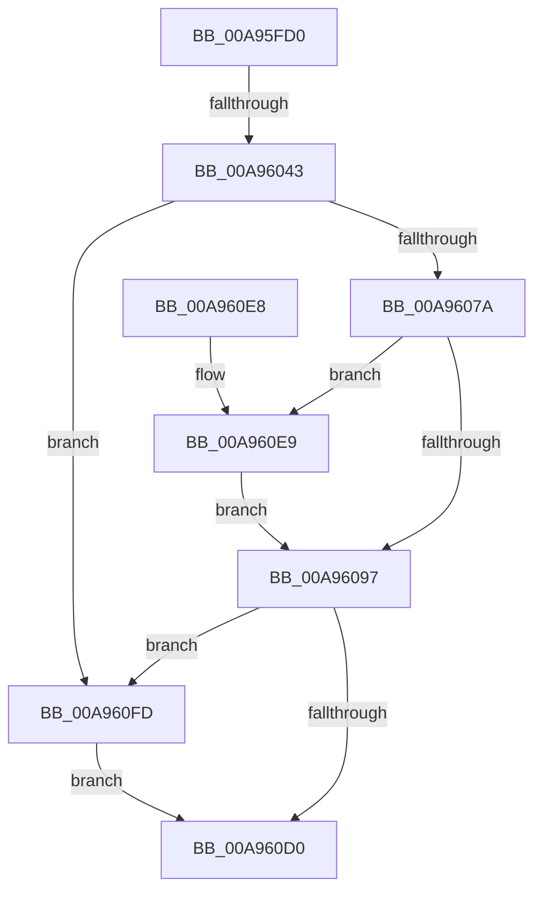

# IopRegistryCallback

- RVA: `0x00A95FD0`–`0x00A9610B` (길이 `315` bytes)
- VA: `0x0000000140A95FD0`
- 실행 섹션: `PAGE`
- PDB 이름 있음: `예`; PDB Function 태그: `예`
- unwind 정보 RVA: `0x000B9A08`
- 디코드: `85`개 명령, `315/315` bytes 표시
- 미해석 바이트: `0` (있으면 어셈블리에 `.byte`로 보존)

> 이 문서는 커널 이미지의 기계어와 PDB 기호를 분석해 생성했습니다. 4번과 5번은 함수 원형과 자료형을 바이너리 사용 방식에서 추정한 C 해석이며 원본 소스 복구 결과는 아닙니다.

## 1. Dependencies

- 직접 호출 지점: **6**; 고유 호출 대상: **5**
- 직접 호출자로 확인된 함수: **0**
- RIP 상대 이미지 참조: **2**

### Outgoing calls
- `0x00A9600C` → [RtlInitUnicodeString](../../text/42/RtlInitUnicodeString_function_0042A780.md) (function, `0x0042A780`)
- `0x00A9606D` → [IopRegistryOpenDeepestPath](IopRegistryOpenDeepestPath_function_00A96114.md) (function, `0x00A96114`)
- `0x00A9607D` → [ZwClose](../../text/6A/ZwClose_function_006AD2B0.md) (function, `0x006AD2B0`)
- `0x00A960C7` → [ZwNotifyChangeKey](../../text/6A/ZwNotifyChangeKey_function_006AF550.md) (function, `0x006AF550`)
- `0x00A960F6` → [guard_dispatch_icall](../../text/6B/guard_dispatch_icall_function_006BAAD0.md) (function, `0x006BAAD0`)
- `0x00A96100` → [ZwClose](../../text/6A/ZwClose_function_006AD2B0.md) (function, `0x006AD2B0`)

### Direct callers
- 이 함수 시작 RVA로 연결되는 직접 call은 확인되지 않았습니다. 간접 호출은 완전히 역산할 수 없습니다.

### Static image references
- `0x00A95FE8` → RVA `0x00E00F10` (`.data`; read)
- `0x00A96019` → RVA `0x00A95FD0` (`IopRegistryCallback`; read)

## 2. Other-region calls and transfers

- 다른 실행 섹션으로 향하는 call: **5**
  - `0x00A9600C` → [RtlInitUnicodeString](../../text/42/RtlInitUnicodeString_function_0042A780.md) (`PAGE` → `.text`)
  - `0x00A9607D` → [ZwClose](../../text/6A/ZwClose_function_006AD2B0.md) (`PAGE` → `.text`)
  - `0x00A960C7` → [ZwNotifyChangeKey](../../text/6A/ZwNotifyChangeKey_function_006AF550.md) (`PAGE` → `.text`)
  - `0x00A960F6` → [guard_dispatch_icall](../../text/6B/guard_dispatch_icall_function_006BAAD0.md) (`PAGE` → `.text`)
  - `0x00A96100` → [ZwClose](../../text/6A/ZwClose_function_006AD2B0.md) (`PAGE` → `.text`)
- call이 아닌 외부 분기/꼬리 이동: **1**
  - `0x00A9603D` → [sub_00B478B4](../B4/Unknown_function_00B478B4.md) (`tail-transfer`)

## 3. Assembly (complete function range)

```asm
00A95FD0  48 8B C4                        mov rax, rsp
00A95FD3  48 89 58 18                     mov qword ptr [rax + 0x18], rbx
00A95FD7  55                              push rbp
00A95FD8  56                              push rsi
00A95FD9  57                              push rdi
00A95FDA  41 54                           push r12
00A95FDC  41 55                           push r13
00A95FDE  41 56                           push r14
00A95FE0  41 57                           push r15
00A95FE2  48 83 EC 60                     sub rsp, 0x60
00A95FE6  8B D9                           mov ebx, ecx
00A95FE8  4C 8D 2D 21 AF 36 00            lea r13, [rip + 0x36af21]
00A95FEF  33 ED                           xor ebp, ebp
00A95FF1  48 8D 48 B8                     lea rcx, [rax - 0x48]
00A95FF5  0F 57 C0                        xorps xmm0, xmm0
00A95FF8  48 89 68 10                     mov qword ptr [rax + 0x10], rbp
00A95FFC  48 6B FB 70                     imul rdi, rbx, 0x70
00A96000  0F 11 40 B8                     movups xmmword ptr [rax - 0x48], xmm0
00A96004  40 88 68 08                     mov byte ptr [rax + 8], bpl
00A96008  4A 8B 14 2F                     mov rdx, qword ptr [rdi + r13]
00A9600C  E8 6F 47 99 FF                  call 0x14042a780
00A96011  4A 8D 34 2F                     lea rsi, [rdi + r13]
00A96015  48 89 6E 40                     mov qword ptr [rsi + 0x40], rbp
00A96019  48 8D 05 B0 FF FF FF            lea rax, [rip - 0x50]
00A96020  49 8D 6D 18                     lea rbp, [r13 + 0x18]
00A96024  48 89 46 50                     mov qword ptr [rsi + 0x50], rax
00A96028  4D 8D 7D 10                     lea r15, [r13 + 0x10]
00A9602C  48 89 5E 58                     mov qword ptr [rsi + 0x58], rbx
00A96030  42 8B 44 2F 28                  mov eax, dword ptr [rdi + r13 + 0x28]
00A96035  48 03 EF                        add rbp, rdi
00A96038  4C 03 FF                        add r15, rdi
00A9603B  A8 01                           test al, 1
00A9603D  0F 85 71 18 0B 00               jne 0x140b478b4
00A96043  49 8D 5D 20                     lea rbx, [r13 + 0x20]
00A96047  4D 8D 75 08                     lea r14, [r13 + 8]
00A9604B  48 03 DF                        add rbx, rdi
00A9604E  4C 03 F7                        add r14, rdi
00A96051  4D 8D 65 60                     lea r12, [r13 + 0x60]
00A96055  4C 03 E7                        add r12, rdi
00A96058  4C 8D 84 24 A0 00 00 00         lea r8, [rsp + 0xa0]
00A96060  48 8D 94 24 A8 00 00 00         lea rdx, [rsp + 0xa8]
00A96068  48 8D 4C 24 50                  lea rcx, [rsp + 0x50]
00A9606D  E8 A2 00 00 00                  call 0x140a96114
00A96072  85 C0                           test eax, eax
00A96074  0F 88 83 00 00 00               js 0x140a960fd
00A9607A  48 8B 0B                        mov rcx, qword ptr [rbx]
00A9607D  E8 2E 72 C1 FF                  call 0x1406ad2b0
00A96082  80 BC 24 A0 00 00 00 01         cmp byte ptr [rsp + 0xa0], 1
00A9608A  48 8B 84 24 A8 00 00 00         mov rax, qword ptr [rsp + 0xa8]
00A96092  48 89 03                        mov qword ptr [rbx], rax
00A96095  74 52                           je 0x140a960e9
00A96097  41 8B 06                        mov eax, dword ptr [r14]
00A9609A  4C 8D 46 40                     lea r8, [rsi + 0x40]
00A9609E  48 8B 0B                        mov rcx, qword ptr [rbx]
00A960A1  41 B9 01 00 00 00               mov r9d, 1
00A960A7  C6 44 24 48 01                  mov byte ptr [rsp + 0x48], 1
00A960AC  33 D2                           xor edx, edx
00A960AE  83 64 24 40 00                  and dword ptr [rsp + 0x40], 0
00A960B3  48 83 64 24 38 00               and qword ptr [rsp + 0x38], 0
00A960B9  C6 44 24 30 01                  mov byte ptr [rsp + 0x30], 1
00A960BE  89 44 24 28                     mov dword ptr [rsp + 0x28], eax
00A960C2  4C 89 64 24 20                  mov qword ptr [rsp + 0x20], r12
00A960C7  E8 84 94 C1 FF                  call 0x1406af550
00A960CC  85 C0                           test eax, eax
00A960CE  78 2D                           js 0x140a960fd
00A960D0  48 8B 9C 24 B0 00 00 00         mov rbx, qword ptr [rsp + 0xb0]
00A960D8  48 83 C4 60                     add rsp, 0x60
00A960DC  41 5F                           pop r15
00A960DE  41 5E                           pop r14
00A960E0  41 5D                           pop r13
00A960E2  41 5C                           pop r12
00A960E4  5F                              pop rdi
00A960E5  5E                              pop rsi
00A960E6  5D                              pop rbp
00A960E7  C3                              ret
00A960E8  CC                              int3
00A960E9  42 83 4C 2F 28 01               or dword ptr [rdi + r13 + 0x28], 1
00A960EF  49 8B 07                        mov rax, qword ptr [r15]
00A960F2  48 8B 4D 00                     mov rcx, qword ptr [rbp]
00A960F6  E8 D5 49 C2 FF                  call 0x1406baad0
00A960FB  EB 9A                           jmp 0x140a96097
00A960FD  48 8B 0B                        mov rcx, qword ptr [rbx]
00A96100  E8 AB 71 C1 FF                  call 0x1406ad2b0
00A96105  41 83 26 00                     and dword ptr [r14], 0
00A96109  EB C5                           jmp 0x140a960d0
```

## 4. C-style interpretation (structured pseudocode)

```c
__int64 __fastcall IopRegistryCallback(int a1)
{
    __int64 result;
    __int64 v_r12;
    __int64 v_r14;
    __int64 v_r15;
    __int64 v_rbp;
    __int64 v_rbx;
    __int64 v_rdi;
    __int64 v_rsp;
    unsigned __int64 v_stack_m48;
    unsigned __int8 v_stack_m50;
    unsigned int v_stack_m58;
    unsigned __int64 v_stack_m60;
    unsigned __int8 v_stack_m68;
    unsigned int v_stack_m70;
    unsigned __int64 v_stack_m78;
    unsigned __int64 v_stack_p10;
    unsigned __int64 v_stack_p18;
    unsigned __int64 v_stack_p8;

    *(unsigned __int64 *)(v_rsp + 24) = v_rbx;
    v_rsp = (v_rsp) - (96);
    v_rbp = 0;
    *(unsigned __int64 *)(v_rsp + 16) = 0;
    v_rdi = (v_rdi) * ((unsigned int)(a1));
    *(unsigned __int64 *)(v_rsp - 72) = v_xmm0;
    *(unsigned __int8 *)(v_rsp + 8) = 0;
    result = RtlInitUnicodeString(v_rsp - 72, *(unsigned __int64 *)(v_rdi + v_rip + 3583777 * 1), a3, a4);
    *(unsigned __int64 *)(v_rdi + v_rip + 3583777 * 1 + 64) = 0;
    *(unsigned __int64 *)(v_rdi + v_rip + 3583777 * 1 + 80) = v_rip - 80;
    *(unsigned __int64 *)(v_rdi + v_rip + 3583777 * 1 + 88) = (unsigned int)(a1);
    v_rbp = (v_rip + 3583777 + 24) + (v_rdi);
    v_r15 = (v_rip + 3583777 + 16) + (v_rdi);
    v_rbx = (v_rip + 3583777 + 32) + (v_rdi);
    v_r14 = (v_rip + 3583777 + 8) + (v_rdi);
    v_r12 = (v_rip + 3583777 + 96) + (v_rdi);
    result = IopRegistryOpenDeepestPath(v_stack_m48, v_stack_p10, v_stack_p8, a4);
    if (sign_flag) goto loc_00A960FD;
    result = ZwClose(*(unsigned __int64 *)(v_rbx), v_stack_p10, v_stack_p8, a4);
    *(unsigned __int64 *)(v_rbx) = v_stack_p10;
    if (v_stack_p8 == 1) goto loc_00A960E9;
loc_00A96097:
    v_stack_m50 = 1;
    a2 = 0;
    v_stack_m68 = 1;
    v_stack_m70 = (unsigned int)((unsigned int)(*(unsigned int *)(v_r14)));
    v_stack_m78 = v_r12;
    result = ZwNotifyChangeKey(*(unsigned __int64 *)(v_rbx), a2, v_rdi + v_rip + 3583777 * 1 + 64, 1);
    if (sign_flag) goto loc_00A960FD;
loc_00A960D0:
    v_rsp = (v_rsp) + (96);
    return result;
loc_00A960E9:
    result = guard_dispatch_icall(*(unsigned __int64 *)(v_rbp), a2, v_rdi + v_rip + 3583777 * 1 + 64, 1);
    goto loc_00A96097;
loc_00A960FD:
    result = ZwClose(*(unsigned __int64 *)(v_stack_p18), a2, v_rdi + v_rip + 3583777 * 1 + 64, 1);
    goto loc_00A960D0;
}
```

## 5. (Beta) C Style

```c
int64_t IopRegistryCallback(int32_t Arg1)
{
    int64_t result;
    int64_t local_r12;
    int64_t local_r14;
    int64_t local_r15;
    int64_t local_rbp;
    int64_t local_rbx;
    int64_t local_rdi;
    int64_t local_rsp;
    uint64_t v_stack_m48;
    uint8_t v_stack_m50;
    uint32_t v_stack_m58;
    uint64_t v_stack_m60;
    uint8_t v_stack_m68;
    uint32_t v_stack_m70;
    uint64_t v_stack_m78;
    uint64_t v_stack_p10;
    uint64_t v_stack_p18;
    uint64_t v_stack_p8;

    *(uint64_t *)(local_rsp + 0x18) = local_rbx;
    local_rsp = (local_rsp) - (96);
    local_rbp = 0;
    *(uint64_t *)(local_rsp + 0x10) = 0;
    local_rdi = (local_rdi) * ((uint32_t)(Arg1));
    *(uint64_t *)(local_rsp - 0x48) = v_xmm0;
    *(uint8_t *)(local_rsp + 0x8) = 0;
    result = RtlInitUnicodeString(local_rsp - 72, *(uint64_t *)(local_rdi + v_rip + 0x36AF21 * 1), a3, a4);
    *(uint64_t *)(local_rdi + v_rip + 0x36AF21 * 1 + 0x40) = 0;
    *(uint64_t *)(local_rdi + v_rip + 0x36AF21 * 1 + 0x50) = v_rip - 80;
    *(uint64_t *)(local_rdi + v_rip + 0x36AF21 * 1 + 0x58) = (uint32_t)(Arg1);
    local_rbp = (v_rip + 3583777 + 24) + (local_rdi);
    local_r15 = (v_rip + 3583777 + 16) + (local_rdi);
    local_rbx = (v_rip + 3583777 + 32) + (local_rdi);
    local_r14 = (v_rip + 3583777 + 8) + (local_rdi);
    local_r12 = (v_rip + 3583777 + 96) + (local_rdi);
    result = IopRegistryOpenDeepestPath(v_stack_m48, v_stack_p10, v_stack_p8, a4);
    if (sign_flag) goto loc_00A960FD;
    result = ZwClose(*(uint64_t *)(local_rbx), v_stack_p10, v_stack_p8, a4);
    *(uint64_t *)(local_rbx) = v_stack_p10;
    if (v_stack_p8 == 1) goto loc_00A960E9;
loc_00A96097:
    v_stack_m50 = 1;
    a2 = 0;
    v_stack_m68 = 1;
    v_stack_m70 = (uint32_t)((uint32_t)(*(uint32_t *)(local_r14)));
    v_stack_m78 = local_r12;
    result = ZwNotifyChangeKey(*(uint64_t *)(local_rbx), a2, local_rdi + v_rip + 3583777 * 1 + 64, 1);
    if (sign_flag) goto loc_00A960FD;
loc_00A960D0:
    local_rsp = (local_rsp) + (96);
    return result;
loc_00A960E9:
    result = guard_dispatch_icall(*(uint64_t *)(local_rbp), a2, local_rdi + v_rip + 3583777 * 1 + 64, 1);
    goto loc_00A96097;
loc_00A960FD:
    result = ZwClose(*(uint64_t *)(v_stack_p18), a2, local_rdi + v_rip + 3583777 * 1 + 64, 1);
    goto loc_00A960D0;
}
```

## 6. Execution-region graph

[열기: 2D/3D 그래프와 함수 탐색 컨트롤 패널](../../../control-panel.html?section=page&rva=0x00A95FD0&view=graph)

- 2D 그래프는 위에서 아래로 흐르고, 3D 그래프는 빈 공간을 드래그해 회전합니다. Shift+드래그는 이동, 휠은 확대·축소, 함수 노드 선택은 대상 보고서 이동입니다.

### Static fallback


