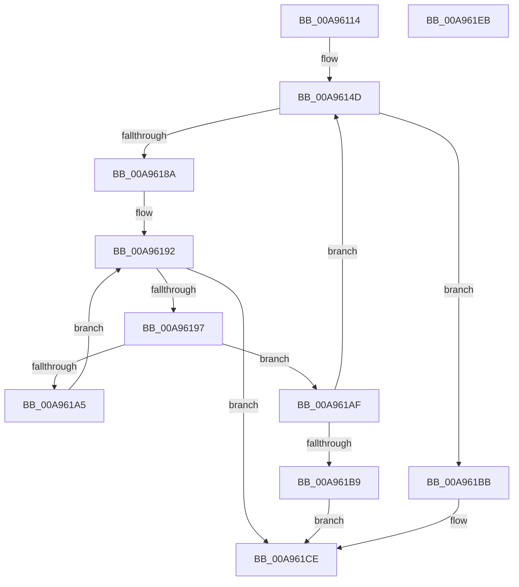

# IopRegistryOpenDeepestPath

- RVA: `0x00A96114`–`0x00A961EC` (길이 `216` bytes)
- VA: `0x0000000140A96114`
- 실행 섹션: `PAGE`
- PDB 이름 있음: `예`; PDB Function 태그: `아니요`
- unwind 정보 RVA: `0x000B9A34`
- 디코드: `62`개 명령, `216/216` bytes 표시
- 미해석 바이트: `0` (있으면 어셈블리에 `.byte`로 보존)

> 이 문서는 커널 이미지의 기계어와 PDB 기호를 분석해 생성했습니다. 4번과 5번은 함수 원형과 자료형을 바이너리 사용 방식에서 추정한 C 해석이며 원본 소스 복구 결과는 아닙니다.

## 1. Dependencies

- 직접 호출 지점: **1**; 고유 호출 대상: **1**
- 직접 호출자로 확인된 함수: **2**
- RIP 상대 이미지 참조: **0**

### Outgoing calls
- `0x00A9617E` → [ZwOpenKey](../../text/6A/ZwOpenKey_function_006AD310.md) (function, `0x006AD310`)

### Direct callers
- [IopRegistryInitializeCallbacks](../72/IopRegistryInitializeCallbacks_function_00722E58.md) at `0x00722EE2`
- [IopRegistryCallback](IopRegistryCallback_function_00A95FD0.md) at `0x00A9606D`

### Static image references
- 디코드된 RIP-relative 메모리 참조가 없습니다.

## 2. Other-region calls and transfers

- 다른 실행 섹션으로 향하는 call: **1**
  - `0x00A9617E` → [ZwOpenKey](../../text/6A/ZwOpenKey_function_006AD310.md) (`PAGE` → `.text`)
- 별도 외부 분기/꼬리 이동을 확인하지 못했습니다.

## 3. Assembly (complete function range)

```asm
00A96114  48 89 5C 24 10                  mov qword ptr [rsp + 0x10], rbx
00A96119  48 89 74 24 18                  mov qword ptr [rsp + 0x18], rsi
00A9611E  48 89 7C 24 20                  mov qword ptr [rsp + 0x20], rdi
00A96123  55                              push rbp
00A96124  41 56                           push r14
00A96126  41 57                           push r15
00A96128  48 8B EC                        mov rbp, rsp
00A9612B  48 83 EC 60                     sub rsp, 0x60
00A9612F  0F 10 01                        movups xmm0, xmmword ptr [rcx]
00A96132  45 33 F6                        xor r14d, r14d
00A96135  49 8B F8                        mov rdi, r8
00A96138  48 8B F2                        mov rsi, rdx
00A9613B  4C 89 75 20                     mov qword ptr [rbp + 0x20], r14
00A9613F  F3 0F 7F 45 C0                  movdqu xmmword ptr [rbp - 0x40], xmm0
00A96144  48 8B D9                        mov rbx, rcx
00A96147  41 BF FE FF 00 00               mov r15d, 0xfffe
00A9614D  48 8D 45 C0                     lea rax, [rbp - 0x40]
00A96151  48 C7 45 D0 30 00 00 00         mov qword ptr [rbp - 0x30], 0x30
00A96159  0F 57 C0                        xorps xmm0, xmm0
00A9615C  48 89 45 E0                     mov qword ptr [rbp - 0x20], rax
00A96160  4C 8D 45 D0                     lea r8, [rbp - 0x30]
00A96164  48 C7 45 E8 40 02 00 00         mov qword ptr [rbp - 0x18], 0x240
00A9616C  BA 10 00 00 00                  mov edx, 0x10
00A96171  4C 89 75 D8                     mov qword ptr [rbp - 0x28], r14
00A96175  48 8D 4D 20                     lea rcx, [rbp + 0x20]
00A96179  F3 0F 7F 45 F0                  movdqu xmmword ptr [rbp - 0x10], xmm0
00A9617E  E8 8D 71 C1 FF                  call 0x1406ad310
00A96183  44 8B C0                        mov r8d, eax
00A96186  85 C0                           test eax, eax
00A96188  79 31                           jns 0x140a961bb
00A9618A  48 8B 45 C8                     mov rax, qword ptr [rbp - 0x38]
00A9618E  0F B7 55 C0                     movzx edx, word ptr [rbp - 0x40]
00A96192  66 85 D2                        test dx, dx
00A96195  74 37                           je 0x140a961ce
00A96197  0F B7 CA                        movzx ecx, dx
00A9619A  48 D1 E9                        shr rcx, 1
00A9619D  66 83 7C 48 FE 5C               cmp word ptr [rax + rcx*2 - 2], 0x5c
00A961A3  74 0A                           je 0x140a961af
00A961A5  66 41 03 D7                     add dx, r15w
00A961A9  66 89 55 C0                     mov word ptr [rbp - 0x40], dx
00A961AD  EB E3                           jmp 0x140a96192
00A961AF  66 41 03 D7                     add dx, r15w
00A961B3  66 89 55 C0                     mov word ptr [rbp - 0x40], dx
00A961B7  75 94                           jne 0x140a9614d
00A961B9  EB 13                           jmp 0x140a961ce
00A961BB  48 8B 45 20                     mov rax, qword ptr [rbp + 0x20]
00A961BF  48 89 06                        mov qword ptr [rsi], rax
00A961C2  0F B7 03                        movzx eax, word ptr [rbx]
00A961C5  66 39 45 C0                     cmp word ptr [rbp - 0x40], ax
00A961C9  0F 94 C0                        sete al
00A961CC  88 07                           mov byte ptr [rdi], al
00A961CE  4C 8D 5C 24 60                  lea r11, [rsp + 0x60]
00A961D3  41 8B C0                        mov eax, r8d
00A961D6  49 8B 5B 28                     mov rbx, qword ptr [r11 + 0x28]
00A961DA  49 8B 73 30                     mov rsi, qword ptr [r11 + 0x30]
00A961DE  49 8B 7B 38                     mov rdi, qword ptr [r11 + 0x38]
00A961E2  49 8B E3                        mov rsp, r11
00A961E5  41 5F                           pop r15
00A961E7  41 5E                           pop r14
00A961E9  5D                              pop rbp
00A961EA  C3                              ret
00A961EB  CC                              int3
```

## 4. C-style interpretation (structured pseudocode)

```c
__int64 __fastcall IopRegistryOpenDeepestPath(__int64 a1, __int64 a2, __int64 a3)
{
    __int64 result;
    __int64 v_r14;
    __int64 v_rsp;
    unsigned __int64 v_stack_m18;
    unsigned __int64 v_stack_m28;
    unsigned __int64 v_stack_m30;
    unsigned __int64 v_stack_m38;
    unsigned __int64 v_stack_m40;
    unsigned __int64 v_stack_m48;
    unsigned __int64 v_stack_m50;
    unsigned __int64 v_stack_m58;
    unsigned __int64 v_stack_p10;
    unsigned __int64 v_stack_p18;
    unsigned __int64 v_stack_p20;
    unsigned __int64 v_stack_p8;

    v_stack_p10 = v_rbx;
    v_stack_p18 = v_rsi;
    v_stack_p20 = v_rdi;
    v_rsp = (v_rsp) - (96);
    v_r14 = 0;
    v_stack_p8 = 0;
    v_stack_m58 = v_xmm0;
loc_00A9614D:
    v_stack_m48 = 48;
    v_stack_m38 = v_stack_m58;
    v_stack_m30 = 576;
    v_stack_m40 = 0;
    v_stack_m28 = v_xmm0;
    result = ZwOpenKey(v_stack_p8, 16, v_stack_m48, a4);
    if (!sign_flag) goto loc_00A961BB;
loc_00A96192:
    if ((unsigned __int16)(v_stack_m58) == 0) goto loc_00A961CE;
    a1 = ((unsigned __int16)(v_stack_m58)) >> (1);
    if ((*(unsigned __int16 *)(v_stack_m50 + a1 * 2 - 2)) == 92) goto loc_00A961AF;
    a2 = (unsigned __int16)((v_stack_m58) + ((unsigned __int16)((unsigned int)(0xFFFEULL))));
    v_stack_m58 = (unsigned __int16)(a2);
    goto loc_00A96192;
loc_00A961AF:
    a2 = (unsigned __int16)((a2) + ((unsigned __int16)((unsigned int)(0xFFFEULL))));
    v_stack_m58 = (unsigned __int16)(a2);
    if (condition_is_not_equal) goto loc_00A9614D;
    goto loc_00A961CE;
loc_00A961BB:
    *(unsigned __int64 *)(a2) = v_stack_p8;
    result = (v_stack_m58 == ((unsigned __int16)(*(unsigned __int16 *)(a1)))) ? 1 : 0;
    *(unsigned __int8 *)(a3) = (unsigned __int8)(result);
loc_00A961CE:
    return (unsigned int)((unsigned int)((unsigned int)((unsigned int)(result))));
}
```

## 5. (Beta) C Style

```c
int64_t IopRegistryOpenDeepestPath(void *Arg1, void *Arg2, void *Arg3)
{
    uint8_t *arg1 = (uint8_t *)Arg1;
    uint8_t *arg2 = (uint8_t *)Arg2;
    uint8_t *arg3 = (uint8_t *)Arg3;

    int64_t result;
    int64_t local_r14;
    int64_t local_rsp;
    uint64_t v_stack_m18;
    uint64_t v_stack_m28;
    uint64_t v_stack_m30;
    uint64_t v_stack_m38;
    uint64_t v_stack_m40;
    uint64_t v_stack_m48;
    uint64_t v_stack_m50;
    uint64_t v_stack_m58;
    uint64_t v_stack_p10;
    uint64_t v_stack_p18;
    uint64_t v_stack_p20;
    uint64_t v_stack_p8;

    v_stack_p10 = local_rbx;
    v_stack_p18 = local_rsi;
    v_stack_p20 = local_rdi;
    local_rsp = (local_rsp) - (96);
    local_r14 = 0;
    v_stack_p8 = 0;
    v_stack_m58 = v_xmm0;
loc_00A9614D:
    v_stack_m48 = 48;
    v_stack_m38 = v_stack_m58;
    v_stack_m30 = 576;
    v_stack_m40 = 0;
    v_stack_m28 = v_xmm0;
    result = ZwOpenKey(v_stack_p8, 16, v_stack_m48, a4);
    if (!sign_flag) goto loc_00A961BB;
loc_00A96192:
    if ((uint16_t)(v_stack_m58) == 0) goto loc_00A961CE;
    Arg1 = ((uint16_t)(v_stack_m58)) >> (1);
    if ((*(uint16_t *)(v_stack_m50 + arg1 * 2 - 0x2)) == 92) goto loc_00A961AF;
    Arg2 = (uint16_t)((v_stack_m58) + ((uint16_t)((uint32_t)(0xFFFEULL))));
    v_stack_m58 = (uint16_t)(Arg2);
    goto loc_00A96192;
loc_00A961AF:
    Arg2 = (uint16_t)((Arg2) + ((uint16_t)((uint32_t)(0xFFFEULL))));
    v_stack_m58 = (uint16_t)(Arg2);
    if (condition_is_not_equal) goto loc_00A9614D;
    goto loc_00A961CE;
loc_00A961BB:
    *(uint64_t *)(arg2) = v_stack_p8;
    result = (v_stack_m58 == ((uint16_t)(*(uint16_t *)(arg1)))) ? 1 : 0;
    *(uint8_t *)(arg3) = (uint8_t)(result);
loc_00A961CE:
    return (uint32_t)((uint32_t)((uint32_t)((uint32_t)(result))));
}
```

### 관측된 메모리 오프셋

구조체 형식이 확인되지 않은 접근은 인자 기준의 오프셋으로만 기록했습니다.

| 기준 인자 | 오프셋 표현 | 폭 (bit) | 접근 |
|---|---:|---:|---|
| `Arg1` | `+ 0x0` | `16` | `R` |
| `Arg1` | `+ 0x0` | `128` | `R` |
| `Arg2` | `+ 0x0` | `64` | `W` |
| `Arg3` | `+ 0x0` | `8` | `W` |

## 6. Execution-region graph

[열기: 2D/3D 그래프와 함수 탐색 컨트롤 패널](../../../control-panel.html?section=page&rva=0x00A96114&view=graph)

- 2D 그래프는 위에서 아래로 흐르고, 3D 그래프는 빈 공간을 드래그해 회전합니다. Shift+드래그는 이동, 휠은 확대·축소, 함수 노드 선택은 대상 보고서 이동입니다.

### Static fallback


