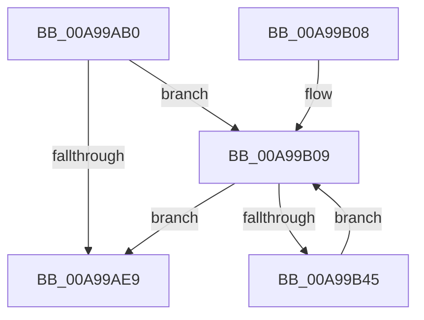

# KeFreeCalloutStack

- RVA: `0x00A99AB0`–`0x00A99B47` (길이 `151` bytes)
- VA: `0x0000000140A99AB0`
- 실행 섹션: `PAGE`
- PDB 이름 있음: `예`; PDB Function 태그: `아니요`
- unwind 정보 RVA: `0x000BA290`
- 디코드: `41`개 명령, `151/151` bytes 표시
- 미해석 바이트: `0` (있으면 어셈블리에 `.byte`로 보존)

> 이 문서는 커널 이미지의 기계어와 PDB 기호를 분석해 생성했습니다. 4번과 5번은 함수 원형과 자료형을 바이너리 사용 방식에서 추정한 C 해석이며 원본 소스 복구 결과는 아닙니다.

## 1. Dependencies

- 직접 호출 지점: **2**; 고유 호출 대상: **2**
- 직접 호출자로 확인된 함수: **2**
- RIP 상대 이미지 참조: **1**

### Outgoing calls
- `0x00A99AEE` → [ExFreePoolWithTag](../../poolcode/B8/ExFreePoolWithTag_function_00B82870.md) (function, `0x00B82870`)
- `0x00A99B24` → [MmDeleteKernelStack](../../text/33/MmDeleteKernelStack_function_0033A960.md) (function, `0x0033A960`)

### Direct callers
- [EtwpAdjustStackLookasideBuffers](../../text/3E/EtwpAdjustStackLookasideBuffers_function_003EB6A4.md) at `0x003EB6E4`
- [EtwpStackDeleteProcessor](../../text/65/EtwpStackDeleteProcessor_function_00651D90.md) at `0x00651DA7`

### Static image references
- `0x00A99B29` → RVA `0x00FC6C08` (`ALMOSTRO`; read)

## 2. Other-region calls and transfers

- 다른 실행 섹션으로 향하는 call: **2**
  - `0x00A99AEE` → [ExFreePoolWithTag](../../poolcode/B8/ExFreePoolWithTag_function_00B82870.md) (`PAGE` → `POOLCODE`)
  - `0x00A99B24` → [MmDeleteKernelStack](../../text/33/MmDeleteKernelStack_function_0033A960.md) (`PAGE` → `.text`)
- 별도 외부 분기/꼬리 이동을 확인하지 못했습니다.

## 3. Assembly (complete function range)

```asm
00A99AB0  48 8B C4                        mov rax, rsp
00A99AB3  48 89 58 08                     mov qword ptr [rax + 8], rbx
00A99AB7  48 89 68 10                     mov qword ptr [rax + 0x10], rbp
00A99ABB  48 89 70 18                     mov qword ptr [rax + 0x18], rsi
00A99ABF  57                              push rdi
00A99AC0  48 83 EC 50                     sub rsp, 0x50
00A99AC4  33 F6                           xor esi, esi
00A99AC6  0F 57 C0                        xorps xmm0, xmm0
00A99AC9  40 38 71 04                     cmp byte ptr [rcx + 4], sil
00A99ACD  8B EE                           mov ebp, esi
00A99ACF  0F 57 C9                        xorps xmm1, xmm1
00A99AD2  48 8B F9                        mov rdi, rcx
00A99AD5  40 0F 95 C5                     setne bpl
00A99AD9  F3 0F 7F 40 D0                  movdqu xmmword ptr [rax - 0x30], xmm0
00A99ADE  F3 0F 7F 48 E8                  movdqu xmmword ptr [rax - 0x18], xmm1
00A99AE3  40 38 71 05                     cmp byte ptr [rcx + 5], sil
00A99AE7  77 20                           ja 0x140a99b09
00A99AE9  33 D2                           xor edx, edx
00A99AEB  48 8B CF                        mov rcx, rdi
00A99AEE  E8 7D 8D 0E 00                  call 0x140b82870
00A99AF3  48 8B 5C 24 60                  mov rbx, qword ptr [rsp + 0x60]
00A99AF8  48 8B 6C 24 68                  mov rbp, qword ptr [rsp + 0x68]
00A99AFD  48 8B 74 24 70                  mov rsi, qword ptr [rsp + 0x70]
00A99B02  48 83 C4 50                     add rsp, 0x50
00A99B06  5F                              pop rdi
00A99B07  C3                              ret
00A99B08  CC                              int3
00A99B09  48 8B 44 F7 40                  mov rax, qword ptr [rdi + rsi*8 + 0x40]
00A99B0E  48 8D 4C 24 20                  lea rcx, [rsp + 0x20]
00A99B13  48 89 44 24 38                  mov qword ptr [rsp + 0x38], rax
00A99B18  89 6C 24 20                     mov dword ptr [rsp + 0x20], ebp
00A99B1C  C7 44 24 24 05 00 00 00         mov dword ptr [rsp + 0x24], 5
00A99B24  E8 37 0E 8A FF                  call 0x14033a960
00A99B29  48 8B 05 D8 D0 52 00            mov rax, qword ptr [rip + 0x52d0d8]
00A99B30  48 05 00 10 00 00               add rax, 0x1000
00A99B36  48 89 44 F7 40                  mov qword ptr [rdi + rsi*8 + 0x40], rax
00A99B3B  FF C6                           inc esi
00A99B3D  0F B6 47 05                     movzx eax, byte ptr [rdi + 5]
00A99B41  3B F0                           cmp esi, eax
00A99B43  73 A4                           jae 0x140a99ae9
00A99B45  EB C2                           jmp 0x140a99b09
```

## 4. C-style interpretation (structured pseudocode)

```c
__int64 __fastcall KeFreeCalloutStack(__int64 a1, int a2)
{
    __int64 result;
    __int64 v_rbp;
    __int64 v_rsi;
    __int64 v_rsp;
    unsigned __int64 v_stack_p10;
    unsigned __int64 v_stack_p18;
    unsigned __int64 v_stack_p20;
    unsigned int v_stack_p24;
    unsigned __int64 v_stack_p38;
    unsigned __int64 v_stack_p8;

    *(unsigned __int64 *)(v_rsp + 8) = v_rbx;
    *(unsigned __int64 *)(v_rsp + 16) = v_rbp;
    *(unsigned __int64 *)(v_rsp + 24) = v_rsi;
    v_rsp = (v_rsp) - (80);
    v_rsi = 0;
    v_rbp = ((*(unsigned __int8 *)(a1 + 4)) != 0) ? 1 : 0;
    *(unsigned __int64 *)(v_rsp - 48) = v_xmm0;
    *(unsigned __int64 *)(v_rsp - 24) = v_xmm1;
    if ((*(unsigned __int8 *)(a1 + 5)) > 0) goto loc_00A99B09;
loc_00A99AE9:
    a2 = 0;
    result = ExFreePoolWithTag(a1, a2, a3, a4);
    v_rsp = (v_rsp) + (80);
    return result;
loc_00A99B09:
    v_stack_p38 = *(unsigned __int64 *)(a1 + v_stack_p18 * 8 + 64);
    v_stack_p20 = (unsigned int)(v_stack_p10);
    v_stack_p24 = 5;
    result = MmDeleteKernelStack(v_stack_p20, a2, a3, a4);
    result = (*(unsigned __int64 *)(v_rip + 5427416)) + (0x1000ULL);
    *(unsigned __int64 *)(a1 + v_stack_p18 * 8 + 64) = result;
    v_rsi = (unsigned int)((v_stack_p18) + 1);
    if (((unsigned int)(v_rsi)) >= ((unsigned int)(*(unsigned __int8 *)(a1 + 5)))) goto loc_00A99AE9;
    goto loc_00A99B09;
}
```

## 5. (Beta) C Style

```c
int64_t KeFreeCalloutStack(void *Arg1, int32_t Arg2)
{
    uint8_t *arg1 = (uint8_t *)Arg1;

    int64_t result;
    int64_t local_rbp;
    int64_t local_rsi;
    int64_t local_rsp;
    uint64_t v_stack_p10;
    uint64_t v_stack_p18;
    uint64_t v_stack_p20;
    uint32_t v_stack_p24;
    uint64_t v_stack_p38;
    uint64_t v_stack_p8;

    *(uint64_t *)(local_rsp + 0x8) = local_rbx;
    *(uint64_t *)(local_rsp + 0x10) = local_rbp;
    *(uint64_t *)(local_rsp + 0x18) = local_rsi;
    local_rsp = (local_rsp) - (80);
    local_rsi = 0;
    local_rbp = ((*(uint8_t *)(arg1 + 0x4)) != 0) ? 1 : 0;
    *(uint64_t *)(local_rsp - 0x30) = v_xmm0;
    *(uint64_t *)(local_rsp - 0x18) = v_xmm1;
    if ((*(uint8_t *)(arg1 + 0x5)) > 0) goto loc_00A99B09;
loc_00A99AE9:
    Arg2 = 0;
    result = ExFreePoolWithTag(Arg1, Arg2, a3, a4);
    local_rsp = (local_rsp) + (80);
    return result;
loc_00A99B09:
    v_stack_p38 = *(uint64_t *)(arg1 + v_stack_p18 * 8 + 0x40);
    v_stack_p20 = (uint32_t)(v_stack_p10);
    v_stack_p24 = 5;
    result = MmDeleteKernelStack(v_stack_p20, Arg2, a3, a4);
    result = (*(uint64_t *)(v_rip + 0x52D0D8)) + (0x1000ULL);
    *(uint64_t *)(arg1 + v_stack_p18 * 8 + 0x40) = result;
    local_rsi = (uint32_t)((v_stack_p18) + 1);
    if (((uint32_t)(local_rsi)) >= ((uint32_t)(*(uint8_t *)(arg1 + 0x5)))) goto loc_00A99AE9;
    goto loc_00A99B09;
}
```

### 관측된 메모리 오프셋

구조체 형식이 확인되지 않은 접근은 인자 기준의 오프셋으로만 기록했습니다.

| 기준 인자 | 오프셋 표현 | 폭 (bit) | 접근 |
|---|---:|---:|---|
| `Arg1` | `+ 0x4` | `8` | `R` |
| `Arg1` | `+ 0x5` | `8` | `R` |
| `Arg1` | `+ 0x40 + rsi*8` | `64` | `R` |
| `Arg1` | `+ 0x40 + rsi*8` | `64` | `W` |

## 6. Execution-region graph

[열기: 2D/3D 그래프와 함수 탐색 컨트롤 패널](../../../control-panel.html?section=page&rva=0x00A99AB0&view=graph)

- 2D 그래프는 위에서 아래로 흐르고, 3D 그래프는 빈 공간을 드래그해 회전합니다. Shift+드래그는 이동, 휠은 확대·축소, 함수 노드 선택은 대상 보고서 이동입니다.

### Static fallback


