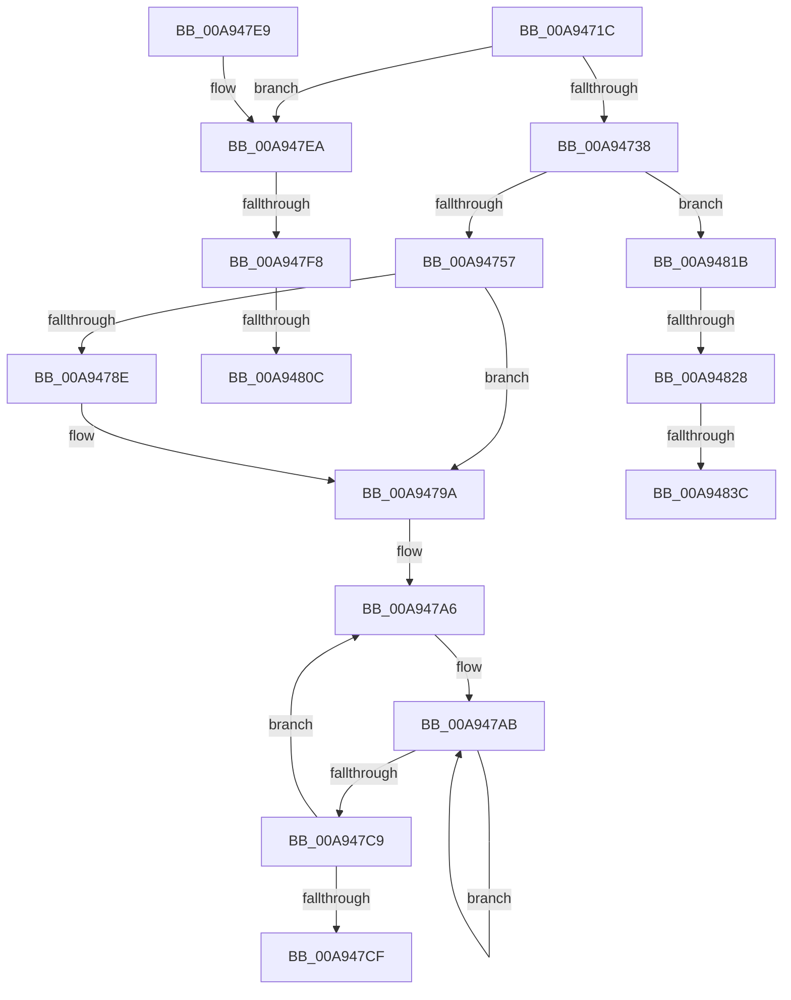

# KeInitializeTimerTable

- RVA: `0x00A9471C`–`0x00A94846` (길이 `298` bytes)
- VA: `0x0000000140A9471C`
- 실행 섹션: `PAGE`
- PDB 이름 있음: `예`; PDB Function 태그: `예`
- unwind 정보 RVA: `0x000B95AC`
- 디코드: `67`개 명령, `298/298` bytes 표시
- 미해석 바이트: `0` (있으면 어셈블리에 `.byte`로 보존)

> 이 문서는 커널 이미지의 기계어와 PDB 기호를 분석해 생성했습니다. 4번과 5번은 함수 원형과 자료형을 바이너리 사용 방식에서 추정한 C 해석이며 원본 소스 복구 결과는 아닙니다.

## 1. Dependencies

- 직접 호출 지점: **3**; 고유 호출 대상: **3**
- 직접 호출자로 확인된 함수: **3**
- RIP 상대 이미지 참조: **6**

### Outgoing calls
- `0x00A9477D` → [KeInitializeDpc](../../text/45/KeInitializeDpc_function_0045BBD0.md) (function, `0x0045BBD0`)
- `0x00A947D2` → [KiInitializeForceIdle](KiInitializeForceIdle_function_00A9484C.md) (function, `0x00A9484C`)
- `0x00A947FF` → [guard_dispatch_icall](../../text/6B/guard_dispatch_icall_function_006BAAD0.md) (function, `0x006BAAD0`)

### Direct callers
- [KiStartDynamicProcessor](../74/KiStartDynamicProcessor_function_007456C8.md) at `0x007458D6`
- [KeStartAllProcessors](../../init/C3/KeStartAllProcessors_function_00C36F78.md) at `0x00C372BD`
- [KeInitSystem](../../init/C7/KeInitSystem_function_00C71660.md) at `0x00C71757`

### Static image references
- `0x00A9473F` → RVA `0x00FC8520` (`ALMOSTRO`; read)
- `0x00A9476B` → RVA `0x005C86D0` (`KiTimerExpirationDpc`; read)
- `0x00A947EA` → RVA `0x00FC5030` (`ALMOSTRO`; read)
- `0x00A947F8` → RVA `0x00E00AC0` (`.data`; read)
- `0x00A9480C` → RVA `0x00FC5030` (`ALMOSTRO`; write)
- `0x00A9482F` → RVA `0x00FD3D80` (`CACHEALI`; read)

## 2. Other-region calls and transfers

- 다른 실행 섹션으로 향하는 call: **2**
  - `0x00A9477D` → [KeInitializeDpc](../../text/45/KeInitializeDpc_function_0045BBD0.md) (`PAGE` → `.text`)
  - `0x00A947FF` → [guard_dispatch_icall](../../text/6B/guard_dispatch_icall_function_006BAAD0.md) (`PAGE` → `.text`)
- call이 아닌 외부 분기/꼬리 이동: **6**
  - `0x00A947F2` → [sub_00B4742A](../B4/Unknown_function_00B4742A.md) (`tail-transfer`)
  - `0x00A94806` → [sub_00B4742A + 0xC](../B4/Unknown_function_00B4742A.md) (`tail-transfer`)
  - `0x00A94816` → [sub_00B4742A + 0xC](../B4/Unknown_function_00B4742A.md) (`tail-transfer`)
  - `0x00A94822` → [sub_00B4742A + 0x17](../B4/Unknown_function_00B4742A.md) (`tail-transfer`)
  - `0x00A94836` → [sub_00B4742A + 0x47](../B4/Unknown_function_00B4742A.md) (`tail-transfer`)
  - `0x00A94841` → [sub_00B4742A + 0x47](../B4/Unknown_function_00B4742A.md) (`tail-transfer`)

## 3. Assembly (complete function range)

```asm
00A9471C  48 89 5C 24 08                  mov qword ptr [rsp + 8], rbx
00A94721  48 89 6C 24 10                  mov qword ptr [rsp + 0x10], rbp
00A94726  57                              push rdi
00A94727  48 83 EC 20                     sub rsp, 0x20
00A9472B  83 79 24 00                     cmp dword ptr [rcx + 0x24], 0
00A9472F  48 8B D9                        mov rbx, rcx
00A94732  0F 84 B2 00 00 00               je 0x140a947ea
00A94738  0F B6 8B D0 00 00 00            movzx ecx, byte ptr [rbx + 0xd0]
00A9473F  48 8D 2D DA 3D 53 00            lea rbp, [rip + 0x533dda]
00A94746  8B C1                           mov eax, ecx
00A94748  48 03 C0                        add rax, rax
00A9474B  48 83 7C C5 08 00               cmp qword ptr [rbp + rax*8 + 8], 0
00A94751  0F 84 C4 00 00 00               je 0x140a9481b
00A94757  48 B8 20 03 00 00 80 F7 FF FF   movabs rax, 0xfffff78000000320
00A94761  48 8D BB F0 83 00 00            lea rdi, [rbx + 0x83f0]
00A94768  45 33 C0                        xor r8d, r8d
00A9476B  48 8D 15 5E 3F B3 FF            lea rdx, [rip - 0x4cc0a2]
00A94772  48 8B CF                        mov rcx, rdi
00A94775  8B 00                           mov eax, dword ptr [rax]
00A94777  89 83 C0 38 00 00               mov dword ptr [rbx + 0x38c0], eax
00A9477D  E8 4E 74 9C FF                  call 0x14045bbd0
00A94782  48 8B 47 38                     mov rax, qword ptr [rdi + 0x38]
00A94786  8B 4B 24                        mov ecx, dword ptr [rbx + 0x24]
00A94789  48 85 C0                        test rax, rax
00A9478C  75 0C                           jne 0x140a9479a
00A9478E  B8 00 08 00 00                  mov eax, 0x800
00A94793  66 03 C8                        add cx, ax
00A94796  66 89 4F 02                     mov word ptr [rdi + 2], cx
00A9479A  48 8D 83 08 43 00 00            lea rax, [rbx + 0x4308]
00A947A1  BA 02 00 00 00                  mov edx, 2
00A947A6  B9 00 01 00 00                  mov ecx, 0x100
00A947AB  48 83 60 F8 00                  and qword ptr [rax - 8], 0
00A947B0  48 89 40 08                     mov qword ptr [rax + 8], rax
00A947B4  48 89 00                        mov qword ptr [rax], rax
00A947B7  83 48 14 FF                     or dword ptr [rax + 0x14], 0xffffffff
00A947BB  83 60 10 00                     and dword ptr [rax + 0x10], 0
00A947BF  48 83 C0 20                     add rax, 0x20
00A947C3  48 83 E9 01                     sub rcx, 1
00A947C7  75 E2                           jne 0x140a947ab
00A947C9  48 83 EA 01                     sub rdx, 1
00A947CD  75 D7                           jne 0x140a947a6
00A947CF  48 8B CB                        mov rcx, rbx
00A947D2  E8 75 00 00 00                  call 0x140a9484c
00A947D7  33 C0                           xor eax, eax
00A947D9  48 8B 5C 24 30                  mov rbx, qword ptr [rsp + 0x30]
00A947DE  48 8B 6C 24 38                  mov rbp, qword ptr [rsp + 0x38]
00A947E3  48 83 C4 20                     add rsp, 0x20
00A947E7  5F                              pop rdi
00A947E8  C3                              ret
00A947E9  CC                              int3
00A947EA  8B 05 40 08 53 00               mov eax, dword ptr [rip + 0x530840]
00A947F0  85 C0                           test eax, eax
00A947F2  0F 85 32 2C 0B 00               jne 0x140b4742a
00A947F8  48 8B 05 C1 C2 36 00            mov rax, qword ptr [rip + 0x36c2c1]
00A947FF  E8 CC 62 C2 FF                  call 0x1406baad0
00A94804  84 C0                           test al, al
00A94806  0F 84 2A 2C 0B 00               je 0x140b47436
00A9480C  C7 05 1A 08 53 00 01 00 00 00   mov dword ptr [rip + 0x53081a], 1
00A94816  E9 1B 2C 0B 00                  jmp 0x140b47436
00A9481B  BF 00 40 00 00                  mov edi, 0x4000
00A94820  84 C9                           test cl, cl
00A94822  0F 85 19 2C 0B 00               jne 0x140b47441
00A94828  83 3D 01 08 53 00 00            cmp dword ptr [rip + 0x530801], 0
00A9482F  48 8D 15 4A F5 53 00            lea rdx, [rip + 0x53f54a]
00A94836  0F 84 35 2C 0B 00               je 0x140b47471
00A9483C  BF 20 00 00 00                  mov edi, 0x20
00A94841  E9 2B 2C 0B 00                  jmp 0x140b47471
```

## 4. C-style interpretation (structured pseudocode)

```c
__int64 __fastcall KeInitializeTimerTable(__int64 a1, __int64 a2, int a3)
{
    __int64 result;
    __int64 v_rsp;
    unsigned __int64 v_stack_p10;
    unsigned __int64 v_stack_p8;

    v_stack_p8 = v_rbx;
    v_stack_p10 = v_rbp;
    v_rsp = (v_rsp) - (32);
    if ((*(unsigned int *)(a1 + 36)) == 0) goto loc_00A947EA;
    result = ((unsigned int)((unsigned int)(*(unsigned __int8 *)(a1 + 208)))) + ((unsigned int)((unsigned int)(*(unsigned __int8 *)(a1 + 208))));
    if ((*(unsigned __int64 *)(v_rip + 5455322 + result * 8 + 8)) == 0) goto loc_00A9481B;
    a3 = 0;
    *(unsigned int *)(a1 + 14528) = (unsigned int)((unsigned int)(*(unsigned int *)(result)));
    result = KeInitializeDpc(a1 + 33776, v_rip - 5030050, a3, a4);
    result = *(unsigned __int64 *)(a1 + 33776 + 56);
    if (*(unsigned __int64 *)(a1 + 33776 + 56) == 0) {
        result = 0x800ULL;
        a1 = (unsigned __int16)(((unsigned int)(*(unsigned int *)(a1 + 36))) + ((unsigned __int16)(result)));
        *(unsigned __int16 *)(a1 + 33776 + 2) = (unsigned __int16)(a1);
    }
loc_00A947A6:
loc_00A947AB:
    *(unsigned __int64 *)(a1 + 17160 + 8) = a1 + 17160;
    *(unsigned __int64 *)(a1 + 17160) = a1 + 17160;
    result = (a1 + 17160) + (32);
    a1 = (256) - (1);
    if (condition_is_not_equal) goto loc_00A947AB;
    a2 = (2) - (1);
    if (condition_is_not_equal) goto loc_00A947A6;
    result = KiInitializeForceIdle(a1, a2, a3, a4);
    result = 0;
    v_rsp = (v_rsp) + (32);
    return result;
loc_00A947EA:
    result = guard_dispatch_icall(a1, a2, a3, a4);
    *(unsigned int *)(v_rip + 5441562) = 1;
loc_00A9481B:
}
```

## 5. (Beta) C Style

```c
int64_t KeInitializeTimerTable(void *TimerTable, int64_t Arg2, int32_t Arg3)
{
    uint8_t *timerTable = (uint8_t *)TimerTable;

    int64_t result;
    int64_t local_rsp;
    uint64_t v_stack_p10;
    uint64_t v_stack_p8;

    v_stack_p8 = local_rbx;
    v_stack_p10 = local_rbp;
    local_rsp = (local_rsp) - (32);
    if ((*(uint32_t *)(timerTable + 0x24)) == 0) goto loc_00A947EA;
    result = ((uint32_t)((uint32_t)(*(uint8_t *)(timerTable + 0xD0)))) + ((uint32_t)((uint32_t)(*(uint8_t *)(timerTable + 0xD0))));
    if ((*(uint64_t *)(v_rip + 0x533DDA + result * 8 + 0x8)) == 0) goto loc_00A9481B;
    Arg3 = 0;
    *(uint32_t *)(timerTable + 0x38C0) = (uint32_t)((uint32_t)(*(uint32_t *)(result)));
    result = KeInitializeDpc(TimerTable + 33776, v_rip - 5030050, Arg3, a4);
    result = *(uint64_t *)(timerTable + 0x83F0 + 0x38);
    if (*(uint64_t *)(timerTable + 0x83F0 + 0x38) == 0) {
        result = 0x800ULL;
        TimerTable = (uint16_t)(((uint32_t)(*(uint32_t *)(timerTable + 0x24))) + ((uint16_t)(result)));
        *(uint16_t *)(timerTable + 0x83F0 + 0x2) = (uint16_t)(TimerTable);
    }
loc_00A947A6:
loc_00A947AB:
    *(void **)(timerTable + 0x4308 + 0x8) = TimerTable + 17160;
    *(void **)(timerTable + 0x4308) = TimerTable + 17160;
    result = (TimerTable + 17160) + (32);
    TimerTable = (256) - (1);
    if (condition_is_not_equal) goto loc_00A947AB;
    Arg2 = (2) - (1);
    if (condition_is_not_equal) goto loc_00A947A6;
    result = KiInitializeForceIdle(TimerTable, Arg2, Arg3, a4);
    result = 0;
    local_rsp = (local_rsp) + (32);
    return result;
loc_00A947EA:
    result = guard_dispatch_icall(TimerTable, Arg2, Arg3, a4);
    *(uint32_t *)(v_rip + 0x53081A) = 1;
loc_00A9481B:
}
```

### 관측된 메모리 오프셋

구조체 형식이 확인되지 않은 접근은 인자 기준의 오프셋으로만 기록했습니다.

| 기준 인자 | 오프셋 표현 | 폭 (bit) | 접근 |
|---|---:|---:|---|
| `TimerTable` | `- 0x8` | `64` | `R/W` |
| `TimerTable` | `+ 0x0` | `64` | `W` |
| `TimerTable` | `+ 0x2` | `16` | `W` |
| `TimerTable` | `+ 0x8` | `64` | `W` |
| `TimerTable` | `+ 0x10` | `32` | `R/W` |
| `TimerTable` | `+ 0x14` | `32` | `R/W` |
| `TimerTable` | `+ 0x24` | `32` | `R` |
| `TimerTable` | `+ 0x38` | `64` | `R` |
| `TimerTable` | `+ 0xD0` | `8` | `R` |
| `TimerTable` | `+ 0x38C0` | `32` | `W` |
| `TimerTable` | `+ 0x4308` | `64` | `R` |
| `TimerTable` | `+ 0x83F0` | `64` | `R` |

## 6. Execution-region graph

[열기: 2D/3D 그래프와 함수 탐색 컨트롤 패널](../../../control-panel.html?section=page&rva=0x00A9471C&view=graph)

- 2D 그래프는 위에서 아래로 흐르고, 3D 그래프는 빈 공간을 드래그해 회전합니다. Shift+드래그는 이동, 휠은 확대·축소, 함수 노드 선택은 대상 보고서 이동입니다.

### Static fallback


