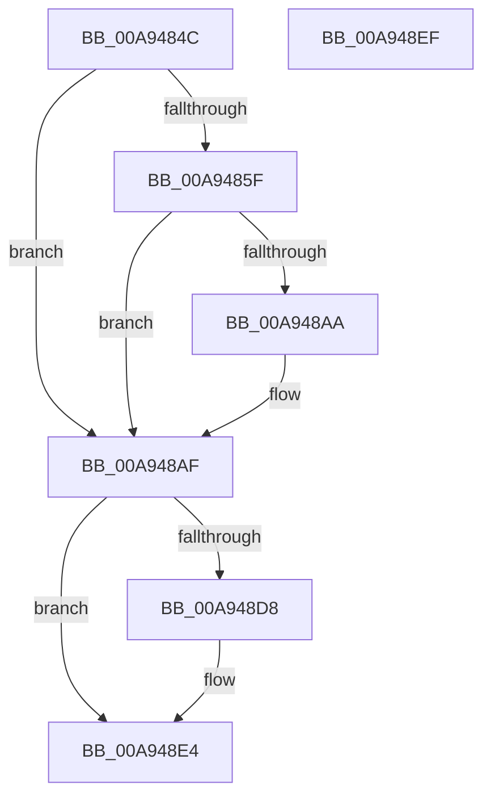

# KiInitializeForceIdle

- RVA: `0x00A9484C`–`0x00A948F0` (길이 `164` bytes)
- VA: `0x0000000140A9484C`
- 실행 섹션: `PAGE`
- PDB 이름 있음: `예`; PDB Function 태그: `아니요`
- unwind 정보 RVA: `0x0005CAAC`
- 디코드: `38`개 명령, `164/164` bytes 표시
- 미해석 바이트: `0` (있으면 어셈블리에 `.byte`로 보존)

> 이 문서는 커널 이미지의 기계어와 PDB 기호를 분석해 생성했습니다. 4번과 5번은 함수 원형과 자료형을 바이너리 사용 방식에서 추정한 C 해석이며 원본 소스 복구 결과는 아닙니다.

## 1. Dependencies

- 직접 호출 지점: **4**; 고유 호출 대상: **2**
- 직접 호출자로 확인된 함수: **1**
- RIP 상대 이미지 참조: **9**

### Outgoing calls
- `0x00A94878` → [KeInitializeDpc](../../text/45/KeInitializeDpc_function_0045BBD0.md) (function, `0x0045BBD0`)
- `0x00A9488E` → [KeInitializeDpc](../../text/45/KeInitializeDpc_function_0045BBD0.md) (function, `0x0045BBD0`)
- `0x00A948AA` → [KeDisableForceIdle](../../text/5C/KeDisableForceIdle_function_005C8864.md) (function, `0x005C8864`)
- `0x00A948C3` → [KeInitializeDpc](../../text/45/KeInitializeDpc_function_0045BBD0.md) (function, `0x0045BBD0`)

### Direct callers
- [KeInitializeTimerTable](KeInitializeTimerTable_function_00A9471C.md) at `0x00A947D2`

### Static image references
- `0x00A9485F` → RVA `0x00F23140` (`.data`; read/write)
- `0x00A94867` → RVA `0x004C3F40` (`KiForceIdleStartDpcRoutine`; read)
- `0x00A94871` → RVA `0x00F23100` (`.data`; read)
- `0x00A94880` → RVA `0x0048D7B0` (`KiForceIdleStopDpcRoutine`; read)
- `0x00A94887` → RVA `0x00F233E0` (`.data`; read)
- `0x00A94893` → RVA `0x00FC5030` (`ALMOSTRO`; read)
- `0x00A9489A` → RVA `0x00F23101` (`.data`; write)
- `0x00A948A1` → RVA `0x00F233E1` (`.data`; write)
- `0x00A948BC` → RVA `0x00352390` (`KiForceIdleParkUnparkDpcRoutine`; read)

## 2. Other-region calls and transfers

- 다른 실행 섹션으로 향하는 call: **4**
  - `0x00A94878` → [KeInitializeDpc](../../text/45/KeInitializeDpc_function_0045BBD0.md) (`PAGE` → `.text`)
  - `0x00A9488E` → [KeInitializeDpc](../../text/45/KeInitializeDpc_function_0045BBD0.md) (`PAGE` → `.text`)
  - `0x00A948AA` → [KeDisableForceIdle](../../text/5C/KeDisableForceIdle_function_005C8864.md) (`PAGE` → `.text`)
  - `0x00A948C3` → [KeInitializeDpc](../../text/45/KeInitializeDpc_function_0045BBD0.md) (`PAGE` → `.text`)
- 별도 외부 분기/꼬리 이동을 확인하지 못했습니다.

## 3. Assembly (complete function range)

```asm
00A9484C  48 89 5C 24 08                  mov qword ptr [rsp + 8], rbx
00A94851  57                              push rdi
00A94852  48 83 EC 20                     sub rsp, 0x20
00A94856  83 79 24 00                     cmp dword ptr [rcx + 0x24], 0
00A9485A  48 8B F9                        mov rdi, rcx
00A9485D  75 50                           jne 0x140a948af
00A9485F  48 83 25 D9 E8 48 00 00         and qword ptr [rip + 0x48e8d9], 0
00A94867  48 8D 15 D2 F6 A2 FF            lea rdx, [rip - 0x5d092e]
00A9486E  45 33 C0                        xor r8d, r8d
00A94871  48 8D 0D 88 E8 48 00            lea rcx, [rip + 0x48e888]
00A94878  E8 53 73 9C FF                  call 0x14045bbd0
00A9487D  45 33 C0                        xor r8d, r8d
00A94880  48 8D 15 29 8F 9F FF            lea rdx, [rip - 0x6070d7]
00A94887  48 8D 0D 52 EB 48 00            lea rcx, [rip + 0x48eb52]
00A9488E  E8 3D 73 9C FF                  call 0x14045bbd0
00A94893  83 3D 96 07 53 00 00            cmp dword ptr [rip + 0x530796], 0
00A9489A  C6 05 60 E8 48 00 03            mov byte ptr [rip + 0x48e860], 3
00A948A1  C6 05 39 EB 48 00 03            mov byte ptr [rip + 0x48eb39], 3
00A948A8  75 05                           jne 0x140a948af
00A948AA  E8 B5 3F B3 FF                  call 0x1405c8864
00A948AF  48 8D 9F 98 8A 00 00            lea rbx, [rdi + 0x8a98]
00A948B6  45 33 C0                        xor r8d, r8d
00A948B9  48 8B CB                        mov rcx, rbx
00A948BC  48 8D 15 CD DA 8B FF            lea rdx, [rip - 0x742533]
00A948C3  E8 08 73 9C FF                  call 0x14045bbd0
00A948C8  C6 43 01 03                     mov byte ptr [rbx + 1], 3
00A948CC  48 8B 43 38                     mov rax, qword ptr [rbx + 0x38]
00A948D0  8B 4F 24                        mov ecx, dword ptr [rdi + 0x24]
00A948D3  48 85 C0                        test rax, rax
00A948D6  75 0C                           jne 0x140a948e4
00A948D8  B8 00 08 00 00                  mov eax, 0x800
00A948DD  66 03 C8                        add cx, ax
00A948E0  66 89 4B 02                     mov word ptr [rbx + 2], cx
00A948E4  48 8B 5C 24 30                  mov rbx, qword ptr [rsp + 0x30]
00A948E9  48 83 C4 20                     add rsp, 0x20
00A948ED  5F                              pop rdi
00A948EE  C3                              ret
00A948EF  CC                              int3
```

## 4. C-style interpretation (structured pseudocode)

```c
__int64 __fastcall KiInitializeForceIdle(__int64 a1, __int64 a2, int a3)
{
    __int64 result;
    __int64 v_rsp;
    unsigned __int64 v_stack_p8;

    v_stack_p8 = v_rbx;
    v_rsp = (v_rsp) - (32);
    if ((*(unsigned int *)(a1 + 36)) != 0) goto loc_00A948AF;
    a3 = 0;
    result = KeInitializeDpc(v_rip + 4778120, v_rip - 6097198, a3, a4);
    a3 = 0;
    result = KeInitializeDpc(v_rip + 4778834, v_rip - 6320343, a3, a4);
    *(unsigned __int8 *)(v_rip + 4778080) = 3;
    *(unsigned __int8 *)(v_rip + 4778809) = 3;
    if ((*(unsigned int *)(v_rip + 5441430)) == 0) {
        result = KeDisableForceIdle(v_rip + 4778834, v_rip - 6320343, a3, a4);
    }
    a3 = 0;
    result = KeInitializeDpc(a1 + 35480, v_rip - 7611699, a3, a4);
    *(unsigned __int8 *)(a1 + 35480 + 1) = 3;
    result = *(unsigned __int64 *)(a1 + 35480 + 56);
    if (*(unsigned __int64 *)(a1 + 35480 + 56) == 0) {
        result = 0x800ULL;
        a1 = (unsigned __int16)(((unsigned int)(*(unsigned int *)(a1 + 36))) + ((unsigned __int16)(result)));
        *(unsigned __int16 *)(a1 + 35480 + 2) = (unsigned __int16)(a1);
    }
    v_rsp = (v_rsp) + (32);
    return result;
}
```

## 5. (Beta) C Style

```c
int64_t KiInitializeForceIdle(void *Arg1, int64_t Arg2, int32_t Arg3)
{
    uint8_t *arg1 = (uint8_t *)Arg1;

    int64_t result;
    int64_t local_rsp;
    uint64_t v_stack_p8;

    v_stack_p8 = local_rbx;
    local_rsp = (local_rsp) - (32);
    if ((*(uint32_t *)(arg1 + 0x24)) != 0) goto loc_00A948AF;
    Arg3 = 0;
    result = KeInitializeDpc(v_rip + 4778120, v_rip - 6097198, Arg3, a4);
    Arg3 = 0;
    result = KeInitializeDpc(v_rip + 4778834, v_rip - 6320343, Arg3, a4);
    *(uint8_t *)(v_rip + 0x48E860) = 3;
    *(uint8_t *)(v_rip + 0x48EB39) = 3;
    if ((*(uint32_t *)(v_rip + 0x530796)) == 0) {
        result = KeDisableForceIdle(v_rip + 4778834, v_rip - 6320343, Arg3, a4);
    }
    Arg3 = 0;
    result = KeInitializeDpc(Arg1 + 35480, v_rip - 7611699, Arg3, a4);
    *(uint8_t *)(arg1 + 0x8A98 + 0x1) = 3;
    result = *(uint64_t *)(arg1 + 0x8A98 + 0x38);
    if (*(uint64_t *)(arg1 + 0x8A98 + 0x38) == 0) {
        result = 0x800ULL;
        Arg1 = (uint16_t)(((uint32_t)(*(uint32_t *)(arg1 + 0x24))) + ((uint16_t)(result)));
        *(uint16_t *)(arg1 + 0x8A98 + 0x2) = (uint16_t)(Arg1);
    }
    local_rsp = (local_rsp) + (32);
    return result;
}
```

### 관측된 메모리 오프셋

구조체 형식이 확인되지 않은 접근은 인자 기준의 오프셋으로만 기록했습니다.

| 기준 인자 | 오프셋 표현 | 폭 (bit) | 접근 |
|---|---:|---:|---|
| `Arg1` | `+ 0x1` | `8` | `W` |
| `Arg1` | `+ 0x2` | `16` | `W` |
| `Arg1` | `+ 0x24` | `32` | `R` |
| `Arg1` | `+ 0x38` | `64` | `R` |
| `Arg1` | `+ 0x8A98` | `64` | `R` |

## 6. Execution-region graph

[열기: 2D/3D 그래프와 함수 탐색 컨트롤 패널](../../../control-panel.html?section=page&rva=0x00A9484C&view=graph)

- 2D 그래프는 위에서 아래로 흐르고, 3D 그래프는 빈 공간을 드래그해 회전합니다. Shift+드래그는 이동, 휠은 확대·축소, 함수 노드 선택은 대상 보고서 이동입니다.

### Static fallback


