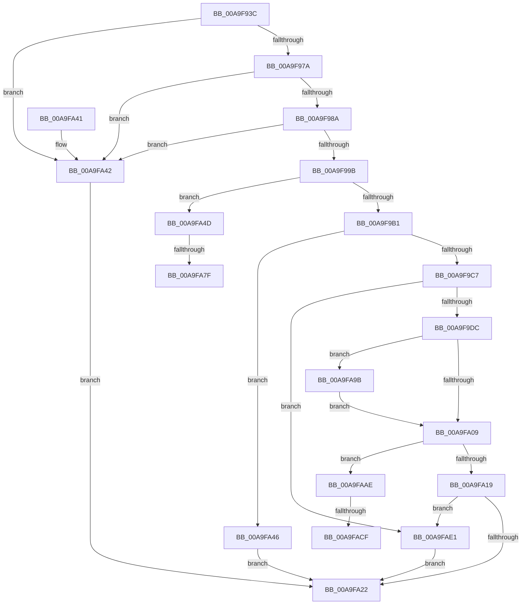

# MiApplyImportOptimizationToRuntimeDriver

- RVA: `0x00A9F93C`–`0x00A9FAF8` (길이 `444` bytes)
- VA: `0x0000000140A9F93C`
- 실행 섹션: `PAGE`
- PDB 이름 있음: `예`; PDB Function 태그: `예`
- unwind 정보 RVA: `0x000BAA24`
- 디코드: `109`개 명령, `444/444` bytes 표시
- 미해석 바이트: `0` (있으면 어셈블리에 `.byte`로 보존)

> 이 문서는 커널 이미지의 기계어와 PDB 기호를 분석해 생성했습니다. 4번과 5번은 함수 원형과 자료형을 바이너리 사용 방식에서 추정한 C 해석이며 원본 소스 복구 결과는 아닙니다.

## 1. Dependencies

- 직접 호출 지점: **11**; 고유 호출 대상: **11**
- 직접 호출자로 확인된 함수: **1**
- RIP 상대 이미지 참조: **4**

### Outgoing calls
- `0x00A9F96D` → [KeIsImportOptimizationEnabled](../../text/4A/KeIsImportOptimizationEnabled_function_004A8FB8.md) (function, `0x004A8FB8`)
- `0x00A9F97D` → [MiDoesControlAreaRequireRetpolineFixups](../../text/4B/MiDoesControlAreaRequireRetpolineFixups_function_004BE1DC.md) (function, `0x004BE1DC`)
- `0x00A9F9BA` → [MiReservePtes](../../text/31/MiReservePtes_function_00318D20.md) (function, `0x00318D20`)
- `0x00A9F9CD` → [MiCaptureRetpolineImportInfo](MiCaptureRetpolineImportInfo_function_00A9FB00.md) (function, `0x00A9FB00`)
- `0x00A9F9F3` → [MiWalkEntireImage](../../text/36/MiWalkEntireImage_function_00365D70.md) (function, `0x00365D70`)
- `0x00A9FA67` → [KeAbPreAcquire](../../text/21/KeAbPreAcquire_function_00210230.md) (function, `0x00210230`)
- `0x00A9FA90` → [ExfAcquirePushLockExclusiveEx](../../text/20/ExfAcquirePushLockExclusiveEx_function_0020FC90.md) (function, `0x0020FC90`)
- `0x00A9FAA4` → [MiUpdateImportRelocationsOnDriverPrivatePages](../../text/44/MiUpdateImportRelocationsOnDriverPrivatePages_function_00449BCC.md) (function, `0x00449BCC`)
- `0x00A9FAB3` → [MiAdjustSecureDriverStateForIatCapture](../../text/4B/MiAdjustSecureDriverStateForIatCapture_function_004BE864.md) (function, `0x004BE864`)
- `0x00A9FAD6` → [ExfTryToWakePushLock](../../text/26/ExfTryToWakePushLock_function_00265DD0.md) (function, `0x00265DD0`)
- `0x00A9FAEE` → [MiReleasePtes](../../text/24/MiReleasePtes_function_00247240.md) (function, `0x00247240`)

### Direct callers
- [MmLoadSystemImageEx](../99/MmLoadSystemImageEx_function_00999B8C.md) at `0x0099A090`

### Static image references
- `0x00A9F99B` → RVA `0x00FC6A88` (`ALMOSTRO`; read)
- `0x00A9F9B3` → RVA `0x00E37668` (`.data`; read)
- `0x00A9FA5A` → RVA `0x00E2D9A0` (`.data`; read)
- `0x00A9FA6C` → RVA `0x00E2D9A0` (`.data`; read/write)

## 2. Other-region calls and transfers

- 다른 실행 섹션으로 향하는 call: **10**
  - `0x00A9F96D` → [KeIsImportOptimizationEnabled](../../text/4A/KeIsImportOptimizationEnabled_function_004A8FB8.md) (`PAGE` → `.text`)
  - `0x00A9F97D` → [MiDoesControlAreaRequireRetpolineFixups](../../text/4B/MiDoesControlAreaRequireRetpolineFixups_function_004BE1DC.md) (`PAGE` → `.text`)
  - `0x00A9F9BA` → [MiReservePtes](../../text/31/MiReservePtes_function_00318D20.md) (`PAGE` → `.text`)
  - `0x00A9F9F3` → [MiWalkEntireImage](../../text/36/MiWalkEntireImage_function_00365D70.md) (`PAGE` → `.text`)
  - `0x00A9FA67` → [KeAbPreAcquire](../../text/21/KeAbPreAcquire_function_00210230.md) (`PAGE` → `.text`)
  - `0x00A9FA90` → [ExfAcquirePushLockExclusiveEx](../../text/20/ExfAcquirePushLockExclusiveEx_function_0020FC90.md) (`PAGE` → `.text`)
  - `0x00A9FAA4` → [MiUpdateImportRelocationsOnDriverPrivatePages](../../text/44/MiUpdateImportRelocationsOnDriverPrivatePages_function_00449BCC.md) (`PAGE` → `.text`)
  - `0x00A9FAB3` → [MiAdjustSecureDriverStateForIatCapture](../../text/4B/MiAdjustSecureDriverStateForIatCapture_function_004BE864.md) (`PAGE` → `.text`)
  - `0x00A9FAD6` → [ExfTryToWakePushLock](../../text/26/ExfTryToWakePushLock_function_00265DD0.md) (`PAGE` → `.text`)
  - `0x00A9FAEE` → [MiReleasePtes](../../text/24/MiReleasePtes_function_00247240.md) (`PAGE` → `.text`)
- call이 아닌 외부 분기/꼬리 이동: **4**
  - `0x00A9FA79` → [sub_00B49200](../B4/Unknown_function_00B49200.md) (`tail-transfer`)
  - `0x00A9FA96` → [sub_00B49200](../B4/Unknown_function_00B49200.md) (`tail-transfer`)
  - `0x00A9FAC9` → [sub_00B49200 + 0x5A](../B4/Unknown_function_00B49200.md) (`tail-transfer`)
  - `0x00A9FADC` → [sub_00B49200 + 0x5A](../B4/Unknown_function_00B49200.md) (`tail-transfer`)

## 3. Assembly (complete function range)

```asm
00A9F93C  48 89 5C 24 08                  mov qword ptr [rsp + 8], rbx
00A9F941  48 89 6C 24 10                  mov qword ptr [rsp + 0x10], rbp
00A9F946  48 89 74 24 20                  mov qword ptr [rsp + 0x20], rsi
00A9F94B  57                              push rdi
00A9F94C  41 54                           push r12
00A9F94E  41 55                           push r13
00A9F950  41 56                           push r14
00A9F952  41 57                           push r15
00A9F954  48 83 EC 20                     sub rsp, 0x20
00A9F958  65 4C 8B 2C 25 88 01 00 00      mov r13, qword ptr gs:[0x188]
00A9F961  4C 8B FA                        mov r15, rdx
00A9F964  48 8B F1                        mov rsi, rcx
00A9F967  45 33 E4                        xor r12d, r12d
00A9F96A  45 33 F6                        xor r14d, r14d
00A9F96D  E8 46 96 A0 FF                  call 0x1404a8fb8
00A9F972  84 C0                           test al, al
00A9F974  0F 84 C8 00 00 00               je 0x140a9fa42
00A9F97A  48 8B CA                        mov rcx, rdx
00A9F97D  E8 5A E8 A1 FF                  call 0x1404be1dc
00A9F982  85 C0                           test eax, eax
00A9F984  0F 84 B8 00 00 00               je 0x140a9fa42
00A9F98A  48 8B 0A                        mov rcx, qword ptr [rdx]
00A9F98D  48 8B 46 30                     mov rax, qword ptr [rsi + 0x30]
00A9F991  48 39 41 20                     cmp qword ptr [rcx + 0x20], rax
00A9F995  0F 85 A7 00 00 00               jne 0x140a9fa42
00A9F99B  48 F7 05 E2 70 52 00 00 80 00 00  test qword ptr [rip + 0x5270e2], 0x8000
00A9F9A6  41 8D 6C 24 01                  lea ebp, [r12 + 1]
00A9F9AB  0F 85 9C 00 00 00               jne 0x140a9fa4d
00A9F9B1  8B D5                           mov edx, ebp
00A9F9B3  48 8D 0D AE 7C 39 00            lea rcx, [rip + 0x397cae]
00A9F9BA  E8 61 93 87 FF                  call 0x140318d20
00A9F9BF  4C 8B F0                        mov r14, rax
00A9F9C2  48 85 C0                        test rax, rax
00A9F9C5  74 7F                           je 0x140a9fa46
00A9F9C7  49 8B D7                        mov rdx, r15
00A9F9CA  48 8B CE                        mov rcx, rsi
00A9F9CD  E8 2E 01 00 00                  call 0x140a9fb00
00A9F9D2  8B D8                           mov ebx, eax
00A9F9D4  85 C0                           test eax, eax
00A9F9D6  0F 88 05 01 00 00               js 0x140a9fae1
00A9F9DC  49 8D BD E6 01 00 00            lea rdi, [r13 + 0x1e6]
00A9F9E3  41 83 C9 FF                     or r9d, 0xffffffff
00A9F9E7  41 B8 08 00 00 00               mov r8d, 8
00A9F9ED  49 8B D6                        mov rdx, r14
00A9F9F0  49 8B CF                        mov rcx, r15
00A9F9F3  E8 78 63 8C FF                  call 0x140365d70
00A9F9F8  48 F7 05 85 70 52 00 00 80 00 00  test qword ptr [rip + 0x527085], 0x8000
00A9FA03  0F 84 92 00 00 00               je 0x140a9fa9b
00A9FA09  0F BA 6E 68 07                  bts dword ptr [rsi + 0x68], 7
00A9FA0E  33 DB                           xor ebx, ebx
00A9FA10  45 85 E4                        test r12d, r12d
00A9FA13  0F 85 95 00 00 00               jne 0x140a9faae
00A9FA19  4D 85 F6                        test r14, r14
00A9FA1C  0F 85 BF 00 00 00               jne 0x140a9fae1
00A9FA22  48 8B 6C 24 58                  mov rbp, qword ptr [rsp + 0x58]
00A9FA27  8B C3                           mov eax, ebx
00A9FA29  48 8B 5C 24 50                  mov rbx, qword ptr [rsp + 0x50]
00A9FA2E  48 8B 74 24 68                  mov rsi, qword ptr [rsp + 0x68]
00A9FA33  48 83 C4 20                     add rsp, 0x20
00A9FA37  41 5F                           pop r15
00A9FA39  41 5E                           pop r14
00A9FA3B  41 5D                           pop r13
00A9FA3D  41 5C                           pop r12
00A9FA3F  5F                              pop rdi
00A9FA40  C3                              ret
00A9FA41  CC                              int3
00A9FA42  33 DB                           xor ebx, ebx
00A9FA44  EB DC                           jmp 0x140a9fa22
00A9FA46  BB 9A 00 00 C0                  mov ebx, 0xc000009a
00A9FA4B  EB D5                           jmp 0x140a9fa22
00A9FA4D  49 8D BD E6 01 00 00            lea rdi, [r13 + 0x1e6]
00A9FA54  45 33 C0                        xor r8d, r8d
00A9FA57  66 29 2F                        sub word ptr [rdi], bp
00A9FA5A  48 8D 0D 3F DF 38 00            lea rcx, [rip + 0x38df3f]
00A9FA61  33 D2                           xor edx, edx
00A9FA63  90                              nop
00A9FA64  44 8B E5                        mov r12d, ebp
00A9FA67  E8 C4 07 77 FF                  call 0x140210230
00A9FA6C  F0 48 0F BA 2D 2A DF 38 00 00   lock bts qword ptr [rip + 0x38df2a], 0
00A9FA76  48 8B D8                        mov rbx, rax
00A9FA79  0F 83 81 97 0A 00               jae 0x140b49200
00A9FA7F  4C 8D 05 1A DF 38 00            lea r8, [rip + 0x38df1a]
00A9FA86  48 8B D0                        mov rdx, rax
00A9FA89  48 8D 0D 10 DF 38 00            lea rcx, [rip + 0x38df10]
00A9FA90  E8 FB 01 77 FF                  call 0x14020fc90
00A9FA95  90                              nop
00A9FA96  E9 65 97 0A 00                  jmp 0x140b49200
00A9FA9B  4D 8B C6                        mov r8, r14
00A9FA9E  49 8B D7                        mov rdx, r15
00A9FAA1  48 8B CE                        mov rcx, rsi
00A9FAA4  E8 23 A1 9A FF                  call 0x140449bcc
00A9FAA9  E9 5B FF FF FF                  jmp 0x140a9fa09
00A9FAAE  33 D2                           xor edx, edx
00A9FAB0  48 8B CE                        mov rcx, rsi
00A9FAB3  E8 AC ED A1 FF                  call 0x1404be864
00A9FAB8  48 83 C8 FF                     or rax, 0xffffffffffffffff
00A9FABC  F0 48 0F C1 05 DB DE 38 00      lock xadd qword ptr [rip + 0x38dedb], rax
00A9FAC5  24 06                           and al, 6
00A9FAC7  3C 02                           cmp al, 2
00A9FAC9  0F 85 8B 97 0A 00               jne 0x140b4925a
00A9FACF  48 8D 0D CA DE 38 00            lea rcx, [rip + 0x38deca]
00A9FAD6  E8 F5 62 7C FF                  call 0x140265dd0
00A9FADB  90                              nop
00A9FADC  E9 79 97 0A 00                  jmp 0x140b4925a
00A9FAE1  44 8B C5                        mov r8d, ebp
00A9FAE4  48 8D 0D 7D 7B 39 00            lea rcx, [rip + 0x397b7d]
00A9FAEB  49 8B D6                        mov rdx, r14
00A9FAEE  E8 4D 77 7A FF                  call 0x140247240
00A9FAF3  E9 2A FF FF FF                  jmp 0x140a9fa22
```

## 4. C-style interpretation (structured pseudocode)

```c
__int64 __fastcall MiApplyImportOptimizationToRuntimeDriver(__int64 a1, __int64 a2, __int64 a3, int a4)
{
    __int64 result;
    __int64 v_r12;
    __int64 v_r14;
    __int64 v_rbx;
    __int64 v_rsp;
    unsigned __int64 v_stack_p10;
    unsigned __int64 v_stack_p20;
    unsigned __int64 v_stack_p8;

    v_stack_p8 = v_rbx;
    v_stack_p10 = v_rbp;
    v_stack_p20 = v_rsi;
    v_rsp = (v_rsp) - (32);
    v_r12 = 0;
    v_r14 = 0;
    result = KeIsImportOptimizationEnabled(a1, a2, a3, a4);
    if ((unsigned __int8)(result) == 0) goto loc_00A9FA42;
    result = MiDoesControlAreaRequireRetpolineFixups(a2, a2, a3, a4);
    if ((unsigned int)(result) == 0) goto loc_00A9FA42;
    if ((*(unsigned __int64 *)(*(unsigned __int64 *)(a2) + 32)) != (*(unsigned __int64 *)(a1 + 48))) goto loc_00A9FA42;
    if (((*(unsigned __int64 *)(v_rip + 5402850)) & (0x8000ULL)) != 0) goto loc_00A9FA4D;
    result = MiReservePtes(v_rip + 3767470, (unsigned int)((unsigned int)(v_r12 + 1)), a3, a4);
    if (result == 0) goto loc_00A9FA46;
    result = MiCaptureRetpolineImportInfo(a1, a2, a3, a4);
    if (sign_flag) goto loc_00A9FAE1;
    a4 = (unsigned int)((a4) | (0xFFFFFFFFULL));
    result = MiWalkEntireImage(a2, result, 8, a4);
    if (((*(unsigned __int64 *)(v_rip + 5402757)) & (0x8000ULL)) == 0) goto loc_00A9FA9B;
loc_00A9FA09:
    v_rbx = 0;
    if (0 != 0) goto loc_00A9FAAE;
    if (result != 0) goto loc_00A9FAE1;
loc_00A9FA22:
    v_rsp = (v_rsp) + (32);
    return 0;
loc_00A9FA42:
    v_rbx = 0;
    goto loc_00A9FA22;
loc_00A9FA46:
    goto loc_00A9FA22;
loc_00A9FA4D:
    a3 = 0;
    a2 = 0;
    result = KeAbPreAcquire(v_rip + 3727167, a2, a3, a4);
    result = ExfAcquirePushLockExclusiveEx(v_rip + 3727120, result, v_rip + 3727130, a4);
loc_00A9FA9B:
    result = MiUpdateImportRelocationsOnDriverPrivatePages(v_stack_p20, 0, result, a4);
    goto loc_00A9FA09;
loc_00A9FAAE:
    a2 = 0;
    result = MiAdjustSecureDriverStateForIatCapture(v_stack_p20, a2, result, a4);
    result = (result) | (-1);
    result = (unsigned __int8)((result) & (6));
    result = ExfTryToWakePushLock(v_rip + 3727050, a2, result, a4);
loc_00A9FAE1:
    result = MiReleasePtes(v_rip + 3767165, result, (unsigned int)((unsigned int)(v_stack_p10)), a4);
    goto loc_00A9FA22;
}
```

## 5. (Beta) C Style

```c
int64_t MiApplyImportOptimizationToRuntimeDriver(void *Arg1, int64_t Arg2, int64_t Arg3, int32_t Arg4)
{
    uint8_t *arg1 = (uint8_t *)Arg1;

    int64_t result;
    int64_t local_r12;
    int64_t local_r14;
    int64_t local_rbx;
    int64_t local_rsp;
    uint64_t v_stack_p10;
    uint64_t v_stack_p20;
    uint64_t v_stack_p8;

    v_stack_p8 = local_rbx;
    v_stack_p10 = local_rbp;
    v_stack_p20 = local_rsi;
    local_rsp = (local_rsp) - (32);
    local_r12 = 0;
    local_r14 = 0;
    result = KeIsImportOptimizationEnabled(Arg1, Arg2, Arg3, Arg4);
    if ((uint8_t)(result) == 0) goto loc_00A9FA42;
    result = MiDoesControlAreaRequireRetpolineFixups(Arg2, Arg2, Arg3, Arg4);
    if ((uint32_t)(result) == 0) goto loc_00A9FA42;
    if ((*(uint64_t *)(*(uint64_t *)(Arg2) + 0x20)) != (*(uint64_t *)(arg1 + 0x30))) goto loc_00A9FA42;
    if (((*(uint64_t *)(v_rip + 0x5270E2)) & (0x8000ULL)) != 0) goto loc_00A9FA4D;
    result = MiReservePtes(v_rip + 3767470, (uint32_t)((uint32_t)(local_r12 + 1)), Arg3, Arg4);
    if (result == 0) goto loc_00A9FA46;
    result = MiCaptureRetpolineImportInfo(Arg1, Arg2, Arg3, Arg4);
    if (sign_flag) goto loc_00A9FAE1;
    Arg4 = (uint32_t)((Arg4) | (0xFFFFFFFFULL));
    result = MiWalkEntireImage(Arg2, result, 8, Arg4);
    if (((*(uint64_t *)(v_rip + 0x527085)) & (0x8000ULL)) == 0) goto loc_00A9FA9B;
loc_00A9FA09:
    local_rbx = 0;
    if (0 != 0) goto loc_00A9FAAE;
    if (result != 0) goto loc_00A9FAE1;
loc_00A9FA22:
    local_rsp = (local_rsp) + (32);
    return 0;
loc_00A9FA42:
    local_rbx = 0;
    goto loc_00A9FA22;
loc_00A9FA46:
    goto loc_00A9FA22;
loc_00A9FA4D:
    Arg3 = 0;
    Arg2 = 0;
    result = KeAbPreAcquire(v_rip + 3727167, Arg2, Arg3, Arg4);
    result = ExfAcquirePushLockExclusiveEx(v_rip + 3727120, result, v_rip + 3727130, Arg4);
loc_00A9FA9B:
    result = MiUpdateImportRelocationsOnDriverPrivatePages(v_stack_p20, 0, result, Arg4);
    goto loc_00A9FA09;
loc_00A9FAAE:
    Arg2 = 0;
    result = MiAdjustSecureDriverStateForIatCapture(v_stack_p20, Arg2, result, Arg4);
    result = (result) | (-1);
    result = (uint8_t)((result) & (6));
    result = ExfTryToWakePushLock(v_rip + 3727050, Arg2, result, Arg4);
loc_00A9FAE1:
    result = MiReleasePtes(v_rip + 3767165, result, (uint32_t)((uint32_t)(v_stack_p10)), Arg4);
    goto loc_00A9FA22;
}
```

### 관측된 메모리 오프셋

구조체 형식이 확인되지 않은 접근은 인자 기준의 오프셋으로만 기록했습니다.

| 기준 인자 | 오프셋 표현 | 폭 (bit) | 접근 |
|---|---:|---:|---|
| `Arg1` | `+ 0x30` | `64` | `R` |
| `Arg1` | `+ 0x68` | `32` | `R/W` |

## 6. Execution-region graph

[열기: 2D/3D 그래프와 함수 탐색 컨트롤 패널](../../../control-panel.html?section=page&rva=0x00A9F93C&view=graph)

- 2D 그래프는 위에서 아래로 흐르고, 3D 그래프는 빈 공간을 드래그해 회전합니다. Shift+드래그는 이동, 휠은 확대·축소, 함수 노드 선택은 대상 보고서 이동입니다.

### Static fallback


