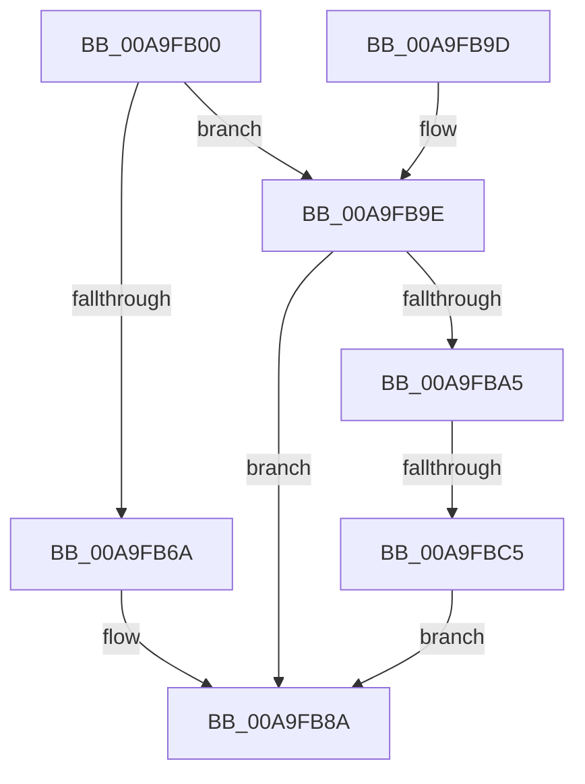

# MiCaptureRetpolineImportInfo

- RVA: `0x00A9FB00`–`0x00A9FBCC` (길이 `204` bytes)
- VA: `0x0000000140A9FB00`
- 실행 섹션: `PAGE`
- PDB 이름 있음: `예`; PDB Function 태그: `예`
- unwind 정보 RVA: `0x000BAA54`
- 디코드: `56`개 명령, `204/204` bytes 표시
- 미해석 바이트: `0` (있으면 어셈블리에 `.byte`로 보존)

> 이 문서는 커널 이미지의 기계어와 PDB 기호를 분석해 생성했습니다. 4번과 5번은 함수 원형과 자료형을 바이너리 사용 방식에서 추정한 C 해석이며 원본 소스 복구 결과는 아닙니다.

## 1. Dependencies

- 직접 호출 지점: **5**; 고유 호출 대상: **5**
- 직접 호출자로 확인된 함수: **1**
- RIP 상대 이미지 참조: **1**

### Outgoing calls
- `0x00A9FB30` → [KeIsRetpolineEnabled](../../text/44/KeIsRetpolineEnabled_function_0044EE20.md) (function, `0x0044EE20`)
- `0x00A9FB61` → [RtlCaptureRetpolineImportRvas](../../text/43/RtlCaptureRetpolineImportRvas_function_004317B4.md) (function, `0x004317B4`)
- `0x00A9FB70` → [MI_LOCK_RELOCATIONS_EXCLUSIVE](../../text/46/MI_LOCK_RELOCATIONS_EXCLUSIVE_function_004650F8.md) (function, `0x004650F8`)
- `0x00A9FB83` → [MI_UNLOCK_RELOCATIONS_EXCLUSIVE](../../text/46/MI_UNLOCK_RELOCATIONS_EXCLUSIVE_function_0046965C.md) (function, `0x0046965C`)
- `0x00A9FBB4` → [MiAllocatePool](../../text/35/MiAllocatePool_function_0035B540.md) (function, `0x0035B540`)

### Direct callers
- [MiApplyImportOptimizationToRuntimeDriver](MiApplyImportOptimizationToRuntimeDriver_function_00A9F93C.md) at `0x00A9F9CD`

### Static image references
- `0x00A9FB3F` → RVA `0x004CDA40` (`MiIsTargetFullyRetpolined`; read)

## 2. Other-region calls and transfers

- 다른 실행 섹션으로 향하는 call: **5**
  - `0x00A9FB30` → [KeIsRetpolineEnabled](../../text/44/KeIsRetpolineEnabled_function_0044EE20.md) (`PAGE` → `.text`)
  - `0x00A9FB61` → [RtlCaptureRetpolineImportRvas](../../text/43/RtlCaptureRetpolineImportRvas_function_004317B4.md) (`PAGE` → `.text`)
  - `0x00A9FB70` → [MI_LOCK_RELOCATIONS_EXCLUSIVE](../../text/46/MI_LOCK_RELOCATIONS_EXCLUSIVE_function_004650F8.md) (`PAGE` → `.text`)
  - `0x00A9FB83` → [MI_UNLOCK_RELOCATIONS_EXCLUSIVE](../../text/46/MI_UNLOCK_RELOCATIONS_EXCLUSIVE_function_0046965C.md) (`PAGE` → `.text`)
  - `0x00A9FBB4` → [MiAllocatePool](../../text/35/MiAllocatePool_function_0035B540.md) (`PAGE` → `.text`)
- call이 아닌 외부 분기/꼬리 이동: **1**
  - `0x00A9FBBF` → [sub_00B4928C](../B4/Unknown_function_00B4928C.md) (`tail-transfer`)

## 3. Assembly (complete function range)

```asm
00A9FB00  48 89 5C 24 10                  mov qword ptr [rsp + 0x10], rbx
00A9FB05  48 89 6C 24 18                  mov qword ptr [rsp + 0x18], rbp
00A9FB0A  56                              push rsi
00A9FB0B  57                              push rdi
00A9FB0C  41 56                           push r14
00A9FB0E  48 83 EC 30                     sub rsp, 0x30
00A9FB12  65 48 8B 34 25 88 01 00 00      mov rsi, qword ptr gs:[0x188]
00A9FB1B  33 DB                           xor ebx, ebx
00A9FB1D  48 8B 42 60                     mov rax, qword ptr [rdx + 0x60]
00A9FB21  48 8B E9                        mov rbp, rcx
00A9FB24  21 5C 24 50                     and dword ptr [rsp + 0x50], ebx
00A9FB28  48 83 E0 F8                     and rax, 0xfffffffffffffff8
00A9FB2C  48 8B 78 20                     mov rdi, qword ptr [rax + 0x20]
00A9FB30  E8 EB F2 9A FF                  call 0x14044ee20
00A9FB35  48 8B 49 30                     mov rcx, qword ptr [rcx + 0x30]
00A9FB39  F6 D8                           neg al
00A9FB3B  44 8B 45 40                     mov r8d, dword ptr [rbp + 0x40]
00A9FB3F  48 8D 05 FA DE A2 FF            lea rax, [rip - 0x5d2106]
00A9FB46  4D 1B F6                        sbb r14, r14
00A9FB49  48 8B D1                        mov rdx, rcx
00A9FB4C  4C 23 F0                        and r14, rax
00A9FB4F  48 8D 44 24 50                  lea rax, [rsp + 0x50]
00A9FB54  48 89 44 24 28                  mov qword ptr [rsp + 0x28], rax
00A9FB59  4D 8B CE                        mov r9, r14
00A9FB5C  48 21 5C 24 20                  and qword ptr [rsp + 0x20], rbx
00A9FB61  E8 4E 1C 99 FF                  call 0x1404317b4
00A9FB66  85 C0                           test eax, eax
00A9FB68  78 34                           js 0x140a9fb9e
00A9FB6A  48 8B D7                        mov rdx, rdi
00A9FB6D  48 8B CE                        mov rcx, rsi
00A9FB70  E8 83 55 9C FF                  call 0x1404650f8
00A9FB75  48 8B 47 58                     mov rax, qword ptr [rdi + 0x58]
00A9FB79  48 8B D7                        mov rdx, rdi
00A9FB7C  48 8B CE                        mov rcx, rsi
00A9FB7F  48 89 58 10                     mov qword ptr [rax + 0x10], rbx
00A9FB83  E8 D4 9A 9C FF                  call 0x14046965c
00A9FB88  33 C0                           xor eax, eax
00A9FB8A  48 8B 5C 24 58                  mov rbx, qword ptr [rsp + 0x58]
00A9FB8F  48 8B 6C 24 60                  mov rbp, qword ptr [rsp + 0x60]
00A9FB94  48 83 C4 30                     add rsp, 0x30
00A9FB98  41 5E                           pop r14
00A9FB9A  5F                              pop rdi
00A9FB9B  5E                              pop rsi
00A9FB9C  C3                              ret
00A9FB9D  CC                              int3
00A9FB9E  3D 23 00 00 C0                  cmp eax, 0xc0000023
00A9FBA3  75 E5                           jne 0x140a9fb8a
00A9FBA5  8B 54 24 50                     mov edx, dword ptr [rsp + 0x50]
00A9FBA9  B9 00 01 00 00                  mov ecx, 0x100
00A9FBAE  41 B8 4D 6D 52 69               mov r8d, 0x69526d4d
00A9FBB4  E8 87 B9 8B FF                  call 0x14035b540
00A9FBB9  48 8B D8                        mov rbx, rax
00A9FBBC  48 85 C0                        test rax, rax
00A9FBBF  0F 85 C7 96 0A 00               jne 0x140b4928c
00A9FBC5  B8 17 00 00 C0                  mov eax, 0xc0000017
00A9FBCA  EB BE                           jmp 0x140a9fb8a
```

## 4. C-style interpretation (structured pseudocode)

```c
__int64 __fastcall MiCaptureRetpolineImportInfo(__int64 a1, __int64 a2)
{
    __int64 result;
    __int64 v_r14;
    __int64 v_rbx;
    __int64 v_rsp;
    unsigned __int64 v_stack_m20;
    unsigned __int64 v_stack_m28;
    unsigned __int64 v_stack_p10;
    unsigned __int64 v_stack_p18;
    unsigned int v_stack_p50;
    unsigned int v_stack_p8;

    v_stack_p10 = v_rbx;
    v_stack_p18 = v_rbp;
    v_rsp = (v_rsp) - (48);
    v_rbx = 0;
    result = (*(unsigned __int64 *)(a2 + 96)) & (-8);
    result = KeIsRetpolineEnabled(a1, a2, a3, a4);
    result = (unsigned __int8)(-(result));
    v_r14 = (v_r14) & (v_rip - 6103302);
    v_stack_m20 = v_stack_p8;
    result = RtlCaptureRetpolineImportRvas(*(unsigned __int64 *)(a1 + 48), *(unsigned __int64 *)(a1 + 48), (unsigned int)(*(unsigned int *)(a1 + 64)), v_r14);
    if (sign_flag) goto loc_00A9FB9E;
    result = MI_LOCK_RELOCATIONS_EXCLUSIVE(*(unsigned __int64 *)(gs_base + (0 + 392)), *(unsigned __int64 *)(result + 32), (unsigned int)(*(unsigned int *)(a1 + 64)), v_r14);
    *(unsigned __int64 *)(*(unsigned __int64 *)(*(unsigned __int64 *)(result + 32) + 88) + 16) = 0;
    result = MI_UNLOCK_RELOCATIONS_EXCLUSIVE(*(unsigned __int64 *)(gs_base + (0 + 392)), *(unsigned __int64 *)(result + 32), (unsigned int)(*(unsigned int *)(a1 + 64)), v_r14);
    result = 0;
loc_00A9FB8A:
    v_rsp = (v_rsp) + (48);
    return result;
loc_00A9FB9E:
    if (0 != 0xC0000023ULL) goto loc_00A9FB8A;
    result = MiAllocatePool(256, (unsigned int)(v_stack_p50), (unsigned int)(0x69526D4DULL), v_r14);
    goto loc_00A9FB8A;
}
```

## 5. (Beta) C Style

```c
int64_t MiCaptureRetpolineImportInfo(void *Arg1, void *Arg2)
{
    uint8_t *arg1 = (uint8_t *)Arg1;
    uint8_t *arg2 = (uint8_t *)Arg2;

    int64_t result;
    int64_t local_r14;
    int64_t local_rbx;
    int64_t local_rsp;
    uint64_t v_stack_m20;
    uint64_t v_stack_m28;
    uint64_t v_stack_p10;
    uint64_t v_stack_p18;
    uint32_t v_stack_p50;
    uint32_t v_stack_p8;

    v_stack_p10 = local_rbx;
    v_stack_p18 = local_rbp;
    local_rsp = (local_rsp) - (48);
    local_rbx = 0;
    result = (*(uint64_t *)(arg2 + 0x60)) & (-8);
    result = KeIsRetpolineEnabled(Arg1, Arg2, a3, a4);
    result = (uint8_t)(-(result));
    local_r14 = (local_r14) & (v_rip - 6103302);
    v_stack_m20 = v_stack_p8;
    result = RtlCaptureRetpolineImportRvas(*(uint64_t *)(arg1 + 0x30), *(uint64_t *)(arg1 + 0x30), (uint32_t)(*(uint32_t *)(arg1 + 0x40)), local_r14);
    if (sign_flag) goto loc_00A9FB9E;
    result = MI_LOCK_RELOCATIONS_EXCLUSIVE(*(uint64_t *)(gs_base + (0 + 0x188)), *(uint64_t *)(result + 0x20), (uint32_t)(*(uint32_t *)(arg1 + 0x40)), local_r14);
    *(uint64_t *)(*(uint64_t *)(*(uint64_t *)(result + 0x20) + 0x58) + 0x10) = 0;
    result = MI_UNLOCK_RELOCATIONS_EXCLUSIVE(*(uint64_t *)(gs_base + (0 + 0x188)), *(uint64_t *)(result + 0x20), (uint32_t)(*(uint32_t *)(arg1 + 0x40)), local_r14);
    result = 0;
loc_00A9FB8A:
    local_rsp = (local_rsp) + (48);
    return result;
loc_00A9FB9E:
    if (0 != 0xC0000023ULL) goto loc_00A9FB8A;
    result = MiAllocatePool(256, (uint32_t)(v_stack_p50), (uint32_t)(0x69526D4DULL), local_r14);
    goto loc_00A9FB8A;
}
```

### 관측된 메모리 오프셋

구조체 형식이 확인되지 않은 접근은 인자 기준의 오프셋으로만 기록했습니다.

| 기준 인자 | 오프셋 표현 | 폭 (bit) | 접근 |
|---|---:|---:|---|
| `Arg1` | `+ 0x40` | `32` | `R` |
| `Arg2` | `+ 0x60` | `64` | `R` |

## 6. Execution-region graph

[열기: 2D/3D 그래프와 함수 탐색 컨트롤 패널](../../../control-panel.html?section=page&rva=0x00A9FB00&view=graph)

- 2D 그래프는 위에서 아래로 흐르고, 3D 그래프는 빈 공간을 드래그해 회전합니다. Shift+드래그는 이동, 휠은 확대·축소, 함수 노드 선택은 대상 보고서 이동입니다.

### Static fallback


