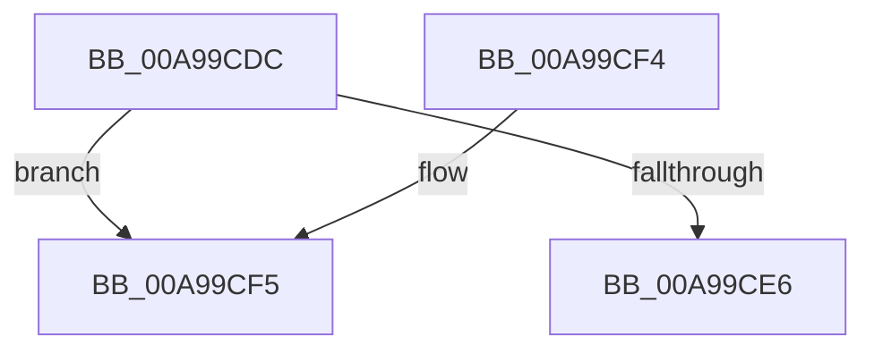

# MiChargeProcessPhysicalPages

- RVA: `0x00A99CDC`–`0x00A99D01` (길이 `37` bytes)
- VA: `0x0000000140A99CDC`
- 실행 섹션: `PAGE`
- PDB 이름 있음: `예`; PDB Function 태그: `예`
- unwind 정보 RVA: `0x000DB714`
- 디코드: `8`개 명령, `37/37` bytes 표시
- 미해석 바이트: `0` (있으면 어셈블리에 `.byte`로 보존)

> 이 문서는 커널 이미지의 기계어와 PDB 기호를 분석해 생성했습니다. 4번과 5번은 함수 원형과 자료형을 바이너리 사용 방식에서 추정한 C 해석이며 원본 소스 복구 결과는 아닙니다.

## 1. Dependencies

- 직접 호출 지점: **0**; 고유 호출 대상: **0**
- 직접 호출자로 확인된 함수: **3**
- RIP 상대 이미지 참조: **0**

### Outgoing calls
- 직접 디코드된 call 명령이 없습니다.

### Direct callers
- [MiCommitExistingVad](../../text/32/MiCommitExistingVad_function_0032A860.md) at `0x0032B31C`
- [MiAllocateUserPhysicalPages](../80/MiAllocateUserPhysicalPages_function_00809828.md) at `0x00809C4A`
- [MiCreateLargePageVad](MiCreateLargePageVad_function_00A99B50.md) at `0x00A99BC4`

### Static image references
- 디코드된 RIP-relative 메모리 참조가 없습니다.

## 2. Other-region calls and transfers

- 다른 실행 섹션으로 향하는 call: **0**
- call이 아닌 외부 분기/꼬리 이동: **1**
  - `0x00A99CFC` → `0x00B48172` (`tail-transfer`)

## 3. Assembly (complete function range)

```asm
00A99CDC  48 83 B9 78 05 00 00 00         cmp qword ptr [rcx + 0x578], 0
00A99CE4  75 0F                           jne 0x140a99cf5
00A99CE6  F0 48 01 91 70 05 00 00         lock add qword ptr [rcx + 0x570], rdx
00A99CEE  B8 01 00 00 00                  mov eax, 1
00A99CF3  C3                              ret
00A99CF4  CC                              int3
00A99CF5  48 8B 81 70 05 00 00            mov rax, qword ptr [rcx + 0x570]
00A99CFC  E9 71 E4 0A 00                  jmp 0x140b48172
```

## 4. C-style interpretation (structured pseudocode)

```c
__int64 __fastcall MiChargeProcessPhysicalPages(__int64 a1, __int64 a2)
{
    if ((*(unsigned __int64 *)(a1 + 1400)) != 0) goto loc_00A99CF5;
    return 1;
loc_00A99CF5:
}
```

## 5. (Beta) C Style

```c
int64_t MiChargeProcessPhysicalPages(void *Arg1, int64_t Arg2)
{
    uint8_t *arg1 = (uint8_t *)Arg1;

    if ((*(uint64_t *)(arg1 + 0x578)) != 0) goto loc_00A99CF5;
    return 1;
loc_00A99CF5:
}
```

### 관측된 메모리 오프셋

구조체 형식이 확인되지 않은 접근은 인자 기준의 오프셋으로만 기록했습니다.

| 기준 인자 | 오프셋 표현 | 폭 (bit) | 접근 |
|---|---:|---:|---|
| `Arg1` | `+ 0x570` | `64` | `R` |
| `Arg1` | `+ 0x570` | `64` | `R/W` |
| `Arg1` | `+ 0x578` | `64` | `R` |

## 6. Execution-region graph

[열기: 2D/3D 그래프와 함수 탐색 컨트롤 패널](../../../control-panel.html?section=page&rva=0x00A99CDC&view=graph)

- 2D 그래프는 위에서 아래로 흐르고, 3D 그래프는 빈 공간을 드래그해 회전합니다. Shift+드래그는 이동, 휠은 확대·축소, 함수 노드 선택은 대상 보고서 이동입니다.

### Static fallback


