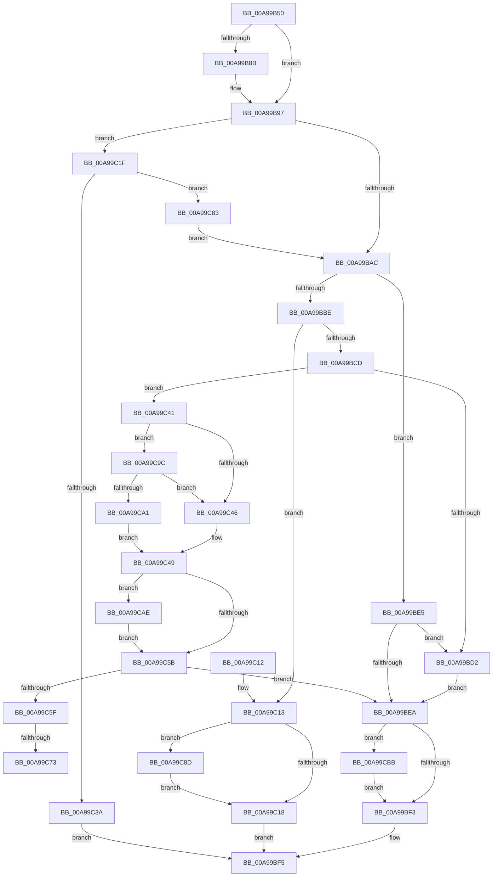

# MiCreateLargePageVad

- RVA: `0x00A99B50`–`0x00A99CD5` (길이 `389` bytes)
- VA: `0x0000000140A99B50`
- 실행 섹션: `PAGE`
- PDB 이름 있음: `예`; PDB Function 태그: `예`
- unwind 정보 RVA: `0x000BA2A8`
- 디코드: `114`개 명령, `389/389` bytes 표시
- 미해석 바이트: `0` (있으면 어셈블리에 `.byte`로 보존)

> 이 문서는 커널 이미지의 기계어와 PDB 기호를 분석해 생성했습니다. 4번과 5번은 함수 원형과 자료형을 바이너리 사용 방식에서 추정한 C 해석이며 원본 소스 복구 결과는 아닙니다.

## 1. Dependencies

- 직접 호출 지점: **9**; 고유 호출 대상: **8**
- 직접 호출자로 확인된 함수: **3**
- RIP 상대 이미지 참조: **0**

### Outgoing calls
- `0x00A99BC4` → [MiChargeProcessPhysicalPages](MiChargeProcessPhysicalPages_function_00A99CDC.md) (function, `0x00A99CDC`)
- `0x00A99BDA` → [ObfReferenceObjectWithTag](../../text/21/ObfReferenceObjectWithTag_function_00210710.md) (function, `0x00210710`)
- `0x00A99C2D` → [MiAllocatePool](../../text/35/MiAllocatePool_function_0035B540.md) (function, `0x0035B540`)
- `0x00A99C4F` → [MiChargeFullProcessCommitment](../88/MiChargeFullProcessCommitment_function_00887630.md) (function, `0x00887630`)
- `0x00A99C78` → [ExFreePoolWithTag](../../poolcode/B8/ExFreePoolWithTag_function_00B82870.md) (function, `0x00B82870`)
- `0x00A99C92` → [ExFreePoolWithTag](../../poolcode/B8/ExFreePoolWithTag_function_00B82870.md) (function, `0x00B82870`)
- `0x00A99CA7` → [LOCK_ADDRESS_SPACE_SHARED](../../text/2A/LOCK_ADDRESS_SPACE_SHARED_function_002A8B3C.md) (function, `0x002A8B3C`)
- `0x00A99CB4` → [UNLOCK_ADDRESS_SPACE_SHARED](../../text/2A/UNLOCK_ADDRESS_SPACE_SHARED_function_002A8ACC.md) (function, `0x002A8ACC`)
- `0x00A99CCB` → [MiInsertVadEvent](../../text/43/MiInsertVadEvent_function_00430E74.md) (function, `0x00430E74`)

### Direct callers
- [MiReserveUserMemory](../88/MiReserveUserMemory_function_00884498.md) at `0x00884C67`
- [MiAllocateChildVads](../97/MiAllocateChildVads_function_0097E380.md) at `0x0097E73B`
- [sub_00B2A146](../B2/Unknown_function_00B2A146.md) at `0x00B2A1A7`

### Static image references
- 디코드된 RIP-relative 메모리 참조가 없습니다.

## 2. Other-region calls and transfers

- 다른 실행 섹션으로 향하는 call: **7**
  - `0x00A99BDA` → [ObfReferenceObjectWithTag](../../text/21/ObfReferenceObjectWithTag_function_00210710.md) (`PAGE` → `.text`)
  - `0x00A99C2D` → [MiAllocatePool](../../text/35/MiAllocatePool_function_0035B540.md) (`PAGE` → `.text`)
  - `0x00A99C78` → [ExFreePoolWithTag](../../poolcode/B8/ExFreePoolWithTag_function_00B82870.md) (`PAGE` → `POOLCODE`)
  - `0x00A99C92` → [ExFreePoolWithTag](../../poolcode/B8/ExFreePoolWithTag_function_00B82870.md) (`PAGE` → `POOLCODE`)
  - `0x00A99CA7` → [LOCK_ADDRESS_SPACE_SHARED](../../text/2A/LOCK_ADDRESS_SPACE_SHARED_function_002A8B3C.md) (`PAGE` → `.text`)
  - `0x00A99CB4` → [UNLOCK_ADDRESS_SPACE_SHARED](../../text/2A/UNLOCK_ADDRESS_SPACE_SHARED_function_002A8ACC.md) (`PAGE` → `.text`)
  - `0x00A99CCB` → [MiInsertVadEvent](../../text/43/MiInsertVadEvent_function_00430E74.md) (`PAGE` → `.text`)
- call이 아닌 외부 분기/꼬리 이동: **2**
  - `0x00A99C6D` → [sub_00B4816A](../B4/Unknown_function_00B4816A.md) (`tail-transfer`)
  - `0x00A99C7E` → [sub_00B4816A](../B4/Unknown_function_00B4816A.md) (`tail-transfer`)

## 3. Assembly (complete function range)

```asm
00A99B50  48 8B C4                        mov rax, rsp
00A99B53  48 89 58 08                     mov qword ptr [rax + 8], rbx
00A99B57  48 89 68 10                     mov qword ptr [rax + 0x10], rbp
00A99B5B  48 89 70 18                     mov qword ptr [rax + 0x18], rsi
00A99B5F  44 89 48 20                     mov dword ptr [rax + 0x20], r9d
00A99B63  57                              push rdi
00A99B64  41 54                           push r12
00A99B66  41 55                           push r13
00A99B68  41 56                           push r14
00A99B6A  41 57                           push r15
00A99B6C  48 83 EC 20                     sub rsp, 0x20
00A99B70  F7 42 30 00 00 20 00            test dword ptr [rdx + 0x30], 0x200000
00A99B77  41 BF 01 00 00 00               mov r15d, 1
00A99B7D  41 8B DF                        mov ebx, r15d
00A99B80  49 8B F0                        mov rsi, r8
00A99B83  4C 8B EA                        mov r13, rdx
00A99B86  48 8B F9                        mov rdi, rcx
00A99B89  74 0C                           je 0x140a99b97
00A99B8B  49 8B C0                        mov rax, r8
00A99B8E  48 F7 D8                        neg rax
00A99B91  4D 1B D2                        sbb r10, r10
00A99B94  49 23 DA                        and rbx, r10
00A99B97  65 4C 8B 34 25 88 01 00 00      mov r14, qword ptr gs:[0x188]
00A99BA0  4D 8B A6 B8 00 00 00            mov r12, qword ptr [r14 + 0xb8]
00A99BA7  48 85 DB                        test rbx, rbx
00A99BAA  75 73                           jne 0x140a99c1f
00A99BAC  41 8B 4D 34                     mov ecx, dword ptr [r13 + 0x34]
00A99BB0  41 0F B6 6D 22                  movzx ebp, byte ptr [r13 + 0x22]
00A99BB5  48 C1 E5 20                     shl rbp, 0x20
00A99BB9  48 0B E9                        or rbp, rcx
00A99BBC  74 27                           je 0x140a99be5
00A99BBE  48 8B D5                        mov rdx, rbp
00A99BC1  48 8B CF                        mov rcx, rdi
00A99BC4  E8 13 01 00 00                  call 0x140a99cdc
00A99BC9  85 C0                           test eax, eax
00A99BCB  74 46                           je 0x140a99c13
00A99BCD  48 85 F6                        test rsi, rsi
00A99BD0  74 6F                           je 0x140a99c41
00A99BD2  BA 44 66 6C 74                  mov edx, 0x746c6644
00A99BD7  48 8B CE                        mov rcx, rsi
00A99BDA  E8 31 6B 77 FF                  call 0x140210710
00A99BDF  48 89 73 18                     mov qword ptr [rbx + 0x18], rsi
00A99BE3  EB 05                           jmp 0x140a99bea
00A99BE5  48 85 F6                        test rsi, rsi
00A99BE8  75 E8                           jne 0x140a99bd2
00A99BEA  48 85 DB                        test rbx, rbx
00A99BED  0F 85 C8 00 00 00               jne 0x140a99cbb
00A99BF3  33 C0                           xor eax, eax
00A99BF5  48 8B 5C 24 50                  mov rbx, qword ptr [rsp + 0x50]
00A99BFA  48 8B 6C 24 58                  mov rbp, qword ptr [rsp + 0x58]
00A99BFF  48 8B 74 24 60                  mov rsi, qword ptr [rsp + 0x60]
00A99C04  48 83 C4 20                     add rsp, 0x20
00A99C08  41 5F                           pop r15
00A99C0A  41 5E                           pop r14
00A99C0C  41 5D                           pop r13
00A99C0E  41 5C                           pop r12
00A99C10  5F                              pop rdi
00A99C11  C3                              ret
00A99C12  CC                              int3
00A99C13  48 85 DB                        test rbx, rbx
00A99C16  75 75                           jne 0x140a99c8d
00A99C18  B8 2D 01 00 C0                  mov eax, 0xc000012d
00A99C1D  EB D6                           jmp 0x140a99bf5
00A99C1F  BA 58 00 00 00                  mov edx, 0x58
00A99C24  41 B8 4D 6D 4C 62               mov r8d, 0x624c6d4d
00A99C2A  8D 4A E8                        lea ecx, [rdx - 0x18]
00A99C2D  E8 0E 19 8C FF                  call 0x14035b540
00A99C32  48 8B D8                        mov rbx, rax
00A99C35  48 85 C0                        test rax, rax
00A99C38  75 49                           jne 0x140a99c83
00A99C3A  B8 9A 00 00 C0                  mov eax, 0xc000009a
00A99C3F  EB B4                           jmp 0x140a99bf5
00A99C41  45 85 C9                        test r9d, r9d
00A99C44  74 56                           je 0x140a99c9c
00A99C46  45 33 FF                        xor r15d, r15d
00A99C49  48 8B D5                        mov rdx, rbp
00A99C4C  48 8B CF                        mov rcx, rdi
00A99C4F  E8 DC D9 DE FF                  call 0x140887630
00A99C54  8B F0                           mov esi, eax
00A99C56  45 85 FF                        test r15d, r15d
00A99C59  75 53                           jne 0x140a99cae
00A99C5B  85 F6                           test esi, esi
00A99C5D  79 8B                           jns 0x140a99bea
00A99C5F  48 F7 DD                        neg rbp
00A99C62  F0 48 01 AF 70 05 00 00         lock add qword ptr [rdi + 0x570], rbp
00A99C6A  48 85 DB                        test rbx, rbx
00A99C6D  0F 84 F7 E4 0A 00               je 0x140b4816a
00A99C73  33 D2                           xor edx, edx
00A99C75  48 8B CB                        mov rcx, rbx
00A99C78  E8 F3 8B 0E 00                  call 0x140b82870
00A99C7D  90                              nop
00A99C7E  E9 E7 E4 0A 00                  jmp 0x140b4816a
00A99C83  44 8B 4C 24 68                  mov r9d, dword ptr [rsp + 0x68]
00A99C88  E9 1F FF FF FF                  jmp 0x140a99bac
00A99C8D  33 D2                           xor edx, edx
00A99C8F  48 8B CB                        mov rcx, rbx
00A99C92  E8 D9 8B 0E 00                  call 0x140b82870
00A99C97  E9 7C FF FF FF                  jmp 0x140a99c18
00A99C9C  4C 3B E7                        cmp r12, rdi
00A99C9F  75 A5                           jne 0x140a99c46
00A99CA1  48 8B D7                        mov rdx, rdi
00A99CA4  49 8B CE                        mov rcx, r14
00A99CA7  E8 90 EE 80 FF                  call 0x1402a8b3c
00A99CAC  EB 9B                           jmp 0x140a99c49
00A99CAE  48 8B D7                        mov rdx, rdi
00A99CB1  49 8B CE                        mov rcx, r14
00A99CB4  E8 13 EE 80 FF                  call 0x1402a8acc
00A99CB9  EB A0                           jmp 0x140a99c5b
00A99CBB  45 33 C0                        xor r8d, r8d
00A99CBE  C7 43 50 10 00 00 00            mov dword ptr [rbx + 0x50], 0x10
00A99CC5  48 8B D3                        mov rdx, rbx
00A99CC8  49 8B CD                        mov rcx, r13
00A99CCB  E8 A4 71 99 FF                  call 0x140430e74
00A99CD0  E9 1E FF FF FF                  jmp 0x140a99bf3
```

## 4. C-style interpretation (structured pseudocode)

```c
__int64 __fastcall MiCreateLargePageVad(__int64 a1, __int64 a2, __int64 a3, int a4)
{
    __int64 result;
    __int64 v_r15;
    __int64 v_rbp;
    __int64 v_rbx;
    __int64 v_rsp;
    unsigned __int64 v_stack_p10;
    unsigned __int64 v_stack_p18;
    unsigned int v_stack_p68;
    unsigned __int64 v_stack_p8;

    *(unsigned __int64 *)(v_rsp + 8) = v_rbx;
    *(unsigned __int64 *)(v_rsp + 16) = v_rbp;
    *(unsigned __int64 *)(v_rsp + 24) = v_rsi;
    *(unsigned int *)(v_rsp + 32) = a4;
    v_rsp = (v_rsp) - (32);
    result = v_rsp;
    v_rbx = 1;
    if (((*(unsigned int *)(a2 + 48)) & (0x200000ULL)) != 0) {
        result = a3;
        result = -(result);
        v_rbx = (1) & (v_r10);
    }
    if (v_rbx != 0) goto loc_00A99C1F;
loc_00A99BAC:
    v_rbp = (*(unsigned __int8 *)(a2 + 34)) << (32);
    v_rbp = (v_rbp) | ((unsigned int)(*(unsigned int *)(a2 + 52)));
    if (condition_is_equal) goto loc_00A99BE5;
    result = MiChargeProcessPhysicalPages(a1, v_rbp, a3, a4);
    if ((unsigned int)(result) == 0) goto loc_00A99C13;
    if (a3 == 0) goto loc_00A99C41;
loc_00A99BD2:
    result = ObfReferenceObjectWithTag(a3, (unsigned int)(0x746C6644ULL), a3, a4);
    *(unsigned __int64 *)(v_rbx + 24) = a3;
    goto loc_00A99BEA;
loc_00A99BE5:
    if (a3 != 0) goto loc_00A99BD2;
loc_00A99BEA:
    if (v_rbx != 0) goto loc_00A99CBB;
loc_00A99BF3:
    result = 0;
loc_00A99BF5:
    v_rsp = (v_rsp) + (32);
    return result;
loc_00A99C13:
    if (v_stack_p8 != 0) goto loc_00A99C8D;
loc_00A99C18:
    goto loc_00A99BF5;
loc_00A99C1F:
    result = MiAllocatePool(88 - 24, 88, (unsigned int)(0x624C6D4DULL), a4);
    if (result != 0) goto loc_00A99C83;
    goto loc_00A99BF5;
loc_00A99C41:
    if (a4 == 0) goto loc_00A99C9C;
loc_00A99C46:
    v_r15 = 0;
loc_00A99C49:
    result = MiChargeFullProcessCommitment(a1, v_stack_p10, (unsigned int)(0x624C6D4DULL), a4);
    if (0 != 0) goto loc_00A99CAE;
loc_00A99C5B:
    if (!sign_flag) goto loc_00A99BEA;
    v_rbp = -(v_stack_p10);
    a2 = 0;
    result = ExFreePoolWithTag(result, a2, (unsigned int)(0x624C6D4DULL), a4);
loc_00A99C83:
    goto loc_00A99BAC;
loc_00A99C8D:
    a2 = 0;
    result = ExFreePoolWithTag(result, a2, (unsigned int)(0x624C6D4DULL), (unsigned int)(v_stack_p68));
    goto loc_00A99C18;
loc_00A99C9C:
    if ((*(unsigned __int64 *)(*(unsigned __int64 *)(gs_base + (0 + 392)) + 184)) != a1) goto loc_00A99C46;
    result = LOCK_ADDRESS_SPACE_SHARED(*(unsigned __int64 *)(gs_base + (0 + 392)), a1, (unsigned int)(0x624C6D4DULL), (unsigned int)(v_stack_p68));
    goto loc_00A99C49;
loc_00A99CAE:
    result = UNLOCK_ADDRESS_SPACE_SHARED(*(unsigned __int64 *)(gs_base + (0 + 392)), a1, (unsigned int)(0x624C6D4DULL), (unsigned int)(v_stack_p68));
    goto loc_00A99C5B;
loc_00A99CBB:
    a3 = 0;
    *(unsigned int *)(result + 80) = 16;
    result = MiInsertVadEvent(0, result, a3, (unsigned int)(v_stack_p68));
    goto loc_00A99BF3;
}
```

## 5. (Beta) C Style

```c
int64_t MiCreateLargePageVad(void *Arg1, void *Arg2, int64_t Arg3, int32_t Arg4)
{
    uint8_t *arg1 = (uint8_t *)Arg1;
    uint8_t *arg2 = (uint8_t *)Arg2;

    int64_t result;
    int64_t local_r15;
    int64_t local_rbp;
    int64_t local_rbx;
    int64_t local_rsp;
    uint64_t v_stack_p10;
    uint64_t v_stack_p18;
    uint32_t v_stack_p68;
    uint64_t v_stack_p8;

    *(uint64_t *)(local_rsp + 0x8) = local_rbx;
    *(uint64_t *)(local_rsp + 0x10) = local_rbp;
    *(uint64_t *)(local_rsp + 0x18) = local_rsi;
    *(uint32_t *)(local_rsp + 0x20) = Arg4;
    local_rsp = (local_rsp) - (32);
    result = local_rsp;
    local_rbx = 1;
    if (((*(uint32_t *)(arg2 + 0x30)) & (0x200000ULL)) != 0) {
        result = Arg3;
        result = -(result);
        local_rbx = (1) & (local_r10);
    }
    if (local_rbx != 0) goto loc_00A99C1F;
loc_00A99BAC:
    local_rbp = (*(uint8_t *)(arg2 + 0x22)) << (32);
    local_rbp = (local_rbp) | ((uint32_t)(*(uint32_t *)(arg2 + 0x34)));
    if (condition_is_equal) goto loc_00A99BE5;
    result = MiChargeProcessPhysicalPages(Arg1, local_rbp, Arg3, Arg4);
    if ((uint32_t)(result) == 0) goto loc_00A99C13;
    if (Arg3 == 0) goto loc_00A99C41;
loc_00A99BD2:
    result = ObfReferenceObjectWithTag(Arg3, (uint32_t)(0x746C6644ULL), Arg3, Arg4);
    *(uint64_t *)(local_rbx + 0x18) = Arg3;
    goto loc_00A99BEA;
loc_00A99BE5:
    if (Arg3 != 0) goto loc_00A99BD2;
loc_00A99BEA:
    if (local_rbx != 0) goto loc_00A99CBB;
loc_00A99BF3:
    result = 0;
loc_00A99BF5:
    local_rsp = (local_rsp) + (32);
    return result;
loc_00A99C13:
    if (v_stack_p8 != 0) goto loc_00A99C8D;
loc_00A99C18:
    goto loc_00A99BF5;
loc_00A99C1F:
    result = MiAllocatePool(88 - 24, 88, (uint32_t)(0x624C6D4DULL), Arg4);
    if (result != 0) goto loc_00A99C83;
    goto loc_00A99BF5;
loc_00A99C41:
    if (Arg4 == 0) goto loc_00A99C9C;
loc_00A99C46:
    local_r15 = 0;
loc_00A99C49:
    result = MiChargeFullProcessCommitment(Arg1, v_stack_p10, (uint32_t)(0x624C6D4DULL), Arg4);
    if (0 != 0) goto loc_00A99CAE;
loc_00A99C5B:
    if (!sign_flag) goto loc_00A99BEA;
    local_rbp = -(v_stack_p10);
    Arg2 = 0;
    result = ExFreePoolWithTag(result, Arg2, (uint32_t)(0x624C6D4DULL), Arg4);
loc_00A99C83:
    goto loc_00A99BAC;
loc_00A99C8D:
    Arg2 = 0;
    result = ExFreePoolWithTag(result, Arg2, (uint32_t)(0x624C6D4DULL), (uint32_t)(v_stack_p68));
    goto loc_00A99C18;
loc_00A99C9C:
    if ((*(uint64_t *)(*(uint64_t *)(gs_base + (0 + 0x188)) + 0xB8)) != Arg1) goto loc_00A99C46;
    result = LOCK_ADDRESS_SPACE_SHARED(*(uint64_t *)(gs_base + (0 + 0x188)), Arg1, (uint32_t)(0x624C6D4DULL), (uint32_t)(v_stack_p68));
    goto loc_00A99C49;
loc_00A99CAE:
    result = UNLOCK_ADDRESS_SPACE_SHARED(*(uint64_t *)(gs_base + (0 + 0x188)), Arg1, (uint32_t)(0x624C6D4DULL), (uint32_t)(v_stack_p68));
    goto loc_00A99C5B;
loc_00A99CBB:
    Arg3 = 0;
    *(uint32_t *)(result + 0x50) = 16;
    result = MiInsertVadEvent(0, result, Arg3, (uint32_t)(v_stack_p68));
    goto loc_00A99BF3;
}
```

### 관측된 메모리 오프셋

구조체 형식이 확인되지 않은 접근은 인자 기준의 오프셋으로만 기록했습니다.

| 기준 인자 | 오프셋 표현 | 폭 (bit) | 접근 |
|---|---:|---:|---|
| `Arg1` | `+ 0x570` | `64` | `R/W` |
| `Arg2` | `+ 0x22` | `8` | `R` |
| `Arg2` | `+ 0x30` | `32` | `R` |
| `Arg2` | `+ 0x34` | `32` | `R` |

## 6. Execution-region graph

[열기: 2D/3D 그래프와 함수 탐색 컨트롤 패널](../../../control-panel.html?section=page&rva=0x00A99B50&view=graph)

- 2D 그래프는 위에서 아래로 흐르고, 3D 그래프는 빈 공간을 드래그해 회전합니다. Shift+드래그는 이동, 휠은 확대·축소, 함수 노드 선택은 대상 보고서 이동입니다.

### Static fallback


