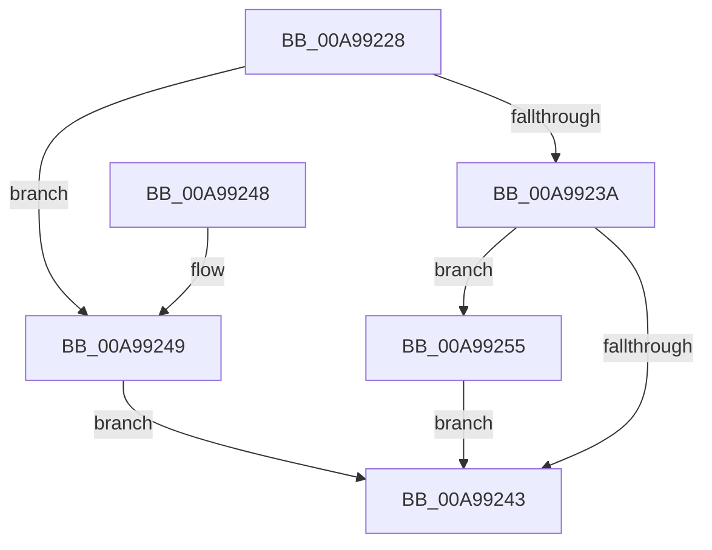

# MiDereferenceFailedControlArea

- RVA: `0x00A99228`–`0x00A9925C` (길이 `52` bytes)
- VA: `0x0000000140A99228`
- 실행 섹션: `PAGE`
- PDB 이름 있음: `예`; PDB Function 태그: `아니요`
- unwind 정보 RVA: `0x00068D6C`
- 디코드: `18`개 명령, `52/52` bytes 표시
- 미해석 바이트: `0` (있으면 어셈블리에 `.byte`로 보존)

> 이 문서는 커널 이미지의 기계어와 PDB 기호를 분석해 생성했습니다. 4번과 5번은 함수 원형과 자료형을 바이너리 사용 방식에서 추정한 C 해석이며 원본 소스 복구 결과는 아닙니다.

## 1. Dependencies

- 직접 호출 지점: **3**; 고유 호출 대상: **3**
- 직접 호출자로 확인된 함수: **2**
- RIP 상대 이미지 참조: **0**

### Outgoing calls
- `0x00A9923A` → [MiAweControlArea](../../text/44/MiAweControlArea_function_00447720.md) (function, `0x00447720`)
- `0x00A9924E` → [MiDereferenceControlAreaBySection](../../text/45/MiDereferenceControlAreaBySection_function_00458348.md) (function, `0x00458348`)
- `0x00A99255` → [MiDeleteSectionAwe](../../text/68/MiDeleteSectionAwe_function_006887A8.md) (function, `0x006887A8`)

### Direct callers
- [MiFinishCreateSection](../98/MiFinishCreateSection_function_009844FC.md) at `0x009847A3`
- [sub_00984D37](../98/Unknown_function_00984D37.md) at `0x00984DA1`

### Static image references
- 디코드된 RIP-relative 메모리 참조가 없습니다.

## 2. Other-region calls and transfers

- 다른 실행 섹션으로 향하는 call: **3**
  - `0x00A9923A` → [MiAweControlArea](../../text/44/MiAweControlArea_function_00447720.md) (`PAGE` → `.text`)
  - `0x00A9924E` → [MiDereferenceControlAreaBySection](../../text/45/MiDereferenceControlAreaBySection_function_00458348.md) (`PAGE` → `.text`)
  - `0x00A99255` → [MiDeleteSectionAwe](../../text/68/MiDeleteSectionAwe_function_006887A8.md) (`PAGE` → `.text`)
- 별도 외부 분기/꼬리 이동을 확인하지 못했습니다.

## 3. Assembly (complete function range)

```asm
00A99228  48 83 EC 28                     sub rsp, 0x28
00A9922C  8B 11                           mov edx, dword ptr [rcx]
00A9922E  4C 8B 41 40                     mov r8, qword ptr [rcx + 0x40]
00A99232  49 8B C8                        mov rcx, r8
00A99235  F6 C2 04                        test dl, 4
00A99238  75 0F                           jne 0x140a99249
00A9923A  E8 E1 E4 9A FF                  call 0x140447720
00A9923F  85 C0                           test eax, eax
00A99241  75 12                           jne 0x140a99255
00A99243  48 83 C4 28                     add rsp, 0x28
00A99247  C3                              ret
00A99248  CC                              int3
00A99249  F7 D2                           not edx
00A9924B  83 E2 01                        and edx, 1
00A9924E  E8 F5 F0 9B FF                  call 0x140458348
00A99253  EB EE                           jmp 0x140a99243
00A99255  E8 4E F5 BE FF                  call 0x1406887a8
00A9925A  EB E7                           jmp 0x140a99243
```

## 4. C-style interpretation (structured pseudocode)

```c
__int64 __fastcall MiDereferenceFailedControlArea(__int64 a1)
{
    __int64 result;
    __int64 v_rsp;

    v_rsp = (v_rsp) - (40);
    if ((((unsigned __int8)((unsigned int)(*(unsigned int *)(a1)))) & (4)) != 0) goto loc_00A99249;
    result = MiAweControlArea(*(unsigned __int64 *)(a1 + 64), (unsigned int)(*(unsigned int *)(a1)), *(unsigned __int64 *)(a1 + 64), a4);
    if ((unsigned int)(result) != 0) goto loc_00A99255;
loc_00A99243:
    v_rsp = (v_rsp) + (40);
    return result;
loc_00A99249:
    a2 = (unsigned int)(~((unsigned int)(*(unsigned int *)(a1))));
    a2 = (unsigned int)((a2) & (1));
    result = MiDereferenceControlAreaBySection(*(unsigned __int64 *)(a1 + 64), a2, *(unsigned __int64 *)(a1 + 64), a4);
    goto loc_00A99243;
loc_00A99255:
    result = MiDeleteSectionAwe(*(unsigned __int64 *)(a1 + 64), a2, *(unsigned __int64 *)(a1 + 64), a4);
    goto loc_00A99243;
}
```

## 5. (Beta) C Style

```c
int64_t MiDereferenceFailedControlArea(void *Arg1)
{
    uint8_t *arg1 = (uint8_t *)Arg1;

    int64_t result;
    int64_t local_rsp;

    local_rsp = (local_rsp) - (40);
    if ((((uint8_t)((uint32_t)(*(uint32_t *)(arg1)))) & (4)) != 0) goto loc_00A99249;
    result = MiAweControlArea(*(uint64_t *)(arg1 + 0x40), (uint32_t)(*(uint32_t *)(arg1)), *(uint64_t *)(arg1 + 0x40), a4);
    if ((uint32_t)(result) != 0) goto loc_00A99255;
loc_00A99243:
    local_rsp = (local_rsp) + (40);
    return result;
loc_00A99249:
    a2 = (uint32_t)(~((uint32_t)(*(uint32_t *)(arg1))));
    a2 = (uint32_t)((a2) & (1));
    result = MiDereferenceControlAreaBySection(*(uint64_t *)(arg1 + 0x40), a2, *(uint64_t *)(arg1 + 0x40), a4);
    goto loc_00A99243;
loc_00A99255:
    result = MiDeleteSectionAwe(*(uint64_t *)(arg1 + 0x40), a2, *(uint64_t *)(arg1 + 0x40), a4);
    goto loc_00A99243;
}
```

### 관측된 메모리 오프셋

구조체 형식이 확인되지 않은 접근은 인자 기준의 오프셋으로만 기록했습니다.

| 기준 인자 | 오프셋 표현 | 폭 (bit) | 접근 |
|---|---:|---:|---|
| `Arg1` | `+ 0x0` | `32` | `R` |
| `Arg1` | `+ 0x40` | `64` | `R` |

## 6. Execution-region graph

[열기: 2D/3D 그래프와 함수 탐색 컨트롤 패널](../../../control-panel.html?section=page&rva=0x00A99228&view=graph)

- 2D 그래프는 위에서 아래로 흐르고, 3D 그래프는 빈 공간을 드래그해 회전합니다. Shift+드래그는 이동, 휠은 확대·축소, 함수 노드 선택은 대상 보고서 이동입니다.

### Static fallback


