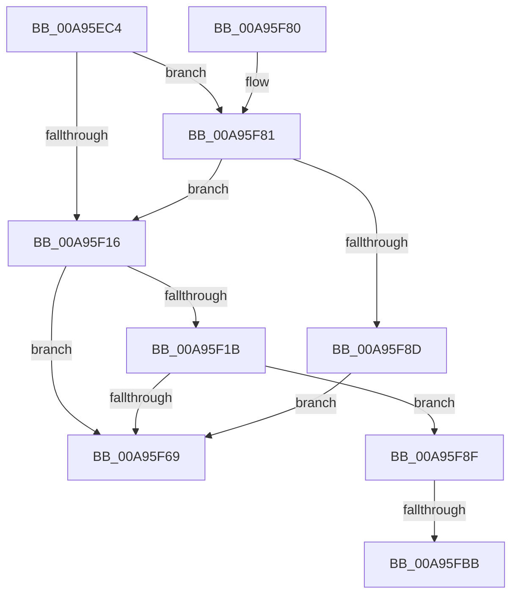

# MiExpandVadBitMapDown

- RVA: `0x00A95EC4`–`0x00A95FC7` (길이 `259` bytes)
- VA: `0x0000000140A95EC4`
- 실행 섹션: `PAGE`
- PDB 이름 있음: `예`; PDB Function 태그: `예`
- unwind 정보 RVA: `0x000B9974`
- 디코드: `67`개 명령, `259/259` bytes 표시
- 미해석 바이트: `0` (있으면 어셈블리에 `.byte`로 보존)

> 이 문서는 커널 이미지의 기계어와 PDB 기호를 분석해 생성했습니다. 4번과 5번은 함수 원형과 자료형을 바이너리 사용 방식에서 추정한 C 해석이며 원본 소스 복구 결과는 아닙니다.

## 1. Dependencies

- 직접 호출 지점: **1**; 고유 호출 대상: **1**
- 직접 호출자로 확인된 함수: **1**
- RIP 상대 이미지 참조: **1**

### Outgoing calls
- `0x00A95F60` → [MiMakeHyperRangeAccessible](../../text/27/MiMakeHyperRangeAccessible_function_0027CE10.md) (function, `0x0027CE10`)

### Direct callers
- [MiExpandVadBitMap](../88/MiExpandVadBitMap_function_00886574.md) at `0x00886748`

### Static image references
- `0x00A95EFE` → RVA `0x00E2F388` (`.data`; read)

## 2. Other-region calls and transfers

- 다른 실행 섹션으로 향하는 call: **1**
  - `0x00A95F60` → [MiMakeHyperRangeAccessible](../../text/27/MiMakeHyperRangeAccessible_function_0027CE10.md) (`PAGE` → `.text`)
- call이 아닌 외부 분기/꼬리 이동: **2**
  - `0x00A95FB5` → [sub_00B47882](../B4/Unknown_function_00B47882.md) (`tail-transfer`)
  - `0x00A95FC2` → [sub_00B47882 + 0x2](../B4/Unknown_function_00B47882.md) (`tail-transfer`)

## 3. Assembly (complete function range)

```asm
00A95EC4  48 8B C4                        mov rax, rsp
00A95EC7  48 89 58 10                     mov qword ptr [rax + 0x10], rbx
00A95ECB  48 89 68 18                     mov qword ptr [rax + 0x18], rbp
00A95ECF  48 89 70 20                     mov qword ptr [rax + 0x20], rsi
00A95ED3  57                              push rdi
00A95ED4  48 83 EC 20                     sub rsp, 0x20
00A95ED8  48 83 60 08 00                  and qword ptr [rax + 8], 0
00A95EDD  48 8B D9                        mov rbx, rcx
00A95EE0  65 48 8B 04 25 88 01 00 00      mov rax, qword ptr gs:[0x188]
00A95EE9  4C 8B 88 B8 00 00 00            mov r9, qword ptr [rax + 0xb8]
00A95EF0  49 8B A9 10 04 00 00            mov rbp, qword ptr [r9 + 0x410]
00A95EF7  4C 8B 49 08                     mov r9, qword ptr [rcx + 8]
00A95EFB  49 8B C1                        mov rax, r9
00A95EFE  48 2B 05 83 94 39 00            sub rax, qword ptr [rip + 0x399483]
00A95F05  48 C1 E0 13                     shl rax, 0x13
00A95F09  48 8B C8                        mov rcx, rax
00A95F0C  48 C1 E9 10                     shr rcx, 0x10
00A95F10  4C 3B 43 38                     cmp r8, qword ptr [rbx + 0x38]
00A95F14  77 6B                           ja 0x140a95f81
00A95F16  48 3B D1                        cmp rdx, rcx
00A95F19  77 4E                           ja 0x140a95f69
00A95F1B  F6 C2 3F                        test dl, 0x3f
00A95F1E  4C 8D 44 24 30                  lea r8, [rsp + 0x30]
00A95F23  B8 00 00 00 00                  mov eax, 0
00A95F28  BF 00 00 00 00                  mov edi, 0
00A95F2D  0F 95 C0                        setne al
00A95F30  49 8B F1                        mov rsi, r9
00A95F33  48 C1 EA 06                     shr rdx, 6
00A95F37  48 03 C2                        add rax, rdx
00A95F3A  49 8D 51 FF                     lea rdx, [r9 - 1]
00A95F3E  48 C1 E0 03                     shl rax, 3
00A95F42  48 A9 FF 0F 00 00               test rax, 0xfff
00A95F48  40 0F 95 C7                     setne dil
00A95F4C  48 C1 E8 0C                     shr rax, 0xc
00A95F50  48 03 F8                        add rdi, rax
00A95F53  48 8B C7                        mov rax, rdi
00A95F56  48 C1 E0 0C                     shl rax, 0xc
00A95F5A  48 2B F0                        sub rsi, rax
00A95F5D  48 8B CE                        mov rcx, rsi
00A95F60  E8 AB 6E 7E FF                  call 0x14027ce10
00A95F65  85 C0                           test eax, eax
00A95F67  79 26                           jns 0x140a95f8f
00A95F69  33 C0                           xor eax, eax
00A95F6B  48 8B 5C 24 38                  mov rbx, qword ptr [rsp + 0x38]
00A95F70  48 8B 6C 24 40                  mov rbp, qword ptr [rsp + 0x40]
00A95F75  48 8B 74 24 48                  mov rsi, qword ptr [rsp + 0x48]
00A95F7A  48 83 C4 20                     add rsp, 0x20
00A95F7E  5F                              pop rdi
00A95F7F  C3                              ret
00A95F80  CC                              int3
00A95F81  49 2B C0                        sub rax, r8
00A95F84  48 C1 E8 10                     shr rax, 0x10
00A95F88  48 3B D0                        cmp rdx, rax
00A95F8B  76 89                           jbe 0x140a95f16
00A95F8D  EB DA                           jmp 0x140a95f69
00A95F8F  48 8B 44 24 30                  mov rax, qword ptr [rsp + 0x30]
00A95F94  48 01 85 E0 03 00 00            add qword ptr [rbp + 0x3e0], rax
00A95F9B  48 8B C7                        mov rax, rdi
00A95F9E  48 C1 E0 0F                     shl rax, 0xf
00A95FA2  BD 01 00 00 00                  mov ebp, 1
00A95FA7  48 01 03                        add qword ptr [rbx], rax
00A95FAA  48 89 73 08                     mov qword ptr [rbx + 8], rsi
00A95FAE  48 3B 35 D3 93 39 00            cmp rsi, qword ptr [rip + 0x3993d3]
00A95FB5  0F 85 C7 18 0B 00               jne 0x140b47882
00A95FBB  48 0F BA 2E 00                  bts qword ptr [rsi], 0
00A95FC0  8B C5                           mov eax, ebp
00A95FC2  E9 BD 18 0B 00                  jmp 0x140b47884
```

## 4. C-style interpretation (structured pseudocode)

```c
__int64 __fastcall MiExpandVadBitMapDown(__int64 a1, __int64 a2, __int64 a3)
{
    __int64 result;
    __int64 v_rdi;
    __int64 v_rsi;
    __int64 v_rsp;
    unsigned __int64 v_stack_p10;
    unsigned __int64 v_stack_p18;
    unsigned __int64 v_stack_p20;
    unsigned __int64 v_stack_p30;
    unsigned __int64 v_stack_p8;

    *(unsigned __int64 *)(v_rsp + 16) = v_rbx;
    *(unsigned __int64 *)(v_rsp + 24) = v_rbp;
    *(unsigned __int64 *)(v_rsp + 32) = v_rsi;
    v_rsp = (v_rsp) - (32);
    result = (*(unsigned __int64 *)(a1 + 8)) - (*(unsigned __int64 *)(v_rip + 3773571));
    result = (result) << (19);
    a1 = (result) >> (16);
    if (a3 > (*(unsigned __int64 *)(a1 + 56))) goto loc_00A95F81;
loc_00A95F16:
    if (a2 > a1) goto loc_00A95F69;
    result = ((((unsigned __int8)(a2)) & (63)) != 0) ? 1 : 0;
    a2 = (a2) >> (6);
    result = (result) + (a2);
    result = (result) << (3);
    v_rdi = (((result) & (0xFFFULL)) != 0) ? 1 : 0;
    result = (result) >> (12);
    v_rdi = (v_rdi) + (result);
    result = (v_rdi) << (12);
    v_rsi = (*(unsigned __int64 *)(a1 + 8)) - (result);
    result = MiMakeHyperRangeAccessible(v_rsi, *(unsigned __int64 *)(a1 + 8) - 1, v_stack_p8, *(unsigned __int64 *)(a1 + 8));
    if (!sign_flag) goto loc_00A95F8F;
loc_00A95F69:
    result = 0;
    v_rsp = (v_rsp) + (32);
    return result;
loc_00A95F81:
    result = (result) - (v_stack_p8);
    result = (result) >> (16);
    if ((*(unsigned __int64 *)(a1 + 8) - 1) <= result) goto loc_00A95F16;
    goto loc_00A95F69;
loc_00A95F8F:
    result = (v_rdi) << (15);
    *(unsigned __int64 *)(v_stack_p10 + 8) = v_stack_p20;
}
```

## 5. (Beta) C Style

```c
int64_t MiExpandVadBitMapDown(void *Arg1, int64_t Arg2, int64_t Arg3)
{
    uint8_t *arg1 = (uint8_t *)Arg1;

    int64_t result;
    int64_t local_rdi;
    int64_t local_rsi;
    int64_t local_rsp;
    uint64_t v_stack_p10;
    uint64_t v_stack_p18;
    uint64_t v_stack_p20;
    uint64_t v_stack_p30;
    uint64_t v_stack_p8;

    *(uint64_t *)(local_rsp + 0x10) = local_rbx;
    *(uint64_t *)(local_rsp + 0x18) = local_rbp;
    *(uint64_t *)(local_rsp + 0x20) = local_rsi;
    local_rsp = (local_rsp) - (32);
    result = (*(uint64_t *)(arg1 + 0x8)) - (*(uint64_t *)(v_rip + 0x399483));
    result = (result) << (19);
    Arg1 = (result) >> (16);
    if (Arg3 > (*(uint64_t *)(arg1 + 0x38))) goto loc_00A95F81;
loc_00A95F16:
    if (Arg2 > Arg1) goto loc_00A95F69;
    result = ((((uint8_t)(Arg2)) & (63)) != 0) ? 1 : 0;
    Arg2 = (Arg2) >> (6);
    result = (result) + (Arg2);
    result = (result) << (3);
    local_rdi = (((result) & (0xFFFULL)) != 0) ? 1 : 0;
    result = (result) >> (12);
    local_rdi = (local_rdi) + (result);
    result = (local_rdi) << (12);
    local_rsi = (*(uint64_t *)(arg1 + 0x8)) - (result);
    result = MiMakeHyperRangeAccessible(local_rsi, *(uint64_t *)(arg1 + 0x8) - 1, v_stack_p8, *(uint64_t *)(arg1 + 0x8));
    if (!sign_flag) goto loc_00A95F8F;
loc_00A95F69:
    result = 0;
    local_rsp = (local_rsp) + (32);
    return result;
loc_00A95F81:
    result = (result) - (v_stack_p8);
    result = (result) >> (16);
    if ((*(uint64_t *)(arg1 + 0x8) - 1) <= result) goto loc_00A95F16;
    goto loc_00A95F69;
loc_00A95F8F:
    result = (local_rdi) << (15);
    *(uint64_t *)(v_stack_p10 + 0x8) = v_stack_p20;
}
```

### 관측된 메모리 오프셋

구조체 형식이 확인되지 않은 접근은 인자 기준의 오프셋으로만 기록했습니다.

| 기준 인자 | 오프셋 표현 | 폭 (bit) | 접근 |
|---|---:|---:|---|
| `Arg1` | `+ 0x0` | `64` | `R/W` |
| `Arg1` | `+ 0x8` | `64` | `R` |
| `Arg1` | `+ 0x8` | `64` | `W` |
| `Arg1` | `+ 0x38` | `64` | `R` |

## 6. Execution-region graph

[열기: 2D/3D 그래프와 함수 탐색 컨트롤 패널](../../../control-panel.html?section=page&rva=0x00A95EC4&view=graph)

- 2D 그래프는 위에서 아래로 흐르고, 3D 그래프는 빈 공간을 드래그해 회전합니다. Shift+드래그는 이동, 휠은 확대·축소, 함수 노드 선택은 대상 보고서 이동입니다.

### Static fallback


