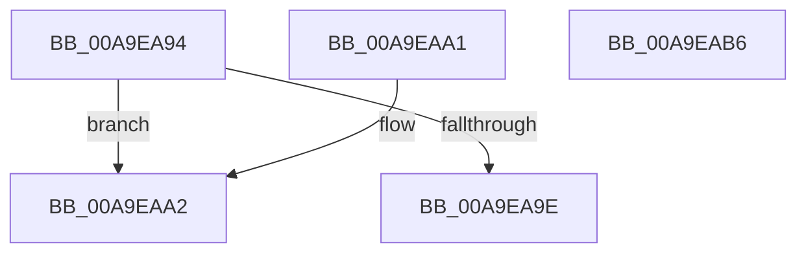

# MiImageCanUseHighOverflowArea

- RVA: `0x00A9EA94`–`0x00A9EAB7` (길이 `35` bytes)
- VA: `0x0000000140A9EA94`
- 실행 섹션: `PAGE`
- PDB 이름 있음: `예`; PDB Function 태그: `아니요`
- unwind 정보 RVA: `0x000DB714`
- 디코드: `12`개 명령, `35/35` bytes 표시
- 미해석 바이트: `0` (있으면 어셈블리에 `.byte`로 보존)

> 이 문서는 커널 이미지의 기계어와 PDB 기호를 분석해 생성했습니다. 4번과 5번은 함수 원형과 자료형을 바이너리 사용 방식에서 추정한 C 해석이며 원본 소스 복구 결과는 아닙니다.

## 1. Dependencies

- 직접 호출 지점: **0**; 고유 호출 대상: **0**
- 직접 호출자로 확인된 함수: **2**
- RIP 상대 이미지 참조: **0**

### Outgoing calls
- 직접 디코드된 call 명령이 없습니다.

### Direct callers
- [MiSelectImageBase](../98/MiSelectImageBase_function_009887B0.md) at `0x00988A95`
- [MiSelectOverflowDllBase](MiSelectOverflowDllBase_function_00A9E8E0.md) at `0x00A9E911`

### Static image references
- 디코드된 RIP-relative 메모리 참조가 없습니다.

## 2. Other-region calls and transfers

- 다른 실행 섹션으로 향하는 call: **0**
- 별도 외부 분기/꼬리 이동을 확인하지 못했습니다.

## 3. Assembly (complete function range)

```asm
00A9EA94  48 8B 41 38                     mov rax, qword ptr [rcx + 0x38]
00A9EA98  F6 40 2C 20                     test byte ptr [rax + 0x2c], 0x20
00A9EA9C  75 04                           jne 0x140a9eaa2
00A9EA9E  33 C0                           xor eax, eax
00A9EAA0  C3                              ret
00A9EAA1  CC                              int3
00A9EAA2  33 C0                           xor eax, eax
00A9EAA4  48 8D 8A 00 00 00 80            lea rcx, [rdx - 0x80000000]
00A9EAAB  48 81 F9 FF FF FF 7F            cmp rcx, 0x7fffffff
00A9EAB2  0F 96 C0                        setbe al
00A9EAB5  C3                              ret
00A9EAB6  CC                              int3
```

## 4. C-style interpretation (structured pseudocode)

```c
__int64 __fastcall MiImageCanUseHighOverflowArea(__int64 a1, __int64 a2)
{
    __int64 result;

    if (((*(unsigned __int8 *)(*(unsigned __int64 *)(a1 + 56) + 44)) & (32)) != 0) goto loc_00A9EAA2;
    result = 0;
    return result;
loc_00A9EAA2:
    result = 0;
    result = ((a2 - 2147483648) <= 0x7FFFFFFFULL) ? 1 : 0;
    return result;
}
```

## 5. (Beta) C Style

```c
int64_t MiImageCanUseHighOverflowArea(void *Arg1, void *Arg2)
{
    uint8_t *arg1 = (uint8_t *)Arg1;
    uint8_t *arg2 = (uint8_t *)Arg2;

    int64_t result;

    if (((*(uint8_t *)(*(uint64_t *)(arg1 + 0x38) + 0x2C)) & (32)) != 0) goto loc_00A9EAA2;
    result = 0;
    return result;
loc_00A9EAA2:
    result = 0;
    result = ((Arg2 - 2147483648) <= 0x7FFFFFFFULL) ? 1 : 0;
    return result;
}
```

### 관측된 메모리 오프셋

구조체 형식이 확인되지 않은 접근은 인자 기준의 오프셋으로만 기록했습니다.

| 기준 인자 | 오프셋 표현 | 폭 (bit) | 접근 |
|---|---:|---:|---|
| `Arg1` | `+ 0x38` | `64` | `R` |
| `Arg2` | `- 0x80000000` | `64` | `R` |

## 6. Execution-region graph

[열기: 2D/3D 그래프와 함수 탐색 컨트롤 패널](../../../control-panel.html?section=page&rva=0x00A9EA94&view=graph)

- 2D 그래프는 위에서 아래로 흐르고, 3D 그래프는 빈 공간을 드래그해 회전합니다. Shift+드래그는 이동, 휠은 확대·축소, 함수 노드 선택은 대상 보고서 이동입니다.

### Static fallback


