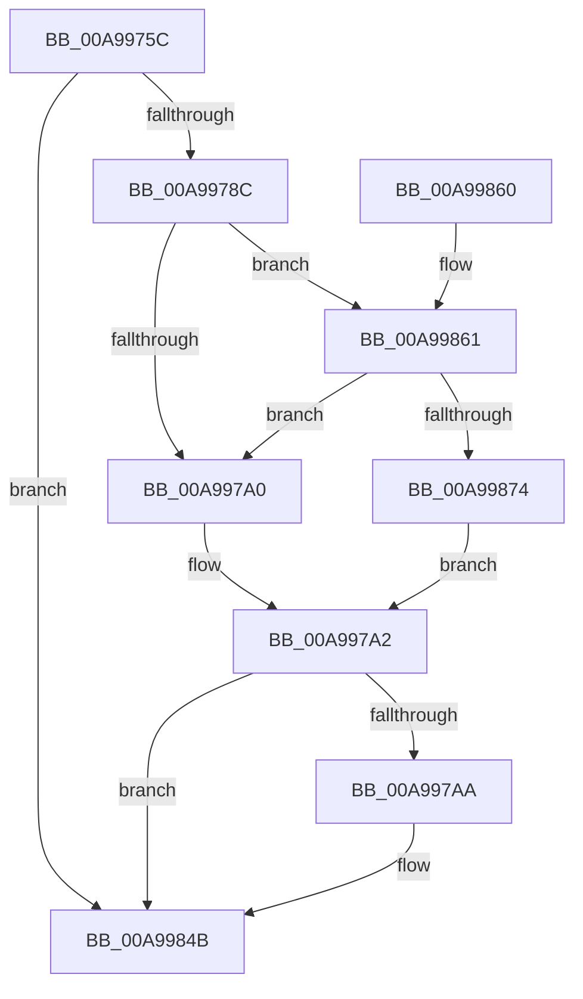

# MiLogNonRetpolineImageLoadEvent

- RVA: `0x00A9975C`–`0x00A9987B` (길이 `287` bytes)
- VA: `0x0000000140A9975C`
- 실행 섹션: `PAGE`
- PDB 이름 있음: `예`; PDB Function 태그: `아니요`
- unwind 정보 RVA: `0x000BA220`
- 디코드: `68`개 명령, `287/287` bytes 표시
- 미해석 바이트: `0` (있으면 어셈블리에 `.byte`로 보존)

> 이 문서는 커널 이미지의 기계어와 PDB 기호를 분석해 생성했습니다. 4번과 5번은 함수 원형과 자료형을 바이너리 사용 방식에서 추정한 C 해석이며 원본 소스 복구 결과는 아닙니다.

## 1. Dependencies

- 직접 호출 지점: **2**; 고유 호출 대상: **2**
- 직접 호출자로 확인된 함수: **2**
- RIP 상대 이미지 참조: **3**

### Outgoing calls
- `0x00A99846` → [tlgWriteAgg](../../text/2F/tlgWriteAgg_function_002F0F7C.md) (function, `0x002F0F7C`)
- `0x00A99852` → [_security_check_cookie](../../text/6A/_security_check_cookie_function_006AC640.md) (function, `0x006AC640`)

### Direct callers
- [MiFlushDeferredRetpolineImageLoadEvents](../80/MiFlushDeferredRetpolineImageLoadEvents_function_00801540.md) at `0x0080158F`
- [MiLogRetpolineImageLoadEvents](MiLogRetpolineImageLoadEvents_function_00A996F0.md) at `0x00A9971E`

### Static image references
- `0x00A9976A` → RVA `0x00E0A740` (`.data`; read)
- `0x00A99778` → RVA `0x00E37618` (`.data`; read)
- `0x00A99816` → RVA `0x00058571` (`.rdata`; read)

## 2. Other-region calls and transfers

- 다른 실행 섹션으로 향하는 call: **2**
  - `0x00A99846` → [tlgWriteAgg](../../text/2F/tlgWriteAgg_function_002F0F7C.md) (`PAGE` → `.text`)
  - `0x00A99852` → [_security_check_cookie](../../text/6A/_security_check_cookie_function_006AC640.md) (`PAGE` → `.text`)
- 별도 외부 분기/꼬리 이동을 확인하지 못했습니다.

## 3. Assembly (complete function range)

```asm
00A9975C  40 55                           push rbp
00A9975E  48 8D 6C 24 A9                  lea rbp, [rsp - 0x57]
00A99763  48 81 EC E0 00 00 00            sub rsp, 0xe0
00A9976A  48 8B 05 CF 0F 37 00            mov rax, qword ptr [rip + 0x370fcf]
00A99771  48 33 C4                        xor rax, rsp
00A99774  48 89 45 47                     mov qword ptr [rbp + 0x47], rax
00A99778  4C 8B 15 99 DE 39 00            mov r10, qword ptr [rip + 0x39de99]
00A9977F  4C 8B C9                        mov r9, rcx
00A99782  41 83 3A 05                     cmp dword ptr [r10], 5
00A99786  0F 86 BF 00 00 00               jbe 0x140a9984b
00A9978C  49 BB 00 00 00 00 00 40 00 00   movabs r11, 0x400000000000
00A99796  4D 85 5A 10                     test qword ptr [r10 + 0x10], r11
00A9979A  0F 85 C1 00 00 00               jne 0x140a99861
00A997A0  32 C0                           xor al, al
00A997A2  84 C0                           test al, al
00A997A4  0F 84 A1 00 00 00               je 0x140a9984b
00A997AA  83 65 F3 00                     and dword ptr [rbp - 0xd], 0
00A997AE  48 8D 45 AF                     lea rax, [rbp - 0x51]
00A997B2  83 65 03 00                     and dword ptr [rbp + 3], 0
00A997B6  41 BB 08 00 00 00               mov r11d, 8
00A997BC  83 65 13 00                     and dword ptr [rbp + 0x13], 0
00A997C0  83 65 23 00                     and dword ptr [rbp + 0x23], 0
00A997C4  83 65 33 00                     and dword ptr [rbp + 0x33], 0
00A997C8  83 65 43 00                     and dword ptr [rbp + 0x43], 0
00A997CC  41 8D 4B FC                     lea ecx, [r11 - 4]
00A997D0  48 89 45 E7                     mov qword ptr [rbp - 0x19], rax
00A997D4  48 8D 45 0F                     lea rax, [rbp + 0xf]
00A997D8  48 89 45 F7                     mov qword ptr [rbp - 9], rax
00A997DC  49 8B 41 08                     mov rax, qword ptr [r9 + 8]
00A997E0  48 89 45 07                     mov qword ptr [rbp + 7], rax
00A997E4  41 0F B7 01                     movzx eax, word ptr [r9]
00A997E8  45 8B CB                        mov r9d, r11d
00A997EB  89 45 0F                        mov dword ptr [rbp + 0xf], eax
00A997EE  48 8D 45 A7                     lea rax, [rbp - 0x59]
00A997F2  48 89 45 17                     mov qword ptr [rbp + 0x17], rax
00A997F6  48 8D 45 AB                     lea rax, [rbp - 0x55]
00A997FA  48 89 45 27                     mov qword ptr [rbp + 0x27], rax
00A997FE  B8 00 00 00 81                  mov eax, 0x81000000
00A99803  48 89 45 B7                     mov qword ptr [rbp - 0x49], rax
00A99807  48 8D 45 B7                     lea rax, [rbp - 0x49]
00A9980B  48 89 45 37                     mov qword ptr [rbp + 0x37], rax
00A9980F  48 8D 45 C7                     lea rax, [rbp - 0x39]
00A99813  89 55 A7                        mov dword ptr [rbp - 0x59], edx
00A99816  48 8D 15 54 ED 5B FF            lea rdx, [rip - 0xa412ac]
00A9981D  89 4D 1F                        mov dword ptr [rbp + 0x1f], ecx
00A99820  89 4D 2F                        mov dword ptr [rbp + 0x2f], ecx
00A99823  49 8B CA                        mov rcx, r10
00A99826  48 89 44 24 20                  mov qword ptr [rsp + 0x20], rax
00A9982B  48 C7 45 AF 01 00 00 00         mov qword ptr [rbp - 0x51], 1
00A99833  44 89 5D EF                     mov dword ptr [rbp - 0x11], r11d
00A99837  C7 45 FF 02 00 00 00            mov dword ptr [rbp - 1], 2
00A9983E  44 89 45 AB                     mov dword ptr [rbp - 0x55], r8d
00A99842  44 89 5D 3F                     mov dword ptr [rbp + 0x3f], r11d
00A99846  E8 31 77 85 FF                  call 0x1402f0f7c
00A9984B  48 8B 4D 47                     mov rcx, qword ptr [rbp + 0x47]
00A9984F  48 33 CC                        xor rcx, rsp
00A99852  E8 E9 2D C1 FF                  call 0x1406ac640
00A99857  48 81 C4 E0 00 00 00            add rsp, 0xe0
00A9985E  5D                              pop rbp
00A9985F  C3                              ret
00A99860  CC                              int3
00A99861  49 8B 4A 18                     mov rcx, qword ptr [r10 + 0x18]
00A99865  48 8B C1                        mov rax, rcx
00A99868  49 23 C3                        and rax, r11
00A9986B  48 3B C1                        cmp rax, rcx
00A9986E  0F 85 2C FF FF FF               jne 0x140a997a0
00A99874  B0 01                           mov al, 1
00A99876  E9 27 FF FF FF                  jmp 0x140a997a2
```

## 4. C-style interpretation (structured pseudocode)

```c
__int64 __fastcall MiLogNonRetpolineImageLoadEvent(__int64 a1, int a2, int a3)
{
    __int64 result;
    __int64 v_r11;
    __int64 v_rsp;
    unsigned __int64 v_stack_m18;
    unsigned int v_stack_m1C;
    unsigned int v_stack_m20;
    unsigned __int64 v_stack_m28;
    unsigned int v_stack_m2C;
    unsigned int v_stack_m30;
    unsigned __int64 v_stack_m38;
    unsigned int v_stack_m3C;
    unsigned int v_stack_m40;
    unsigned __int64 v_stack_m48;
    unsigned int v_stack_m4C;
    unsigned __int64 v_stack_m50;
    unsigned __int64 v_stack_m58;
    unsigned int v_stack_m5C;
    unsigned __int64 v_stack_m5F;
    unsigned int v_stack_m60;
    unsigned __int64 v_stack_m68;
    unsigned int v_stack_m6C;
    unsigned int v_stack_m70;
    unsigned __int64 v_stack_m78;
    unsigned __int64 v_stack_m98;
    unsigned __int64 v_stack_mA8;
    unsigned __int64 v_stack_mB0;
    unsigned __int64 v_stack_mB4;
    unsigned __int64 v_stack_mB8;
    unsigned __int64 v_stack_mC8;

    v_rsp = (v_rsp) - (224);
    result = (*(unsigned __int64 *)(v_rip + 3608527)) ^ (v_rsp);
    v_stack_m18 = result;
    if ((*(unsigned int *)(*(unsigned __int64 *)(v_rip + 3792537))) <= 5) goto loc_00A9984B;
    if (((*(unsigned __int64 *)(*(unsigned __int64 *)(v_rip + 3792537) + 16)) & (v_r11)) != 0) goto loc_00A99861;
loc_00A997A0:
    result = 0;
loc_00A997A2:
    if (0 != 0) {
        result = v_stack_mB0;
        v_r11 = 8;
        a1 = v_r11 - 4;
        v_stack_m78 = result;
        result = v_stack_m50;
        v_stack_m68 = result;
        result = *(unsigned __int64 *)(a1 + 8);
        v_stack_m58 = result;
        result = *(unsigned __int16 *)(a1);
        a4 = (unsigned int)(v_r11);
        v_stack_m50 = (unsigned int)(result);
        result = v_stack_mB8;
        v_stack_m48 = result;
        result = v_stack_mB4;
        v_stack_m38 = result;
        result = 0x81000000ULL;
        v_stack_mA8 = result;
        result = v_stack_mA8;
        v_stack_m28 = result;
        result = v_stack_m98;
        v_stack_mB8 = a2;
        a2 = v_rip - 10752684;
        v_stack_m40 = (unsigned int)(a1);
        v_stack_m30 = (unsigned int)(a1);
        a1 = *(unsigned __int64 *)(v_rip + 3792537);
        v_stack_mC8 = result;
        v_stack_mB0 = 1;
        v_stack_m70 = (unsigned int)(v_r11);
        v_stack_m60 = 2;
        v_stack_mB4 = a3;
        v_stack_m20 = (unsigned int)(v_r11);
        result = tlgWriteAgg(a1, a2, a3, a4);
    }
    a1 = (v_stack_m18) ^ (v_rsp);
    result = _security_check_cookie(a1, a2, a3, a4);
    v_rsp = (v_rsp) + (224);
    return result;
loc_00A99861:
    result = (*(unsigned __int64 *)(*(unsigned __int64 *)(v_rip + 3792537) + 24)) & (v_r11);
    if (result != (*(unsigned __int64 *)(*(unsigned __int64 *)(v_rip + 3792537) + 24))) goto loc_00A997A0;
    goto loc_00A997A2;
}
```

## 5. (Beta) C Style

```c
int64_t MiLogNonRetpolineImageLoadEvent(void *Arg1, int32_t Arg2, int32_t Arg3)
{
    uint8_t *arg1 = (uint8_t *)Arg1;

    int64_t result;
    int64_t local_r11;
    int64_t local_rsp;
    uint64_t v_stack_m18;
    uint32_t v_stack_m1C;
    uint32_t v_stack_m20;
    uint64_t v_stack_m28;
    uint32_t v_stack_m2C;
    uint32_t v_stack_m30;
    uint64_t v_stack_m38;
    uint32_t v_stack_m3C;
    uint32_t v_stack_m40;
    uint64_t v_stack_m48;
    uint32_t v_stack_m4C;
    uint64_t v_stack_m50;
    uint64_t v_stack_m58;
    uint32_t v_stack_m5C;
    uint64_t v_stack_m5F;
    uint32_t v_stack_m60;
    uint64_t v_stack_m68;
    uint32_t v_stack_m6C;
    uint32_t v_stack_m70;
    uint64_t v_stack_m78;
    uint64_t v_stack_m98;
    uint64_t v_stack_mA8;
    uint64_t v_stack_mB0;
    uint64_t v_stack_mB4;
    uint64_t v_stack_mB8;
    uint64_t v_stack_mC8;

    local_rsp = (local_rsp) - (224);
    result = (*(uint64_t *)(v_rip + 0x370FCF)) ^ (local_rsp);
    v_stack_m18 = result;
    if ((*(uint32_t *)(*(uint64_t *)(v_rip + 0x39DE99))) <= 5) goto loc_00A9984B;
    if (((*(uint64_t *)(*(uint64_t *)(v_rip + 0x39DE99) + 0x10)) & (local_r11)) != 0) goto loc_00A99861;
loc_00A997A0:
    result = 0;
loc_00A997A2:
    if (0 != 0) {
        result = v_stack_mB0;
        local_r11 = 8;
        Arg1 = local_r11 - 4;
        v_stack_m78 = result;
        result = v_stack_m50;
        v_stack_m68 = result;
        result = *(uint64_t *)(arg1 + 0x8);
        v_stack_m58 = result;
        result = *(uint16_t *)(arg1);
        a4 = (uint32_t)(local_r11);
        v_stack_m50 = (uint32_t)(result);
        result = v_stack_mB8;
        v_stack_m48 = result;
        result = v_stack_mB4;
        v_stack_m38 = result;
        result = 0x81000000ULL;
        v_stack_mA8 = result;
        result = v_stack_mA8;
        v_stack_m28 = result;
        result = v_stack_m98;
        v_stack_mB8 = Arg2;
        Arg2 = v_rip - 10752684;
        v_stack_m40 = (uint32_t)(Arg1);
        v_stack_m30 = (uint32_t)(Arg1);
        Arg1 = *(uint64_t *)(v_rip + 0x39DE99);
        v_stack_mC8 = result;
        v_stack_mB0 = 1;
        v_stack_m70 = (uint32_t)(local_r11);
        v_stack_m60 = 2;
        v_stack_mB4 = Arg3;
        v_stack_m20 = (uint32_t)(local_r11);
        result = tlgWriteAgg(Arg1, Arg2, Arg3, a4);
    }
    Arg1 = (v_stack_m18) ^ (local_rsp);
    result = _security_check_cookie(Arg1, Arg2, Arg3, a4);
    local_rsp = (local_rsp) + (224);
    return result;
loc_00A99861:
    result = (*(uint64_t *)(*(uint64_t *)(v_rip + 0x39DE99) + 0x18)) & (local_r11);
    if (result != (*(uint64_t *)(*(uint64_t *)(v_rip + 0x39DE99) + 0x18))) goto loc_00A997A0;
    goto loc_00A997A2;
}
```

### 관측된 메모리 오프셋

구조체 형식이 확인되지 않은 접근은 인자 기준의 오프셋으로만 기록했습니다.

| 기준 인자 | 오프셋 표현 | 폭 (bit) | 접근 |
|---|---:|---:|---|
| `Arg1` | `+ 0x0` | `16` | `R` |
| `Arg1` | `+ 0x8` | `64` | `R` |

## 6. Execution-region graph

[열기: 2D/3D 그래프와 함수 탐색 컨트롤 패널](../../../control-panel.html?section=page&rva=0x00A9975C&view=graph)

- 2D 그래프는 위에서 아래로 흐르고, 3D 그래프는 빈 공간을 드래그해 회전합니다. Shift+드래그는 이동, 휠은 확대·축소, 함수 노드 선택은 대상 보고서 이동입니다.

### Static fallback


