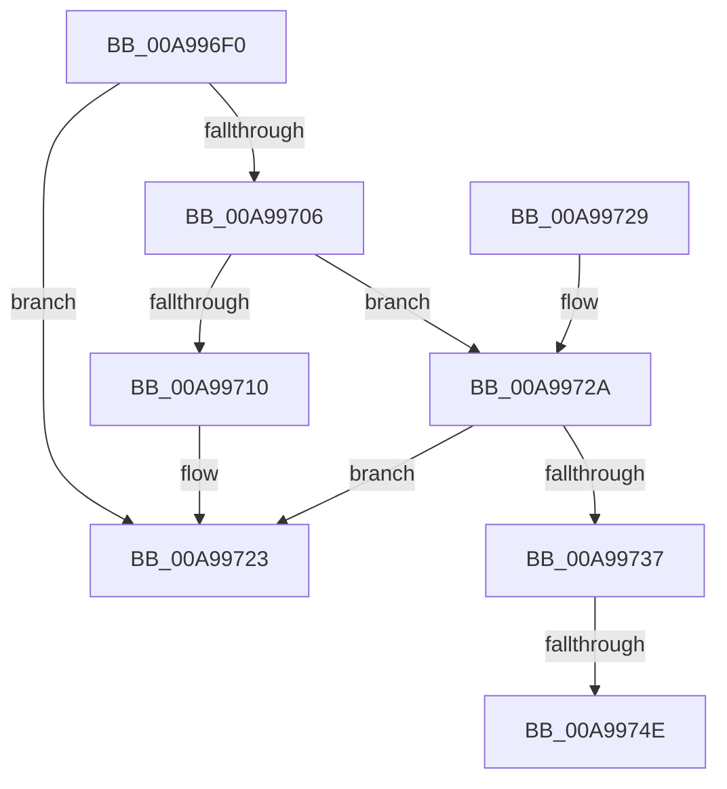

# MiLogRetpolineImageLoadEvents

- RVA: `0x00A996F0`–`0x00A99755` (길이 `101` bytes)
- VA: `0x0000000140A996F0`
- 실행 섹션: `PAGE`
- PDB 이름 있음: `예`; PDB Function 태그: `예`
- unwind 정보 RVA: `0x000AD3D0`
- 디코드: `27`개 명령, `101/101` bytes 표시
- 미해석 바이트: `0` (있으면 어셈블리에 `.byte`로 보존)

> 이 문서는 커널 이미지의 기계어와 PDB 기호를 분석해 생성했습니다. 4번과 5번은 함수 원형과 자료형을 바이너리 사용 방식에서 추정한 C 해석이며 원본 소스 복구 결과는 아닙니다.

## 1. Dependencies

- 직접 호출 지점: **3**; 고유 호출 대상: **3**
- 직접 호출자로 확인된 함수: **2**
- RIP 상대 이미지 참조: **3**

### Outgoing calls
- `0x00A996FD` → [RtlIsImageFullyRetpolined](../../text/4C/RtlIsImageFullyRetpolined_function_004CDE74.md) (function, `0x004CDE74`)
- `0x00A9971E` → [MiLogNonRetpolineImageLoadEvent](MiLogNonRetpolineImageLoadEvent_function_00A9975C.md) (function, `0x00A9975C`)
- `0x00A9972D` → [MiConstructNonRetpolineImageLoadRecord](../80/MiConstructNonRetpolineImageLoadRecord_function_008014C0.md) (function, `0x008014C0`)

### Direct callers
- [MiFinalizeKernelScpForSystemImage](../AA/MiFinalizeKernelScpForSystemImage_function_00AA02F8.md) at `0x00AA0339`
- [MiApplyRetpolineToBootDriver](../../init/C6/MiApplyRetpolineToBootDriver_function_00C66264.md) at `0x00C662B5`

### Static image references
- `0x00A99706` → RVA `0x00E37618` (`.data`; read)
- `0x00A99737` → RVA `0x00E2D870` (`.data`; read)
- `0x00A9973E` → RVA `0x00E2D868` (`.data`; read)

## 2. Other-region calls and transfers

- 다른 실행 섹션으로 향하는 call: **1**
  - `0x00A996FD` → [RtlIsImageFullyRetpolined](../../text/4C/RtlIsImageFullyRetpolined_function_004CDE74.md) (`PAGE` → `.text`)
- call이 아닌 외부 분기/꼬리 이동: **1**
  - `0x00A99748` → [sub_00B48112](../B4/Unknown_function_00B48112.md) (`tail-transfer`)

## 3. Assembly (complete function range)

```asm
00A996F0  40 53                           push rbx
00A996F2  48 83 EC 20                     sub rsp, 0x20
00A996F6  48 8B D9                        mov rbx, rcx
00A996F9  48 8B 49 30                     mov rcx, qword ptr [rcx + 0x30]
00A996FD  E8 72 47 A3 FF                  call 0x1404cde74
00A99702  85 C0                           test eax, eax
00A99704  75 1D                           jne 0x140a99723
00A99706  48 83 3D 0A DF 39 00 00         cmp qword ptr [rip + 0x39df0a], 0
00A9970E  74 1A                           je 0x140a9972a
00A99710  44 8B 83 9C 00 00 00            mov r8d, dword ptr [rbx + 0x9c]
00A99717  48 8D 4B 58                     lea rcx, [rbx + 0x58]
00A9971B  8B 53 78                        mov edx, dword ptr [rbx + 0x78]
00A9971E  E8 39 00 00 00                  call 0x140a9975c
00A99723  48 83 C4 20                     add rsp, 0x20
00A99727  5B                              pop rbx
00A99728  C3                              ret
00A99729  CC                              int3
00A9972A  48 8B CB                        mov rcx, rbx
00A9972D  E8 8E 7D D6 FF                  call 0x1408014c0
00A99732  48 85 C0                        test rax, rax
00A99735  74 EC                           je 0x140a99723
00A99737  48 8B 0D 32 41 39 00            mov rcx, qword ptr [rip + 0x394132]
00A9973E  48 8D 15 23 41 39 00            lea rdx, [rip + 0x394123]
00A99745  48 39 11                        cmp qword ptr [rcx], rdx
00A99748  0F 84 C4 E9 0A 00               je 0x140b48112
00A9974E  B9 03 00 00 00                  mov ecx, 3
00A99753  CD 29                           int 0x29
```

## 4. C-style interpretation (structured pseudocode)

```c
__int64 __fastcall MiLogRetpolineImageLoadEvents(__int64 a1)
{
    __int64 result;
    __int64 v_rsp;

    v_rsp = (v_rsp) - (32);
    result = RtlIsImageFullyRetpolined(*(unsigned __int64 *)(a1 + 48), a2, a3, a4);
    if ((unsigned int)(result) != 0) goto loc_00A99723;
    if ((*(unsigned __int64 *)(v_rip + 3792650)) == 0) goto loc_00A9972A;
    result = MiLogNonRetpolineImageLoadEvent(a1 + 88, (unsigned int)(*(unsigned int *)(a1 + 120)), (unsigned int)(*(unsigned int *)(a1 + 156)), a4);
loc_00A99723:
    v_rsp = (v_rsp) + (32);
    return result;
loc_00A9972A:
    result = MiConstructNonRetpolineImageLoadRecord(a1, (unsigned int)(*(unsigned int *)(a1 + 120)), (unsigned int)(*(unsigned int *)(a1 + 156)), a4);
    if (result == 0) goto loc_00A99723;
    return result;
}
```

## 5. (Beta) C Style

```c
int64_t MiLogRetpolineImageLoadEvents(void *Arg1)
{
    uint8_t *arg1 = (uint8_t *)Arg1;

    int64_t result;
    int64_t local_rsp;

    local_rsp = (local_rsp) - (32);
    result = RtlIsImageFullyRetpolined(*(uint64_t *)(arg1 + 0x30), a2, a3, a4);
    if ((uint32_t)(result) != 0) goto loc_00A99723;
    if ((*(uint64_t *)(v_rip + 0x39DF0A)) == 0) goto loc_00A9972A;
    result = MiLogNonRetpolineImageLoadEvent(Arg1 + 88, (uint32_t)(*(uint32_t *)(arg1 + 0x78)), (uint32_t)(*(uint32_t *)(arg1 + 0x9C)), a4);
loc_00A99723:
    local_rsp = (local_rsp) + (32);
    return result;
loc_00A9972A:
    result = MiConstructNonRetpolineImageLoadRecord(Arg1, (uint32_t)(*(uint32_t *)(arg1 + 0x78)), (uint32_t)(*(uint32_t *)(arg1 + 0x9C)), a4);
    if (result == 0) goto loc_00A99723;
    return result;
}
```

### 관측된 메모리 오프셋

구조체 형식이 확인되지 않은 접근은 인자 기준의 오프셋으로만 기록했습니다.

| 기준 인자 | 오프셋 표현 | 폭 (bit) | 접근 |
|---|---:|---:|---|
| `Arg1` | `+ 0x30` | `64` | `R` |
| `Arg1` | `+ 0x58` | `64` | `R` |
| `Arg1` | `+ 0x78` | `32` | `R` |
| `Arg1` | `+ 0x9C` | `32` | `R` |

## 6. Execution-region graph

[열기: 2D/3D 그래프와 함수 탐색 컨트롤 패널](../../../control-panel.html?section=page&rva=0x00A996F0&view=graph)

- 2D 그래프는 위에서 아래로 흐르고, 3D 그래프는 빈 공간을 드래그해 회전합니다. Shift+드래그는 이동, 휠은 확대·축소, 함수 노드 선택은 대상 보고서 이동입니다.

### Static fallback


