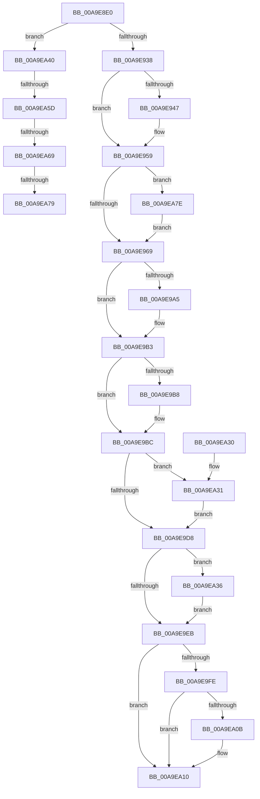

# MiSelectOverflowDllBase

- RVA: `0x00A9E8E0`–`0x00A9EA8B` (길이 `427` bytes)
- VA: `0x0000000140A9E8E0`
- 실행 섹션: `PAGE`
- PDB 이름 있음: `예`; PDB Function 태그: `예`
- unwind 정보 RVA: `0x000BA930`
- 디코드: `114`개 명령, `427/427` bytes 표시
- 미해석 바이트: `0` (있으면 어셈블리에 `.byte`로 보존)

> 이 문서는 커널 이미지의 기계어와 PDB 기호를 분석해 생성했습니다. 4번과 5번은 함수 원형과 자료형을 바이너리 사용 방식에서 추정한 C 해석이며 원본 소스 복구 결과는 아닙니다.

## 1. Dependencies

- 직접 호출 지점: **7**; 고유 호출 대상: **7**
- 직접 호출자로 확인된 함수: **1**
- RIP 상대 이미지 참조: **4**

### Outgoing calls
- `0x00A9E911` → [MiImageCanUseHighOverflowArea](MiImageCanUseHighOverflowArea_function_00A9EA94.md) (function, `0x00A9EA94`)
- `0x00A9E994` → [KeAbPreAcquire](../../text/21/KeAbPreAcquire_function_00210230.md) (function, `0x00210230`)
- `0x00A9E9AE` → [ExfAcquirePushLockExclusiveEx](../../text/20/ExfAcquirePushLockExclusiveEx_function_0020FC90.md) (function, `0x0020FC90`)
- `0x00A9E9EE` → [KeAbPostRelease](../../text/2E/KeAbPostRelease_function_002E1600.md) (function, `0x002E1600`)
- `0x00A9EA0B` → [KiCheckForKernelApcDelivery](../../text/2E/KiCheckForKernelApcDelivery_function_002E2C80.md) (function, `0x002E2C80`)
- `0x00A9EA39` → [ExfTryToWakePushLock](../../text/26/ExfTryToWakePushLock_function_00265DD0.md) (function, `0x00265DD0`)
- `0x00A9EA45` → [ExGenRandom](../../text/41/ExGenRandom_function_0041B010.md) (function, `0x0041B010`)

### Direct callers
- [sub_00B2B51A](../B2/Unknown_function_00B2B51A.md) at `0x00B2B6BE`

### Static image references
- `0x00A9E93C` → RVA `0x00E2D748` (`.data`; read)
- `0x00A9E94F` → RVA `0x00E2D778` (`.data`; read)
- `0x00A9E97C` → RVA `0x00E2D728` (`.data`; read)
- `0x00A9E9DC` → RVA `0x00E2D728` (`.data`; read/write)

## 2. Other-region calls and transfers

- 다른 실행 섹션으로 향하는 call: **6**
  - `0x00A9E994` → [KeAbPreAcquire](../../text/21/KeAbPreAcquire_function_00210230.md) (`PAGE` → `.text`)
  - `0x00A9E9AE` → [ExfAcquirePushLockExclusiveEx](../../text/20/ExfAcquirePushLockExclusiveEx_function_0020FC90.md) (`PAGE` → `.text`)
  - `0x00A9E9EE` → [KeAbPostRelease](../../text/2E/KeAbPostRelease_function_002E1600.md) (`PAGE` → `.text`)
  - `0x00A9EA0B` → [KiCheckForKernelApcDelivery](../../text/2E/KiCheckForKernelApcDelivery_function_002E2C80.md) (`PAGE` → `.text`)
  - `0x00A9EA39` → [ExfTryToWakePushLock](../../text/26/ExfTryToWakePushLock_function_00265DD0.md) (`PAGE` → `.text`)
  - `0x00A9EA45` → [ExGenRandom](../../text/41/ExGenRandom_function_0041B010.md) (`PAGE` → `.text`)
- call이 아닌 외부 분기/꼬리 이동: **4**
  - `0x00A9EA57` → [sub_00B491CE + 0x24](../B4/Unknown_function_00B491CE.md) (`tail-transfer`)
  - `0x00A9EA63` → [sub_00B491CE](../B4/Unknown_function_00B491CE.md) (`tail-transfer`)
  - `0x00A9EA73` → [sub_00B491CE](../B4/Unknown_function_00B491CE.md) (`tail-transfer`)
  - `0x00A9EA79` → [sub_00B491CE + 0x24](../B4/Unknown_function_00B491CE.md) (`tail-transfer`)

## 3. Assembly (complete function range)

```asm
00A9E8E0  48 89 5C 24 08                  mov qword ptr [rsp + 8], rbx
00A9E8E5  48 89 6C 24 10                  mov qword ptr [rsp + 0x10], rbp
00A9E8EA  48 89 74 24 18                  mov qword ptr [rsp + 0x18], rsi
00A9E8EF  57                              push rdi
00A9E8F0  41 54                           push r12
00A9E8F2  41 55                           push r13
00A9E8F4  41 56                           push r14
00A9E8F6  41 57                           push r15
00A9E8F8  48 83 EC 20                     sub rsp, 0x20
00A9E8FC  8B 79 08                        mov edi, dword ptr [rcx + 8]
00A9E8FF  48 8B DA                        mov rbx, rdx
00A9E902  C1 E7 0C                        shl edi, 0xc
00A9E905  81 C7 FF FF 00 00               add edi, 0xffff
00A9E90B  81 E7 00 00 FF FF               and edi, 0xffff0000
00A9E911  E8 7E 01 00 00                  call 0x140a9ea94
00A9E916  8B C8                           mov ecx, eax
00A9E918  8B F7                           mov esi, edi
00A9E91A  F7 D9                           neg ecx
00A9E91C  44 8B C8                        mov r9d, eax
00A9E91F  48 1B D2                        sbb rdx, rdx
00A9E922  81 E2 00 00 00 0C               and edx, 0xc000000
00A9E928  48 81 C2 00 00 00 04            add rdx, 0x4000000
00A9E92F  48 3B F2                        cmp rsi, rdx
00A9E932  0F 87 08 01 00 00               ja 0x140a9ea40
00A9E938  41 8D 40 FD                     lea eax, [r8 - 3]
00A9E93C  48 8D 0D 05 EE 38 00            lea rcx, [rip + 0x38ee05]
00A9E943  85 C0                           test eax, eax
00A9E945  75 12                           jne 0x140a9e959
00A9E947  41 8D 48 FD                     lea ecx, [r8 - 3]
00A9E94B  48 C1 E1 06                     shl rcx, 6
00A9E94F  48 8D 05 22 EE 38 00            lea rax, [rip + 0x38ee22]
00A9E956  48 03 C8                        add rcx, rax
00A9E959  48 8B 29                        mov rbp, qword ptr [rcx]
00A9E95C  48 8D 79 08                     lea rdi, [rcx + 8]
00A9E960  45 85 C9                        test r9d, r9d
00A9E963  0F 85 15 01 00 00               jne 0x140a9ea7e
00A9E969  65 4C 8B 3C 25 88 01 00 00      mov r15, qword ptr gs:[0x188]
00A9E972  4C 8D 24 2A                     lea r12, [rdx + rbp]
00A9E976  41 BE 01 00 00 00               mov r14d, 1
00A9E97C  4C 8D 2D A5 ED 38 00            lea r13, [rip + 0x38eda5]
00A9E983  45 33 C0                        xor r8d, r8d
00A9E986  33 D2                           xor edx, edx
00A9E988  49 8B CD                        mov rcx, r13
00A9E98B  66 45 29 B7 E6 01 00 00         sub word ptr [r15 + 0x1e6], r14w
00A9E993  90                              nop
00A9E994  E8 97 18 77 FF                  call 0x140210230
00A9E999  F0 49 0F BA 6D 00 00            lock bts qword ptr [r13], 0
00A9E9A0  48 8B D8                        mov rbx, rax
00A9E9A3  73 0E                           jae 0x140a9e9b3
00A9E9A5  4D 8B C5                        mov r8, r13
00A9E9A8  48 8B D0                        mov rdx, rax
00A9E9AB  49 8B CD                        mov rcx, r13
00A9E9AE  E8 DD 12 77 FF                  call 0x14020fc90
00A9E9B3  48 85 DB                        test rbx, rbx
00A9E9B6  74 04                           je 0x140a9e9bc
00A9E9B8  44 88 73 0A                     mov byte ptr [rbx + 0xa], r14b
00A9E9BC  48 8B 1F                        mov rbx, qword ptr [rdi]
00A9E9BF  49 8B C4                        mov rax, r12
00A9E9C2  48 2B C3                        sub rax, rbx
00A9E9C5  48 3B F0                        cmp rsi, rax
00A9E9C8  48 0F 47 DD                     cmova rbx, rbp
00A9E9CC  48 8D 04 1E                     lea rax, [rsi + rbx]
00A9E9D0  48 89 07                        mov qword ptr [rdi], rax
00A9E9D3  49 3B C4                        cmp rax, r12
00A9E9D6  74 59                           je 0x140a9ea31
00A9E9D8  48 83 C8 FF                     or rax, 0xffffffffffffffff
00A9E9DC  F0 48 0F C1 05 43 ED 38 00      lock xadd qword ptr [rip + 0x38ed43], rax
00A9E9E5  24 06                           and al, 6
00A9E9E7  3C 02                           cmp al, 2
00A9E9E9  74 4B                           je 0x140a9ea36
00A9E9EB  49 8B CD                        mov rcx, r13
00A9E9EE  E8 0D 2C 84 FF                  call 0x1402e1600
00A9E9F3  90                              nop
00A9E9F4  66 45 01 B7 E6 01 00 00         add word ptr [r15 + 0x1e6], r14w
00A9E9FC  75 12                           jne 0x140a9ea10
00A9E9FE  49 8D 8F 98 00 00 00            lea rcx, [r15 + 0x98]
00A9EA05  90                              nop
00A9EA06  48 39 09                        cmp qword ptr [rcx], rcx
00A9EA09  74 05                           je 0x140a9ea10
00A9EA0B  E8 70 42 84 FF                  call 0x1402e2c80
00A9EA10  48 8B C3                        mov rax, rbx
00A9EA13  48 8B 5C 24 50                  mov rbx, qword ptr [rsp + 0x50]
00A9EA18  48 8B 6C 24 58                  mov rbp, qword ptr [rsp + 0x58]
00A9EA1D  48 8B 74 24 60                  mov rsi, qword ptr [rsp + 0x60]
00A9EA22  48 83 C4 20                     add rsp, 0x20
00A9EA26  41 5F                           pop r15
00A9EA28  41 5E                           pop r14
00A9EA2A  41 5D                           pop r13
00A9EA2C  41 5C                           pop r12
00A9EA2E  5F                              pop rdi
00A9EA2F  C3                              ret
00A9EA30  CC                              int3
00A9EA31  48 89 2F                        mov qword ptr [rdi], rbp
00A9EA34  EB A2                           jmp 0x140a9e9d8
00A9EA36  49 8B CD                        mov rcx, r13
00A9EA39  E8 92 73 7C FF                  call 0x140265dd0
00A9EA3E  EB AB                           jmp 0x140a9e9eb
00A9EA40  B9 01 00 00 00                  mov ecx, 1
00A9EA45  E8 C6 C5 97 FF                  call 0x14041b010
00A9EA4A  0F B6 C8                        movzx ecx, al
00A9EA4D  C1 E1 10                        shl ecx, 0x10
00A9EA50  48 81 FB 00 00 01 01            cmp rbx, 0x1010000
00A9EA57  0F 82 95 A7 0A 00               jb 0x140b491f2
00A9EA5D  48 8D 57 FF                     lea rdx, [rdi - 1]
00A9EA61  85 FF                           test edi, edi
00A9EA63  0F 84 65 A7 0A 00               je 0x140b491ce
00A9EA69  48 8D 43 FF                     lea rax, [rbx - 1]
00A9EA6D  48 03 C6                        add rax, rsi
00A9EA70  48 3B C3                        cmp rax, rbx
00A9EA73  0F 83 55 A7 0A 00               jae 0x140b491ce
00A9EA79  E9 74 A7 0A 00                  jmp 0x140b491f2
00A9EA7E  48 8B 69 10                     mov rbp, qword ptr [rcx + 0x10]
00A9EA82  48 8D 79 18                     lea rdi, [rcx + 0x18]
00A9EA86  E9 DE FE FF FF                  jmp 0x140a9e969
```

## 4. C-style interpretation (structured pseudocode)

```c
__int64 __fastcall MiSelectOverflowDllBase(__int64 a1, __int64 a2, __int64 a3)
{
    __int64 result;
    __int64 v_rbx;
    __int64 v_rdi;
    __int64 v_rsp;
    unsigned __int64 v_stack_p10;
    unsigned __int64 v_stack_p18;
    unsigned __int64 v_stack_p8;

    v_stack_p8 = v_rbx;
    v_stack_p10 = v_rbp;
    v_stack_p18 = v_rsi;
    v_rsp = (v_rsp) - (32);
    v_rdi = (unsigned int)(((unsigned int)(*(unsigned int *)(a1 + 8))) << (12));
    v_rdi = (unsigned int)((v_rdi) + (0xFFFFULL));
    v_rdi = (unsigned int)((v_rdi) & (0xFFFF0000ULL));
    result = MiImageCanUseHighOverflowArea(a1, a2, a3, a4);
    a1 = (unsigned int)(-((unsigned int)((unsigned int)(result))));
    a2 = (unsigned int)((a2) & (0xC000000ULL));
    a2 = (a2) + (0x4000000ULL);
    if (((unsigned int)((unsigned int)(v_rdi))) > a2) goto loc_00A9EA40;
    result = a3 - 3;
    if ((unsigned int)(a3 - 3) == 0) {
        a1 = a3 - 3;
        a1 = (a1) << (6);
        result = v_rip + 3730978;
        a1 = (a1) + (result);
    }
    if ((unsigned int)((unsigned int)((unsigned int)(result))) != 0) goto loc_00A9EA7E;
loc_00A9E969:
    a3 = 0;
    a2 = 0;
    result = KeAbPreAcquire(v_rip + 3730853, a2, a3, (unsigned int)((unsigned int)(result)));
    if (!(condition_is_above_or_equal)) {
        a3 = v_rip + 3730853;
        a2 = result;
        a1 = v_rip + 3730853;
        result = ExfAcquirePushLockExclusiveEx(a1, a2, a3, (unsigned int)((unsigned int)(result)));
    }
    if (result != 0) {
        *(unsigned __int8 *)(result + 10) = 1;
    }
    result = (a2 + *(unsigned __int64 *)(a1) * 1) - (*(unsigned __int64 *)(a1 + 8));
    v_rbx = *(unsigned __int64 *)(a1 + 8);
    if (((unsigned int)((unsigned int)(v_rdi))) > result) { v_rbx = *(unsigned __int64 *)(a1); }
    *(unsigned __int64 *)(a1 + 8) = (unsigned int)((unsigned int)(v_rdi)) + v_rbx * 1;
    if (((unsigned int)((unsigned int)(v_rdi)) + v_rbx * 1) == (a2 + *(unsigned __int64 *)(a1) * 1)) goto loc_00A9EA31;
loc_00A9E9D8:
    result = ((unsigned int)((unsigned int)(v_rdi)) + v_rbx * 1) | (-1);
    result = (unsigned __int8)((result) & (6));
    if (((unsigned __int8)(result)) == 2) goto loc_00A9EA36;
loc_00A9E9EB:
    result = KeAbPostRelease(v_rip + 3730853, a2, a3, (unsigned int)((unsigned int)(result)));
    if (((unsigned __int8)(result)) != 2) goto loc_00A9EA10;
    if ((*(unsigned __int64 *)(*(unsigned __int64 *)(gs_base + (0 + 392)) + 152)) != (*(unsigned __int64 *)(gs_base + (0 + 392)) + 152)) {
        result = KiCheckForKernelApcDelivery(*(unsigned __int64 *)(gs_base + (0 + 392)) + 152, a2, a3, (unsigned int)((unsigned int)(result)));
    }
    v_rsp = (v_rsp) + (32);
    return v_rbx;
loc_00A9EA31:
    *(unsigned __int64 *)(a1 + 8) = v_stack_p10;
    goto loc_00A9E9D8;
loc_00A9EA36:
    result = ExfTryToWakePushLock(v_rip + 3730853, a2, a3, (unsigned int)((unsigned int)(result)));
    goto loc_00A9E9EB;
loc_00A9EA40:
    result = ExGenRandom(1, a2, a3, (unsigned int)((unsigned int)(result)));
    a1 = (unsigned int)(((unsigned __int8)(result)) << (16));
    result = (v_stack_p8 - 1) + (v_stack_p18);
loc_00A9EA7E:
    goto loc_00A9E969;
}
```

## 5. (Beta) C Style

```c
int64_t MiSelectOverflowDllBase(void *Arg1, int64_t Arg2, int64_t Arg3)
{
    uint8_t *arg1 = (uint8_t *)Arg1;

    int64_t result;
    int64_t local_rbx;
    int64_t local_rdi;
    int64_t local_rsp;
    uint64_t v_stack_p10;
    uint64_t v_stack_p18;
    uint64_t v_stack_p8;

    v_stack_p8 = local_rbx;
    v_stack_p10 = local_rbp;
    v_stack_p18 = local_rsi;
    local_rsp = (local_rsp) - (32);
    local_rdi = (uint32_t)(((uint32_t)(*(uint32_t *)(arg1 + 0x8))) << (12));
    local_rdi = (uint32_t)((local_rdi) + (0xFFFFULL));
    local_rdi = (uint32_t)((local_rdi) & (0xFFFF0000ULL));
    result = MiImageCanUseHighOverflowArea(Arg1, Arg2, Arg3, a4);
    Arg1 = (uint32_t)(-((uint32_t)((uint32_t)(result))));
    Arg2 = (uint32_t)((Arg2) & (0xC000000ULL));
    Arg2 = (Arg2) + (0x4000000ULL);
    if (((uint32_t)((uint32_t)(local_rdi))) > Arg2) goto loc_00A9EA40;
    result = Arg3 - 3;
    if ((uint32_t)(Arg3 - 3) == 0) {
        Arg1 = Arg3 - 3;
        Arg1 = (Arg1) << (6);
        result = v_rip + 3730978;
        Arg1 = (Arg1) + (result);
    }
    if ((uint32_t)((uint32_t)((uint32_t)(result))) != 0) goto loc_00A9EA7E;
loc_00A9E969:
    Arg3 = 0;
    Arg2 = 0;
    result = KeAbPreAcquire(v_rip + 3730853, Arg2, Arg3, (uint32_t)((uint32_t)(result)));
    if (!(condition_is_above_or_equal)) {
        Arg3 = v_rip + 3730853;
        Arg2 = result;
        Arg1 = v_rip + 3730853;
        result = ExfAcquirePushLockExclusiveEx(Arg1, Arg2, Arg3, (uint32_t)((uint32_t)(result)));
    }
    if (result != 0) {
        *(uint8_t *)(result + 0xA) = 1;
    }
    result = (Arg2 + *(uint64_t *)(arg1) * 1) - (*(uint64_t *)(arg1 + 0x8));
    local_rbx = *(uint64_t *)(arg1 + 0x8);
    if (((uint32_t)((uint32_t)(local_rdi))) > result) { local_rbx = *(uint64_t *)(arg1); }
    *(uint64_t *)(arg1 + 0x8) = (uint32_t)((uint32_t)(local_rdi)) + local_rbx * 1;
    if (((uint32_t)((uint32_t)(local_rdi)) + local_rbx * 1) == (Arg2 + *(uint64_t *)(arg1) * 1)) goto loc_00A9EA31;
loc_00A9E9D8:
    result = ((uint32_t)((uint32_t)(local_rdi)) + local_rbx * 1) | (-1);
    result = (uint8_t)((result) & (6));
    if (((uint8_t)(result)) == 2) goto loc_00A9EA36;
loc_00A9E9EB:
    result = KeAbPostRelease(v_rip + 3730853, Arg2, Arg3, (uint32_t)((uint32_t)(result)));
    if (((uint8_t)(result)) != 2) goto loc_00A9EA10;
    if ((*(uint64_t *)(*(uint64_t *)(gs_base + (0 + 0x188)) + 0x98)) != (*(uint64_t *)(gs_base + (0 + 0x188)) + 152)) {
        result = KiCheckForKernelApcDelivery(*(uint64_t *)(gs_base + (0 + 0x188)) + 152, Arg2, Arg3, (uint32_t)((uint32_t)(result)));
    }
    local_rsp = (local_rsp) + (32);
    return local_rbx;
loc_00A9EA31:
    *(uint64_t *)(arg1 + 0x8) = v_stack_p10;
    goto loc_00A9E9D8;
loc_00A9EA36:
    result = ExfTryToWakePushLock(v_rip + 3730853, Arg2, Arg3, (uint32_t)((uint32_t)(result)));
    goto loc_00A9E9EB;
loc_00A9EA40:
    result = ExGenRandom(1, Arg2, Arg3, (uint32_t)((uint32_t)(result)));
    Arg1 = (uint32_t)(((uint8_t)(result)) << (16));
    result = (v_stack_p8 - 1) + (v_stack_p18);
loc_00A9EA7E:
    goto loc_00A9E969;
}
```

### 관측된 메모리 오프셋

구조체 형식이 확인되지 않은 접근은 인자 기준의 오프셋으로만 기록했습니다.

| 기준 인자 | 오프셋 표현 | 폭 (bit) | 접근 |
|---|---:|---:|---|
| `Arg1` | `+ 0x8` | `32` | `R` |

## 6. Execution-region graph

[열기: 2D/3D 그래프와 함수 탐색 컨트롤 패널](../../../control-panel.html?section=page&rva=0x00A9E8E0&view=graph)

- 2D 그래프는 위에서 아래로 흐르고, 3D 그래프는 빈 공간을 드래그해 회전합니다. Shift+드래그는 이동, 휠은 확대·축소, 함수 노드 선택은 대상 보고서 이동입니다.

### Static fallback


