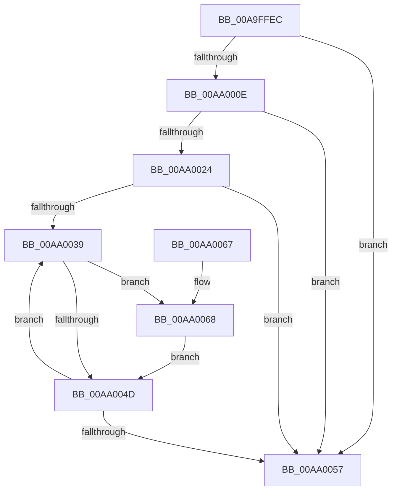

# MiUnlockDriverCode

- RVA: `0x00A9FFEC`–`0x00AA0083` (길이 `151` bytes)
- VA: `0x0000000140A9FFEC`
- 실행 섹션: `PAGE`
- PDB 이름 있음: `예`; PDB Function 태그: `아니요`
- unwind 정보 RVA: `0x00063C10`
- 디코드: `43`개 명령, `151/151` bytes 표시
- 미해석 바이트: `0` (있으면 어셈블리에 `.byte`로 보존)

> 이 문서는 커널 이미지의 기계어와 PDB 기호를 분석해 생성했습니다. 4번과 5번은 함수 원형과 자료형을 바이너리 사용 방식에서 추정한 C 해석이며 원본 소스 복구 결과는 아닙니다.

## 1. Dependencies

- 직접 호출 지점: **4**; 고유 호출 대상: **4**
- 직접 호출자로 확인된 함수: **1**
- RIP 상대 이미지 참조: **0**

### Outgoing calls
- `0x00AA0005` → [MI_IS_PHYSICAL_ADDRESS](../../text/23/MI_IS_PHYSICAL_ADDRESS_function_0023B3A0.md) (function, `0x0023B3A0`)
- `0x00AA0011` → [MiGetBaseLoaderPortion](../../text/4D/MiGetBaseLoaderPortion_function_004D9D34.md) (function, `0x004D9D34`)
- `0x00AA0027` → [MiGetPteAddress](../../text/43/MiGetPteAddress_function_0043E130.md) (function, `0x0043E130`)
- `0x00AA007C` → [MiUnlockCodePage](../../text/2A/MiUnlockCodePage_function_002A2AB8.md) (function, `0x002A2AB8`)

### Direct callers
- [MiUnloadSystemImage](../AA/MiUnloadSystemImage_function_00AA2FD4.md) at `0x00AA3280`

### Static image references
- 디코드된 RIP-relative 메모리 참조가 없습니다.

## 2. Other-region calls and transfers

- 다른 실행 섹션으로 향하는 call: **4**
  - `0x00AA0005` → [MI_IS_PHYSICAL_ADDRESS](../../text/23/MI_IS_PHYSICAL_ADDRESS_function_0023B3A0.md) (`PAGE` → `.text`)
  - `0x00AA0011` → [MiGetBaseLoaderPortion](../../text/4D/MiGetBaseLoaderPortion_function_004D9D34.md) (`PAGE` → `.text`)
  - `0x00AA0027` → [MiGetPteAddress](../../text/43/MiGetPteAddress_function_0043E130.md) (`PAGE` → `.text`)
  - `0x00AA007C` → [MiUnlockCodePage](../../text/2A/MiUnlockCodePage_function_002A2AB8.md) (`PAGE` → `.text`)
- 별도 외부 분기/꼬리 이동을 확인하지 못했습니다.

## 3. Assembly (complete function range)

```asm
00A9FFEC  48 89 5C 24 08                  mov qword ptr [rsp + 8], rbx
00A9FFF1  48 89 74 24 10                  mov qword ptr [rsp + 0x10], rsi
00A9FFF6  57                              push rdi
00A9FFF7  48 83 EC 20                     sub rsp, 0x20
00A9FFFB  48 8B 71 30                     mov rsi, qword ptr [rcx + 0x30]
00A9FFFF  48 8B D9                        mov rbx, rcx
00AA0002  48 8B CE                        mov rcx, rsi
00AA0005  E8 96 B3 79 FF                  call 0x14023b3a0
00AA000A  85 C0                           test eax, eax
00AA000C  75 49                           jne 0x140aa0057
00AA000E  48 8B CB                        mov rcx, rbx
00AA0011  E8 1E 9D A3 FF                  call 0x1404d9d34
00AA0016  48 8B F8                        mov rdi, rax
00AA0019  8B 90 B8 00 00 00               mov edx, dword ptr [rax + 0xb8]
00AA001F  F6 C2 01                        test dl, 1
00AA0022  74 33                           je 0x140aa0057
00AA0024  48 8B CE                        mov rcx, rsi
00AA0027  E8 04 E1 99 FF                  call 0x14043e130
00AA002C  33 DB                           xor ebx, ebx
00AA002E  48 8B F0                        mov rsi, rax
00AA0031  39 9F 28 01 00 00               cmp dword ptr [rdi + 0x128], ebx
00AA0037  76 1E                           jbe 0x140aa0057
00AA0039  48 8B 8F C8 00 00 00            mov rcx, qword ptr [rdi + 0xc8]
00AA0040  4C 8D 04 5B                     lea r8, [rbx + rbx*2]
00AA0044  42 8B 44 81 08                  mov eax, dword ptr [rcx + r8*4 + 8]
00AA0049  85 C0                           test eax, eax
00AA004B  75 1B                           jne 0x140aa0068
00AA004D  FF C3                           inc ebx
00AA004F  3B 9F 28 01 00 00               cmp ebx, dword ptr [rdi + 0x128]
00AA0055  72 E2                           jb 0x140aa0039
00AA0057  48 8B 5C 24 30                  mov rbx, qword ptr [rsp + 0x30]
00AA005C  48 8B 74 24 38                  mov rsi, qword ptr [rsp + 0x38]
00AA0061  48 83 C4 20                     add rsp, 0x20
00AA0065  5F                              pop rdi
00AA0066  C3                              ret
00AA0067  CC                              int3
00AA0068  42 8B 44 81 04                  mov eax, dword ptr [rcx + r8*4 + 4]
00AA006D  48 8D 14 C6                     lea rdx, [rsi + rax*8]
00AA0071  42 8B 04 81                     mov eax, dword ptr [rcx + r8*4]
00AA0075  45 33 C0                        xor r8d, r8d
00AA0078  48 8D 0C C6                     lea rcx, [rsi + rax*8]
00AA007C  E8 37 2A 80 FF                  call 0x1402a2ab8
00AA0081  EB CA                           jmp 0x140aa004d
```

## 4. C-style interpretation (structured pseudocode)

```c
__int64 __fastcall MiUnlockDriverCode(__int64 a1)
{
    __int64 result;
    __int64 v_rbx;
    __int64 v_rsp;
    unsigned __int64 v_stack_p10;
    unsigned __int64 v_stack_p8;

    v_stack_p8 = v_rbx;
    v_stack_p10 = v_rsi;
    v_rsp = (v_rsp) - (32);
    result = MI_IS_PHYSICAL_ADDRESS(*(unsigned __int64 *)(a1 + 48), a2, a3, a4);
    if ((unsigned int)(result) != 0) goto loc_00AA0057;
    result = MiGetBaseLoaderPortion(a1, a2, a3, a4);
    if ((((unsigned __int8)((unsigned int)(*(unsigned int *)(result + 184)))) & (1)) == 0) goto loc_00AA0057;
    result = MiGetPteAddress(*(unsigned __int64 *)(a1 + 48), (unsigned int)(*(unsigned int *)(result + 184)), a3, a4);
    v_rbx = 0;
    if ((*(unsigned int *)(result + 296)) <= 0) goto loc_00AA0057;
loc_00AA0039:
    if ((unsigned int)((unsigned int)(*(unsigned int *)(*(unsigned __int64 *)(result + 200) + v_rbx + v_rbx * 2 * 4 + 8))) != 0) goto loc_00AA0068;
loc_00AA004D:
    v_rbx = (unsigned int)((v_rbx) + 1);
    if (((unsigned int)(v_rbx)) < (*(unsigned int *)(result + 296))) goto loc_00AA0039;
loc_00AA0057:
    v_rsp = (v_rsp) + (32);
    return (unsigned int)(*(unsigned int *)(*(unsigned __int64 *)(result + 200) + v_rbx + v_rbx * 2 * 4 + 8));
loc_00AA0068:
    a3 = 0;
    result = MiUnlockCodePage(v_stack_p10 + (unsigned int)(*(unsigned int *)(*(unsigned __int64 *)(result + 200) + v_rbx + v_rbx * 2 * 4)) * 8, v_stack_p10 + (unsigned int)(*(unsigned int *)(*(unsigned __int64 *)(result + 200) + v_rbx + v_rbx * 2 * 4 + 4)) * 8, a3, a4);
    goto loc_00AA004D;
}
```

## 5. (Beta) C Style

```c
int64_t MiUnlockDriverCode(void *Arg1)
{
    uint8_t *arg1 = (uint8_t *)Arg1;

    int64_t result;
    int64_t local_rbx;
    int64_t local_rsp;
    uint64_t v_stack_p10;
    uint64_t v_stack_p8;

    v_stack_p8 = local_rbx;
    v_stack_p10 = local_rsi;
    local_rsp = (local_rsp) - (32);
    result = MI_IS_PHYSICAL_ADDRESS(*(uint64_t *)(arg1 + 0x30), a2, a3, a4);
    if ((uint32_t)(result) != 0) goto loc_00AA0057;
    result = MiGetBaseLoaderPortion(Arg1, a2, a3, a4);
    if ((((uint8_t)((uint32_t)(*(uint32_t *)(result + 0xB8)))) & (1)) == 0) goto loc_00AA0057;
    result = MiGetPteAddress(*(uint64_t *)(arg1 + 0x30), (uint32_t)(*(uint32_t *)(result + 0xB8)), a3, a4);
    local_rbx = 0;
    if ((*(uint32_t *)(result + 0x128)) <= 0) goto loc_00AA0057;
loc_00AA0039:
    if ((uint32_t)((uint32_t)(*(uint32_t *)(*(uint64_t *)(result + 0xC8) + local_rbx + local_rbx * 2 * 4 + 0x8))) != 0) goto loc_00AA0068;
loc_00AA004D:
    local_rbx = (uint32_t)((local_rbx) + 1);
    if (((uint32_t)(local_rbx)) < (*(uint32_t *)(result + 0x128))) goto loc_00AA0039;
loc_00AA0057:
    local_rsp = (local_rsp) + (32);
    return (uint32_t)(*(uint32_t *)(*(uint64_t *)(result + 0xC8) + local_rbx + local_rbx * 2 * 4 + 0x8));
loc_00AA0068:
    a3 = 0;
    result = MiUnlockCodePage(v_stack_p10 + (uint32_t)(*(uint32_t *)(*(uint64_t *)(result + 0xC8) + local_rbx + local_rbx * 2 * 4)) * 8, v_stack_p10 + (uint32_t)(*(uint32_t *)(*(uint64_t *)(result + 0xC8) + local_rbx + local_rbx * 2 * 4 + 0x4)) * 8, a3, a4);
    goto loc_00AA004D;
}
```

### 관측된 메모리 오프셋

구조체 형식이 확인되지 않은 접근은 인자 기준의 오프셋으로만 기록했습니다.

| 기준 인자 | 오프셋 표현 | 폭 (bit) | 접근 |
|---|---:|---:|---|
| `Arg1` | `+ 0x30` | `64` | `R` |

## 6. Execution-region graph

[열기: 2D/3D 그래프와 함수 탐색 컨트롤 패널](../../../control-panel.html?section=page&rva=0x00A9FFEC&view=graph)

- 2D 그래프는 위에서 아래로 흐르고, 3D 그래프는 빈 공간을 드래그해 회전합니다. Shift+드래그는 이동, 휠은 확대·축소, 함수 노드 선택은 대상 보고서 이동입니다.

### Static fallback


