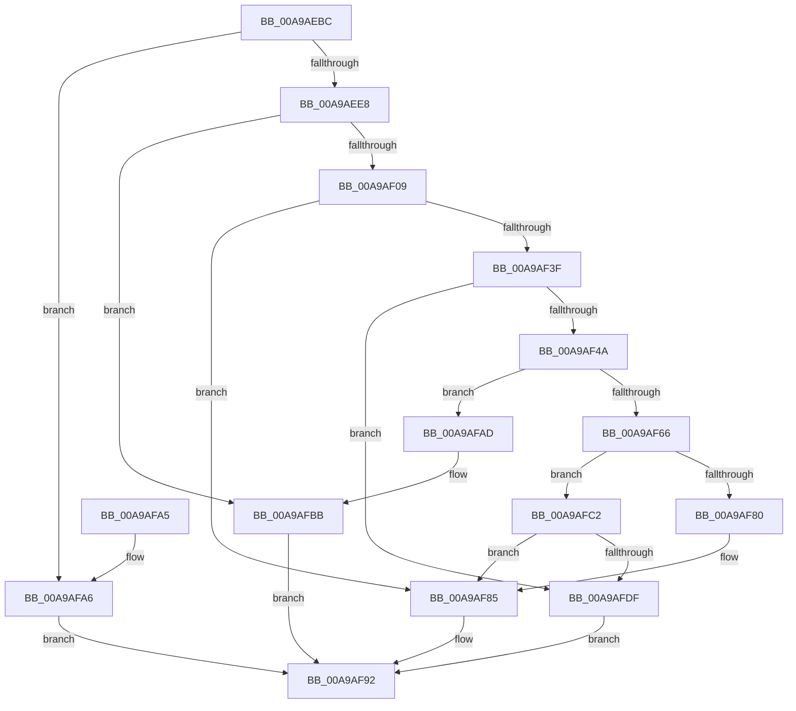

# MmGetFileNameForSection

- RVA: `0x00A9AEBC`–`0x00A9AFFB` (길이 `319` bytes)
- VA: `0x0000000140A9AEBC`
- 실행 섹션: `PAGE`
- PDB 이름 있음: `예`; PDB Function 태그: `아니요`
- unwind 정보 RVA: `0x000BA314`
- 디코드: `91`개 명령, `319/319` bytes 표시
- 미해석 바이트: `0` (있으면 어셈블리에 `.byte`로 보존)

> 이 문서는 커널 이미지의 기계어와 PDB 기호를 분석해 생성했습니다. 4번과 5번은 함수 원형과 자료형을 바이너리 사용 방식에서 추정한 C 해석이며 원본 소스 복구 결과는 아닙니다.

## 1. Dependencies

- 직접 호출 지점: **11**; 고유 호출 대상: **6**
- 직접 호출자로 확인된 함수: **1**
- RIP 상대 이미지 참조: **0**

### Outgoing calls
- `0x00A9AEF8` → [MiAllocatePool](../../text/35/MiAllocatePool_function_0035B540.md) (function, `0x0035B540`)
- `0x00A9AF0C` → [MiSectionControlArea](../../text/29/MiSectionControlArea_function_00294CB0.md) (function, `0x00294CB0`)
- `0x00A9AF17` → [MiReferenceControlAreaFile](../../text/43/MiReferenceControlAreaFile_function_00431554.md) (function, `0x00431554`)
- `0x00A9AF34` → [ObQueryNameStringMode](../8A/ObQueryNameStringMode_function_008A7ED0.md) (function, `0x008A7ED0`)
- `0x00A9AF4F` → [ExFreePoolWithTag](../../poolcode/B8/ExFreePoolWithTag_function_00B82870.md) (function, `0x00B82870`)
- `0x00A9AF73` → [MiAllocatePool](../../text/35/MiAllocatePool_function_0035B540.md) (function, `0x0035B540`)
- `0x00A9AF8B` → [MiDereferenceControlAreaFile](../../text/43/MiDereferenceControlAreaFile_function_004345E0.md) (function, `0x004345E0`)
- `0x00A9AFB6` → [MiDereferenceControlAreaFile](../../text/43/MiDereferenceControlAreaFile_function_004345E0.md) (function, `0x004345E0`)
- `0x00A9AFD4` → [ObQueryNameStringMode](../8A/ObQueryNameStringMode_function_008A7ED0.md) (function, `0x008A7ED0`)
- `0x00A9AFE5` → [MiDereferenceControlAreaFile](../../text/43/MiDereferenceControlAreaFile_function_004345E0.md) (function, `0x004345E0`)
- `0x00A9AFEF` → [ExFreePoolWithTag](../../poolcode/B8/ExFreePoolWithTag_function_00B82870.md) (function, `0x00B82870`)

### Direct callers
- [DbgkpSectionToFileHandle](DbgkpSectionToFileHandle_function_00A9AE08.md) at `0x00A9AE38`

### Static image references
- 디코드된 RIP-relative 메모리 참조가 없습니다.

## 2. Other-region calls and transfers

- 다른 실행 섹션으로 향하는 call: **9**
  - `0x00A9AEF8` → [MiAllocatePool](../../text/35/MiAllocatePool_function_0035B540.md) (`PAGE` → `.text`)
  - `0x00A9AF0C` → [MiSectionControlArea](../../text/29/MiSectionControlArea_function_00294CB0.md) (`PAGE` → `.text`)
  - `0x00A9AF17` → [MiReferenceControlAreaFile](../../text/43/MiReferenceControlAreaFile_function_00431554.md) (`PAGE` → `.text`)
  - `0x00A9AF4F` → [ExFreePoolWithTag](../../poolcode/B8/ExFreePoolWithTag_function_00B82870.md) (`PAGE` → `POOLCODE`)
  - `0x00A9AF73` → [MiAllocatePool](../../text/35/MiAllocatePool_function_0035B540.md) (`PAGE` → `.text`)
  - `0x00A9AF8B` → [MiDereferenceControlAreaFile](../../text/43/MiDereferenceControlAreaFile_function_004345E0.md) (`PAGE` → `.text`)
  - `0x00A9AFB6` → [MiDereferenceControlAreaFile](../../text/43/MiDereferenceControlAreaFile_function_004345E0.md) (`PAGE` → `.text`)
  - `0x00A9AFE5` → [MiDereferenceControlAreaFile](../../text/43/MiDereferenceControlAreaFile_function_004345E0.md) (`PAGE` → `.text`)
  - `0x00A9AFEF` → [ExFreePoolWithTag](../../poolcode/B8/ExFreePoolWithTag_function_00B82870.md) (`PAGE` → `POOLCODE`)
- 별도 외부 분기/꼬리 이동을 확인하지 못했습니다.

## 3. Assembly (complete function range)

```asm
00A9AEBC  48 89 5C 24 10                  mov qword ptr [rsp + 0x10], rbx
00A9AEC1  48 89 6C 24 18                  mov qword ptr [rsp + 0x18], rbp
00A9AEC6  56                              push rsi
00A9AEC7  57                              push rdi
00A9AEC8  41 56                           push r14
00A9AECA  48 83 EC 30                     sub rsp, 0x30
00A9AECE  8B 41 38                        mov eax, dword ptr [rcx + 0x38]
00A9AED1  33 DB                           xor ebx, ebx
00A9AED3  89 5C 24 50                     mov dword ptr [rsp + 0x50], ebx
00A9AED7  48 8B FA                        mov rdi, rdx
00A9AEDA  48 89 1A                        mov qword ptr [rdx], rbx
00A9AEDD  48 8B F1                        mov rsi, rcx
00A9AEE0  A8 20                           test al, 0x20
00A9AEE2  0F 84 BE 00 00 00               je 0x140a9afa6
00A9AEE8  BA 00 04 00 00                  mov edx, 0x400
00A9AEED  B9 00 01 00 00                  mov ecx, 0x100
00A9AEF2  41 B8 4D 6D 20 20               mov r8d, 0x20206d4d
00A9AEF8  E8 43 06 8C FF                  call 0x14035b540
00A9AEFD  48 89 07                        mov qword ptr [rdi], rax
00A9AF00  48 85 C0                        test rax, rax
00A9AF03  0F 84 B2 00 00 00               je 0x140a9afbb
00A9AF09  48 8B CE                        mov rcx, rsi
00A9AF0C  E8 9F 9D 7F FF                  call 0x140294cb0
00A9AF11  48 8B C8                        mov rcx, rax
00A9AF14  4C 8B F0                        mov r14, rax
00A9AF17  E8 38 66 99 FF                  call 0x140431554
00A9AF1C  48 8B 17                        mov rdx, qword ptr [rdi]
00A9AF1F  4C 8D 4C 24 50                  lea r9, [rsp + 0x50]
00A9AF24  41 B8 00 04 00 00               mov r8d, 0x400
00A9AF2A  88 5C 24 20                     mov byte ptr [rsp + 0x20], bl
00A9AF2E  48 8B C8                        mov rcx, rax
00A9AF31  48 8B F0                        mov rsi, rax
00A9AF34  E8 97 CF E0 FF                  call 0x1408a7ed0
00A9AF39  8B E8                           mov ebp, eax
00A9AF3B  85 C0                           test eax, eax
00A9AF3D  79 46                           jns 0x140a9af85
00A9AF3F  3D 04 00 00 C0                  cmp eax, 0xc0000004
00A9AF44  0F 85 95 00 00 00               jne 0x140a9afdf
00A9AF4A  48 8B 0F                        mov rcx, qword ptr [rdi]
00A9AF4D  33 D2                           xor edx, edx
00A9AF4F  E8 1C 79 0E 00                  call 0x140b82870
00A9AF54  8B 6C 24 50                     mov ebp, dword ptr [rsp + 0x50]
00A9AF58  81 C5 00 04 00 00               add ebp, 0x400
00A9AF5E  81 FD 00 04 00 00               cmp ebp, 0x400
00A9AF64  76 47                           jbe 0x140a9afad
00A9AF66  8B D5                           mov edx, ebp
00A9AF68  B9 00 01 00 00                  mov ecx, 0x100
00A9AF6D  41 B8 4D 6D 20 20               mov r8d, 0x20206d4d
00A9AF73  E8 C8 05 8C FF                  call 0x14035b540
00A9AF78  48 89 07                        mov qword ptr [rdi], rax
00A9AF7B  48 85 C0                        test rax, rax
00A9AF7E  75 42                           jne 0x140a9afc2
00A9AF80  BB 17 00 00 C0                  mov ebx, 0xc0000017
00A9AF85  48 8B D6                        mov rdx, rsi
00A9AF88  49 8B CE                        mov rcx, r14
00A9AF8B  E8 50 96 99 FF                  call 0x1404345e0
00A9AF90  8B C3                           mov eax, ebx
00A9AF92  48 8B 5C 24 58                  mov rbx, qword ptr [rsp + 0x58]
00A9AF97  48 8B 6C 24 60                  mov rbp, qword ptr [rsp + 0x60]
00A9AF9C  48 83 C4 30                     add rsp, 0x30
00A9AFA0  41 5E                           pop r14
00A9AFA2  5F                              pop rdi
00A9AFA3  5E                              pop rsi
00A9AFA4  C3                              ret
00A9AFA5  CC                              int3
00A9AFA6  B8 49 00 00 C0                  mov eax, 0xc0000049
00A9AFAB  EB E5                           jmp 0x140a9af92
00A9AFAD  48 8B D6                        mov rdx, rsi
00A9AFB0  48 89 1F                        mov qword ptr [rdi], rbx
00A9AFB3  49 8B CE                        mov rcx, r14
00A9AFB6  E8 25 96 99 FF                  call 0x1404345e0
00A9AFBB  B8 17 00 00 C0                  mov eax, 0xc0000017
00A9AFC0  EB D0                           jmp 0x140a9af92
00A9AFC2  4C 8D 4C 24 50                  lea r9, [rsp + 0x50]
00A9AFC7  88 5C 24 20                     mov byte ptr [rsp + 0x20], bl
00A9AFCB  44 8B C5                        mov r8d, ebp
00A9AFCE  48 8B D0                        mov rdx, rax
00A9AFD1  48 8B CE                        mov rcx, rsi
00A9AFD4  E8 F7 CE E0 FF                  call 0x1408a7ed0
00A9AFD9  8B E8                           mov ebp, eax
00A9AFDB  85 C0                           test eax, eax
00A9AFDD  79 A6                           jns 0x140a9af85
00A9AFDF  48 8B D6                        mov rdx, rsi
00A9AFE2  49 8B CE                        mov rcx, r14
00A9AFE5  E8 F6 95 99 FF                  call 0x1404345e0
00A9AFEA  48 8B 0F                        mov rcx, qword ptr [rdi]
00A9AFED  33 D2                           xor edx, edx
00A9AFEF  E8 7C 78 0E 00                  call 0x140b82870
00A9AFF4  8B C5                           mov eax, ebp
00A9AFF6  48 89 1F                        mov qword ptr [rdi], rbx
00A9AFF9  EB 97                           jmp 0x140a9af92
```

## 4. C-style interpretation (structured pseudocode)

```c
__int64 __fastcall MmGetFileNameForSection(__int64 a1, __int64 a2)
{
    __int64 result;
    __int64 v_rbp;
    __int64 v_rbx;
    __int64 v_rsp;
    unsigned __int8 v_stack_m28;
    unsigned __int64 v_stack_p10;
    unsigned __int64 v_stack_p18;
    unsigned __int8 v_stack_p20;
    unsigned __int64 v_stack_p50;
    unsigned int v_stack_p8;

    v_stack_p10 = v_rbx;
    v_stack_p18 = v_rbp;
    v_rsp = (v_rsp) - (48);
    v_rbx = 0;
    v_stack_p8 = 0;
    *(unsigned __int64 *)(a2) = 0;
    if ((((unsigned __int8)((unsigned int)(*(unsigned int *)(a1 + 56)))) & (32)) == 0) goto loc_00A9AFA6;
    result = MiAllocatePool(256, (unsigned int)(0x400ULL), (unsigned int)(0x20206D4DULL), a4);
    *(unsigned __int64 *)(a2) = result;
    if (result == 0) goto loc_00A9AFBB;
    result = MiSectionControlArea(a1, (unsigned int)(0x400ULL), (unsigned int)(0x20206D4DULL), a4);
    result = MiReferenceControlAreaFile(result, (unsigned int)(0x400ULL), (unsigned int)(0x20206D4DULL), a4);
    v_stack_m28 = 0;
    result = ObQueryNameStringMode(result, *(unsigned __int64 *)(a2), (unsigned int)(0x400ULL), v_stack_p8);
    if (!sign_flag) goto loc_00A9AF85;
    if (((unsigned int)(result)) != 0xC0000004ULL) goto loc_00A9AFDF;
    a2 = 0;
    result = ExFreePoolWithTag(*(unsigned __int64 *)(a2), a2, (unsigned int)(0x400ULL), v_stack_p8);
    v_rbp = (unsigned int)(((unsigned int)(v_stack_p8)) + (0x400ULL));
    if (((unsigned int)(v_rbp)) <= 0x400ULL) goto loc_00A9AFAD;
    result = MiAllocatePool(256, (unsigned int)((unsigned int)(v_rbp)), (unsigned int)(0x20206D4DULL), v_stack_p8);
    *(unsigned __int64 *)(a2) = result;
    if (result != 0) goto loc_00A9AFC2;
loc_00A9AF85:
    result = MiDereferenceControlAreaFile(result, result, (unsigned int)(0x20206D4DULL), v_stack_p8);
loc_00A9AF92:
    v_rsp = (v_rsp) + (48);
    return (unsigned int)((unsigned int)((unsigned int)(0xC0000017ULL)));
loc_00A9AFA6:
    goto loc_00A9AF92;
loc_00A9AFAD:
    *(unsigned __int64 *)(a2) = v_stack_p10;
    result = MiDereferenceControlAreaFile(result, result, (unsigned int)(0x20206D4DULL), v_stack_p8);
loc_00A9AFBB:
    goto loc_00A9AF92;
loc_00A9AFC2:
    v_stack_p20 = (unsigned __int8)(v_stack_p10);
    result = ObQueryNameStringMode(result, (unsigned int)(0xC0000017ULL), (unsigned int)((unsigned int)(v_stack_p18)), v_stack_p50);
    if (!sign_flag) goto loc_00A9AF85;
loc_00A9AFDF:
    result = MiDereferenceControlAreaFile(result, result, (unsigned int)((unsigned int)(v_stack_p18)), v_stack_p50);
    a2 = 0;
    result = ExFreePoolWithTag(*(unsigned __int64 *)(a2), a2, (unsigned int)((unsigned int)(v_stack_p18)), v_stack_p50);
    *(unsigned __int64 *)(a2) = v_stack_p10;
    goto loc_00A9AF92;
}
```

## 5. (Beta) C Style

```c
int64_t MmGetFileNameForSection(void *Arg1, void *Arg2)
{
    uint8_t *arg1 = (uint8_t *)Arg1;
    uint8_t *arg2 = (uint8_t *)Arg2;

    int64_t result;
    int64_t local_rbp;
    int64_t local_rbx;
    int64_t local_rsp;
    uint8_t v_stack_m28;
    uint64_t v_stack_p10;
    uint64_t v_stack_p18;
    uint8_t v_stack_p20;
    uint64_t v_stack_p50;
    uint32_t v_stack_p8;

    v_stack_p10 = local_rbx;
    v_stack_p18 = local_rbp;
    local_rsp = (local_rsp) - (48);
    local_rbx = 0;
    v_stack_p8 = 0;
    *(uint64_t *)(arg2) = 0;
    if ((((uint8_t)((uint32_t)(*(uint32_t *)(arg1 + 0x38)))) & (32)) == 0) goto loc_00A9AFA6;
    result = MiAllocatePool(256, (uint32_t)(0x400ULL), (uint32_t)(0x20206D4DULL), a4);
    *(uint64_t *)(arg2) = result;
    if (result == 0) goto loc_00A9AFBB;
    result = MiSectionControlArea(Arg1, (uint32_t)(0x400ULL), (uint32_t)(0x20206D4DULL), a4);
    result = MiReferenceControlAreaFile(result, (uint32_t)(0x400ULL), (uint32_t)(0x20206D4DULL), a4);
    v_stack_m28 = 0;
    result = ObQueryNameStringMode(result, *(uint64_t *)(arg2), (uint32_t)(0x400ULL), v_stack_p8);
    if (!sign_flag) goto loc_00A9AF85;
    if (((uint32_t)(result)) != 0xC0000004ULL) goto loc_00A9AFDF;
    Arg2 = 0;
    result = ExFreePoolWithTag(*(uint64_t *)(arg2), Arg2, (uint32_t)(0x400ULL), v_stack_p8);
    local_rbp = (uint32_t)(((uint32_t)(v_stack_p8)) + (0x400ULL));
    if (((uint32_t)(local_rbp)) <= 0x400ULL) goto loc_00A9AFAD;
    result = MiAllocatePool(256, (uint32_t)((uint32_t)(local_rbp)), (uint32_t)(0x20206D4DULL), v_stack_p8);
    *(uint64_t *)(arg2) = result;
    if (result != 0) goto loc_00A9AFC2;
loc_00A9AF85:
    result = MiDereferenceControlAreaFile(result, result, (uint32_t)(0x20206D4DULL), v_stack_p8);
loc_00A9AF92:
    local_rsp = (local_rsp) + (48);
    return (uint32_t)((uint32_t)((uint32_t)(0xC0000017ULL)));
loc_00A9AFA6:
    goto loc_00A9AF92;
loc_00A9AFAD:
    *(uint64_t *)(arg2) = v_stack_p10;
    result = MiDereferenceControlAreaFile(result, result, (uint32_t)(0x20206D4DULL), v_stack_p8);
loc_00A9AFBB:
    goto loc_00A9AF92;
loc_00A9AFC2:
    v_stack_p20 = (uint8_t)(v_stack_p10);
    result = ObQueryNameStringMode(result, (uint32_t)(0xC0000017ULL), (uint32_t)((uint32_t)(v_stack_p18)), v_stack_p50);
    if (!sign_flag) goto loc_00A9AF85;
loc_00A9AFDF:
    result = MiDereferenceControlAreaFile(result, result, (uint32_t)((uint32_t)(v_stack_p18)), v_stack_p50);
    Arg2 = 0;
    result = ExFreePoolWithTag(*(uint64_t *)(arg2), Arg2, (uint32_t)((uint32_t)(v_stack_p18)), v_stack_p50);
    *(uint64_t *)(arg2) = v_stack_p10;
    goto loc_00A9AF92;
}
```

### 관측된 메모리 오프셋

구조체 형식이 확인되지 않은 접근은 인자 기준의 오프셋으로만 기록했습니다.

| 기준 인자 | 오프셋 표현 | 폭 (bit) | 접근 |
|---|---:|---:|---|
| `Arg1` | `+ 0x38` | `32` | `R` |
| `Arg2` | `+ 0x0` | `64` | `R` |
| `Arg2` | `+ 0x0` | `64` | `W` |

## 6. Execution-region graph

[열기: 2D/3D 그래프와 함수 탐색 컨트롤 패널](../../../control-panel.html?section=page&rva=0x00A9AEBC&view=graph)

- 2D 그래프는 위에서 아래로 흐르고, 3D 그래프는 빈 공간을 드래그해 회전합니다. Shift+드래그는 이동, 휠은 확대·축소, 함수 노드 선택은 대상 보고서 이동입니다.

### Static fallback


