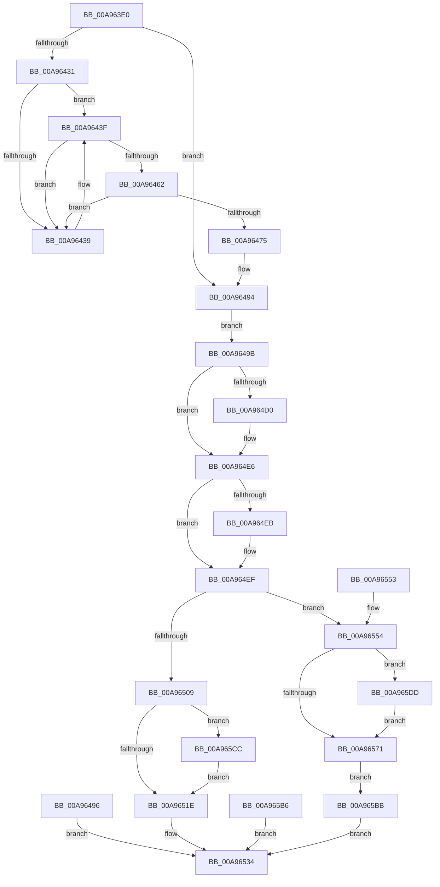

# NtAllocateUuids

- RVA: `0x00A963E0`–`0x00A965EB` (길이 `523` bytes)
- VA: `0x0000000140A963E0`
- 실행 섹션: `PAGE`
- PDB 이름 있음: `예`; PDB Function 태그: `아니요`
- unwind 정보 RVA: `0x000B9B10`
- 디코드: `137`개 명령, `523/523` bytes 표시
- 미해석 바이트: `0` (있으면 어셈블리에 `.byte`로 보존)

> 이 문서는 커널 이미지의 기계어와 PDB 기호를 분석해 생성했습니다. 4번과 5번은 함수 원형과 자료형을 바이너리 사용 방식에서 추정한 C 해석이며 원본 소스 복구 결과는 아닙니다.

## 1. Dependencies

- 직접 호출 지점: **11**; 고유 호출 대상: **8**
- 직접 호출자로 확인된 함수: **0**
- RIP 상대 이미지 참조: **5**

### Outgoing calls
- `0x00A96439` → [ExRaiseDatatypeMisalignment](../89/ExRaiseDatatypeMisalignment_function_00899FD0.md) (function, `0x00899FD0`)
- `0x00A964BC` → [KeAbPreAcquire](../../text/21/KeAbPreAcquire_function_00210230.md) (function, `0x00210230`)
- `0x00A964E1` → [ExfAcquirePushLockExclusiveEx](../../text/20/ExfAcquirePushLockExclusiveEx_function_0020FC90.md) (function, `0x0020FC90`)
- `0x00A964FE` → [ExpAllocateUuids](ExpAllocateUuids_function_00A965F4.md) (function, `0x00A965F4`)
- `0x00A96525` → [KeAbPostRelease](../../text/2E/KeAbPostRelease_function_002E1600.md) (function, `0x002E1600`)
- `0x00A9652D` → [KiLeaveCriticalRegionUnsafe](../../text/25/KiLeaveCriticalRegionUnsafe_function_0025F010.md) (function, `0x0025F010`)
- `0x00A96554` → [ExpUuidSaveSequenceNumberIf](ExpUuidSaveSequenceNumberIf_function_00A9672C.md) (function, `0x00A9672C`)
- `0x00A96578` → [KeAbPostRelease](../../text/2E/KeAbPostRelease_function_002E1600.md) (function, `0x002E1600`)
- `0x00A96580` → [KiLeaveCriticalRegionUnsafe](../../text/25/KiLeaveCriticalRegionUnsafe_function_0025F010.md) (function, `0x0025F010`)
- `0x00A965D3` → [ExfTryToWakePushLock](../../text/26/ExfTryToWakePushLock_function_00265DD0.md) (function, `0x00265DD0`)
- `0x00A965E4` → [ExfTryToWakePushLock](../../text/26/ExfTryToWakePushLock_function_00265DD0.md) (function, `0x00265DD0`)

### Direct callers
- 이 함수 시작 RVA로 연결되는 직접 call은 확인되지 않았습니다. 간접 호출은 완전히 역산할 수 없습니다.

### Static image references
- `0x00A964B5` → RVA `0x00E685D8` (`.data`; read)
- `0x00A964C4` → RVA `0x00E685D8` (`.data`; read/write)
- `0x00A96559` → RVA `0x00FD8007` (`PAGEDATA`; read)
- `0x00A9659D` → RVA `0x00FD825E` (`PAGEDATA`; read)
- `0x00A965A7` → RVA `0x00FD8262` (`PAGEDATA`; read)

## 2. Other-region calls and transfers

- 다른 실행 섹션으로 향하는 call: **8**
  - `0x00A964BC` → [KeAbPreAcquire](../../text/21/KeAbPreAcquire_function_00210230.md) (`PAGE` → `.text`)
  - `0x00A964E1` → [ExfAcquirePushLockExclusiveEx](../../text/20/ExfAcquirePushLockExclusiveEx_function_0020FC90.md) (`PAGE` → `.text`)
  - `0x00A96525` → [KeAbPostRelease](../../text/2E/KeAbPostRelease_function_002E1600.md) (`PAGE` → `.text`)
  - `0x00A9652D` → [KiLeaveCriticalRegionUnsafe](../../text/25/KiLeaveCriticalRegionUnsafe_function_0025F010.md) (`PAGE` → `.text`)
  - `0x00A96578` → [KeAbPostRelease](../../text/2E/KeAbPostRelease_function_002E1600.md) (`PAGE` → `.text`)
  - `0x00A96580` → [KiLeaveCriticalRegionUnsafe](../../text/25/KiLeaveCriticalRegionUnsafe_function_0025F010.md) (`PAGE` → `.text`)
  - `0x00A965D3` → [ExfTryToWakePushLock](../../text/26/ExfTryToWakePushLock_function_00265DD0.md) (`PAGE` → `.text`)
  - `0x00A965E4` → [ExfTryToWakePushLock](../../text/26/ExfTryToWakePushLock_function_00265DD0.md) (`PAGE` → `.text`)
- 별도 외부 분기/꼬리 이동을 확인하지 못했습니다.

## 3. Assembly (complete function range)

```asm
00A963E0  48 8B C4                        mov rax, rsp
00A963E3  48 89 58 08                     mov qword ptr [rax + 8], rbx
00A963E7  48 89 70 10                     mov qword ptr [rax + 0x10], rsi
00A963EB  48 89 78 18                     mov qword ptr [rax + 0x18], rdi
00A963EF  4C 89 60 20                     mov qword ptr [rax + 0x20], r12
00A963F3  41 55                           push r13
00A963F5  41 56                           push r14
00A963F7  41 57                           push r15
00A963F9  48 83 EC 50                     sub rsp, 0x50
00A963FD  4D 8B E1                        mov r12, r9
00A96400  4D 8B E8                        mov r13, r8
00A96403  4C 8B FA                        mov r15, rdx
00A96406  4C 8B F1                        mov r14, rcx
00A96409  33 C9                           xor ecx, ecx
00A9640B  48 89 48 C8                     mov qword ptr [rax - 0x38], rcx
00A9640F  89 48 BC                        mov dword ptr [rax - 0x44], ecx
00A96412  89 48 C0                        mov dword ptr [rax - 0x40], ecx
00A96415  65 48 8B 04 25 88 01 00 00      mov rax, qword ptr gs:[0x188]
00A9641E  48 89 44 24 48                  mov qword ptr [rsp + 0x48], rax
00A96423  8A 80 32 02 00 00               mov al, byte ptr [rax + 0x232]
00A96429  88 44 24 22                     mov byte ptr [rsp + 0x22], al
00A9642D  84 C0                           test al, al
00A9642F  74 63                           je 0x140a96494
00A96431  41 B0 03                        mov r8b, 3
00A96434  45 84 F0                        test r8b, r14b
00A96437  74 06                           je 0x140a9643f
00A96439  E8 92 3B E0 FF                  call 0x140899fd0
00A9643E  CC                              int3
00A9643F  48 BA 00 00 FF FF FF 7F 00 00   movabs rdx, 0x7fffffff0000
00A96449  48 8B CA                        mov rcx, rdx
00A9644C  4C 3B F2                        cmp r14, rdx
00A9644F  49 0F 42 CE                     cmovb rcx, r14
00A96453  8A 01                           mov al, byte ptr [rcx]
00A96455  88 01                           mov byte ptr [rcx], al
00A96457  8A 41 07                        mov al, byte ptr [rcx + 7]
00A9645A  88 41 07                        mov byte ptr [rcx + 7], al
00A9645D  45 84 F8                        test r8b, r15b
00A96460  75 D7                           jne 0x140a96439
00A96462  48 8B CA                        mov rcx, rdx
00A96465  4C 3B FA                        cmp r15, rdx
00A96468  49 0F 42 CF                     cmovb rcx, r15
00A9646C  8B 01                           mov eax, dword ptr [rcx]
00A9646E  89 01                           mov dword ptr [rcx], eax
00A96470  45 84 E8                        test r8b, r13b
00A96473  75 C4                           jne 0x140a96439
00A96475  48 8B CA                        mov rcx, rdx
00A96478  4C 3B EA                        cmp r13, rdx
00A9647B  49 0F 42 CD                     cmovb rcx, r13
00A9647F  8B 01                           mov eax, dword ptr [rcx]
00A96481  89 01                           mov dword ptr [rcx], eax
00A96483  4C 3B E2                        cmp r12, rdx
00A96486  49 0F 42 D4                     cmovb rdx, r12
00A9648A  8A 02                           mov al, byte ptr [rdx]
00A9648C  88 02                           mov byte ptr [rdx], al
00A9648E  8A 42 05                        mov al, byte ptr [rdx + 5]
00A96491  88 42 05                        mov byte ptr [rdx + 5], al
00A96494  EB 05                           jmp 0x140a9649b
00A96496  E9 99 00 00 00                  jmp 0x140a96534
00A9649B  65 48 8B 34 25 88 01 00 00      mov rsi, qword ptr gs:[0x188]
00A964A4  48 83 CB FF                     or rbx, 0xffffffffffffffff
00A964A8  66 01 9E E4 01 00 00            add word ptr [rsi + 0x1e4], bx
00A964AF  90                              nop
00A964B0  45 33 C0                        xor r8d, r8d
00A964B3  33 D2                           xor edx, edx
00A964B5  48 8D 0D 1C 21 3D 00            lea rcx, [rip + 0x3d211c]
00A964BC  E8 6F 9D 77 FF                  call 0x140210230
00A964C1  48 8B F8                        mov rdi, rax
00A964C4  F0 48 0F BA 2D 0A 21 3D 00 00   lock bts qword ptr [rip + 0x3d210a], 0
00A964CE  73 16                           jae 0x140a964e6
00A964D0  4C 8D 05 01 21 3D 00            lea r8, [rip + 0x3d2101]
00A964D7  48 8B D0                        mov rdx, rax
00A964DA  48 8D 0D F7 20 3D 00            lea rcx, [rip + 0x3d20f7]
00A964E1  E8 AA 97 77 FF                  call 0x14020fc90
00A964E6  48 85 FF                        test rdi, rdi
00A964E9  74 04                           je 0x140a964ef
00A964EB  C6 47 0A 01                     mov byte ptr [rdi + 0xa], 1
00A964EF  4C 8D 44 24 28                  lea r8, [rsp + 0x28]
00A964F4  48 8D 54 24 24                  lea rdx, [rsp + 0x24]
00A964F9  48 8D 4C 24 30                  lea rcx, [rsp + 0x30]
00A964FE  E8 F1 00 00 00                  call 0x140a965f4
00A96503  8B F8                           mov edi, eax
00A96505  85 C0                           test eax, eax
00A96507  79 4B                           jns 0x140a96554
00A96509  F0 48 0F C1 1D C6 20 3D 00      lock xadd qword ptr [rip + 0x3d20c6], rbx
00A96512  80 E3 06                        and bl, 6
00A96515  80 FB 02                        cmp bl, 2
00A96518  0F 84 AE 00 00 00               je 0x140a965cc
00A9651E  48 8D 0D B3 20 3D 00            lea rcx, [rip + 0x3d20b3]
00A96525  E8 D6 B0 84 FF                  call 0x1402e1600
00A9652A  48 8B CE                        mov rcx, rsi
00A9652D  E8 DE 8A 7C FF                  call 0x14025f010
00A96532  8B C7                           mov eax, edi
00A96534  4C 8D 5C 24 50                  lea r11, [rsp + 0x50]
00A96539  49 8B 5B 20                     mov rbx, qword ptr [r11 + 0x20]
00A9653D  49 8B 73 28                     mov rsi, qword ptr [r11 + 0x28]
00A96541  49 8B 7B 30                     mov rdi, qword ptr [r11 + 0x30]
00A96545  4D 8B 63 38                     mov r12, qword ptr [r11 + 0x38]
00A96549  49 8B E3                        mov rsp, r11
00A9654C  41 5F                           pop r15
00A9654E  41 5E                           pop r14
00A96550  41 5D                           pop r13
00A96552  C3                              ret
00A96553  CC                              int3
00A96554  E8 D3 01 00 00                  call 0x140a9672c
00A96559  40 8A 3D A7 1A 54 00            mov dil, byte ptr [rip + 0x541aa7]
00A96560  F0 48 0F C1 1D 6F 20 3D 00      lock xadd qword ptr [rip + 0x3d206f], rbx
00A96569  80 E3 06                        and bl, 6
00A9656C  80 FB 02                        cmp bl, 2
00A9656F  74 6C                           je 0x140a965dd
00A96571  48 8D 0D 60 20 3D 00            lea rcx, [rip + 0x3d2060]
00A96578  E8 83 B0 84 FF                  call 0x1402e1600
00A9657D  48 8B CE                        mov rcx, rsi
00A96580  E8 8B 8A 7C FF                  call 0x14025f010
00A96585  90                              nop
00A96586  48 8B 44 24 30                  mov rax, qword ptr [rsp + 0x30]
00A9658B  49 89 06                        mov qword ptr [r14], rax
00A9658E  8B 44 24 24                     mov eax, dword ptr [rsp + 0x24]
00A96592  41 89 07                        mov dword ptr [r15], eax
00A96595  8B 44 24 28                     mov eax, dword ptr [rsp + 0x28]
00A96599  41 89 45 00                     mov dword ptr [r13], eax
00A9659D  8B 05 BB 1C 54 00               mov eax, dword ptr [rip + 0x541cbb]
00A965A3  41 89 04 24                     mov dword ptr [r12], eax
00A965A7  0F B7 05 B4 1C 54 00            movzx eax, word ptr [rip + 0x541cb4]
00A965AE  66 41 89 44 24 04               mov word ptr [r12 + 4], ax
00A965B4  EB 05                           jmp 0x140a965bb
00A965B6  E9 79 FF FF FF                  jmp 0x140a96534
00A965BB  40 F6 DF                        neg dil
00A965BE  1B C0                           sbb eax, eax
00A965C0  F7 D0                           not eax
00A965C2  25 56 00 02 40                  and eax, 0x40020056
00A965C7  E9 68 FF FF FF                  jmp 0x140a96534
00A965CC  48 8D 0D 05 20 3D 00            lea rcx, [rip + 0x3d2005]
00A965D3  E8 F8 F7 7C FF                  call 0x140265dd0
00A965D8  E9 41 FF FF FF                  jmp 0x140a9651e
00A965DD  48 8D 0D F4 1F 3D 00            lea rcx, [rip + 0x3d1ff4]
00A965E4  E8 E7 F7 7C FF                  call 0x140265dd0
00A965E9  EB 86                           jmp 0x140a96571
```

## 4. C-style interpretation (structured pseudocode)

```c
__int64 __fastcall NtAllocateUuids(__int64 a1, __int64 a2, __int64 a3, __int64 a4)
{
    __int64 result;
    __int64 v_rbx;
    __int64 v_rdi;
    __int64 v_rsp;
    unsigned __int64 v_stack_m18;
    unsigned __int64 v_stack_m20;
    unsigned int v_stack_m28;
    unsigned int v_stack_m2C;
    unsigned __int64 v_stack_m38;
    unsigned __int64 v_stack_m40;
    unsigned __int64 v_stack_m44;
    unsigned __int8 v_stack_m46;

    *(unsigned __int64 *)(v_rsp + 8) = v_rbx;
    *(unsigned __int64 *)(v_rsp + 16) = v_rsi;
    *(unsigned __int64 *)(v_rsp + 24) = v_rdi;
    *(unsigned __int64 *)(v_rsp + 32) = v_r12;
    v_rsp = (v_rsp) - (80);
    a1 = 0;
    *(unsigned __int64 *)(v_rsp - 56) = 0;
    *(unsigned int *)(v_rsp - 68) = 0;
    *(unsigned int *)(v_rsp - 64) = 0;
    v_stack_m20 = *(unsigned __int64 *)(gs_base + (0 + 392));
    v_stack_m46 = (unsigned __int8)(*(unsigned __int8 *)(*(unsigned __int64 *)(gs_base + (0 + 392)) + 562));
    if ((unsigned __int8)(*(unsigned __int8 *)(*(unsigned __int64 *)(gs_base + (0 + 392)) + 562)) == 0) goto loc_00A96494;
    result = *(unsigned __int8 *)(*(unsigned __int64 *)(gs_base + (0 + 392)) + 562);
    if (((3) & (0)) != 0) {
        result = ExRaiseDatatypeMisalignment(a1, a2, 3, a4);
    }
    if (0 < a2) { a2 = 0; }
    *(unsigned __int8 *)(a2) = (unsigned __int8)(*(unsigned __int8 *)(a2));
    *(unsigned __int8 *)(a2 + 7) = (unsigned __int8)(*(unsigned __int8 *)(a2 + 7));
    if (((3) & ((unsigned __int8)(a2))) != 0) goto loc_00A96439;
    if (a2 < a2) { a2 = a2; }
    *(unsigned int *)(a2) = (unsigned int)((unsigned int)(*(unsigned int *)(a2)));
    if (((3) & ((unsigned __int8)(a3))) != 0) goto loc_00A96439;
    if (a3 < a2) { a2 = a3; }
    *(unsigned int *)(a2) = (unsigned int)((unsigned int)(*(unsigned int *)(a2)));
    if (a4 < a2) { a2 = a4; }
    *(unsigned __int8 *)(a2) = (unsigned __int8)(*(unsigned __int8 *)(a2));
    *(unsigned __int8 *)(a2 + 5) = (unsigned __int8)(*(unsigned __int8 *)(a2 + 5));
loc_00A96494:
    goto loc_00A9649B;
loc_00A9649B:
    v_rbx = (v_rbx) | (-1);
    a3 = 0;
    a2 = 0;
    result = KeAbPreAcquire(v_rip + 4006172, a2, a3, a4);
    if (!(condition_is_above_or_equal)) {
        a3 = v_rip + 4006145;
        a2 = result;
        a1 = v_rip + 4006135;
        result = ExfAcquirePushLockExclusiveEx(a1, a2, a3, a4);
    }
    if (result != 0) {
        *(unsigned __int8 *)(result + 10) = 1;
    }
    result = ExpAllocateUuids(v_stack_m38, v_stack_m44, v_stack_m40, a4);
    if (!sign_flag) goto loc_00A96554;
    v_rbx = (unsigned __int8)((v_rbx) & (6));
    if (((unsigned __int8)(v_rbx)) == 2) goto loc_00A965CC;
loc_00A9651E:
    result = KeAbPostRelease(v_rip + 4006067, v_stack_m44, v_stack_m40, a4);
    result = KiLeaveCriticalRegionUnsafe(*(unsigned __int64 *)(gs_base + (0 + 392)), v_stack_m44, v_stack_m40, a4);
loc_00A96534:
    return (unsigned int)((unsigned int)((unsigned int)((unsigned int)(result))));
loc_00A96554:
    result = ExpUuidSaveSequenceNumberIf(*(unsigned __int64 *)(gs_base + (0 + 392)), v_stack_m44, v_stack_m40, a4);
    v_rbx = (unsigned __int8)((*(unsigned __int64 *)(v_stack_m18 + 32)) & (6));
    if (((unsigned __int8)(v_rbx)) == 2) goto loc_00A965DD;
loc_00A96571:
    result = KeAbPostRelease(v_rip + 4005984, v_stack_m44, v_stack_m40, a4);
    result = KiLeaveCriticalRegionUnsafe(*(unsigned __int64 *)(v_stack_m18 + 40), v_stack_m44, v_stack_m40, a4);
    *(unsigned __int64 *)(a1) = v_stack_m20;
    *(unsigned int *)(a2) = (unsigned int)((unsigned int)(v_stack_m2C));
    *(unsigned int *)(a3) = (unsigned int)((unsigned int)(v_stack_m28));
    *(unsigned int *)(*(unsigned __int64 *)(v_stack_m18 + 56)) = (unsigned int)((unsigned int)(*(unsigned int *)(v_rip + 5512379)));
    *(unsigned __int16 *)(*(unsigned __int64 *)(v_stack_m18 + 56) + 4) = (unsigned __int16)(*(unsigned __int16 *)(v_rip + 5512372));
    goto loc_00A965BB;
loc_00A965BB:
    v_rdi = (unsigned __int8)(-(*(unsigned __int8 *)(v_rip + 5511847)));
    result = (unsigned int)(~(*(unsigned __int16 *)(v_rip + 5512372)));
    result = (unsigned int)((result) & (0x40020056ULL));
    goto loc_00A96534;
loc_00A965CC:
    result = ExfTryToWakePushLock(v_rip + 4005893, v_stack_m44, v_stack_m40, a4);
    goto loc_00A9651E;
loc_00A965DD:
    result = ExfTryToWakePushLock(v_rip + 4005876, v_stack_m44, v_stack_m40, a4);
    goto loc_00A96571;
}
```

## 5. (Beta) C Style

```c
int64_t NtAllocateUuids(int64_t Arg1, int64_t Arg2, int64_t Arg3, int64_t Arg4)
{
    int64_t result;
    int64_t local_rbx;
    int64_t local_rdi;
    int64_t local_rsp;
    uint64_t v_stack_m18;
    uint64_t v_stack_m20;
    uint32_t v_stack_m28;
    uint32_t v_stack_m2C;
    uint64_t v_stack_m38;
    uint64_t v_stack_m40;
    uint64_t v_stack_m44;
    uint8_t v_stack_m46;

    *(uint64_t *)(local_rsp + 0x8) = local_rbx;
    *(uint64_t *)(local_rsp + 0x10) = local_rsi;
    *(uint64_t *)(local_rsp + 0x18) = local_rdi;
    *(uint64_t *)(local_rsp + 0x20) = local_r12;
    local_rsp = (local_rsp) - (80);
    Arg1 = 0;
    *(uint64_t *)(local_rsp - 0x38) = 0;
    *(uint32_t *)(local_rsp - 0x44) = 0;
    *(uint32_t *)(local_rsp - 0x40) = 0;
    v_stack_m20 = *(uint64_t *)(gs_base + (0 + 0x188));
    v_stack_m46 = (uint8_t)(*(uint8_t *)(*(uint64_t *)(gs_base + (0 + 0x188)) + 0x232));
    if ((uint8_t)(*(uint8_t *)(*(uint64_t *)(gs_base + (0 + 0x188)) + 0x232)) == 0) goto loc_00A96494;
    result = *(uint8_t *)(*(uint64_t *)(gs_base + (0 + 0x188)) + 0x232);
    if (((3) & (0)) != 0) {
        result = ExRaiseDatatypeMisalignment(Arg1, Arg2, 3, Arg4);
    }
    if (0 < Arg2) { Arg2 = 0; }
    *(uint8_t *)(Arg2) = (uint8_t)(*(uint8_t *)(Arg2));
    *(uint8_t *)(Arg2 + 0x7) = (uint8_t)(*(uint8_t *)(Arg2 + 0x7));
    if (((3) & ((uint8_t)(Arg2))) != 0) goto loc_00A96439;
    if (Arg2 < Arg2) { Arg2 = Arg2; }
    *(uint32_t *)(Arg2) = (uint32_t)((uint32_t)(*(uint32_t *)(Arg2)));
    if (((3) & ((uint8_t)(Arg3))) != 0) goto loc_00A96439;
    if (Arg3 < Arg2) { Arg2 = Arg3; }
    *(uint32_t *)(Arg2) = (uint32_t)((uint32_t)(*(uint32_t *)(Arg2)));
    if (Arg4 < Arg2) { Arg2 = Arg4; }
    *(uint8_t *)(Arg2) = (uint8_t)(*(uint8_t *)(Arg2));
    *(uint8_t *)(Arg2 + 0x5) = (uint8_t)(*(uint8_t *)(Arg2 + 0x5));
loc_00A96494:
    goto loc_00A9649B;
loc_00A9649B:
    local_rbx = (local_rbx) | (-1);
    Arg3 = 0;
    Arg2 = 0;
    result = KeAbPreAcquire(v_rip + 4006172, Arg2, Arg3, Arg4);
    if (!(condition_is_above_or_equal)) {
        Arg3 = v_rip + 4006145;
        Arg2 = result;
        Arg1 = v_rip + 4006135;
        result = ExfAcquirePushLockExclusiveEx(Arg1, Arg2, Arg3, Arg4);
    }
    if (result != 0) {
        *(uint8_t *)(result + 0xA) = 1;
    }
    result = ExpAllocateUuids(v_stack_m38, v_stack_m44, v_stack_m40, Arg4);
    if (!sign_flag) goto loc_00A96554;
    local_rbx = (uint8_t)((local_rbx) & (6));
    if (((uint8_t)(local_rbx)) == 2) goto loc_00A965CC;
loc_00A9651E:
    result = KeAbPostRelease(v_rip + 4006067, v_stack_m44, v_stack_m40, Arg4);
    result = KiLeaveCriticalRegionUnsafe(*(uint64_t *)(gs_base + (0 + 0x188)), v_stack_m44, v_stack_m40, Arg4);
loc_00A96534:
    return (uint32_t)((uint32_t)((uint32_t)((uint32_t)(result))));
loc_00A96554:
    result = ExpUuidSaveSequenceNumberIf(*(uint64_t *)(gs_base + (0 + 0x188)), v_stack_m44, v_stack_m40, Arg4);
    local_rbx = (uint8_t)((*(uint64_t *)(v_stack_m18 + 0x20)) & (6));
    if (((uint8_t)(local_rbx)) == 2) goto loc_00A965DD;
loc_00A96571:
    result = KeAbPostRelease(v_rip + 4005984, v_stack_m44, v_stack_m40, Arg4);
    result = KiLeaveCriticalRegionUnsafe(*(uint64_t *)(v_stack_m18 + 0x28), v_stack_m44, v_stack_m40, Arg4);
    *(uint64_t *)(Arg1) = v_stack_m20;
    *(uint32_t *)(Arg2) = (uint32_t)((uint32_t)(v_stack_m2C));
    *(uint32_t *)(Arg3) = (uint32_t)((uint32_t)(v_stack_m28));
    *(uint32_t *)(*(uint64_t *)(v_stack_m18 + 0x38)) = (uint32_t)((uint32_t)(*(uint32_t *)(v_rip + 0x541CBB)));
    *(uint16_t *)(*(uint64_t *)(v_stack_m18 + 0x38) + 0x4) = (uint16_t)(*(uint16_t *)(v_rip + 0x541CB4));
    goto loc_00A965BB;
loc_00A965BB:
    local_rdi = (uint8_t)(-(*(uint8_t *)(v_rip + 0x541AA7)));
    result = (uint32_t)(~(*(uint16_t *)(v_rip + 0x541CB4)));
    result = (uint32_t)((result) & (0x40020056ULL));
    goto loc_00A96534;
loc_00A965CC:
    result = ExfTryToWakePushLock(v_rip + 4005893, v_stack_m44, v_stack_m40, Arg4);
    goto loc_00A9651E;
loc_00A965DD:
    result = ExfTryToWakePushLock(v_rip + 4005876, v_stack_m44, v_stack_m40, Arg4);
    goto loc_00A96571;
}
```

## 6. Execution-region graph

[열기: 2D/3D 그래프와 함수 탐색 컨트롤 패널](../../../control-panel.html?section=page&rva=0x00A963E0&view=graph)

- 2D 그래프는 위에서 아래로 흐르고, 3D 그래프는 빈 공간을 드래그해 회전합니다. Shift+드래그는 이동, 휠은 확대·축소, 함수 노드 선택은 대상 보고서 이동입니다.

### Static fallback


