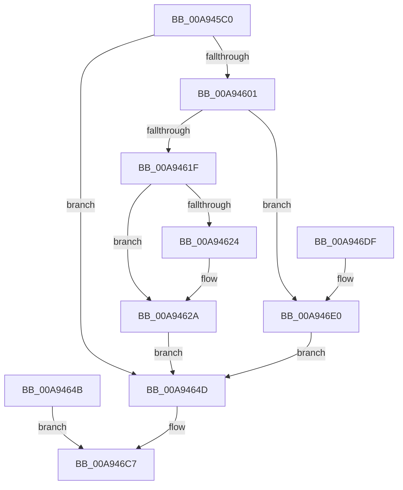

# NtCreateMailslotFile

- RVA: `0x00A945C0`–`0x00A946F0` (길이 `304` bytes)
- VA: `0x0000000140A945C0`
- 실행 섹션: `PAGE`
- PDB 이름 있음: `예`; PDB Function 태그: `아니요`
- unwind 정보 RVA: `0x000B9520`
- 디코드: `61`개 명령, `304/304` bytes 표시
- 미해석 바이트: `0` (있으면 어셈블리에 `.byte`로 보존)

> 이 문서는 커널 이미지의 기계어와 PDB 기호를 분석해 생성했습니다. 4번과 5번은 함수 원형과 자료형을 바이너리 사용 방식에서 추정한 C 해석이며 원본 소스 복구 결과는 아닙니다.

## 1. Dependencies

- 직접 호출 지점: **3**; 고유 호출 대상: **3**
- 직접 호출자로 확인된 함수: **0**
- RIP 상대 이미지 참조: **1**

### Outgoing calls
- `0x00A94624` → [ExRaiseDatatypeMisalignment](../89/ExRaiseDatatypeMisalignment_function_00899FD0.md) (function, `0x00899FD0`)
- `0x00A946C2` → [IopCreateFile](../8A/IopCreateFile_function_008AB298.md) (function, `0x008AB298`)
- `0x00A946D2` → [_security_check_cookie](../../text/6A/_security_check_cookie_function_006AC640.md) (function, `0x006AC640`)

### Direct callers
- 이 함수 시작 RVA로 연결되는 직접 call은 확인되지 않았습니다. 간접 호출은 완전히 역산할 수 없습니다.

### Static image references
- `0x00A945C7` → RVA `0x00E0A740` (`.data`; read)

## 2. Other-region calls and transfers

- 다른 실행 섹션으로 향하는 call: **1**
  - `0x00A946D2` → [_security_check_cookie](../../text/6A/_security_check_cookie_function_006AC640.md) (`PAGE` → `.text`)
- 별도 외부 분기/꼬리 이동을 확인하지 못했습니다.

## 3. Assembly (complete function range)

```asm
00A945C0  48 81 EC A8 00 00 00            sub rsp, 0xa8
00A945C7  48 8B 05 72 61 37 00            mov rax, qword ptr [rip + 0x376172]
00A945CE  48 33 C4                        xor rax, rsp
00A945D1  48 89 84 24 98 00 00 00         mov qword ptr [rsp + 0x98], rax
00A945D9  44 8B DA                        mov r11d, edx
00A945DC  4C 8B D1                        mov r10, rcx
00A945DF  48 8B 94 24 E8 00 00 00         mov rdx, qword ptr [rsp + 0xe8]
00A945E7  0F 57 C0                        xorps xmm0, xmm0
00A945EA  33 C0                           xor eax, eax
00A945EC  0F 11 84 24 80 00 00 00         movups xmmword ptr [rsp + 0x80], xmm0
00A945F4  48 89 84 24 90 00 00 00         mov qword ptr [rsp + 0x90], rax
00A945FC  48 85 D2                        test rdx, rdx
00A945FF  74 4C                           je 0x140a9464d
00A94601  C6 84 24 90 00 00 00 01         mov byte ptr [rsp + 0x90], 1
00A94609  65 48 8B 04 25 88 01 00 00      mov rax, qword ptr gs:[0x188]
00A94612  80 B8 32 02 00 00 00            cmp byte ptr [rax + 0x232], 0
00A94619  0F 84 C1 00 00 00               je 0x140a946e0
00A9461F  F6 C2 03                        test dl, 3
00A94622  74 06                           je 0x140a9462a
00A94624  E8 A7 59 E0 FF                  call 0x140899fd0
00A94629  CC                              int3
00A9462A  48 B8 00 00 FF FF FF 7F 00 00   movabs rax, 0x7fffffff0000
00A94634  48 3B D0                        cmp rdx, rax
00A94637  48 0F 42 C2                     cmovb rax, rdx
00A9463B  90                              nop
00A9463C  8A 00                           mov al, byte ptr [rax]
00A9463E  48 8B 02                        mov rax, qword ptr [rdx]
00A94641  48 89 84 24 88 00 00 00         mov qword ptr [rsp + 0x88], rax
00A94649  EB 02                           jmp 0x140a9464d
00A9464B  EB 7A                           jmp 0x140a946c7
00A9464D  8B 84 24 D8 00 00 00            mov eax, dword ptr [rsp + 0xd8]
00A94654  89 84 24 80 00 00 00            mov dword ptr [rsp + 0x80], eax
00A9465B  8B 84 24 E0 00 00 00            mov eax, dword ptr [rsp + 0xe0]
00A94662  89 84 24 84 00 00 00            mov dword ptr [rsp + 0x84], eax
00A94669  48 83 64 24 78 00               and qword ptr [rsp + 0x78], 0
00A9466F  83 64 24 70 00                  and dword ptr [rsp + 0x70], 0
00A94674  83 64 24 68 00                  and dword ptr [rsp + 0x68], 0
00A94679  48 8D 84 24 80 00 00 00         lea rax, [rsp + 0x80]
00A94681  48 89 44 24 60                  mov qword ptr [rsp + 0x60], rax
00A94686  B9 02 00 00 00                  mov ecx, 2
00A9468B  89 4C 24 58                     mov dword ptr [rsp + 0x58], ecx
00A9468F  83 64 24 50 00                  and dword ptr [rsp + 0x50], 0
00A94694  48 83 64 24 48 00               and qword ptr [rsp + 0x48], 0
00A9469A  8B 84 24 D0 00 00 00            mov eax, dword ptr [rsp + 0xd0]
00A946A1  89 44 24 40                     mov dword ptr [rsp + 0x40], eax
00A946A5  89 4C 24 38                     mov dword ptr [rsp + 0x38], ecx
00A946A9  C7 44 24 30 03 00 00 00         mov dword ptr [rsp + 0x30], 3
00A946B1  83 64 24 28 00                  and dword ptr [rsp + 0x28], 0
00A946B6  48 83 64 24 20 00               and qword ptr [rsp + 0x20], 0
00A946BC  41 8B D3                        mov edx, r11d
00A946BF  49 8B CA                        mov rcx, r10
00A946C2  E8 D1 6B E1 FF                  call 0x1408ab298
00A946C7  48 8B 8C 24 98 00 00 00         mov rcx, qword ptr [rsp + 0x98]
00A946CF  48 33 CC                        xor rcx, rsp
00A946D2  E8 69 7F C1 FF                  call 0x1406ac640
00A946D7  48 81 C4 A8 00 00 00            add rsp, 0xa8
00A946DE  C3                              ret
00A946DF  CC                              int3
00A946E0  48 8B 02                        mov rax, qword ptr [rdx]
00A946E3  48 89 84 24 88 00 00 00         mov qword ptr [rsp + 0x88], rax
00A946EB  E9 5D FF FF FF                  jmp 0x140a9464d
```

## 4. C-style interpretation (structured pseudocode)

```c
__int64 __fastcall NtCreateMailslotFile(__int64 a1, int a2, __int64 a3, __int64 a4, unsigned int a5, unsigned int a6, unsigned int a7, __int64 a8)
{
    __int64 result;
    __int64 v_rsp;
    unsigned __int64 v_stack_m10;
    unsigned __int64 v_stack_m18;
    unsigned __int64 v_stack_m20;
    unsigned int v_stack_m24;
    unsigned __int64 v_stack_m28;
    unsigned __int64 v_stack_m30;
    unsigned int v_stack_m38;
    unsigned int v_stack_m40;
    unsigned __int64 v_stack_m48;
    unsigned int v_stack_m50;
    unsigned int v_stack_m58;
    unsigned __int64 v_stack_m60;
    unsigned int v_stack_m68;
    unsigned int v_stack_m70;
    unsigned int v_stack_m78;
    unsigned int v_stack_m80;
    unsigned __int64 v_stack_m88;
    unsigned __int64 v_stack_p88;

    v_rsp = (v_rsp) - (168);
    result = (*(unsigned __int64 *)(v_rip + 3629426)) ^ (v_rsp);
    v_stack_m10 = result;
    result = 0;
    v_stack_m28 = v_xmm0;
    v_stack_m18 = 0;
    if (a8 == 0) goto loc_00A9464D;
    v_stack_m18 = 1;
    if ((*(unsigned __int8 *)(*(unsigned __int64 *)(gs_base + (0 + 392)) + 562)) == 0) goto loc_00A946E0;
    result = *(unsigned __int64 *)(gs_base + (0 + 392));
    if ((((unsigned __int8)(a8)) & (3)) != 0) {
        result = ExRaiseDatatypeMisalignment(a1, a8, a3, a4);
    }
    if (a8 < result) { result = a8; }
    v_stack_m20 = *(unsigned __int64 *)(a8);
    goto loc_00A9464D;
loc_00A9464D:
    v_stack_m28 = (unsigned int)((unsigned int)(a6));
    v_stack_m24 = (unsigned int)((unsigned int)(a7));
    v_stack_m48 = v_stack_m28;
    v_stack_m50 = 2;
    v_stack_m68 = (unsigned int)((unsigned int)(a5));
    v_stack_m70 = 2;
    v_stack_m78 = 3;
    result = IopCreateFile(a1, (unsigned int)((unsigned int)((unsigned int)(a2))), a3, a4);
loc_00A946C7:
    a1 = (v_stack_m10) ^ (v_rsp);
    result = _security_check_cookie(a1, (unsigned int)((unsigned int)((unsigned int)(a2))), a3, a4);
    v_rsp = (v_rsp) + (168);
    return result;
loc_00A946E0:
    v_stack_p88 = *(unsigned __int64 *)((unsigned int)((unsigned int)((unsigned int)(a2))));
    goto loc_00A9464D;
}
```

## 5. (Beta) C Style

```c
int64_t NtCreateMailslotFile(int64_t Arg1, int32_t Arg2, int64_t Arg3, int64_t Arg4, uint32_t Arg5, uint32_t Arg6, uint32_t Arg7, int64_t Arg8)
{
    int64_t result;
    int64_t local_rsp;
    uint64_t v_stack_m10;
    uint64_t v_stack_m18;
    uint64_t v_stack_m20;
    uint32_t v_stack_m24;
    uint64_t v_stack_m28;
    uint64_t v_stack_m30;
    uint32_t v_stack_m38;
    uint32_t v_stack_m40;
    uint64_t v_stack_m48;
    uint32_t v_stack_m50;
    uint32_t v_stack_m58;
    uint64_t v_stack_m60;
    uint32_t v_stack_m68;
    uint32_t v_stack_m70;
    uint32_t v_stack_m78;
    uint32_t v_stack_m80;
    uint64_t v_stack_m88;
    uint64_t v_stack_p88;

    local_rsp = (local_rsp) - (168);
    result = (*(uint64_t *)(v_rip + 0x376172)) ^ (local_rsp);
    v_stack_m10 = result;
    result = 0;
    v_stack_m28 = v_xmm0;
    v_stack_m18 = 0;
    if (Arg8 == 0) goto loc_00A9464D;
    v_stack_m18 = 1;
    if ((*(uint8_t *)(*(uint64_t *)(gs_base + (0 + 0x188)) + 0x232)) == 0) goto loc_00A946E0;
    result = *(uint64_t *)(gs_base + (0 + 0x188));
    if ((((uint8_t)(Arg8)) & (3)) != 0) {
        result = ExRaiseDatatypeMisalignment(Arg1, Arg8, Arg3, Arg4);
    }
    if (Arg8 < result) { result = Arg8; }
    v_stack_m20 = *(uint64_t *)(Arg8);
    goto loc_00A9464D;
loc_00A9464D:
    v_stack_m28 = (uint32_t)((uint32_t)(Arg6));
    v_stack_m24 = (uint32_t)((uint32_t)(Arg7));
    v_stack_m48 = v_stack_m28;
    v_stack_m50 = 2;
    v_stack_m68 = (uint32_t)((uint32_t)(Arg5));
    v_stack_m70 = 2;
    v_stack_m78 = 3;
    result = IopCreateFile(Arg1, (uint32_t)((uint32_t)((uint32_t)(Arg2))), Arg3, Arg4);
loc_00A946C7:
    Arg1 = (v_stack_m10) ^ (local_rsp);
    result = _security_check_cookie(Arg1, (uint32_t)((uint32_t)((uint32_t)(Arg2))), Arg3, Arg4);
    local_rsp = (local_rsp) + (168);
    return result;
loc_00A946E0:
    v_stack_p88 = *(uint64_t *)((uint32_t)((uint32_t)((uint32_t)(Arg2))));
    goto loc_00A9464D;
}
```

## 6. Execution-region graph

[열기: 2D/3D 그래프와 함수 탐색 컨트롤 패널](../../../control-panel.html?section=page&rva=0x00A945C0&view=graph)

- 2D 그래프는 위에서 아래로 흐르고, 3D 그래프는 빈 공간을 드래그해 회전합니다. Shift+드래그는 이동, 휠은 확대·축소, 함수 노드 선택은 대상 보고서 이동입니다.

### Static fallback


