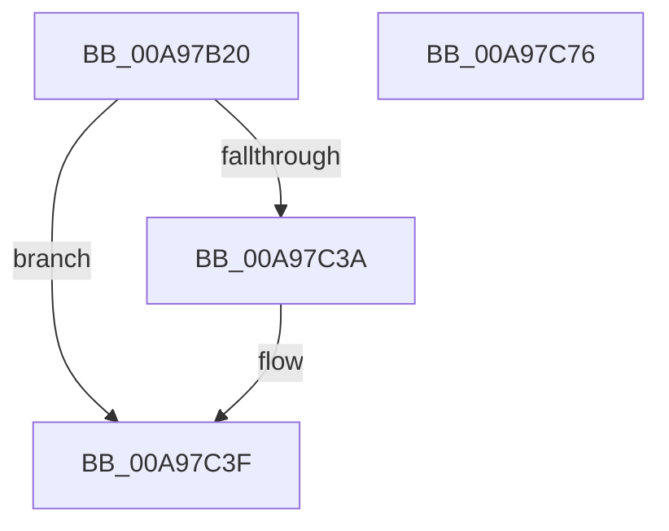

# NtDeleteFile

- RVA: `0x00A97B20`–`0x00A97C77` (길이 `343` bytes)
- VA: `0x0000000140A97B20`
- 실행 섹션: `PAGE`
- PDB 이름 있음: `예`; PDB Function 태그: `아니요`
- unwind 정보 RVA: `0x000B9E20`
- 디코드: `74`개 명령, `343/343` bytes 표시
- 미해석 바이트: `0` (있으면 어셈블리에 `.byte`로 보존)

> 이 문서는 커널 이미지의 기계어와 PDB 기호를 분석해 생성했습니다. 4번과 5번은 함수 원형과 자료형을 바이너리 사용 방식에서 추정한 C 해석이며 원본 소스 복구 결과는 아닙니다.

## 1. Dependencies

- 직접 호출 지점: **6**; 고유 호출 대상: **5**
- 직접 호출자로 확인된 함수: **1**
- RIP 상대 이미지 참조: **2**

### Outgoing calls
- `0x00A97B5E` → [memset](../../text/6C/memset_function_006C6C40.md) (function, `0x006C6C40`)
- `0x00A97B7F` → [memset](../../text/6C/memset_function_006C6C40.md) (function, `0x006C6C40`)
- `0x00A97BD4` → [PsGetCurrentSilo](../../text/40/PsGetCurrentSilo_function_004094A0.md) (function, `0x004094A0`)
- `0x00A97C2A` → [ObOpenObjectByNameEx](../89/ObOpenObjectByNameEx_function_0089A8A0.md) (function, `0x0089A8A0`)
- `0x00A97C3A` → [FsRtlpCleanupEcps](../8A/FsRtlpCleanupEcps_function_008A1220.md) (function, `0x008A1220`)
- `0x00A97C58` → [_security_check_cookie](../../text/6A/_security_check_cookie_function_006AC640.md) (function, `0x006AC640`)

### Direct callers
- [DifNtDeleteFileWrapper](../../text/63/DifNtDeleteFileWrapper_function_00637620.md) at `0x006376ED`

### Static image references
- `0x00A97B3E` → RVA `0x00E0A740` (`.data`; read)
- `0x00A97C03` → RVA `0x00FC6AE0` (`ALMOSTRO`; read)

## 2. Other-region calls and transfers

- 다른 실행 섹션으로 향하는 call: **4**
  - `0x00A97B5E` → [memset](../../text/6C/memset_function_006C6C40.md) (`PAGE` → `.text`)
  - `0x00A97B7F` → [memset](../../text/6C/memset_function_006C6C40.md) (`PAGE` → `.text`)
  - `0x00A97BD4` → [PsGetCurrentSilo](../../text/40/PsGetCurrentSilo_function_004094A0.md) (`PAGE` → `.text`)
  - `0x00A97C58` → [_security_check_cookie](../../text/6A/_security_check_cookie_function_006AC640.md) (`PAGE` → `.text`)
- 별도 외부 분기/꼬리 이동을 확인하지 못했습니다.

## 3. Assembly (complete function range)

```asm
00A97B20  48 8B C4                        mov rax, rsp
00A97B23  48 89 58 10                     mov qword ptr [rax + 0x10], rbx
00A97B27  48 89 70 18                     mov qword ptr [rax + 0x18], rsi
00A97B2B  48 89 78 20                     mov qword ptr [rax + 0x20], rdi
00A97B2F  55                              push rbp
00A97B30  48 8D A8 A8 FE FF FF            lea rbp, [rax - 0x158]
00A97B37  48 81 EC 50 02 00 00            sub rsp, 0x250
00A97B3E  48 8B 05 FB 2B 37 00            mov rax, qword ptr [rip + 0x372bfb]
00A97B45  48 33 C4                        xor rax, rsp
00A97B48  48 89 85 40 01 00 00            mov qword ptr [rbp + 0x140], rax
00A97B4F  48 8B F9                        mov rdi, rcx
00A97B52  33 D2                           xor edx, edx
00A97B54  48 8D 4D 30                     lea rcx, [rbp + 0x30]
00A97B58  41 B8 10 01 00 00               mov r8d, 0x110
00A97B5E  E8 DD F0 C2 FF                  call 0x1406c6c40
00A97B63  65 48 8B 04 25 88 01 00 00      mov rax, qword ptr gs:[0x188]
00A97B6C  48 8D 4C 24 50                  lea rcx, [rsp + 0x50]
00A97B71  33 D2                           xor edx, edx
00A97B73  41 B8 E0 00 00 00               mov r8d, 0xe0
00A97B79  8A 98 32 02 00 00               mov bl, byte ptr [rax + 0x232]
00A97B7F  E8 BC F0 C2 FF                  call 0x1406c6c40
00A97B84  0F 57 C0                        xorps xmm0, xmm0
00A97B87  C7 44 24 50 08 00 E0 00         mov dword ptr [rsp + 0x50], 0xe00008
00A97B8F  B8 07 00 00 00                  mov eax, 7
00A97B94  C7 45 90 00 10 00 00            mov dword ptr [rbp - 0x70], 0x1000
00A97B9B  66 89 45 96                     mov word ptr [rbp - 0x6a], ax
00A97B9F  48 8D 45 30                     lea rax, [rbp + 0x30]
00A97BA3  48 89 45 E0                     mov qword ptr [rbp - 0x20], rax
00A97BA7  33 C0                           xor eax, eax
00A97BA9  48 89 45 10                     mov qword ptr [rbp + 0x10], rax
00A97BAD  B8 28 00 00 00                  mov eax, 0x28
00A97BB2  0F 11 45 F0                     movups xmmword ptr [rbp - 0x10], xmm0
00A97BB6  66 89 45 F0                     mov word ptr [rbp - 0x10], ax
00A97BBA  C7 45 A8 01 00 00 00            mov dword ptr [rbp - 0x58], 1
00A97BC1  C6 45 DA 01                     mov byte ptr [rbp - 0x26], 1
00A97BC5  48 89 7D 80                     mov qword ptr [rbp - 0x80], rdi
00A97BC9  C7 45 E8 20 00 00 00            mov dword ptr [rbp - 0x18], 0x20
00A97BD0  0F 11 45 00                     movups xmmword ptr [rbp], xmm0
00A97BD4  E8 C7 18 97 FF                  call 0x1404094a0
00A97BD9  48 89 45 10                     mov qword ptr [rbp + 0x10], rax
00A97BDD  45 33 C9                        xor r9d, r9d
00A97BE0  65 48 8B 04 25 88 01 00 00      mov rax, qword ptr gs:[0x188]
00A97BE9  44 8A C3                        mov r8b, bl
00A97BEC  48 8B CF                        mov rcx, rdi
00A97BEF  48 FF 80 90 03 00 00            inc qword ptr [rax + 0x390]
00A97BF6  48 8D 44 24 40                  lea rax, [rsp + 0x40]
00A97BFB  65 FF 04 25 E4 2E 00 00         inc dword ptr gs:[0x2ee4]
00A97C03  48 8B 15 D6 EE 52 00            mov rdx, qword ptr [rip + 0x52eed6]
00A97C0A  48 89 44 24 38                  mov qword ptr [rsp + 0x38], rax
00A97C0F  48 8B 45 10                     mov rax, qword ptr [rbp + 0x10]
00A97C13  48 89 44 24 30                  mov qword ptr [rsp + 0x30], rax
00A97C18  48 8D 44 24 50                  lea rax, [rsp + 0x50]
00A97C1D  48 89 44 24 28                  mov qword ptr [rsp + 0x28], rax
00A97C22  C7 44 24 20 00 00 01 00         mov dword ptr [rsp + 0x20], 0x10000
00A97C2A  E8 71 2C E0 FF                  call 0x14089a8a0
00A97C2F  48 8B 4D F8                     mov rcx, qword ptr [rbp - 8]
00A97C33  8B D8                           mov ebx, eax
00A97C35  48 85 C9                        test rcx, rcx
00A97C38  74 05                           je 0x140a97c3f
00A97C3A  E8 E1 95 E0 FF                  call 0x1408a1220
00A97C3F  81 7C 24 70 51 02 AA BE         cmp dword ptr [rsp + 0x70], 0xbeaa0251
00A97C47  8B 44 24 60                     mov eax, dword ptr [rsp + 0x60]
00A97C4B  0F 45 C3                        cmovne eax, ebx
00A97C4E  48 8B 8D 40 01 00 00            mov rcx, qword ptr [rbp + 0x140]
00A97C55  48 33 CC                        xor rcx, rsp
00A97C58  E8 E3 49 C1 FF                  call 0x1406ac640
00A97C5D  4C 8D 9C 24 50 02 00 00         lea r11, [rsp + 0x250]
00A97C65  49 8B 5B 18                     mov rbx, qword ptr [r11 + 0x18]
00A97C69  49 8B 73 20                     mov rsi, qword ptr [r11 + 0x20]
00A97C6D  49 8B 7B 28                     mov rdi, qword ptr [r11 + 0x28]
00A97C71  49 8B E3                        mov rsp, r11
00A97C74  5D                              pop rbp
00A97C75  C3                              ret
00A97C76  CC                              int3
```

## 4. C-style interpretation (structured pseudocode)

```c
__int64 __fastcall NtDeleteFile(__int64 a1, int a2, __int64 a3, int a4)
{
    __int64 result;
    __int64 v_rsp;
    unsigned int v_stack_m1E8;
    unsigned int v_stack_m1F8;
    unsigned __int64 v_stack_m208;
    unsigned __int64 v_stack_m218;
    unsigned __int64 v_stack_m220;
    unsigned __int64 v_stack_m228;
    unsigned __int64 v_stack_m230;
    unsigned int v_stack_m238;
    unsigned __int64 v_stack_m8;

    *(unsigned __int64 *)(v_rsp + 16) = v_rbx;
    *(unsigned __int64 *)(v_rsp + 24) = v_rsi;
    *(unsigned __int64 *)(v_rsp + 32) = v_rdi;
    v_rsp = (v_rsp) - (592);
    result = (*(unsigned __int64 *)(v_rip + 3615739)) ^ (v_rsp);
    *(unsigned __int64 *)(v_rsp - 344 + 320) = result;
    a2 = 0;
    result = memset(v_rsp - 344 + 48, a2, 272, a4);
    a2 = 0;
    result = memset(v_stack_m208, a2, 224, a4);
    v_stack_m208 = 0xE00008ULL;
    *(unsigned int *)(v_rsp - 344 - 112) = 0x1000ULL;
    *(unsigned __int16 *)(v_rsp - 344 - 106) = 7;
    *(unsigned __int64 *)(v_rsp - 344 - 32) = v_rsp - 344 + 48;
    result = 0;
    *(unsigned __int64 *)(v_rsp - 344 + 16) = 0;
    *(unsigned __int64 *)(v_rsp - 344 - 16) = v_xmm0;
    *(unsigned __int16 *)(v_rsp - 344 - 16) = 40;
    *(unsigned int *)(v_rsp - 344 - 88) = 1;
    *(unsigned __int8 *)(v_rsp - 344 - 38) = 1;
    *(unsigned __int64 *)(v_rsp - 344 - 128) = a1;
    *(unsigned int *)(v_rsp - 344 - 24) = 32;
    *(unsigned __int64 *)(v_rsp - 344) = v_xmm0;
    result = PsGetCurrentSilo(v_stack_m208, a2, 224, a4);
    *(unsigned __int64 *)(v_rsp - 344 + 16) = result;
    a4 = 0;
    v_stack_m220 = v_stack_m218;
    v_stack_m228 = *(unsigned __int64 *)(v_rsp - 344 + 16);
    v_stack_m230 = v_stack_m208;
    v_stack_m238 = 0x10000ULL;
    result = ObOpenObjectByNameEx(a1, *(unsigned __int64 *)(v_rip + 5435094), (unsigned __int8)(*(unsigned __int8 *)(*(unsigned __int64 *)(gs_base + (0 + 392)) + 562)), a4);
    if (*(unsigned __int64 *)(v_rsp - 344 - 8) != 0) {
        result = FsRtlpCleanupEcps(*(unsigned __int64 *)(v_rsp - 344 - 8), *(unsigned __int64 *)(v_rip + 5435094), (unsigned __int8)(*(unsigned __int8 *)(*(unsigned __int64 *)(gs_base + (0 + 392)) + 562)), a4);
    }
    result = (unsigned int)(v_stack_m1F8);
    if (v_stack_m1E8 != 0xBEAA0251ULL) { result = (unsigned int)((unsigned int)((unsigned int)(result))); }
    a1 = (*(unsigned __int64 *)(v_rsp - 344 + 320)) ^ (v_rsp);
    result = _security_check_cookie(a1, *(unsigned __int64 *)(v_rip + 5435094), (unsigned __int8)(*(unsigned __int8 *)(*(unsigned __int64 *)(gs_base + (0 + 392)) + 562)), a4);
    return result;
}
```

## 5. (Beta) C Style

```c
int64_t NtDeleteFile(int64_t Arg1, int32_t Arg2, int64_t Arg3, int32_t Arg4)
{
    int64_t result;
    int64_t local_rsp;
    uint32_t v_stack_m1E8;
    uint32_t v_stack_m1F8;
    uint64_t v_stack_m208;
    uint64_t v_stack_m218;
    uint64_t v_stack_m220;
    uint64_t v_stack_m228;
    uint64_t v_stack_m230;
    uint32_t v_stack_m238;
    uint64_t v_stack_m8;

    *(uint64_t *)(local_rsp + 0x10) = local_rbx;
    *(uint64_t *)(local_rsp + 0x18) = local_rsi;
    *(uint64_t *)(local_rsp + 0x20) = local_rdi;
    local_rsp = (local_rsp) - (592);
    result = (*(uint64_t *)(v_rip + 0x372BFB)) ^ (local_rsp);
    *(uint64_t *)(local_rsp - 0x158 + 0x140) = result;
    Arg2 = 0;
    result = memset(local_rsp - 344 + 48, Arg2, 272, Arg4);
    Arg2 = 0;
    result = memset(v_stack_m208, Arg2, 224, Arg4);
    v_stack_m208 = 0xE00008ULL;
    *(uint32_t *)(local_rsp - 0x158 - 0x70) = 0x1000ULL;
    *(uint16_t *)(local_rsp - 0x158 - 0x6A) = 7;
    *(uint64_t *)(local_rsp - 0x158 - 0x20) = local_rsp - 344 + 48;
    result = 0;
    *(uint64_t *)(local_rsp - 0x158 + 0x10) = 0;
    *(uint64_t *)(local_rsp - 0x158 - 0x10) = v_xmm0;
    *(uint16_t *)(local_rsp - 0x158 - 0x10) = 40;
    *(uint32_t *)(local_rsp - 0x158 - 0x58) = 1;
    *(uint8_t *)(local_rsp - 0x158 - 0x26) = 1;
    *(uint64_t *)(local_rsp - 0x158 - 0x80) = Arg1;
    *(uint32_t *)(local_rsp - 0x158 - 0x18) = 32;
    *(uint64_t *)(local_rsp - 0x158) = v_xmm0;
    result = PsGetCurrentSilo(v_stack_m208, Arg2, 224, Arg4);
    *(uint64_t *)(local_rsp - 0x158 + 0x10) = result;
    Arg4 = 0;
    v_stack_m220 = v_stack_m218;
    v_stack_m228 = *(uint64_t *)(local_rsp - 0x158 + 0x10);
    v_stack_m230 = v_stack_m208;
    v_stack_m238 = 0x10000ULL;
    result = ObOpenObjectByNameEx(Arg1, *(uint64_t *)(v_rip + 0x52EED6), (uint8_t)(*(uint8_t *)(*(uint64_t *)(gs_base + (0 + 0x188)) + 0x232)), Arg4);
    if (*(uint64_t *)(local_rsp - 0x158 - 0x8) != 0) {
        result = FsRtlpCleanupEcps(*(uint64_t *)(local_rsp - 0x158 - 0x8), *(uint64_t *)(v_rip + 0x52EED6), (uint8_t)(*(uint8_t *)(*(uint64_t *)(gs_base + (0 + 0x188)) + 0x232)), Arg4);
    }
    result = (uint32_t)(v_stack_m1F8);
    if (v_stack_m1E8 != 0xBEAA0251ULL) { result = (uint32_t)((uint32_t)((uint32_t)(result))); }
    Arg1 = (*(uint64_t *)(local_rsp - 0x158 + 0x140)) ^ (local_rsp);
    result = _security_check_cookie(Arg1, *(uint64_t *)(v_rip + 0x52EED6), (uint8_t)(*(uint8_t *)(*(uint64_t *)(gs_base + (0 + 0x188)) + 0x232)), Arg4);
    return result;
}
```

## 6. Execution-region graph

[열기: 2D/3D 그래프와 함수 탐색 컨트롤 패널](../../../control-panel.html?section=page&rva=0x00A97B20&view=graph)

- 2D 그래프는 위에서 아래로 흐르고, 3D 그래프는 빈 공간을 드래그해 회전합니다. Shift+드래그는 이동, 휠은 확대·축소, 함수 노드 선택은 대상 보고서 이동입니다.

### Static fallback


