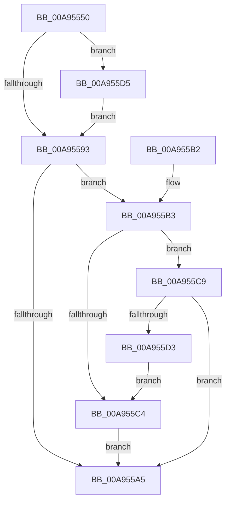

# NtGetCurrentProcessorNumber

- RVA: `0x00A95550`–`0x00A955E1` (길이 `145` bytes)
- VA: `0x0000000140A95550`
- 실행 섹션: `PAGE`
- PDB 이름 있음: `예`; PDB Function 태그: `아니요`
- unwind 정보 RVA: `0x000B9820`
- 디코드: `38`개 명령, `145/145` bytes 표시
- 미해석 바이트: `0` (있으면 어셈블리에 `.byte`로 보존)

> 이 문서는 커널 이미지의 기계어와 PDB 기호를 분석해 생성했습니다. 4번과 5번은 함수 원형과 자료형을 바이너리 사용 방식에서 추정한 C 해석이며 원본 소스 복구 결과는 아닙니다.

## 1. Dependencies

- 직접 호출 지점: **3**; 고유 호출 대상: **3**
- 직접 호출자로 확인된 함수: **0**
- RIP 상대 이미지 참조: **0**

### Outgoing calls
- `0x00A95583` → [KeQueryPrimaryGroupAffinityThread](../../text/3C/KeQueryPrimaryGroupAffinityThread_function_003C7238.md) (function, `0x003C7238`)
- `0x00A95596` → [IoThreadToProcess](../../text/44/IoThreadToProcess_function_00448540.md) (function, `0x00448540`)
- `0x00A955D8` → [KeFindBiasedSetMember](../../text/41/KeFindBiasedSetMember_function_00414DE0.md) (function, `0x00414DE0`)

### Direct callers
- 이 함수 시작 RVA로 연결되는 직접 call은 확인되지 않았습니다. 간접 호출은 완전히 역산할 수 없습니다.

### Static image references
- 디코드된 RIP-relative 메모리 참조가 없습니다.

## 2. Other-region calls and transfers

- 다른 실행 섹션으로 향하는 call: **3**
  - `0x00A95583` → [KeQueryPrimaryGroupAffinityThread](../../text/3C/KeQueryPrimaryGroupAffinityThread_function_003C7238.md) (`PAGE` → `.text`)
  - `0x00A95596` → [IoThreadToProcess](../../text/44/IoThreadToProcess_function_00448540.md) (`PAGE` → `.text`)
  - `0x00A955D8` → [KeFindBiasedSetMember](../../text/41/KeFindBiasedSetMember_function_00414DE0.md) (`PAGE` → `.text`)
- 별도 외부 분기/꼬리 이동을 확인하지 못했습니다.

## 3. Assembly (complete function range)

```asm
00A95550  48 89 5C 24 08                  mov qword ptr [rsp + 8], rbx
00A95555  57                              push rdi
00A95556  48 83 EC 30                     sub rsp, 0x30
00A9555A  65 48 8B 04 25 20 00 00 00      mov rax, qword ptr gs:[0x20]
00A95563  48 8D 54 24 20                  lea rdx, [rsp + 0x20]
00A95568  65 48 8B 3C 25 88 01 00 00      mov rdi, qword ptr gs:[0x188]
00A95571  0F 57 C0                        xorps xmm0, xmm0
00A95574  48 8B CF                        mov rcx, rdi
00A95577  0F 11 44 24 20                  movups xmmword ptr [rsp + 0x20], xmm0
00A9557C  0F B6 98 D1 00 00 00            movzx ebx, byte ptr [rax + 0xd1]
00A95583  E8 B0 1C 93 FF                  call 0x1403c7238
00A95588  48 8B 4C 24 20                  mov rcx, qword ptr [rsp + 0x20]
00A9558D  48 0F A3 D9                     bt rcx, rbx
00A95591  73 42                           jae 0x140a955d5
00A95593  48 8B CF                        mov rcx, rdi
00A95596  E8 A5 2F 9B FF                  call 0x140448540
00A9559B  48 83 B8 10 03 00 00 00         cmp qword ptr [rax + 0x310], 0
00A955A3  75 0E                           jne 0x140a955b3
00A955A5  8B C3                           mov eax, ebx
00A955A7  48 8B 5C 24 40                  mov rbx, qword ptr [rsp + 0x40]
00A955AC  48 83 C4 30                     add rsp, 0x30
00A955B0  5F                              pop rdi
00A955B1  C3                              ret
00A955B2  CC                              int3
00A955B3  0F B7 80 EC 06 00 00            movzx eax, word ptr [rax + 0x6ec]
00A955BA  B9 4C 01 00 00                  mov ecx, 0x14c
00A955BF  66 3B C1                        cmp ax, cx
00A955C2  75 05                           jne 0x140a955c9
00A955C4  83 E3 1F                        and ebx, 0x1f
00A955C7  EB DC                           jmp 0x140a955a5
00A955C9  B9 C4 01 00 00                  mov ecx, 0x1c4
00A955CE  66 3B C1                        cmp ax, cx
00A955D1  75 D2                           jne 0x140a955a5
00A955D3  EB EF                           jmp 0x140a955c4
00A955D5  48 8B D3                        mov rdx, rbx
00A955D8  E8 03 F8 97 FF                  call 0x140414de0
00A955DD  8B D8                           mov ebx, eax
00A955DF  EB B2                           jmp 0x140a95593
```

## 4. C-style interpretation (structured pseudocode)

```c
__int64 __fastcall NtGetCurrentProcessorNumber(void)
{
    __int64 result;
    __int64 v_rbx;
    __int64 v_rsp;
    unsigned __int64 v_stack_m18;
    unsigned __int64 v_stack_p8;

    v_stack_p8 = v_rbx;
    v_rsp = (v_rsp) - (48);
    v_stack_m18 = v_xmm0;
    result = KeQueryPrimaryGroupAffinityThread(*(unsigned __int64 *)(gs_base + (0 + 392)), v_stack_m18, a3, a4);
    if (condition_is_above_or_equal) goto loc_00A955D5;
loc_00A95593:
    result = IoThreadToProcess(*(unsigned __int64 *)(gs_base + (0 + 392)), v_stack_m18, a3, a4);
    if ((*(unsigned __int64 *)(result + 784)) != 0) goto loc_00A955B3;
loc_00A955A5:
    v_rsp = (v_rsp) + (48);
    return (unsigned int)((unsigned int)(*(unsigned __int8 *)(*(unsigned __int64 *)(gs_base + (0 + 32)) + 209)));
loc_00A955B3:
    if (((unsigned __int16)(*(unsigned __int16 *)((unsigned int)((unsigned int)(*(unsigned __int8 *)(*(unsigned __int64 *)(gs_base + (0 + 32)) + 209))) + 1772))) != 332) goto loc_00A955C9;
loc_00A955C4:
    v_rbx = (unsigned int)((v_stack_p8) & (31));
    goto loc_00A955A5;
loc_00A955C9:
    if (((unsigned __int16)(*(unsigned __int16 *)((unsigned int)((unsigned int)(*(unsigned __int8 *)(*(unsigned __int64 *)(gs_base + (0 + 32)) + 209))) + 1772))) != 452) goto loc_00A955A5;
    goto loc_00A955C4;
loc_00A955D5:
    result = KeFindBiasedSetMember(452, v_rbx, a3, a4);
    goto loc_00A95593;
}
```

## 5. (Beta) C Style

```c
void NtGetCurrentProcessorNumber(void)
{
    int64_t result;
    int64_t local_rbx;
    int64_t local_rsp;
    uint64_t v_stack_m18;
    uint64_t v_stack_p8;

    v_stack_p8 = local_rbx;
    local_rsp = (local_rsp) - (48);
    v_stack_m18 = v_xmm0;
    result = KeQueryPrimaryGroupAffinityThread(*(uint64_t *)(gs_base + (0 + 0x188)), v_stack_m18, a3, a4);
    if (condition_is_above_or_equal) goto loc_00A955D5;
loc_00A95593:
    result = IoThreadToProcess(*(uint64_t *)(gs_base + (0 + 0x188)), v_stack_m18, a3, a4);
    if ((*(uint64_t *)(result + 0x310)) != 0) goto loc_00A955B3;
loc_00A955A5:
    local_rsp = (local_rsp) + (48);
    return (uint32_t)((uint32_t)(*(uint8_t *)(*(uint64_t *)(gs_base + (0 + 0x20)) + 0xD1)));
loc_00A955B3:
    if (((uint16_t)(*(uint16_t *)((uint32_t)((uint32_t)(*(uint8_t *)(*(uint64_t *)(gs_base + (0 + 0x20)) + 0xD1))) + 0x6EC))) != 332) goto loc_00A955C9;
loc_00A955C4:
    local_rbx = (uint32_t)((v_stack_p8) & (31));
    goto loc_00A955A5;
loc_00A955C9:
    if (((uint16_t)(*(uint16_t *)((uint32_t)((uint32_t)(*(uint8_t *)(*(uint64_t *)(gs_base + (0 + 0x20)) + 0xD1))) + 0x6EC))) != 452) goto loc_00A955A5;
    goto loc_00A955C4;
loc_00A955D5:
    result = KeFindBiasedSetMember(452, local_rbx, a3, a4);
    goto loc_00A95593;
}
```

## 6. Execution-region graph

[열기: 2D/3D 그래프와 함수 탐색 컨트롤 패널](../../../control-panel.html?section=page&rva=0x00A95550&view=graph)

- 2D 그래프는 위에서 아래로 흐르고, 3D 그래프는 빈 공간을 드래그해 회전합니다. Shift+드래그는 이동, 휠은 확대·축소, 함수 노드 선택은 대상 보고서 이동입니다.

### Static fallback


