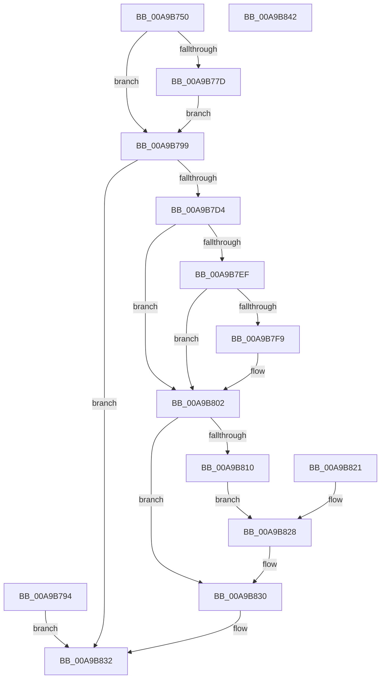

# NtGetDevicePowerState

- RVA: `0x00A9B750`–`0x00A9B843` (길이 `243` bytes)
- VA: `0x0000000140A9B750`
- 실행 섹션: `PAGE`
- PDB 이름 있음: `예`; PDB Function 태그: `아니요`
- unwind 정보 RVA: `0x000BA3F0`
- 디코드: `62`개 명령, `243/243` bytes 표시
- 미해석 바이트: `0` (있으면 어셈블리에 `.byte`로 보존)

> 이 문서는 커널 이미지의 기계어와 PDB 기호를 분석해 생성했습니다. 4번과 5번은 함수 원형과 자료형을 바이너리 사용 방식에서 추정한 C 해석이며 원본 소스 복구 결과는 아닙니다.

## 1. Dependencies

- 직접 호출 지점: **5**; 고유 호출 대상: **4**
- 직접 호출자로 확인된 함수: **1**
- RIP 상대 이미지 참조: **1**

### Outgoing calls
- `0x00A9B7CB` → [ObReferenceObjectByHandle](../86/ObReferenceObjectByHandle_function_00868DB0.md) (function, `0x00868DB0`)
- `0x00A9B7E4` → [PnpGetRelatedTargetDevice](../../text/27/PnpGetRelatedTargetDevice_function_00271F54.md) (function, `0x00271F54`)
- `0x00A9B807` → [ObfDereferenceObject](../../text/2F/ObfDereferenceObject_function_002F9350.md) (function, `0x002F9350`)
- `0x00A9B817` → [PopLockGetDoDevicePowerState](../../text/4B/PopLockGetDoDevicePowerState_function_004BE7E8.md) (function, `0x004BE7E8`)
- `0x00A9B82B` → [ObfDereferenceObject](../../text/2F/ObfDereferenceObject_function_002F9350.md) (function, `0x002F9350`)

### Direct callers
- [PfpVolumeOpenAndVerify](../93/PfpVolumeOpenAndVerify_function_009381F4.md) at `0x00938515`

### Static image references
- `0x00A9B7A9` → RVA `0x00FC6AE0` (`ALMOSTRO`; read)

## 2. Other-region calls and transfers

- 다른 실행 섹션으로 향하는 call: **4**
  - `0x00A9B7E4` → [PnpGetRelatedTargetDevice](../../text/27/PnpGetRelatedTargetDevice_function_00271F54.md) (`PAGE` → `.text`)
  - `0x00A9B807` → [ObfDereferenceObject](../../text/2F/ObfDereferenceObject_function_002F9350.md) (`PAGE` → `.text`)
  - `0x00A9B817` → [PopLockGetDoDevicePowerState](../../text/4B/PopLockGetDoDevicePowerState_function_004BE7E8.md) (`PAGE` → `.text`)
  - `0x00A9B82B` → [ObfDereferenceObject](../../text/2F/ObfDereferenceObject_function_002F9350.md) (`PAGE` → `.text`)
- 별도 외부 분기/꼬리 이동을 확인하지 못했습니다.

## 3. Assembly (complete function range)

```asm
00A9B750  48 89 5C 24 08                  mov qword ptr [rsp + 8], rbx
00A9B755  48 89 74 24 10                  mov qword ptr [rsp + 0x10], rsi
00A9B75A  57                              push rdi
00A9B75B  48 83 EC 40                     sub rsp, 0x40
00A9B75F  48 8B F2                        mov rsi, rdx
00A9B762  4C 8B D1                        mov r10, rcx
00A9B765  33 DB                           xor ebx, ebx
00A9B767  48 89 5C 24 30                  mov qword ptr [rsp + 0x30], rbx
00A9B76C  65 48 8B 04 25 88 01 00 00      mov rax, qword ptr gs:[0x188]
00A9B775  38 98 32 02 00 00               cmp byte ptr [rax + 0x232], bl
00A9B77B  74 1C                           je 0x140a9b799
00A9B77D  48 B9 00 00 FF FF FF 7F 00 00   movabs rcx, 0x7fffffff0000
00A9B787  48 3B D1                        cmp rdx, rcx
00A9B78A  48 0F 42 CA                     cmovb rcx, rdx
00A9B78E  8B 01                           mov eax, dword ptr [rcx]
00A9B790  89 01                           mov dword ptr [rcx], eax
00A9B792  EB 05                           jmp 0x140a9b799
00A9B794  E9 99 00 00 00                  jmp 0x140a9b832
00A9B799  65 48 8B 04 25 88 01 00 00      mov rax, qword ptr gs:[0x188]
00A9B7A2  44 8A 88 32 02 00 00            mov r9b, byte ptr [rax + 0x232]
00A9B7A9  4C 8B 05 30 B3 52 00            mov r8, qword ptr [rip + 0x52b330]
00A9B7B0  48 83 64 24 60 00               and qword ptr [rsp + 0x60], 0
00A9B7B6  48 83 64 24 28 00               and qword ptr [rsp + 0x28], 0
00A9B7BC  48 8D 44 24 60                  lea rax, [rsp + 0x60]
00A9B7C1  48 89 44 24 20                  mov qword ptr [rsp + 0x20], rax
00A9B7C6  33 D2                           xor edx, edx
00A9B7C8  49 8B CA                        mov rcx, r10
00A9B7CB  E8 E0 D5 DC FF                  call 0x140868db0
00A9B7D0  85 C0                           test eax, eax
00A9B7D2  78 5E                           js 0x140a9b832
00A9B7D4  48 83 64 24 68 00               and qword ptr [rsp + 0x68], 0
00A9B7DA  48 8D 54 24 68                  lea rdx, [rsp + 0x68]
00A9B7DF  48 8B 4C 24 60                  mov rcx, qword ptr [rsp + 0x60]
00A9B7E4  E8 6B 67 7D FF                  call 0x140271f54
00A9B7E9  8B F8                           mov edi, eax
00A9B7EB  85 C0                           test eax, eax
00A9B7ED  78 13                           js 0x140a9b802
00A9B7EF  48 8B 44 24 68                  mov rax, qword ptr [rsp + 0x68]
00A9B7F4  48 85 C0                        test rax, rax
00A9B7F7  74 09                           je 0x140a9b802
00A9B7F9  48 8B 58 20                     mov rbx, qword ptr [rax + 0x20]
00A9B7FD  48 89 5C 24 30                  mov qword ptr [rsp + 0x30], rbx
00A9B802  48 8B 4C 24 60                  mov rcx, qword ptr [rsp + 0x60]
00A9B807  E8 44 DB 85 FF                  call 0x1402f9350
00A9B80C  85 FF                           test edi, edi
00A9B80E  78 20                           js 0x140a9b830
00A9B810  48 8B 8B 38 01 00 00            mov rcx, qword ptr [rbx + 0x138]
00A9B817  E8 CC 2F A2 FF                  call 0x1404be7e8
00A9B81C  90                              nop
00A9B81D  89 06                           mov dword ptr [rsi], eax
00A9B81F  EB 07                           jmp 0x140a9b828
00A9B821  8B F8                           mov edi, eax
00A9B823  48 8B 5C 24 30                  mov rbx, qword ptr [rsp + 0x30]
00A9B828  48 8B CB                        mov rcx, rbx
00A9B82B  E8 20 DB 85 FF                  call 0x1402f9350
00A9B830  8B C7                           mov eax, edi
00A9B832  48 8B 5C 24 50                  mov rbx, qword ptr [rsp + 0x50]
00A9B837  48 8B 74 24 58                  mov rsi, qword ptr [rsp + 0x58]
00A9B83C  48 83 C4 40                     add rsp, 0x40
00A9B840  5F                              pop rdi
00A9B841  C3                              ret
00A9B842  CC                              int3
```

## 4. C-style interpretation (structured pseudocode)

```c
__int64 __fastcall NtGetDevicePowerState(__int64 a1, __int64 a2)
{
    __int64 result;
    __int64 v_rbx;
    __int64 v_rsp;
    unsigned __int64 v_stack_m18;
    unsigned __int64 v_stack_m20;
    unsigned __int64 v_stack_m28;
    unsigned __int64 v_stack_p10;
    unsigned __int64 v_stack_p18;
    unsigned __int64 v_stack_p20;
    unsigned __int64 v_stack_p8;

    v_stack_p8 = v_rbx;
    v_stack_p10 = v_rsi;
    v_rsp = (v_rsp) - (64);
    v_rbx = 0;
    v_stack_m18 = 0;
    if ((*(unsigned __int8 *)(*(unsigned __int64 *)(gs_base + (0 + 392)) + 562)) == 0) goto loc_00A9B799;
    if (a2 < a1) { a1 = a2; }
    *(unsigned int *)(a1) = (unsigned int)((unsigned int)(*(unsigned int *)(a1)));
    goto loc_00A9B799;
loc_00A9B799:
    v_stack_m28 = v_stack_p18;
    a2 = 0;
    result = ObReferenceObjectByHandle(a1, a2, *(unsigned __int64 *)(v_rip + 5419824), *(unsigned __int8 *)(*(unsigned __int64 *)(gs_base + (0 + 392)) + 562));
    if (sign_flag) goto loc_00A9B832;
    result = PnpGetRelatedTargetDevice(v_stack_p18, v_stack_p20, *(unsigned __int64 *)(v_rip + 5419824), *(unsigned __int8 *)(*(unsigned __int64 *)(gs_base + (0 + 392)) + 562));
    if (sign_flag) goto loc_00A9B802;
    if (v_stack_p20 != 0) {
        v_rbx = *(unsigned __int64 *)(v_stack_p20 + 32);
        v_stack_m18 = v_rbx;
    }
    result = ObfDereferenceObject(v_stack_p18, v_stack_p20, *(unsigned __int64 *)(v_rip + 5419824), *(unsigned __int8 *)(*(unsigned __int64 *)(gs_base + (0 + 392)) + 562));
    if (sign_flag) goto loc_00A9B830;
    result = PopLockGetDoDevicePowerState(*(unsigned __int64 *)(v_rbx + 312), v_stack_p20, *(unsigned __int64 *)(v_rip + 5419824), *(unsigned __int8 *)(*(unsigned __int64 *)(gs_base + (0 + 392)) + 562));
    *(unsigned int *)(a2) = (unsigned int)(result);
    goto loc_00A9B828;
loc_00A9B828:
    result = ObfDereferenceObject(v_rbx, v_stack_p20, *(unsigned __int64 *)(v_rip + 5419824), *(unsigned __int8 *)(*(unsigned __int64 *)(gs_base + (0 + 392)) + 562));
loc_00A9B830:
loc_00A9B832:
    v_rsp = (v_rsp) + (64);
    return (unsigned int)((unsigned int)((unsigned int)((unsigned int)(result))));
}
```

## 5. (Beta) C Style

```c
int64_t NtGetDevicePowerState(int64_t Arg1, void *Arg2)
{
    uint8_t *arg2 = (uint8_t *)Arg2;

    int64_t result;
    int64_t local_rbx;
    int64_t local_rsp;
    uint64_t v_stack_m18;
    uint64_t v_stack_m20;
    uint64_t v_stack_m28;
    uint64_t v_stack_p10;
    uint64_t v_stack_p18;
    uint64_t v_stack_p20;
    uint64_t v_stack_p8;

    v_stack_p8 = local_rbx;
    v_stack_p10 = local_rsi;
    local_rsp = (local_rsp) - (64);
    local_rbx = 0;
    v_stack_m18 = 0;
    if ((*(uint8_t *)(*(uint64_t *)(gs_base + (0 + 0x188)) + 0x232)) == 0) goto loc_00A9B799;
    if (Arg2 < Arg1) { Arg1 = Arg2; }
    *(uint32_t *)(Arg1) = (uint32_t)((uint32_t)(*(uint32_t *)(Arg1)));
    goto loc_00A9B799;
loc_00A9B799:
    v_stack_m28 = v_stack_p18;
    Arg2 = 0;
    result = ObReferenceObjectByHandle(Arg1, Arg2, *(uint64_t *)(v_rip + 0x52B330), *(uint8_t *)(*(uint64_t *)(gs_base + (0 + 0x188)) + 0x232));
    if (sign_flag) goto loc_00A9B832;
    result = PnpGetRelatedTargetDevice(v_stack_p18, v_stack_p20, *(uint64_t *)(v_rip + 0x52B330), *(uint8_t *)(*(uint64_t *)(gs_base + (0 + 0x188)) + 0x232));
    if (sign_flag) goto loc_00A9B802;
    if (v_stack_p20 != 0) {
        local_rbx = *(uint64_t *)(v_stack_p20 + 0x20);
        v_stack_m18 = local_rbx;
    }
    result = ObfDereferenceObject(v_stack_p18, v_stack_p20, *(uint64_t *)(v_rip + 0x52B330), *(uint8_t *)(*(uint64_t *)(gs_base + (0 + 0x188)) + 0x232));
    if (sign_flag) goto loc_00A9B830;
    result = PopLockGetDoDevicePowerState(*(uint64_t *)(local_rbx + 0x138), v_stack_p20, *(uint64_t *)(v_rip + 0x52B330), *(uint8_t *)(*(uint64_t *)(gs_base + (0 + 0x188)) + 0x232));
    *(uint32_t *)(arg2) = (uint32_t)(result);
    goto loc_00A9B828;
loc_00A9B828:
    result = ObfDereferenceObject(local_rbx, v_stack_p20, *(uint64_t *)(v_rip + 0x52B330), *(uint8_t *)(*(uint64_t *)(gs_base + (0 + 0x188)) + 0x232));
loc_00A9B830:
loc_00A9B832:
    local_rsp = (local_rsp) + (64);
    return (uint32_t)((uint32_t)((uint32_t)((uint32_t)(result))));
}
```

### 관측된 메모리 오프셋

구조체 형식이 확인되지 않은 접근은 인자 기준의 오프셋으로만 기록했습니다.

| 기준 인자 | 오프셋 표현 | 폭 (bit) | 접근 |
|---|---:|---:|---|
| `Arg2` | `+ 0x0` | `32` | `W` |

## 6. Execution-region graph

[열기: 2D/3D 그래프와 함수 탐색 컨트롤 패널](../../../control-panel.html?section=page&rva=0x00A9B750&view=graph)

- 2D 그래프는 위에서 아래로 흐르고, 3D 그래프는 빈 공간을 드래그해 회전합니다. Shift+드래그는 이동, 휠은 확대·축소, 함수 노드 선택은 대상 보고서 이동입니다.

### Static fallback


