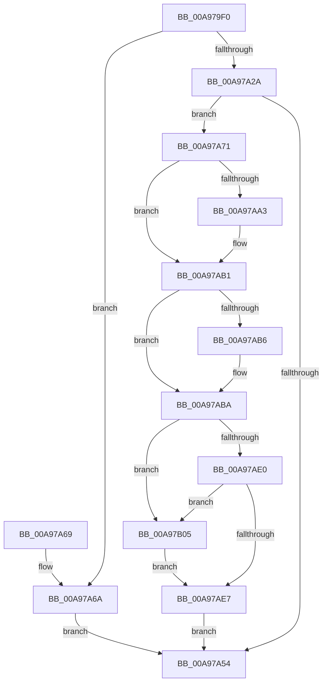

# NtMakePermanentObject

- RVA: `0x00A979F0`–`0x00A97B0F` (길이 `287` bytes)
- VA: `0x0000000140A979F0`
- 실행 섹션: `PAGE`
- PDB 이름 있음: `예`; PDB Function 태그: `아니요`
- unwind 정보 RVA: `0x000B9E08`
- 디코드: `77`개 명령, `287/287` bytes 표시
- 미해석 바이트: `0` (있으면 어셈블리에 `.byte`로 보존)

> 이 문서는 커널 이미지의 기계어와 PDB 기호를 분석해 생성했습니다. 4번과 5번은 함수 원형과 자료형을 바이너리 사용 방식에서 추정한 C 해석이며 원본 소스 복구 결과는 아닙니다.

## 1. Dependencies

- 직접 호출 지점: **8**; 고유 호출 대상: **8**
- 직접 호출자로 확인된 함수: **0**
- RIP 상대 이미지 참조: **1**

### Outgoing calls
- `0x00A97A1F` → [SeSinglePrivilegeCheck](../87/SeSinglePrivilegeCheck_function_00871E20.md) (function, `0x00871E20`)
- `0x00A97A49` → [ObReferenceObjectByHandle](../86/ObReferenceObjectByHandle_function_00868DB0.md) (function, `0x00868DB0`)
- `0x00A97A93` → [KeAbPreAcquire](../../text/21/KeAbPreAcquire_function_00210230.md) (function, `0x00210230`)
- `0x00A97AAC` → [ExfAcquirePushLockExclusiveEx](../../text/20/ExfAcquirePushLockExclusiveEx_function_0020FC90.md) (function, `0x0020FC90`)
- `0x00A97AEA` → [KeAbPostRelease](../../text/2E/KeAbPostRelease_function_002E1600.md) (function, `0x002E1600`)
- `0x00A97AEF` → [KeLeaveCriticalRegion](../../text/25/KeLeaveCriticalRegion_function_0025D8B0.md) (function, `0x0025D8B0`)
- `0x00A97AF9` → [ObfDereferenceObject](../../text/2F/ObfDereferenceObject_function_002F9350.md) (function, `0x002F9350`)
- `0x00A97B08` → [ExfReleasePushLock](../../text/26/ExfReleasePushLock_function_002638D0.md) (function, `0x002638D0`)

### Direct callers
- 이 함수 시작 RVA로 연결되는 직접 call은 확인되지 않았습니다. 간접 호출은 완전히 역산할 수 없습니다.

### Static image references
- `0x00A97A10` → RVA `0x00FD9BD0` (`PAGEDATA`; read)

## 2. Other-region calls and transfers

- 다른 실행 섹션으로 향하는 call: **6**
  - `0x00A97A93` → [KeAbPreAcquire](../../text/21/KeAbPreAcquire_function_00210230.md) (`PAGE` → `.text`)
  - `0x00A97AAC` → [ExfAcquirePushLockExclusiveEx](../../text/20/ExfAcquirePushLockExclusiveEx_function_0020FC90.md) (`PAGE` → `.text`)
  - `0x00A97AEA` → [KeAbPostRelease](../../text/2E/KeAbPostRelease_function_002E1600.md) (`PAGE` → `.text`)
  - `0x00A97AEF` → [KeLeaveCriticalRegion](../../text/25/KeLeaveCriticalRegion_function_0025D8B0.md) (`PAGE` → `.text`)
  - `0x00A97AF9` → [ObfDereferenceObject](../../text/2F/ObfDereferenceObject_function_002F9350.md) (`PAGE` → `.text`)
  - `0x00A97B08` → [ExfReleasePushLock](../../text/26/ExfReleasePushLock_function_002638D0.md) (`PAGE` → `.text`)
- 별도 외부 분기/꼬리 이동을 확인하지 못했습니다.

## 3. Assembly (complete function range)

```asm
00A979F0  48 89 5C 24 08                  mov qword ptr [rsp + 8], rbx
00A979F5  48 89 6C 24 18                  mov qword ptr [rsp + 0x18], rbp
00A979FA  48 89 74 24 20                  mov qword ptr [rsp + 0x20], rsi
00A979FF  57                              push rdi
00A97A00  48 83 EC 30                     sub rsp, 0x30
00A97A04  65 48 8B 04 25 88 01 00 00      mov rax, qword ptr gs:[0x188]
00A97A0D  48 8B F9                        mov rdi, rcx
00A97A10  48 8B 0D B9 21 54 00            mov rcx, qword ptr [rip + 0x5421b9]
00A97A17  8A 98 32 02 00 00               mov bl, byte ptr [rax + 0x232]
00A97A1D  8A D3                           mov dl, bl
00A97A1F  E8 FC A3 DD FF                  call 0x140871e20
00A97A24  33 ED                           xor ebp, ebp
00A97A26  84 C0                           test al, al
00A97A28  74 40                           je 0x140a97a6a
00A97A2A  48 8D 44 24 48                  lea rax, [rsp + 0x48]
00A97A2F  48 89 6C 24 28                  mov qword ptr [rsp + 0x28], rbp
00A97A34  44 8A CB                        mov r9b, bl
00A97A37  48 89 44 24 20                  mov qword ptr [rsp + 0x20], rax
00A97A3C  45 33 C0                        xor r8d, r8d
00A97A3F  48 89 6C 24 48                  mov qword ptr [rsp + 0x48], rbp
00A97A44  33 D2                           xor edx, edx
00A97A46  48 8B CF                        mov rcx, rdi
00A97A49  E8 62 13 DD FF                  call 0x140868db0
00A97A4E  8B F0                           mov esi, eax
00A97A50  85 C0                           test eax, eax
00A97A52  79 1D                           jns 0x140a97a71
00A97A54  48 8B 5C 24 40                  mov rbx, qword ptr [rsp + 0x40]
00A97A59  48 8B 6C 24 50                  mov rbp, qword ptr [rsp + 0x50]
00A97A5E  48 8B 74 24 58                  mov rsi, qword ptr [rsp + 0x58]
00A97A63  48 83 C4 30                     add rsp, 0x30
00A97A67  5F                              pop rdi
00A97A68  C3                              ret
00A97A69  CC                              int3
00A97A6A  B8 61 00 00 C0                  mov eax, 0xc0000061
00A97A6F  EB E3                           jmp 0x140a97a54
00A97A71  65 48 8B 04 25 88 01 00 00      mov rax, qword ptr gs:[0x188]
00A97A7A  45 33 C0                        xor r8d, r8d
00A97A7D  48 8B 5C 24 48                  mov rbx, qword ptr [rsp + 0x48]
00A97A82  33 D2                           xor edx, edx
00A97A84  48 83 C3 E0                     add rbx, -0x20
00A97A88  48 8B CB                        mov rcx, rbx
00A97A8B  66 FF 88 E4 01 00 00            dec word ptr [rax + 0x1e4]
00A97A92  90                              nop
00A97A93  E8 98 87 77 FF                  call 0x140210230
00A97A98  F0 48 0F BA 2B 00               lock bts qword ptr [rbx], 0
00A97A9E  48 8B F8                        mov rdi, rax
00A97AA1  73 0E                           jae 0x140a97ab1
00A97AA3  4C 8B C3                        mov r8, rbx
00A97AA6  48 8B D0                        mov rdx, rax
00A97AA9  48 8B CB                        mov rcx, rbx
00A97AAC  E8 DF 81 77 FF                  call 0x14020fc90
00A97AB1  48 85 FF                        test rdi, rdi
00A97AB4  74 04                           je 0x140a97aba
00A97AB6  C6 47 0A 01                     mov byte ptr [rdi + 0xa], 1
00A97ABA  48 8B 44 24 48                  mov rax, qword ptr [rsp + 0x48]
00A97ABF  80 48 EB 10                     or byte ptr [rax - 0x15], 0x10
00A97AC3  0F 0D 0B                        prefetchw byte ptr [rbx]
00A97AC6  48 8B 03                        mov rax, qword ptr [rbx]
00A97AC9  48 8B C8                        mov rcx, rax
00A97ACC  48 83 E1 F0                     and rcx, 0xfffffffffffffff0
00A97AD0  48 83 F9 10                     cmp rcx, 0x10
00A97AD4  48 8D 50 F0                     lea rdx, [rax - 0x10]
00A97AD8  48 0F 46 D5                     cmovbe rdx, rbp
00A97ADC  A8 02                           test al, 2
00A97ADE  75 25                           jne 0x140a97b05
00A97AE0  F0 48 0F B1 13                  lock cmpxchg qword ptr [rbx], rdx
00A97AE5  75 1E                           jne 0x140a97b05
00A97AE7  48 8B CB                        mov rcx, rbx
00A97AEA  E8 11 9B 84 FF                  call 0x1402e1600
00A97AEF  E8 BC 5D 7C FF                  call 0x14025d8b0
00A97AF4  48 8B 4C 24 48                  mov rcx, qword ptr [rsp + 0x48]
00A97AF9  E8 52 18 86 FF                  call 0x1402f9350
00A97AFE  8B C6                           mov eax, esi
00A97B00  E9 4F FF FF FF                  jmp 0x140a97a54
00A97B05  48 8B CB                        mov rcx, rbx
00A97B08  E8 C3 BD 7C FF                  call 0x1402638d0
00A97B0D  EB D8                           jmp 0x140a97ae7
```

## 4. C-style interpretation (structured pseudocode)

```c
__int64 __fastcall NtMakePermanentObject(__int64 a1, __int64 a2, int a3)
{
    __int64 result;
    __int64 v_rbp;
    __int64 v_rbx;
    __int64 v_rsp;
    unsigned __int64 v_stack_m10;
    unsigned __int64 v_stack_m18;
    unsigned __int64 v_stack_p10;
    unsigned __int64 v_stack_p18;
    unsigned __int64 v_stack_p20;
    unsigned __int64 v_stack_p48;
    unsigned __int64 v_stack_p8;

    v_stack_p8 = v_rbx;
    v_stack_p18 = v_rbp;
    v_stack_p20 = v_rsi;
    v_rsp = (v_rsp) - (48);
    result = SeSinglePrivilegeCheck(*(unsigned __int64 *)(v_rip + 5513657), (unsigned __int8)(*(unsigned __int8 *)(*(unsigned __int64 *)(gs_base + (0 + 392)) + 562)), a3, a4);
    v_rbp = 0;
    if ((unsigned __int8)(result) == 0) goto loc_00A97A6A;
    v_stack_m10 = 0;
    v_stack_m18 = v_stack_p10;
    a3 = 0;
    v_stack_p10 = 0;
    a2 = 0;
    result = ObReferenceObjectByHandle(a1, a2, a3, (unsigned __int8)(*(unsigned __int8 *)(*(unsigned __int64 *)(gs_base + (0 + 392)) + 562)));
    if (!sign_flag) goto loc_00A97A71;
loc_00A97A54:
    v_rsp = (v_rsp) + (48);
    return result;
loc_00A97A6A:
    goto loc_00A97A54;
loc_00A97A71:
    a3 = 0;
    a2 = 0;
    v_rbx = (v_stack_p48) + (-32);
    result = KeAbPreAcquire(v_rbx, a2, a3, (unsigned __int8)(*(unsigned __int8 *)(*(unsigned __int64 *)(gs_base + (0 + 392)) + 562)));
    if (!(condition_is_above_or_equal)) {
        a3 = v_rbx;
        a2 = result;
        a1 = v_rbx;
        result = ExfAcquirePushLockExclusiveEx(a1, a2, a3, (unsigned __int8)(*(unsigned __int8 *)(*(unsigned __int64 *)(gs_base + (0 + 392)) + 562)));
    }
    if (result != 0) {
        *(unsigned __int8 *)(result + 10) = 1;
    }
    a1 = (*(unsigned __int64 *)(v_rbx)) & (-16);
    a2 = *(unsigned __int64 *)(v_rbx) - 16;
    if (a1 <= 16) { a2 = v_stack_p18; }
    if ((((unsigned __int8)(*(unsigned __int64 *)(v_rbx))) & (2)) != 0) goto loc_00A97B05;
    if ((((unsigned __int8)(*(unsigned __int64 *)(v_rbx))) & (2)) != 0) goto loc_00A97B05;
loc_00A97AE7:
    result = KeAbPostRelease(v_rbx, a2, a3, (unsigned __int8)(*(unsigned __int8 *)(*(unsigned __int64 *)(gs_base + (0 + 392)) + 562)));
    result = KeLeaveCriticalRegion(v_rbx, a2, a3, (unsigned __int8)(*(unsigned __int8 *)(*(unsigned __int64 *)(gs_base + (0 + 392)) + 562)));
    result = ObfDereferenceObject(v_stack_p48, a2, a3, (unsigned __int8)(*(unsigned __int8 *)(*(unsigned __int64 *)(gs_base + (0 + 392)) + 562)));
    goto loc_00A97A54;
loc_00A97B05:
    result = ExfReleasePushLock(v_rbx, a2, a3, (unsigned __int8)(*(unsigned __int8 *)(*(unsigned __int64 *)(gs_base + (0 + 392)) + 562)));
    goto loc_00A97AE7;
}
```

## 5. (Beta) C Style

```c
int64_t NtMakePermanentObject(int64_t Arg1, int64_t Arg2, int32_t Arg3)
{
    int64_t result;
    int64_t local_rbp;
    int64_t local_rbx;
    int64_t local_rsp;
    uint64_t v_stack_m10;
    uint64_t v_stack_m18;
    uint64_t v_stack_p10;
    uint64_t v_stack_p18;
    uint64_t v_stack_p20;
    uint64_t v_stack_p48;
    uint64_t v_stack_p8;

    v_stack_p8 = local_rbx;
    v_stack_p18 = local_rbp;
    v_stack_p20 = local_rsi;
    local_rsp = (local_rsp) - (48);
    result = SeSinglePrivilegeCheck(*(uint64_t *)(v_rip + 0x5421B9), (uint8_t)(*(uint8_t *)(*(uint64_t *)(gs_base + (0 + 0x188)) + 0x232)), Arg3, a4);
    local_rbp = 0;
    if ((uint8_t)(result) == 0) goto loc_00A97A6A;
    v_stack_m10 = 0;
    v_stack_m18 = v_stack_p10;
    Arg3 = 0;
    v_stack_p10 = 0;
    Arg2 = 0;
    result = ObReferenceObjectByHandle(Arg1, Arg2, Arg3, (uint8_t)(*(uint8_t *)(*(uint64_t *)(gs_base + (0 + 0x188)) + 0x232)));
    if (!sign_flag) goto loc_00A97A71;
loc_00A97A54:
    local_rsp = (local_rsp) + (48);
    return result;
loc_00A97A6A:
    goto loc_00A97A54;
loc_00A97A71:
    Arg3 = 0;
    Arg2 = 0;
    local_rbx = (v_stack_p48) + (-32);
    result = KeAbPreAcquire(local_rbx, Arg2, Arg3, (uint8_t)(*(uint8_t *)(*(uint64_t *)(gs_base + (0 + 0x188)) + 0x232)));
    if (!(condition_is_above_or_equal)) {
        Arg3 = local_rbx;
        Arg2 = result;
        Arg1 = local_rbx;
        result = ExfAcquirePushLockExclusiveEx(Arg1, Arg2, Arg3, (uint8_t)(*(uint8_t *)(*(uint64_t *)(gs_base + (0 + 0x188)) + 0x232)));
    }
    if (result != 0) {
        *(uint8_t *)(result + 0xA) = 1;
    }
    Arg1 = (*(uint64_t *)(local_rbx)) & (-16);
    Arg2 = *(uint64_t *)(local_rbx) - 16;
    if (Arg1 <= 16) { Arg2 = v_stack_p18; }
    if ((((uint8_t)(*(uint64_t *)(local_rbx))) & (2)) != 0) goto loc_00A97B05;
    if ((((uint8_t)(*(uint64_t *)(local_rbx))) & (2)) != 0) goto loc_00A97B05;
loc_00A97AE7:
    result = KeAbPostRelease(local_rbx, Arg2, Arg3, (uint8_t)(*(uint8_t *)(*(uint64_t *)(gs_base + (0 + 0x188)) + 0x232)));
    result = KeLeaveCriticalRegion(local_rbx, Arg2, Arg3, (uint8_t)(*(uint8_t *)(*(uint64_t *)(gs_base + (0 + 0x188)) + 0x232)));
    result = ObfDereferenceObject(v_stack_p48, Arg2, Arg3, (uint8_t)(*(uint8_t *)(*(uint64_t *)(gs_base + (0 + 0x188)) + 0x232)));
    goto loc_00A97A54;
loc_00A97B05:
    result = ExfReleasePushLock(local_rbx, Arg2, Arg3, (uint8_t)(*(uint8_t *)(*(uint64_t *)(gs_base + (0 + 0x188)) + 0x232)));
    goto loc_00A97AE7;
}
```

## 6. Execution-region graph

[열기: 2D/3D 그래프와 함수 탐색 컨트롤 패널](../../../control-panel.html?section=page&rva=0x00A979F0&view=graph)

- 2D 그래프는 위에서 아래로 흐르고, 3D 그래프는 빈 공간을 드래그해 회전합니다. Shift+드래그는 이동, 휠은 확대·축소, 함수 노드 선택은 대상 보고서 이동입니다.

### Static fallback


