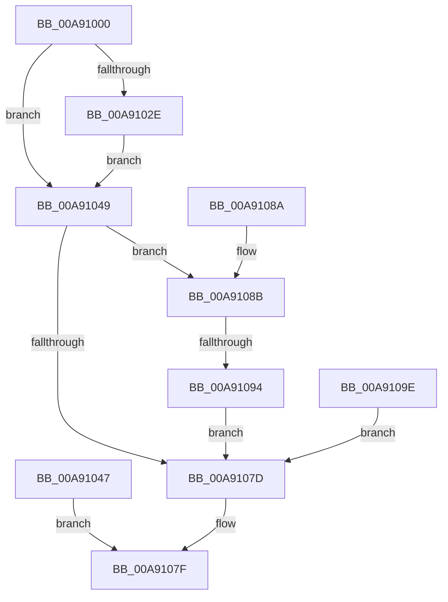

# NtOpenTimer

- RVA: `0x00A91000`–`0x00A910A4` (길이 `164` bytes)
- VA: `0x0000000140A91000`
- 실행 섹션: `PAGE`
- PDB 이름 있음: `예`; PDB Function 태그: `예`
- unwind 정보 RVA: `0x000B9020`
- 디코드: `44`개 명령, `164/164` bytes 표시
- 미해석 바이트: `0` (있으면 어셈블리에 `.byte`로 보존)

> 이 문서는 커널 이미지의 기계어와 PDB 기호를 분석해 생성했습니다. 4번과 5번은 함수 원형과 자료형을 바이너리 사용 방식에서 추정한 C 해석이며 원본 소스 복구 결과는 아닙니다.

## 1. Dependencies

- 직접 호출 지점: **1**; 고유 호출 대상: **1**
- 직접 호출자로 확인된 함수: **0**
- RIP 상대 이미지 참조: **1**

### Outgoing calls
- `0x00A9106E` → [ObOpenObjectByName](../89/ObOpenObjectByName_function_00899F50.md) (function, `0x00899F50`)

### Direct callers
- 이 함수 시작 RVA로 연결되는 직접 call은 확인되지 않았습니다. 간접 호출은 완전히 역산할 수 없습니다.

### Static image references
- `0x00A91064` → RVA `0x00FC6D98` (`ALMOSTRO`; read)

## 2. Other-region calls and transfers

- 다른 실행 섹션으로 향하는 call: **0**
- call이 아닌 외부 분기/꼬리 이동: **1**
  - `0x00A9108E` → [sub_00B46B1A](../B4/Unknown_function_00B46B1A.md) (`tail-transfer`)

## 3. Assembly (complete function range)

```asm
00A91000  48 89 5C 24 08                  mov qword ptr [rsp + 8], rbx
00A91005  57                              push rdi
00A91006  48 83 EC 50                     sub rsp, 0x50
00A9100A  4D 8B D0                        mov r10, r8
00A9100D  44 8B C2                        mov r8d, edx
00A91010  48 8B D9                        mov rbx, rcx
00A91013  48 83 64 24 40 00               and qword ptr [rsp + 0x40], 0
00A91019  65 48 8B 04 25 88 01 00 00      mov rax, qword ptr gs:[0x188]
00A91022  40 8A B8 32 02 00 00            mov dil, byte ptr [rax + 0x232]
00A91029  40 84 FF                        test dil, dil
00A9102C  74 1B                           je 0x140a91049
00A9102E  48 BA 00 00 FF FF FF 7F 00 00   movabs rdx, 0x7fffffff0000
00A91038  48 3B CA                        cmp rcx, rdx
00A9103B  48 0F 42 D1                     cmovb rdx, rcx
00A9103F  48 8B 02                        mov rax, qword ptr [rdx]
00A91042  48 89 02                        mov qword ptr [rdx], rax
00A91045  EB 02                           jmp 0x140a91049
00A91047  EB 36                           jmp 0x140a9107f
00A91049  48 8D 44 24 40                  lea rax, [rsp + 0x40]
00A9104E  48 89 44 24 30                  mov qword ptr [rsp + 0x30], rax
00A91053  48 83 64 24 28 00               and qword ptr [rsp + 0x28], 0
00A91059  44 89 44 24 20                  mov dword ptr [rsp + 0x20], r8d
00A9105E  45 33 C9                        xor r9d, r9d
00A91061  44 8A C7                        mov r8b, dil
00A91064  48 8B 15 2D 5D 53 00            mov rdx, qword ptr [rip + 0x535d2d]
00A9106B  49 8B CA                        mov rcx, r10
00A9106E  E8 DD 8E E0 FF                  call 0x140899f50
00A91073  8B D0                           mov edx, eax
00A91075  89 44 24 78                     mov dword ptr [rsp + 0x78], eax
00A91079  85 C0                           test eax, eax
00A9107B  79 0E                           jns 0x140a9108b
00A9107D  8B C2                           mov eax, edx
00A9107F  48 8B 5C 24 60                  mov rbx, qword ptr [rsp + 0x60]
00A91084  48 83 C4 50                     add rsp, 0x50
00A91088  5F                              pop rdi
00A91089  C3                              ret
00A9108A  CC                              int3
00A9108B  40 84 FF                        test dil, dil
00A9108E  0F 84 86 5A 0B 00               je 0x140b46b1a
00A91094  48 8B 4C 24 40                  mov rcx, qword ptr [rsp + 0x40]
00A91099  48 89 0B                        mov qword ptr [rbx], rcx
00A9109C  EB DF                           jmp 0x140a9107d
00A9109E  8B 54 24 78                     mov edx, dword ptr [rsp + 0x78]
00A910A2  EB D9                           jmp 0x140a9107d
```

## 4. C-style interpretation (structured pseudocode)

```c
__int64 __fastcall NtOpenTimer(__int64 a1, int a2, __int64 a3, int a4)
{
    __int64 result;
    __int64 v_rsp;
    unsigned __int64 v_stack_m18;
    unsigned __int64 v_stack_m28;
    unsigned __int64 v_stack_m30;
    unsigned int v_stack_m38;
    unsigned int v_stack_p20;
    unsigned __int64 v_stack_p40;
    unsigned int v_stack_p78;
    unsigned __int64 v_stack_p8;

    v_stack_p8 = v_rbx;
    v_rsp = (v_rsp) - (80);
    if ((unsigned __int8)(*(unsigned __int8 *)(*(unsigned __int64 *)(gs_base + (0 + 392)) + 562)) == 0) goto loc_00A91049;
    if (a1 < a2) { a2 = a1; }
    *(unsigned __int64 *)(a2) = *(unsigned __int64 *)(a2);
    goto loc_00A91049;
loc_00A91049:
    v_stack_m28 = v_stack_m18;
    v_stack_m38 = (unsigned int)((unsigned int)(a2));
    a4 = 0;
    result = ObOpenObjectByName(a3, *(unsigned __int64 *)(v_rip + 5463341), (unsigned __int8)(*(unsigned __int8 *)(*(unsigned __int64 *)(gs_base + (0 + 392)) + 562)), a4);
    v_stack_p20 = (unsigned int)(result);
    if (!sign_flag) goto loc_00A9108B;
loc_00A9107D:
loc_00A9107F:
    v_rsp = (v_rsp) + (80);
    return (unsigned int)((unsigned int)((unsigned int)((unsigned int)(result))));
loc_00A9108B:
    *(unsigned __int64 *)(v_stack_p8) = v_stack_p40;
    goto loc_00A9107D;
}
```

## 5. (Beta) C Style

```c
int64_t NtOpenTimer(void *Arg1, int32_t Arg2, int64_t Arg3, int32_t Arg4)
{
    uint8_t *arg1 = (uint8_t *)Arg1;

    int64_t result;
    int64_t local_rsp;
    uint64_t v_stack_m18;
    uint64_t v_stack_m28;
    uint64_t v_stack_m30;
    uint32_t v_stack_m38;
    uint32_t v_stack_p20;
    uint64_t v_stack_p40;
    uint32_t v_stack_p78;
    uint64_t v_stack_p8;

    v_stack_p8 = local_rbx;
    local_rsp = (local_rsp) - (80);
    if ((uint8_t)(*(uint8_t *)(*(uint64_t *)(gs_base + (0 + 0x188)) + 0x232)) == 0) goto loc_00A91049;
    if (Arg1 < Arg2) { Arg2 = Arg1; }
    *(uint64_t *)(Arg2) = *(uint64_t *)(Arg2);
    goto loc_00A91049;
loc_00A91049:
    v_stack_m28 = v_stack_m18;
    v_stack_m38 = (uint32_t)((uint32_t)(Arg2));
    Arg4 = 0;
    result = ObOpenObjectByName(Arg3, *(uint64_t *)(v_rip + 0x535D2D), (uint8_t)(*(uint8_t *)(*(uint64_t *)(gs_base + (0 + 0x188)) + 0x232)), Arg4);
    v_stack_p20 = (uint32_t)(result);
    if (!sign_flag) goto loc_00A9108B;
loc_00A9107D:
loc_00A9107F:
    local_rsp = (local_rsp) + (80);
    return (uint32_t)((uint32_t)((uint32_t)((uint32_t)(result))));
loc_00A9108B:
    *(uint64_t *)(v_stack_p8) = v_stack_p40;
    goto loc_00A9107D;
}
```

### 관측된 메모리 오프셋

구조체 형식이 확인되지 않은 접근은 인자 기준의 오프셋으로만 기록했습니다.

| 기준 인자 | 오프셋 표현 | 폭 (bit) | 접근 |
|---|---:|---:|---|
| `Arg1` | `+ 0x0` | `64` | `W` |

## 6. Execution-region graph

[열기: 2D/3D 그래프와 함수 탐색 컨트롤 패널](../../../control-panel.html?section=page&rva=0x00A91000&view=graph)

- 2D 그래프는 위에서 아래로 흐르고, 3D 그래프는 빈 공간을 드래그해 회전합니다. Shift+드래그는 이동, 휠은 확대·축소, 함수 노드 선택은 대상 보고서 이동입니다.

### Static fallback


