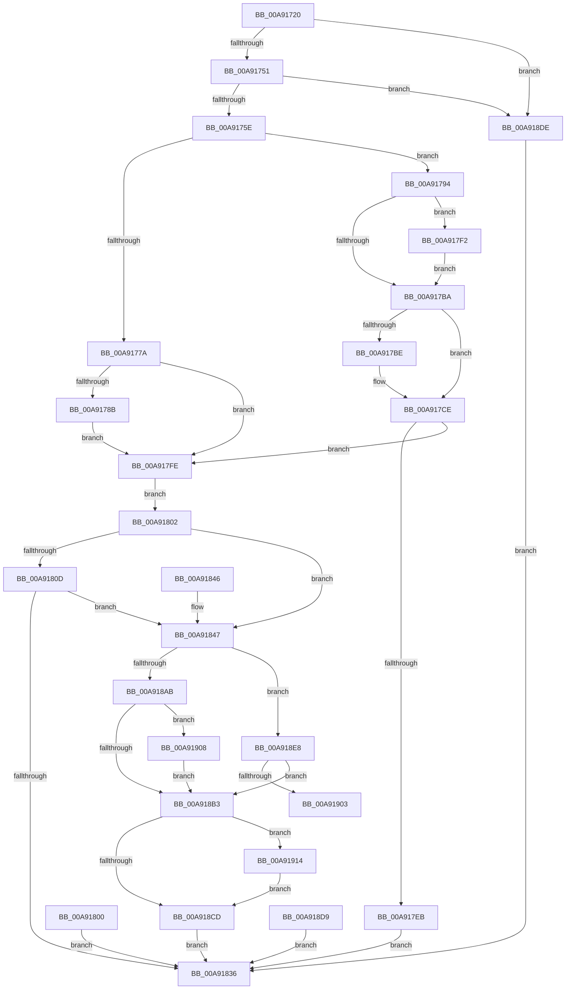

# NtQueryBootEntryOrder

- RVA: `0x00A91720`–`0x00A91922` (길이 `514` bytes)
- VA: `0x0000000140A91720`
- 실행 섹션: `PAGE`
- PDB 이름 있음: `예`; PDB Function 태그: `예`
- unwind 정보 RVA: `0x000B9170`
- 디코드: `125`개 명령, `514/514` bytes 표시
- 미해석 바이트: `0` (있으면 어셈블리에 `.byte`로 보존)

> 이 문서는 커널 이미지의 기계어와 PDB 기호를 분석해 생성했습니다. 4번과 5번은 함수 원형과 자료형을 바이너리 사용 방식에서 추정한 C 해석이며 원본 소스 복구 결과는 아닙니다.

## 1. Dependencies

- 직접 호출 지점: **9**; 고유 호출 대상: **9**
- 직접 호출자로 확인된 함수: **0**
- RIP 상대 이미지 참조: **5**

### Outgoing calls
- `0x00A91751` → [PsIsCurrentThreadInServerSilo](../../text/43/PsIsCurrentThreadInServerSilo_function_004362E0.md) (function, `0x004362E0`)
- `0x00A917C9` → [ProbeForWrite](../8E/ProbeForWrite_function_008E91C0.md) (function, `0x008E91C0`)
- `0x00A917DB` → [SeSinglePrivilegeCheck](../87/SeSinglePrivilegeCheck_function_00871E20.md) (function, `0x00871E20`)
- `0x00A9182D` → [ExLockUserBuffer](../95/ExLockUserBuffer_function_009533B8.md) (function, `0x009533B8`)
- `0x00A91866` → [ExAcquireFastMutexUnsafe](../../text/3F/ExAcquireFastMutexUnsafe_function_003F3720.md) (function, `0x003F3720`)
- `0x00A9188F` → [IoGetEnvironmentVariableEx](../95/IoGetEnvironmentVariableEx_function_00952760.md) (function, `0x00952760`)
- `0x00A9189D` → [ExReleaseFastMutexUnsafe](../../text/25/ExReleaseFastMutexUnsafe_function_002503A0.md) (function, `0x002503A0`)
- `0x00A918A2` → [KeLeaveCriticalRegion](../../text/25/KeLeaveCriticalRegion_function_0025D8B0.md) (function, `0x0025D8B0`)
- `0x00A91914` → [ExUnlockUserBuffer](../../text/29/ExUnlockUserBuffer_function_0029F258.md) (function, `0x0029F258`)

### Direct callers
- 이 함수 시작 RVA로 연결되는 직접 call은 확인되지 않았습니다. 간접 호출은 완전히 역산할 수 없습니다.

### Static image references
- `0x00A91744` → RVA `0x00EFF050` (`.data`; read)
- `0x00A917D4` → RVA `0x00FD9AB8` (`PAGEDATA`; read)
- `0x00A9185F` → RVA `0x00EFAB40` (`.data`; read)
- `0x00A91881` → RVA `0x00019EF0` (`.rdata`; read)
- `0x00A91888` → RVA `0x00B089C0` (` ?? ::NNGAKEGL::`string'`; read)

## 2. Other-region calls and transfers

- 다른 실행 섹션으로 향하는 call: **5**
  - `0x00A91751` → [PsIsCurrentThreadInServerSilo](../../text/43/PsIsCurrentThreadInServerSilo_function_004362E0.md) (`PAGE` → `.text`)
  - `0x00A91866` → [ExAcquireFastMutexUnsafe](../../text/3F/ExAcquireFastMutexUnsafe_function_003F3720.md) (`PAGE` → `.text`)
  - `0x00A9189D` → [ExReleaseFastMutexUnsafe](../../text/25/ExReleaseFastMutexUnsafe_function_002503A0.md) (`PAGE` → `.text`)
  - `0x00A918A2` → [KeLeaveCriticalRegion](../../text/25/KeLeaveCriticalRegion_function_0025D8B0.md) (`PAGE` → `.text`)
  - `0x00A91914` → [ExUnlockUserBuffer](../../text/29/ExUnlockUserBuffer_function_0029F258.md) (`PAGE` → `.text`)
- call이 아닌 외부 분기/꼬리 이동: **1**
  - `0x00A91903` → [sub_00B46DAC](../B4/Unknown_function_00B46DAC.md) (`tail-transfer`)

## 3. Assembly (complete function range)

```asm
00A91720  48 8B C4                        mov rax, rsp
00A91723  48 89 58 08                     mov qword ptr [rax + 8], rbx
00A91727  48 89 70 10                     mov qword ptr [rax + 0x10], rsi
00A9172B  57                              push rdi
00A9172C  48 83 EC 60                     sub rsp, 0x60
00A91730  48 8B F2                        mov rsi, rdx
00A91733  48 8B F9                        mov rdi, rcx
00A91736  48 83 60 D0 00                  and qword ptr [rax - 0x30], 0
00A9173B  83 60 20 00                     and dword ptr [rax + 0x20], 0
00A9173F  48 83 60 D8 00                  and qword ptr [rax - 0x28], 0
00A91744  83 3D 05 D9 46 00 02            cmp dword ptr [rip + 0x46d905], 2
00A9174B  0F 85 8D 01 00 00               jne 0x140a918de
00A91751  E8 8A 4B 9A FF                  call 0x1404362e0
00A91756  84 C0                           test al, al
00A91758  0F 85 80 01 00 00               jne 0x140a918de
00A9175E  65 48 8B 04 25 88 01 00 00      mov rax, qword ptr gs:[0x188]
00A91767  48 89 44 24 58                  mov qword ptr [rsp + 0x58], rax
00A9176C  8A 98 32 02 00 00               mov bl, byte ptr [rax + 0x232]
00A91772  88 5C 24 30                     mov byte ptr [rsp + 0x30], bl
00A91776  84 DB                           test bl, bl
00A91778  75 1A                           jne 0x140a91794
00A9177A  8B 06                           mov eax, dword ptr [rsi]
00A9177C  C1 E0 02                        shl eax, 2
00A9177F  89 84 24 88 00 00 00            mov dword ptr [rsp + 0x88], eax
00A91786  48 85 FF                        test rdi, rdi
00A91789  75 73                           jne 0x140a917fe
00A9178B  21 BC 24 88 00 00 00            and dword ptr [rsp + 0x88], edi
00A91792  EB 6A                           jmp 0x140a917fe
00A91794  48 B9 00 00 FF FF FF 7F 00 00   movabs rcx, 0x7fffffff0000
00A9179E  48 3B F1                        cmp rsi, rcx
00A917A1  48 0F 42 CE                     cmovb rcx, rsi
00A917A5  8B 01                           mov eax, dword ptr [rcx]
00A917A7  89 01                           mov dword ptr [rcx], eax
00A917A9  8B 06                           mov eax, dword ptr [rsi]
00A917AB  C1 E0 02                        shl eax, 2
00A917AE  89 84 24 88 00 00 00            mov dword ptr [rsp + 0x88], eax
00A917B5  48 85 FF                        test rdi, rdi
00A917B8  74 38                           je 0x140a917f2
00A917BA  85 C0                           test eax, eax
00A917BC  74 10                           je 0x140a917ce
00A917BE  8B D0                           mov edx, eax
00A917C0  41 B8 04 00 00 00               mov r8d, 4
00A917C6  48 8B CF                        mov rcx, rdi
00A917C9  E8 F2 79 E5 FF                  call 0x1408e91c0
00A917CE  8A 5C 24 30                     mov bl, byte ptr [rsp + 0x30]
00A917D2  8A D3                           mov dl, bl
00A917D4  48 8B 0D DD 82 54 00            mov rcx, qword ptr [rip + 0x5482dd]
00A917DB  E8 40 06 DE FF                  call 0x140871e20
00A917E0  88 84 24 80 00 00 00            mov byte ptr [rsp + 0x80], al
00A917E7  84 C0                           test al, al
00A917E9  75 13                           jne 0x140a917fe
00A917EB  B8 61 00 00 C0                  mov eax, 0xc0000061
00A917F0  EB 44                           jmp 0x140a91836
00A917F2  83 A4 24 88 00 00 00 00         and dword ptr [rsp + 0x88], 0
00A917FA  33 C0                           xor eax, eax
00A917FC  EB BC                           jmp 0x140a917ba
00A917FE  EB 02                           jmp 0x140a91802
00A91800  EB 34                           jmp 0x140a91836
00A91802  8B 94 24 88 00 00 00            mov edx, dword ptr [rsp + 0x88]
00A91809  85 D2                           test edx, edx
00A9180B  74 3A                           je 0x140a91847
00A9180D  48 8D 44 24 40                  lea rax, [rsp + 0x40]
00A91812  48 89 44 24 28                  mov qword ptr [rsp + 0x28], rax
00A91817  48 8D 44 24 38                  lea rax, [rsp + 0x38]
00A9181C  48 89 44 24 20                  mov qword ptr [rsp + 0x20], rax
00A91821  41 B9 01 00 00 00               mov r9d, 1
00A91827  44 8A C3                        mov r8b, bl
00A9182A  48 8B CF                        mov rcx, rdi
00A9182D  E8 86 1B EC FF                  call 0x1409533b8
00A91832  85 C0                           test eax, eax
00A91834  79 11                           jns 0x140a91847
00A91836  48 8B 5C 24 70                  mov rbx, qword ptr [rsp + 0x70]
00A9183B  48 8B 74 24 78                  mov rsi, qword ptr [rsp + 0x78]
00A91840  48 83 C4 60                     add rsp, 0x60
00A91844  5F                              pop rdi
00A91845  C3                              ret
00A91846  CC                              int3
00A91847  D1 AC 24 88 00 00 00            shr dword ptr [rsp + 0x88], 1
00A9184E  65 48 8B 04 25 88 01 00 00      mov rax, qword ptr gs:[0x188]
00A91857  66 FF 88 E4 01 00 00            dec word ptr [rax + 0x1e4]
00A9185E  90                              nop
00A9185F  48 8D 0D DA 92 46 00            lea rcx, [rip + 0x4692da]
00A91866  E8 B5 1E 96 FF                  call 0x1403f3720
00A9186B  48 83 64 24 20 00               and qword ptr [rsp + 0x20], 0
00A91871  4C 8D 8C 24 88 00 00 00         lea r9, [rsp + 0x88]
00A91879  48 8B 7C 24 38                  mov rdi, qword ptr [rsp + 0x38]
00A9187E  4C 8B C7                        mov r8, rdi
00A91881  48 8D 15 68 86 58 FF            lea rdx, [rip - 0xa77998]
00A91888  48 8D 0D 31 71 07 00            lea rcx, [rip + 0x77131]
00A9188F  E8 CC 0E EC FF                  call 0x140952760
00A91894  8B D8                           mov ebx, eax
00A91896  48 8D 0D A3 92 46 00            lea rcx, [rip + 0x4692a3]
00A9189D  E8 FE EA 7B FF                  call 0x1402503a0
00A918A2  E8 09 C0 7C FF                  call 0x14025d8b0
00A918A7  85 DB                           test ebx, ebx
00A918A9  79 3D                           jns 0x140a918e8
00A918AB  81 FB 00 01 00 C0               cmp ebx, 0xc0000100
00A918B1  74 55                           je 0x140a91908
00A918B3  8B 84 24 88 00 00 00            mov eax, dword ptr [rsp + 0x88]
00A918BA  03 C0                           add eax, eax
00A918BC  89 84 24 88 00 00 00            mov dword ptr [rsp + 0x88], eax
00A918C3  48 8B 4C 24 40                  mov rcx, qword ptr [rsp + 0x40]
00A918C8  48 85 C9                        test rcx, rcx
00A918CB  75 47                           jne 0x140a91914
00A918CD  C1 E8 02                        shr eax, 2
00A918D0  89 06                           mov dword ptr [rsi], eax
00A918D2  8B C3                           mov eax, ebx
00A918D4  E9 5D FF FF FF                  jmp 0x140a91836
00A918D9  E9 58 FF FF FF                  jmp 0x140a91836
00A918DE  B8 02 00 00 C0                  mov eax, 0xc0000002
00A918E3  E9 4E FF FF FF                  jmp 0x140a91836
00A918E8  44 8B 84 24 88 00 00 00         mov r8d, dword ptr [rsp + 0x88]
00A918F0  41 D1 E8                        shr r8d, 1
00A918F3  41 8D 48 FF                     lea ecx, [r8 - 1]
00A918F7  8B D1                           mov edx, ecx
00A918F9  48 8D 0C 4F                     lea rcx, [rdi + rcx*2]
00A918FD  4C 8D 0C 97                     lea r9, [rdi + rdx*4]
00A91901  74 B0                           je 0x140a918b3
00A91903  E9 A4 54 0B 00                  jmp 0x140b46dac
00A91908  83 A4 24 88 00 00 00 00         and dword ptr [rsp + 0x88], 0
00A91910  33 DB                           xor ebx, ebx
00A91912  EB 9F                           jmp 0x140a918b3
00A91914  E8 3F D9 80 FF                  call 0x14029f258
00A91919  8B 84 24 88 00 00 00            mov eax, dword ptr [rsp + 0x88]
00A91920  EB AB                           jmp 0x140a918cd
```

## 4. C-style interpretation (structured pseudocode)

```c
__int64 __fastcall NtQueryBootEntryOrder(__int64 a1, __int64 a2)
{
    __int64 result;
    __int64 v_rbx;
    __int64 v_rsp;
    unsigned __int64 v_stack_m10;
    unsigned __int64 v_stack_m28;
    unsigned __int64 v_stack_m30;
    unsigned __int8 v_stack_m38;
    unsigned __int64 v_stack_m40;
    unsigned __int64 v_stack_m48;
    unsigned __int64 v_stack_p10;
    unsigned __int8 v_stack_p18;
    unsigned int v_stack_p20;
    unsigned __int64 v_stack_p38;
    unsigned __int64 v_stack_p40;
    unsigned __int64 v_stack_p8;
    unsigned int v_stack_p88;

    *(unsigned __int64 *)(v_rsp + 8) = v_rbx;
    *(unsigned __int64 *)(v_rsp + 16) = v_rsi;
    v_rsp = (v_rsp) - (96);
    if ((*(unsigned int *)(v_rip + 4643077)) != 2) goto loc_00A918DE;
    result = PsIsCurrentThreadInServerSilo(a1, a2, a3, a4);
    if ((unsigned __int8)(result) != 0) goto loc_00A918DE;
    v_stack_m10 = *(unsigned __int64 *)(gs_base + (0 + 392));
    v_stack_m38 = (unsigned __int8)(*(unsigned __int8 *)(*(unsigned __int64 *)(gs_base + (0 + 392)) + 562));
    if ((unsigned __int8)(*(unsigned __int8 *)(*(unsigned __int64 *)(gs_base + (0 + 392)) + 562)) != 0) goto loc_00A91794;
    result = (unsigned int)(((unsigned int)(*(unsigned int *)(a2))) << (2));
    v_stack_p20 = (unsigned int)(result);
    if (a1 != 0) goto loc_00A917FE;
    goto loc_00A917FE;
loc_00A91794:
    if (a2 < a1) { a1 = a2; }
    *(unsigned int *)(a1) = (unsigned int)((unsigned int)(*(unsigned int *)(a1)));
    result = (unsigned int)(((unsigned int)(*(unsigned int *)(a2))) << (2));
    v_stack_p20 = (unsigned int)(result);
    if (a1 == 0) goto loc_00A917F2;
loc_00A917BA:
    if ((unsigned int)(result) != 0) {
        a2 = (unsigned int)(result);
        a3 = 4;
        a1 = a1;
        result = ProbeForWrite(a1, a2, a3, a4);
    }
    result = SeSinglePrivilegeCheck(*(unsigned __int64 *)(v_rip + 5538525), (unsigned __int8)(v_stack_m38), a3, a4);
    v_stack_p18 = (unsigned __int8)(result);
    if ((unsigned __int8)(result) != 0) goto loc_00A917FE;
    goto loc_00A91836;
loc_00A917F2:
    result = 0;
    goto loc_00A917BA;
loc_00A917FE:
    goto loc_00A91802;
loc_00A91802:
    if ((unsigned int)((unsigned int)(v_stack_p20)) == 0) goto loc_00A91847;
    v_stack_m40 = v_stack_m28;
    v_stack_m48 = v_stack_m30;
    result = ExLockUserBuffer(a1, (unsigned int)(v_stack_p20), (unsigned __int8)(v_stack_m38), 1);
    if (!sign_flag) goto loc_00A91847;
loc_00A91836:
    v_rsp = (v_rsp) + (96);
    return result;
loc_00A91847:
    result = ExAcquireFastMutexUnsafe(v_rip + 4625114, (unsigned int)(v_stack_p20), (unsigned __int8)(v_stack_m38), 1);
    result = IoGetEnvironmentVariableEx(v_rip + 487729, v_rip - 10975640, v_stack_p38, v_stack_p88);
    result = ExReleaseFastMutexUnsafe(v_rip + 4625059, v_rip - 10975640, v_stack_p38, v_stack_p88);
    result = KeLeaveCriticalRegion(v_rip + 4625059, v_rip - 10975640, v_stack_p38, v_stack_p88);
    if (!sign_flag) goto loc_00A918E8;
    if (((unsigned int)((unsigned int)((unsigned int)(result)))) == 0xC0000100ULL) goto loc_00A91908;
loc_00A918B3:
    result = (unsigned int)(((unsigned int)(v_stack_p88)) + ((unsigned int)((unsigned int)(v_stack_p88))));
    v_stack_p88 = (unsigned int)(result);
    if (v_stack_p40 != 0) goto loc_00A91914;
loc_00A918CD:
    result = (unsigned int)((result) >> (2));
    *(unsigned int *)(v_stack_p10) = (unsigned int)(result);
    goto loc_00A91836;
loc_00A918DE:
    goto loc_00A91836;
loc_00A918E8:
    a3 = (unsigned int)(((unsigned int)(v_stack_p88)) >> (1));
    if (condition_is_equal) goto loc_00A918B3;
loc_00A91908:
    v_rbx = 0;
    goto loc_00A918B3;
loc_00A91914:
    result = ExUnlockUserBuffer(v_stack_p38 + a3 - 1 * 2, (unsigned int)((unsigned int)(a3 - 1)), a3, v_stack_p38 + (unsigned int)((unsigned int)(a3 - 1)) * 4);
    goto loc_00A918CD;
}
```

## 5. (Beta) C Style

```c
int64_t NtQueryBootEntryOrder(int64_t Arg1, void *Arg2)
{
    uint8_t *arg2 = (uint8_t *)Arg2;

    int64_t result;
    int64_t local_rbx;
    int64_t local_rsp;
    uint64_t v_stack_m10;
    uint64_t v_stack_m28;
    uint64_t v_stack_m30;
    uint8_t v_stack_m38;
    uint64_t v_stack_m40;
    uint64_t v_stack_m48;
    uint64_t v_stack_p10;
    uint8_t v_stack_p18;
    uint32_t v_stack_p20;
    uint64_t v_stack_p38;
    uint64_t v_stack_p40;
    uint64_t v_stack_p8;
    uint32_t v_stack_p88;

    *(uint64_t *)(local_rsp + 0x8) = local_rbx;
    *(uint64_t *)(local_rsp + 0x10) = local_rsi;
    local_rsp = (local_rsp) - (96);
    if ((*(uint32_t *)(v_rip + 0x46D905)) != 2) goto loc_00A918DE;
    result = PsIsCurrentThreadInServerSilo(Arg1, Arg2, a3, a4);
    if ((uint8_t)(result) != 0) goto loc_00A918DE;
    v_stack_m10 = *(uint64_t *)(gs_base + (0 + 0x188));
    v_stack_m38 = (uint8_t)(*(uint8_t *)(*(uint64_t *)(gs_base + (0 + 0x188)) + 0x232));
    if ((uint8_t)(*(uint8_t *)(*(uint64_t *)(gs_base + (0 + 0x188)) + 0x232)) != 0) goto loc_00A91794;
    result = (uint32_t)(((uint32_t)(*(uint32_t *)(arg2))) << (2));
    v_stack_p20 = (uint32_t)(result);
    if (Arg1 != 0) goto loc_00A917FE;
    goto loc_00A917FE;
loc_00A91794:
    if (Arg2 < Arg1) { Arg1 = Arg2; }
    *(uint32_t *)(Arg1) = (uint32_t)((uint32_t)(*(uint32_t *)(Arg1)));
    result = (uint32_t)(((uint32_t)(*(uint32_t *)(arg2))) << (2));
    v_stack_p20 = (uint32_t)(result);
    if (Arg1 == 0) goto loc_00A917F2;
loc_00A917BA:
    if ((uint32_t)(result) != 0) {
        Arg2 = (uint32_t)(result);
        a3 = 4;
        Arg1 = Arg1;
        result = ProbeForWrite(Arg1, Arg2, a3, a4);
    }
    result = SeSinglePrivilegeCheck(*(uint64_t *)(v_rip + 0x5482DD), (uint8_t)(v_stack_m38), a3, a4);
    v_stack_p18 = (uint8_t)(result);
    if ((uint8_t)(result) != 0) goto loc_00A917FE;
    goto loc_00A91836;
loc_00A917F2:
    result = 0;
    goto loc_00A917BA;
loc_00A917FE:
    goto loc_00A91802;
loc_00A91802:
    if ((uint32_t)((uint32_t)(v_stack_p20)) == 0) goto loc_00A91847;
    v_stack_m40 = v_stack_m28;
    v_stack_m48 = v_stack_m30;
    result = ExLockUserBuffer(Arg1, (uint32_t)(v_stack_p20), (uint8_t)(v_stack_m38), 1);
    if (!sign_flag) goto loc_00A91847;
loc_00A91836:
    local_rsp = (local_rsp) + (96);
    return result;
loc_00A91847:
    result = ExAcquireFastMutexUnsafe(v_rip + 4625114, (uint32_t)(v_stack_p20), (uint8_t)(v_stack_m38), 1);
    result = IoGetEnvironmentVariableEx(v_rip + 487729, v_rip - 10975640, v_stack_p38, v_stack_p88);
    result = ExReleaseFastMutexUnsafe(v_rip + 4625059, v_rip - 10975640, v_stack_p38, v_stack_p88);
    result = KeLeaveCriticalRegion(v_rip + 4625059, v_rip - 10975640, v_stack_p38, v_stack_p88);
    if (!sign_flag) goto loc_00A918E8;
    if (((uint32_t)((uint32_t)((uint32_t)(result)))) == 0xC0000100ULL) goto loc_00A91908;
loc_00A918B3:
    result = (uint32_t)(((uint32_t)(v_stack_p88)) + ((uint32_t)((uint32_t)(v_stack_p88))));
    v_stack_p88 = (uint32_t)(result);
    if (v_stack_p40 != 0) goto loc_00A91914;
loc_00A918CD:
    result = (uint32_t)((result) >> (2));
    *(uint32_t *)(v_stack_p10) = (uint32_t)(result);
    goto loc_00A91836;
loc_00A918DE:
    goto loc_00A91836;
loc_00A918E8:
    a3 = (uint32_t)(((uint32_t)(v_stack_p88)) >> (1));
    if (condition_is_equal) goto loc_00A918B3;
loc_00A91908:
    local_rbx = 0;
    goto loc_00A918B3;
loc_00A91914:
    result = ExUnlockUserBuffer(v_stack_p38 + a3 - 1 * 2, (uint32_t)((uint32_t)(a3 - 1)), a3, v_stack_p38 + (uint32_t)((uint32_t)(a3 - 1)) * 4);
    goto loc_00A918CD;
}
```

### 관측된 메모리 오프셋

구조체 형식이 확인되지 않은 접근은 인자 기준의 오프셋으로만 기록했습니다.

| 기준 인자 | 오프셋 표현 | 폭 (bit) | 접근 |
|---|---:|---:|---|
| `Arg2` | `+ 0x0` | `32` | `R` |

## 6. Execution-region graph

[열기: 2D/3D 그래프와 함수 탐색 컨트롤 패널](../../../control-panel.html?section=page&rva=0x00A91720&view=graph)

- 2D 그래프는 위에서 아래로 흐르고, 3D 그래프는 빈 공간을 드래그해 회전합니다. Shift+드래그는 이동, 휠은 확대·축소, 함수 노드 선택은 대상 보고서 이동입니다.

### Static fallback


