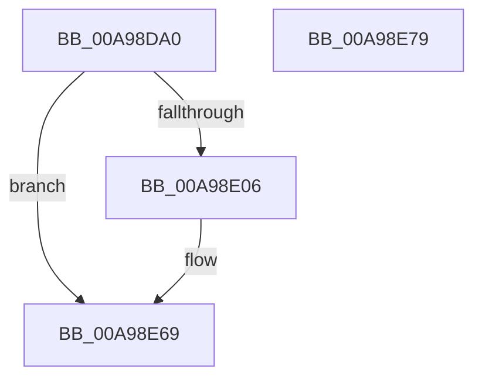

# NtRequestPort

- RVA: `0x00A98DA0`–`0x00A98E7A` (길이 `218` bytes)
- VA: `0x0000000140A98DA0`
- 실행 섹션: `PAGE`
- PDB 이름 있음: `예`; PDB Function 태그: `아니요`
- unwind 정보 RVA: `0x000BA0F0`
- 디코드: `45`개 명령, `218/218` bytes 표시
- 미해석 바이트: `0` (있으면 어셈블리에 `.byte`로 보존)

> 이 문서는 커널 이미지의 기계어와 PDB 기호를 분석해 생성했습니다. 4번과 5번은 함수 원형과 자료형을 바이너리 사용 방식에서 추정한 C 해석이며 원본 소스 복구 결과는 아닙니다.

## 1. Dependencies

- 직접 호출 지점: **5**; 고유 호출 대상: **5**
- 직접 호출자로 확인된 함수: **0**
- RIP 상대 이미지 참조: **1**

### Outgoing calls
- `0x00A98DBB` → [memset](../../text/6C/memset_function_006C6C40.md) (function, `0x006C6C40`)
- `0x00A98DFB` → [ObReferenceObjectByHandle](../86/ObReferenceObjectByHandle_function_00868DB0.md) (function, `0x00868DB0`)
- `0x00A98E47` → [AlpcpSendMessage](../88/AlpcpSendMessage_function_0088BD40.md) (function, `0x0088BD40`)
- `0x00A98E57` → [KeLeaveCriticalRegionThread](../../text/25/KeLeaveCriticalRegionThread_function_0025EFF0.md) (function, `0x0025EFF0`)
- `0x00A98E64` → [ObfDereferenceObject](../../text/2F/ObfDereferenceObject_function_002F9350.md) (function, `0x002F9350`)

### Direct callers
- 이 함수 시작 RVA로 연결되는 직접 call은 확인되지 않았습니다. 간접 호출은 완전히 역산할 수 없습니다.

### Static image references
- `0x00A98DCE` → RVA `0x00FC6C18` (`ALMOSTRO`; read)

## 2. Other-region calls and transfers

- 다른 실행 섹션으로 향하는 call: **3**
  - `0x00A98DBB` → [memset](../../text/6C/memset_function_006C6C40.md) (`PAGE` → `.text`)
  - `0x00A98E57` → [KeLeaveCriticalRegionThread](../../text/25/KeLeaveCriticalRegionThread_function_0025EFF0.md) (`PAGE` → `.text`)
  - `0x00A98E64` → [ObfDereferenceObject](../../text/2F/ObfDereferenceObject_function_002F9350.md) (`PAGE` → `.text`)
- 별도 외부 분기/꼬리 이동을 확인하지 못했습니다.

## 3. Assembly (complete function range)

```asm
00A98DA0  48 89 5C 24 08                  mov qword ptr [rsp + 8], rbx
00A98DA5  57                              push rdi
00A98DA6  48 83 EC 70                     sub rsp, 0x70
00A98DAA  48 8B FA                        mov rdi, rdx
00A98DAD  48 8B D9                        mov rbx, rcx
00A98DB0  33 D2                           xor edx, edx
00A98DB2  48 8D 4C 24 30                  lea rcx, [rsp + 0x30]
00A98DB7  44 8D 42 40                     lea r8d, [rdx + 0x40]
00A98DBB  E8 80 DE C2 FF                  call 0x1406c6c40
00A98DC0  65 48 8B 04 25 88 01 00 00      mov rax, qword ptr gs:[0x188]
00A98DC9  BA 01 00 00 00                  mov edx, 1
00A98DCE  4C 8B 05 43 DE 52 00            mov r8, qword ptr [rip + 0x52de43]
00A98DD5  48 8B CB                        mov rcx, rbx
00A98DD8  48 83 64 24 28 00               and qword ptr [rsp + 0x28], 0
00A98DDE  48 83 A4 24 90 00 00 00 00      and qword ptr [rsp + 0x90], 0
00A98DE7  44 8A 88 32 02 00 00            mov r9b, byte ptr [rax + 0x232]
00A98DEE  48 8D 84 24 90 00 00 00         lea rax, [rsp + 0x90]
00A98DF6  48 89 44 24 20                  mov qword ptr [rsp + 0x20], rax
00A98DFB  E8 B0 FF DC FF                  call 0x140868db0
00A98E00  8B D8                           mov ebx, eax
00A98E02  85 C0                           test eax, eax
00A98E04  78 63                           js 0x140a98e69
00A98E06  48 8B 84 24 90 00 00 00         mov rax, qword ptr [rsp + 0x90]
00A98E0E  48 8D 4C 24 30                  lea rcx, [rsp + 0x30]
00A98E13  48 89 44 24 30                  mov qword ptr [rsp + 0x30], rax
00A98E18  45 33 C0                        xor r8d, r8d
00A98E1B  C7 44 24 60 00 00 01 00         mov dword ptr [rsp + 0x60], 0x10000
00A98E23  48 8B D7                        mov rdx, rdi
00A98E26  65 48 8B 04 25 88 01 00 00      mov rax, qword ptr gs:[0x188]
00A98E2F  66 FF 88 E4 01 00 00            dec word ptr [rax + 0x1e4]
00A98E36  90                              nop
00A98E37  65 48 8B 04 25 88 01 00 00      mov rax, qword ptr gs:[0x188]
00A98E40  44 8A 88 32 02 00 00            mov r9b, byte ptr [rax + 0x232]
00A98E47  E8 F4 2E DF FF                  call 0x14088bd40
00A98E4C  65 48 8B 0C 25 88 01 00 00      mov rcx, qword ptr gs:[0x188]
00A98E55  8B D8                           mov ebx, eax
00A98E57  E8 94 61 7C FF                  call 0x14025eff0
00A98E5C  48 8B 8C 24 90 00 00 00         mov rcx, qword ptr [rsp + 0x90]
00A98E64  E8 E7 04 86 FF                  call 0x1402f9350
00A98E69  8B C3                           mov eax, ebx
00A98E6B  48 8B 9C 24 80 00 00 00         mov rbx, qword ptr [rsp + 0x80]
00A98E73  48 83 C4 70                     add rsp, 0x70
00A98E77  5F                              pop rdi
00A98E78  C3                              ret
00A98E79  CC                              int3
```

## 4. C-style interpretation (structured pseudocode)

```c
__int64 __fastcall NtRequestPort(__int64 a1, __int64 a2)
{
    __int64 result;
    __int64 v_rbx;
    __int64 v_rsp;
    unsigned int v_stack_m18;
    unsigned __int64 v_stack_m48;
    unsigned __int64 v_stack_m50;
    unsigned __int64 v_stack_m58;
    unsigned __int64 v_stack_p18;
    unsigned __int64 v_stack_p8;

    v_stack_p8 = v_rbx;
    v_rsp = (v_rsp) - (112);
    a2 = 0;
    result = memset(v_stack_m48, a2, a2 + 64, a4);
    v_stack_m58 = v_stack_p18;
    result = ObReferenceObjectByHandle(a1, 1, *(unsigned __int64 *)(v_rip + 5430851), *(unsigned __int8 *)(*(unsigned __int64 *)(gs_base + (0 + 392)) + 562));
    v_rbx = (unsigned int)((unsigned int)(result));
    if (!(sign_flag)) {
        result = v_stack_p18;
        a1 = v_stack_m48;
        v_stack_m48 = result;
        a3 = 0;
        v_stack_m18 = 0x10000ULL;
        a2 = 0;
        result = *(unsigned __int64 *)(gs_base + (0 + 392));
        result = *(unsigned __int64 *)(gs_base + (0 + 392));
        a4 = *(unsigned __int8 *)(result + 562);
        result = AlpcpSendMessage(a1, a2, a3, a4);
        a1 = *(unsigned __int64 *)(gs_base + (0 + 392));
        v_rbx = (unsigned int)(result);
        result = KeLeaveCriticalRegionThread(a1, a2, a3, a4);
        a1 = v_stack_p18;
        result = ObfDereferenceObject(a1, a2, a3, a4);
    }
    v_rsp = (v_rsp) + (112);
    return (unsigned int)((unsigned int)(v_rbx));
}
```

## 5. (Beta) C Style

```c
int64_t NtRequestPort(int64_t Arg1, int64_t Arg2)
{
    int64_t result;
    int64_t local_rbx;
    int64_t local_rsp;
    uint32_t v_stack_m18;
    uint64_t v_stack_m48;
    uint64_t v_stack_m50;
    uint64_t v_stack_m58;
    uint64_t v_stack_p18;
    uint64_t v_stack_p8;

    v_stack_p8 = local_rbx;
    local_rsp = (local_rsp) - (112);
    Arg2 = 0;
    result = memset(v_stack_m48, Arg2, Arg2 + 64, a4);
    v_stack_m58 = v_stack_p18;
    result = ObReferenceObjectByHandle(Arg1, 1, *(uint64_t *)(v_rip + 0x52DE43), *(uint8_t *)(*(uint64_t *)(gs_base + (0 + 0x188)) + 0x232));
    local_rbx = (uint32_t)((uint32_t)(result));
    if (!(sign_flag)) {
        result = v_stack_p18;
        Arg1 = v_stack_m48;
        v_stack_m48 = result;
        a3 = 0;
        v_stack_m18 = 0x10000ULL;
        Arg2 = 0;
        result = *(uint64_t *)(gs_base + (0 + 0x188));
        result = *(uint64_t *)(gs_base + (0 + 0x188));
        a4 = *(uint8_t *)(result + 0x232);
        result = AlpcpSendMessage(Arg1, Arg2, a3, a4);
        Arg1 = *(uint64_t *)(gs_base + (0 + 0x188));
        local_rbx = (uint32_t)(result);
        result = KeLeaveCriticalRegionThread(Arg1, Arg2, a3, a4);
        Arg1 = v_stack_p18;
        result = ObfDereferenceObject(Arg1, Arg2, a3, a4);
    }
    local_rsp = (local_rsp) + (112);
    return (uint32_t)((uint32_t)(local_rbx));
}
```

## 6. Execution-region graph

[열기: 2D/3D 그래프와 함수 탐색 컨트롤 패널](../../../control-panel.html?section=page&rva=0x00A98DA0&view=graph)

- 2D 그래프는 위에서 아래로 흐르고, 3D 그래프는 빈 공간을 드래그해 회전합니다. Shift+드래그는 이동, 휠은 확대·축소, 함수 노드 선택은 대상 보고서 이동입니다.

### Static fallback


