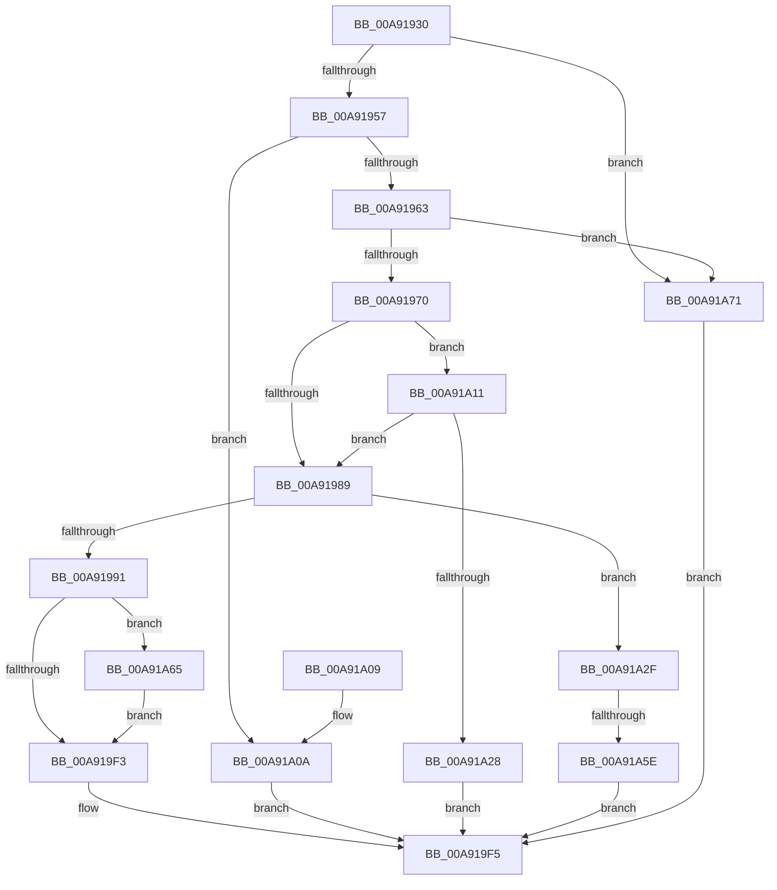

# NtSetBootEntryOrder

- RVA: `0x00A91930`–`0x00A91A7B` (길이 `331` bytes)
- VA: `0x0000000140A91930`
- 실행 섹션: `PAGE`
- PDB 이름 있음: `예`; PDB Function 태그: `예`
- unwind 정보 RVA: `0x000B91E4`
- 디코드: `78`개 명령, `331/331` bytes 표시
- 미해석 바이트: `0` (있으면 어셈블리에 `.byte`로 보존)

> 이 문서는 커널 이미지의 기계어와 PDB 기호를 분석해 생성했습니다. 4번과 5번은 함수 원형과 자료형을 바이너리 사용 방식에서 추정한 C 해석이며 원본 소스 복구 결과는 아닙니다.

## 1. Dependencies

- 직접 호출 지점: **8**; 고유 호출 대상: **8**
- 직접 호출자로 확인된 함수: **0**
- RIP 상대 이미지 참조: **5**

### Outgoing calls
- `0x00A91963` → [PsIsCurrentThreadInServerSilo](../../text/43/PsIsCurrentThreadInServerSilo_function_004362E0.md) (function, `0x004362E0`)
- `0x00A919A9` → [ExAcquireFastMutexUnsafe](../../text/3F/ExAcquireFastMutexUnsafe_function_003F3720.md) (function, `0x003F3720`)
- `0x00A919CB` → [IoSetEnvironmentVariableEx](IoSetEnvironmentVariableEx_function_00A91A84.md) (function, `0x00A91A84`)
- `0x00A919D9` → [ExReleaseFastMutexUnsafe](../../text/25/ExReleaseFastMutexUnsafe_function_002503A0.md) (function, `0x002503A0`)
- `0x00A919DE` → [KeLeaveCriticalRegion](../../text/25/KeLeaveCriticalRegion_function_0025D8B0.md) (function, `0x0025D8B0`)
- `0x00A91A1B` → [SeSinglePrivilegeCheck](../87/SeSinglePrivilegeCheck_function_00871E20.md) (function, `0x00871E20`)
- `0x00A91A48` → [ExAllocatePool2](../../poolcode/B8/ExAllocatePool2_function_00B820F0.md) (function, `0x00B820F0`)
- `0x00A91A6A` → [ExFreePoolWithTag](../../poolcode/B8/ExFreePoolWithTag_function_00B82870.md) (function, `0x00B82870`)

### Direct callers
- 이 함수 시작 RVA로 연결되는 직접 call은 확인되지 않았습니다. 간접 호출은 완전히 역산할 수 없습니다.

### Static image references
- `0x00A9194A` → RVA `0x00EFF050` (`.data`; read)
- `0x00A919A2` → RVA `0x00EFAB40` (`.data`; read)
- `0x00A919BD` → RVA `0x00019EF0` (`.rdata`; read)
- `0x00A919C4` → RVA `0x00B089C0` (` ?? ::NNGAKEGL::`string'`; read)
- `0x00A91A14` → RVA `0x00FD9AB8` (`PAGEDATA`; read)

## 2. Other-region calls and transfers

- 다른 실행 섹션으로 향하는 call: **6**
  - `0x00A91963` → [PsIsCurrentThreadInServerSilo](../../text/43/PsIsCurrentThreadInServerSilo_function_004362E0.md) (`PAGE` → `.text`)
  - `0x00A919A9` → [ExAcquireFastMutexUnsafe](../../text/3F/ExAcquireFastMutexUnsafe_function_003F3720.md) (`PAGE` → `.text`)
  - `0x00A919D9` → [ExReleaseFastMutexUnsafe](../../text/25/ExReleaseFastMutexUnsafe_function_002503A0.md) (`PAGE` → `.text`)
  - `0x00A919DE` → [KeLeaveCriticalRegion](../../text/25/KeLeaveCriticalRegion_function_0025D8B0.md) (`PAGE` → `.text`)
  - `0x00A91A48` → [ExAllocatePool2](../../poolcode/B8/ExAllocatePool2_function_00B820F0.md) (`PAGE` → `POOLCODE`)
  - `0x00A91A6A` → [ExFreePoolWithTag](../../poolcode/B8/ExFreePoolWithTag_function_00B82870.md) (`PAGE` → `POOLCODE`)
- call이 아닌 외부 분기/꼬리 이동: **1**
  - `0x00A91A58` → [sub_00B46DC6](../B4/Unknown_function_00B46DC6.md) (`tail-transfer`)

## 3. Assembly (complete function range)

```asm
00A91930  48 89 5C 24 08                  mov qword ptr [rsp + 8], rbx
00A91935  48 89 74 24 10                  mov qword ptr [rsp + 0x10], rsi
00A9193A  57                              push rdi
00A9193B  41 56                           push r14
00A9193D  41 57                           push r15
00A9193F  48 83 EC 40                     sub rsp, 0x40
00A91943  8B DA                           mov ebx, edx
00A91945  48 8B F1                        mov rsi, rcx
00A91948  33 FF                           xor edi, edi
00A9194A  83 3D FF D6 46 00 02            cmp dword ptr [rip + 0x46d6ff], 2
00A91951  0F 85 1A 01 00 00               jne 0x140a91a71
00A91957  81 FB FF FF FF 3F               cmp ebx, 0x3fffffff
00A9195D  0F 87 A7 00 00 00               ja 0x140a91a0a
00A91963  E8 78 49 9A FF                  call 0x1404362e0
00A91968  84 C0                           test al, al
00A9196A  0F 85 01 01 00 00               jne 0x140a91a71
00A91970  65 48 8B 04 25 88 01 00 00      mov rax, qword ptr gs:[0x188]
00A91979  44 8A B0 32 02 00 00            mov r14b, byte ptr [rax + 0x232]
00A91980  45 84 F6                        test r14b, r14b
00A91983  0F 85 88 00 00 00               jne 0x140a91a11
00A91989  85 DB                           test ebx, ebx
00A9198B  0F 85 9E 00 00 00               jne 0x140a91a2f
00A91991  65 48 8B 04 25 88 01 00 00      mov rax, qword ptr gs:[0x188]
00A9199A  66 FF 88 E4 01 00 00            dec word ptr [rax + 0x1e4]
00A919A1  90                              nop
00A919A2  48 8D 0D 97 91 46 00            lea rcx, [rip + 0x469197]
00A919A9  E8 72 1D 96 FF                  call 0x1403f3720
00A919AE  44 8D 0C 1B                     lea r9d, [rbx + rbx]
00A919B2  C7 44 24 20 01 00 00 00         mov dword ptr [rsp + 0x20], 1
00A919BA  4C 8B C7                        mov r8, rdi
00A919BD  48 8D 15 2C 85 58 FF            lea rdx, [rip - 0xa77ad4]
00A919C4  48 8D 0D F5 6F 07 00            lea rcx, [rip + 0x76ff5]
00A919CB  E8 B4 00 00 00                  call 0x140a91a84
00A919D0  8B D8                           mov ebx, eax
00A919D2  48 8D 0D 67 91 46 00            lea rcx, [rip + 0x469167]
00A919D9  E8 C2 E9 7B FF                  call 0x1402503a0
00A919DE  E8 CD BE 7C FF                  call 0x14025d8b0
00A919E3  33 F6                           xor esi, esi
00A919E5  81 FB 00 01 00 C0               cmp ebx, 0xc0000100
00A919EB  0F 45 F3                        cmovne esi, ebx
00A919EE  48 85 FF                        test rdi, rdi
00A919F1  75 72                           jne 0x140a91a65
00A919F3  8B C6                           mov eax, esi
00A919F5  48 8B 5C 24 60                  mov rbx, qword ptr [rsp + 0x60]
00A919FA  48 8B 74 24 68                  mov rsi, qword ptr [rsp + 0x68]
00A919FF  48 83 C4 40                     add rsp, 0x40
00A91A03  41 5F                           pop r15
00A91A05  41 5E                           pop r14
00A91A07  5F                              pop rdi
00A91A08  C3                              ret
00A91A09  CC                              int3
00A91A0A  B8 0D 00 00 C0                  mov eax, 0xc000000d
00A91A0F  EB E4                           jmp 0x140a919f5
00A91A11  41 8A D6                        mov dl, r14b
00A91A14  48 8B 0D 9D 80 54 00            mov rcx, qword ptr [rip + 0x54809d]
00A91A1B  E8 00 04 DE FF                  call 0x140871e20
00A91A20  84 C0                           test al, al
00A91A22  0F 85 61 FF FF FF               jne 0x140a91989
00A91A28  B8 61 00 00 C0                  mov eax, 0xc0000061
00A91A2D  EB C6                           jmp 0x140a919f5
00A91A2F  44 8D 3C 9D 00 00 00 00         lea r15d, [rbx*4]
00A91A37  48 8B D3                        mov rdx, rbx
00A91A3A  48 03 D2                        add rdx, rdx
00A91A3D  B9 40 00 00 00                  mov ecx, 0x40
00A91A42  41 B8 45 6E 76 72               mov r8d, 0x72766e45
00A91A48  E8 A3 06 0F 00                  call 0x140b820f0
00A91A4D  48 8B F8                        mov rdi, rax
00A91A50  48 89 44 24 70                  mov qword ptr [rsp + 0x70], rax
00A91A55  48 85 C0                        test rax, rax
00A91A58  0F 85 68 53 0B 00               jne 0x140b46dc6
00A91A5E  B8 9A 00 00 C0                  mov eax, 0xc000009a
00A91A63  EB 90                           jmp 0x140a919f5
00A91A65  33 D2                           xor edx, edx
00A91A67  48 8B CF                        mov rcx, rdi
00A91A6A  E8 01 0E 0F 00                  call 0x140b82870
00A91A6F  EB 82                           jmp 0x140a919f3
00A91A71  B8 02 00 00 C0                  mov eax, 0xc0000002
00A91A76  E9 7A FF FF FF                  jmp 0x140a919f5
```

## 4. C-style interpretation (structured pseudocode)

```c
__int64 __fastcall NtSetBootEntryOrder(__int64 a1, int a2)
{
    __int64 result;
    __int64 v_rdi;
    __int64 v_rsi;
    __int64 v_rsp;
    unsigned int v_stack_m38;
    unsigned __int64 v_stack_p10;
    unsigned __int64 v_stack_p70;
    unsigned __int64 v_stack_p8;

    v_stack_p8 = v_rbx;
    v_stack_p10 = v_rsi;
    v_rsp = (v_rsp) - (64);
    v_rdi = 0;
    if ((*(unsigned int *)(v_rip + 4642559)) != 2) goto loc_00A91A71;
    if (((unsigned int)((unsigned int)(a2))) > 0x3FFFFFFFULL) goto loc_00A91A0A;
    result = PsIsCurrentThreadInServerSilo(a1, a2, a3, a4);
    if ((unsigned __int8)(result) != 0) goto loc_00A91A71;
    if ((unsigned __int8)(*(unsigned __int8 *)(*(unsigned __int64 *)(gs_base + (0 + 392)) + 562)) != 0) goto loc_00A91A11;
loc_00A91989:
    if ((unsigned int)((unsigned int)(a2)) != 0) goto loc_00A91A2F;
    result = ExAcquireFastMutexUnsafe(v_rip + 4624791, a2, a3, a4);
    v_stack_m38 = 1;
    result = IoSetEnvironmentVariableEx(v_rip + 487413, v_rip - 10975956, 0, (unsigned int)(a2) + (unsigned int)(a2) * 1);
    result = ExReleaseFastMutexUnsafe(v_rip + 4624743, v_rip - 10975956, 0, (unsigned int)(a2) + (unsigned int)(a2) * 1);
    result = KeLeaveCriticalRegion(v_rip + 4624743, v_rip - 10975956, 0, (unsigned int)(a2) + (unsigned int)(a2) * 1);
    v_rsi = 0;
    if (((unsigned int)((unsigned int)((unsigned int)(result)))) != 0xC0000100ULL) { v_rsi = (unsigned int)((unsigned int)((unsigned int)(result))); }
    if (0 != 0) goto loc_00A91A65;
loc_00A919F3:
loc_00A919F5:
    v_rsp = (v_rsp) + (64);
    return (unsigned int)((unsigned int)(v_rsi));
loc_00A91A0A:
    goto loc_00A919F5;
loc_00A91A11:
    result = SeSinglePrivilegeCheck(*(unsigned __int64 *)(v_rip + 5537949), (unsigned __int8)(*(unsigned __int8 *)(*(unsigned __int64 *)(gs_base + (0 + 392)) + 562)), 0, (unsigned int)(a2) + (unsigned int)(a2) * 1);
    if ((unsigned __int8)(result) != 0) goto loc_00A91989;
    goto loc_00A919F5;
loc_00A91A2F:
    a2 = (v_stack_p8) + (v_stack_p8);
    result = ExAllocatePool2(64, a2, (unsigned int)(0x72766E45ULL), (unsigned int)(a2) + (unsigned int)(a2) * 1);
    v_stack_p70 = result;
    goto loc_00A919F5;
loc_00A91A65:
    a2 = 0;
    result = ExFreePoolWithTag(result, a2, (unsigned int)(0x72766E45ULL), (unsigned int)(a2) + (unsigned int)(a2) * 1);
    goto loc_00A919F3;
loc_00A91A71:
    goto loc_00A919F5;
}
```

## 5. (Beta) C Style

```c
int64_t NtSetBootEntryOrder(int64_t Arg1, int32_t Arg2)
{
    int64_t result;
    int64_t local_rdi;
    int64_t local_rsi;
    int64_t local_rsp;
    uint32_t v_stack_m38;
    uint64_t v_stack_p10;
    uint64_t v_stack_p70;
    uint64_t v_stack_p8;

    v_stack_p8 = local_rbx;
    v_stack_p10 = local_rsi;
    local_rsp = (local_rsp) - (64);
    local_rdi = 0;
    if ((*(uint32_t *)(v_rip + 0x46D6FF)) != 2) goto loc_00A91A71;
    if (((uint32_t)((uint32_t)(Arg2))) > 0x3FFFFFFFULL) goto loc_00A91A0A;
    result = PsIsCurrentThreadInServerSilo(Arg1, Arg2, a3, a4);
    if ((uint8_t)(result) != 0) goto loc_00A91A71;
    if ((uint8_t)(*(uint8_t *)(*(uint64_t *)(gs_base + (0 + 0x188)) + 0x232)) != 0) goto loc_00A91A11;
loc_00A91989:
    if ((uint32_t)((uint32_t)(Arg2)) != 0) goto loc_00A91A2F;
    result = ExAcquireFastMutexUnsafe(v_rip + 4624791, Arg2, a3, a4);
    v_stack_m38 = 1;
    result = IoSetEnvironmentVariableEx(v_rip + 487413, v_rip - 10975956, 0, (uint32_t)(Arg2) + (uint32_t)(Arg2) * 1);
    result = ExReleaseFastMutexUnsafe(v_rip + 4624743, v_rip - 10975956, 0, (uint32_t)(Arg2) + (uint32_t)(Arg2) * 1);
    result = KeLeaveCriticalRegion(v_rip + 4624743, v_rip - 10975956, 0, (uint32_t)(Arg2) + (uint32_t)(Arg2) * 1);
    local_rsi = 0;
    if (((uint32_t)((uint32_t)((uint32_t)(result)))) != 0xC0000100ULL) { local_rsi = (uint32_t)((uint32_t)((uint32_t)(result))); }
    if (0 != 0) goto loc_00A91A65;
loc_00A919F3:
loc_00A919F5:
    local_rsp = (local_rsp) + (64);
    return (uint32_t)((uint32_t)(local_rsi));
loc_00A91A0A:
    goto loc_00A919F5;
loc_00A91A11:
    result = SeSinglePrivilegeCheck(*(uint64_t *)(v_rip + 0x54809D), (uint8_t)(*(uint8_t *)(*(uint64_t *)(gs_base + (0 + 0x188)) + 0x232)), 0, (uint32_t)(Arg2) + (uint32_t)(Arg2) * 1);
    if ((uint8_t)(result) != 0) goto loc_00A91989;
    goto loc_00A919F5;
loc_00A91A2F:
    Arg2 = (v_stack_p8) + (v_stack_p8);
    result = ExAllocatePool2(64, Arg2, (uint32_t)(0x72766E45ULL), (uint32_t)(Arg2) + (uint32_t)(Arg2) * 1);
    v_stack_p70 = result;
    goto loc_00A919F5;
loc_00A91A65:
    Arg2 = 0;
    result = ExFreePoolWithTag(result, Arg2, (uint32_t)(0x72766E45ULL), (uint32_t)(Arg2) + (uint32_t)(Arg2) * 1);
    goto loc_00A919F3;
loc_00A91A71:
    goto loc_00A919F5;
}
```

## 6. Execution-region graph

[열기: 2D/3D 그래프와 함수 탐색 컨트롤 패널](../../../control-panel.html?section=page&rva=0x00A91930&view=graph)

- 2D 그래프는 위에서 아래로 흐르고, 3D 그래프는 빈 공간을 드래그해 회전합니다. Shift+드래그는 이동, 휠은 확대·축소, 함수 노드 선택은 대상 보고서 이동입니다.

### Static fallback


