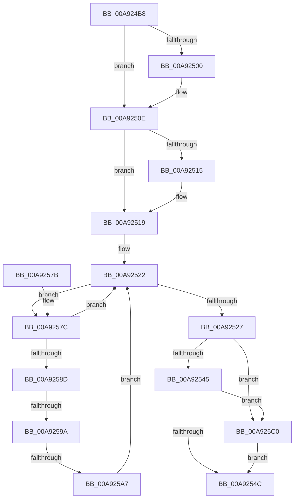

# ObDestroyHandleRevocationBlock

- RVA: `0x00A924B8`–`0x00A925CA` (길이 `274` bytes)
- VA: `0x0000000140A924B8`
- 실행 섹션: `PAGE`
- PDB 이름 있음: `예`; PDB Function 태그: `예`
- unwind 정보 RVA: `0x000B939C`
- 디코드: `76`개 명령, `274/274` bytes 표시
- 미해석 바이트: `0` (있으면 어셈블리에 `.byte`로 보존)

> 이 문서는 커널 이미지의 기계어와 PDB 기호를 분석해 생성했습니다. 4번과 5번은 함수 원형과 자료형을 바이너리 사용 방식에서 추정한 C 해석이며 원본 소스 복구 결과는 아닙니다.

## 1. Dependencies

- 직접 호출 지점: **7**; 고유 호출 대상: **7**
- 직접 호출자로 확인된 함수: **2**
- RIP 상대 이미지 참조: **0**

### Outgoing calls
- `0x00A924F0` → [KeAbPreAcquire](../../text/21/KeAbPreAcquire_function_00210230.md) (function, `0x00210230`)
- `0x00A92509` → [ExfAcquirePushLockExclusiveEx](../../text/20/ExfAcquirePushLockExclusiveEx_function_0020FC90.md) (function, `0x0020FC90`)
- `0x00A9254F` → [KeAbPostRelease](../../text/2E/KeAbPostRelease_function_002E1600.md) (function, `0x002E1600`)
- `0x00A92554` → [KeLeaveCriticalRegion](../../text/25/KeLeaveCriticalRegion_function_0025D8B0.md) (function, `0x0025D8B0`)
- `0x00A9255D` → [ExWaitForRundownProtectionRelease](../../text/2A/ExWaitForRundownProtectionRelease_function_002A4CB0.md) (function, `0x002A4CB0`)
- `0x00A925B2` → [ExReleaseRundownProtection](../../text/34/ExReleaseRundownProtection_function_00349E80.md) (function, `0x00349E80`)
- `0x00A925C3` → [ExfReleasePushLock](../../text/26/ExfReleasePushLock_function_002638D0.md) (function, `0x002638D0`)

### Direct callers
- [SepDeleteLogonSessionTrack](../AA/SepDeleteLogonSessionTrack_function_00AA04E0.md) at `0x00AA066C`
- [SepDeReferenceLogonSession](../AF/SepDeReferenceLogonSession_function_00AF25EC.md) at `0x00AF2804`

### Static image references
- 디코드된 RIP-relative 메모리 참조가 없습니다.

## 2. Other-region calls and transfers

- 다른 실행 섹션으로 향하는 call: **7**
  - `0x00A924F0` → [KeAbPreAcquire](../../text/21/KeAbPreAcquire_function_00210230.md) (`PAGE` → `.text`)
  - `0x00A92509` → [ExfAcquirePushLockExclusiveEx](../../text/20/ExfAcquirePushLockExclusiveEx_function_0020FC90.md) (`PAGE` → `.text`)
  - `0x00A9254F` → [KeAbPostRelease](../../text/2E/KeAbPostRelease_function_002E1600.md) (`PAGE` → `.text`)
  - `0x00A92554` → [KeLeaveCriticalRegion](../../text/25/KeLeaveCriticalRegion_function_0025D8B0.md) (`PAGE` → `.text`)
  - `0x00A9255D` → [ExWaitForRundownProtectionRelease](../../text/2A/ExWaitForRundownProtectionRelease_function_002A4CB0.md) (`PAGE` → `.text`)
  - `0x00A925B2` → [ExReleaseRundownProtection](../../text/34/ExReleaseRundownProtection_function_00349E80.md) (`PAGE` → `.text`)
  - `0x00A925C3` → [ExfReleasePushLock](../../text/26/ExfReleasePushLock_function_002638D0.md) (`PAGE` → `.text`)
- call이 아닌 외부 분기/꼬리 이동: **2**
  - `0x00A92594` → [sub_00B4727C](../B4/Unknown_function_00B4727C.md) (`tail-transfer`)
  - `0x00A925A1` → [sub_00B4727C](../B4/Unknown_function_00B4727C.md) (`tail-transfer`)

## 3. Assembly (complete function range)

```asm
00A924B8  48 89 5C 24 10                  mov qword ptr [rsp + 0x10], rbx
00A924BD  48 89 6C 24 18                  mov qword ptr [rsp + 0x18], rbp
00A924C2  48 89 74 24 20                  mov qword ptr [rsp + 0x20], rsi
00A924C7  57                              push rdi
00A924C8  41 56                           push r14
00A924CA  41 57                           push r15
00A924CC  48 83 EC 20                     sub rsp, 0x20
00A924D0  65 48 8B 04 25 88 01 00 00      mov rax, qword ptr gs:[0x188]
00A924D9  48 8D 59 10                     lea rbx, [rcx + 0x10]
00A924DD  48 8B F9                        mov rdi, rcx
00A924E0  45 33 C0                        xor r8d, r8d
00A924E3  33 D2                           xor edx, edx
00A924E5  48 8B CB                        mov rcx, rbx
00A924E8  66 FF 88 E4 01 00 00            dec word ptr [rax + 0x1e4]
00A924EF  90                              nop
00A924F0  E8 3B DD 77 FF                  call 0x140210230
00A924F5  F0 48 0F BA 2B 00               lock bts qword ptr [rbx], 0
00A924FB  48 8B F0                        mov rsi, rax
00A924FE  73 0E                           jae 0x140a9250e
00A92500  4C 8B C3                        mov r8, rbx
00A92503  48 8B D0                        mov rdx, rax
00A92506  48 8B CB                        mov rcx, rbx
00A92509  E8 82 D7 77 FF                  call 0x14020fc90
00A9250E  33 ED                           xor ebp, ebp
00A92510  48 85 F6                        test rsi, rsi
00A92513  74 04                           je 0x140a92519
00A92515  C6 46 0A 01                     mov byte ptr [rsi + 0xa], 1
00A92519  4C 8B 37                        mov r14, qword ptr [rdi]
00A9251C  41 BF 02 00 00 00               mov r15d, 2
00A92522  4C 3B F7                        cmp r14, rdi
00A92525  75 55                           jne 0x140a9257c
00A92527  0F 0D 0B                        prefetchw byte ptr [rbx]
00A9252A  48 8B 03                        mov rax, qword ptr [rbx]
00A9252D  48 8B C8                        mov rcx, rax
00A92530  48 83 E1 F0                     and rcx, 0xfffffffffffffff0
00A92534  48 83 F9 10                     cmp rcx, 0x10
00A92538  48 8D 50 F0                     lea rdx, [rax - 0x10]
00A9253C  48 0F 46 D5                     cmovbe rdx, rbp
00A92540  41 84 C7                        test r15b, al
00A92543  75 7B                           jne 0x140a925c0
00A92545  F0 48 0F B1 13                  lock cmpxchg qword ptr [rbx], rdx
00A9254A  75 74                           jne 0x140a925c0
00A9254C  48 8B CB                        mov rcx, rbx
00A9254F  E8 AC F0 84 FF                  call 0x1402e1600
00A92554  E8 57 B3 7C FF                  call 0x14025d8b0
00A92559  48 8D 4F 18                     lea rcx, [rdi + 0x18]
00A9255D  E8 4E 27 81 FF                  call 0x1402a4cb0
00A92562  48 8B 5C 24 48                  mov rbx, qword ptr [rsp + 0x48]
00A92567  48 8B 6C 24 50                  mov rbp, qword ptr [rsp + 0x50]
00A9256C  48 8B 74 24 58                  mov rsi, qword ptr [rsp + 0x58]
00A92571  48 83 C4 20                     add rsp, 0x20
00A92575  41 5F                           pop r15
00A92577  41 5E                           pop r14
00A92579  5F                              pop rdi
00A9257A  C3                              ret
00A9257B  CC                              int3
00A9257C  49 8B F6                        mov rsi, r14
00A9257F  48 8B C7                        mov rax, rdi
00A92582  4D 8B 36                        mov r14, qword ptr [r14]
00A92585  F0 4C 0F B1 7E 10               lock cmpxchg qword ptr [rsi + 0x10], r15
00A9258B  75 95                           jne 0x140a92522
00A9258D  48 8B 0E                        mov rcx, qword ptr [rsi]
00A92590  48 39 71 08                     cmp qword ptr [rcx + 8], rsi
00A92594  0F 85 E2 4C 0B 00               jne 0x140b4727c
00A9259A  48 8B 46 08                     mov rax, qword ptr [rsi + 8]
00A9259E  48 39 30                        cmp qword ptr [rax], rsi
00A925A1  0F 85 D5 4C 0B 00               jne 0x140b4727c
00A925A7  48 89 08                        mov qword ptr [rax], rcx
00A925AA  48 89 41 08                     mov qword ptr [rcx + 8], rax
00A925AE  48 8D 4F 18                     lea rcx, [rdi + 0x18]
00A925B2  E8 C9 78 8B FF                  call 0x140349e80
00A925B7  48 89 6E 10                     mov qword ptr [rsi + 0x10], rbp
00A925BB  E9 62 FF FF FF                  jmp 0x140a92522
00A925C0  48 8B CB                        mov rcx, rbx
00A925C3  E8 08 13 7D FF                  call 0x1402638d0
00A925C8  EB 82                           jmp 0x140a9254c
```

## 4. C-style interpretation (structured pseudocode)

```c
__int64 __fastcall ObDestroyHandleRevocationBlock(__int64 a1, int a2, int a3)
{
    __int64 result;
    __int64 v_rbp;
    __int64 v_rsp;
    unsigned __int64 v_stack_p10;
    unsigned __int64 v_stack_p18;
    unsigned __int64 v_stack_p20;

    v_stack_p10 = v_rbx;
    v_stack_p18 = v_rbp;
    v_stack_p20 = v_rsi;
    v_rsp = (v_rsp) - (32);
    a3 = 0;
    a2 = 0;
    result = KeAbPreAcquire(a1 + 16, a2, a3, a4);
    if (!(condition_is_above_or_equal)) {
        a3 = a1 + 16;
        a2 = result;
        a1 = a1 + 16;
        result = ExfAcquirePushLockExclusiveEx(a1, a2, a3, a4);
    }
    v_rbp = 0;
    if (result != 0) {
        *(unsigned __int8 *)(result + 10) = 1;
    }
loc_00A92522:
    if ((*(unsigned __int64 *)(a1)) != a1) goto loc_00A9257C;
    a1 = (*(unsigned __int64 *)(a1 + 16)) & (-16);
    a2 = *(unsigned __int64 *)(a1 + 16) - 16;
    if (a1 <= 16) { a2 = 0; }
    if (((2) & ((unsigned __int8)(*(unsigned __int64 *)(a1 + 16)))) != 0) goto loc_00A925C0;
    if (((2) & ((unsigned __int8)(*(unsigned __int64 *)(a1 + 16)))) != 0) goto loc_00A925C0;
loc_00A9254C:
    result = KeAbPostRelease(a1 + 16, a2, a3, a4);
    result = KeLeaveCriticalRegion(a1 + 16, a2, a3, a4);
    result = ExWaitForRundownProtectionRelease(a1 + 24, a2, a3, a4);
    v_rsp = (v_rsp) + (32);
    return result;
loc_00A9257C:
    if (condition_is_not_equal) goto loc_00A92522;
    *(unsigned __int64 *)(*(unsigned __int64 *)(*(unsigned __int64 *)(a1) + 8)) = *(unsigned __int64 *)(*(unsigned __int64 *)(a1));
    *(unsigned __int64 *)(*(unsigned __int64 *)(*(unsigned __int64 *)(a1)) + 8) = *(unsigned __int64 *)(*(unsigned __int64 *)(a1) + 8);
    result = ExReleaseRundownProtection(a1 + 24, a2, a3, a4);
    *(unsigned __int64 *)(*(unsigned __int64 *)(a1) + 16) = v_stack_p18;
    goto loc_00A92522;
loc_00A925C0:
    result = ExfReleasePushLock(v_stack_p10, a2, a3, a4);
    goto loc_00A9254C;
}
```

## 5. (Beta) C Style

```c
int64_t ObDestroyHandleRevocationBlock(void *Arg1, int32_t Arg2, int32_t Arg3)
{
    uint8_t *arg1 = (uint8_t *)Arg1;

    int64_t result;
    int64_t local_rbp;
    int64_t local_rsp;
    uint64_t v_stack_p10;
    uint64_t v_stack_p18;
    uint64_t v_stack_p20;

    v_stack_p10 = local_rbx;
    v_stack_p18 = local_rbp;
    v_stack_p20 = local_rsi;
    local_rsp = (local_rsp) - (32);
    Arg3 = 0;
    Arg2 = 0;
    result = KeAbPreAcquire(Arg1 + 16, Arg2, Arg3, a4);
    if (!(condition_is_above_or_equal)) {
        Arg3 = Arg1 + 16;
        Arg2 = result;
        Arg1 = Arg1 + 16;
        result = ExfAcquirePushLockExclusiveEx(Arg1, Arg2, Arg3, a4);
    }
    local_rbp = 0;
    if (result != 0) {
        *(uint8_t *)(result + 0xA) = 1;
    }
loc_00A92522:
    if ((*(uint64_t *)(arg1)) != Arg1) goto loc_00A9257C;
    Arg1 = (*(uint64_t *)(arg1 + 0x10)) & (-16);
    Arg2 = *(uint64_t *)(arg1 + 0x10) - 16;
    if (Arg1 <= 16) { Arg2 = 0; }
    if (((2) & ((uint8_t)(*(uint64_t *)(arg1 + 0x10)))) != 0) goto loc_00A925C0;
    if (((2) & ((uint8_t)(*(uint64_t *)(arg1 + 0x10)))) != 0) goto loc_00A925C0;
loc_00A9254C:
    result = KeAbPostRelease(Arg1 + 16, Arg2, Arg3, a4);
    result = KeLeaveCriticalRegion(Arg1 + 16, Arg2, Arg3, a4);
    result = ExWaitForRundownProtectionRelease(Arg1 + 24, Arg2, Arg3, a4);
    local_rsp = (local_rsp) + (32);
    return result;
loc_00A9257C:
    if (condition_is_not_equal) goto loc_00A92522;
    *(uint64_t *)(*(uint64_t *)(*(uint64_t *)(arg1) + 0x8)) = *(uint64_t *)(*(uint64_t *)(arg1));
    *(uint64_t *)(*(uint64_t *)(*(uint64_t *)(arg1)) + 0x8) = *(uint64_t *)(*(uint64_t *)(arg1) + 0x8);
    result = ExReleaseRundownProtection(Arg1 + 24, Arg2, Arg3, a4);
    *(uint64_t *)(*(uint64_t *)(arg1) + 0x10) = v_stack_p18;
    goto loc_00A92522;
loc_00A925C0:
    result = ExfReleasePushLock(v_stack_p10, Arg2, Arg3, a4);
    goto loc_00A9254C;
}
```

### 관측된 메모리 오프셋

구조체 형식이 확인되지 않은 접근은 인자 기준의 오프셋으로만 기록했습니다.

| 기준 인자 | 오프셋 표현 | 폭 (bit) | 접근 |
|---|---:|---:|---|
| `Arg1` | `+ 0x0` | `8` | `R` |
| `Arg1` | `+ 0x0` | `64` | `R` |
| `Arg1` | `+ 0x0` | `64` | `R/W` |
| `Arg1` | `+ 0x10` | `64` | `R` |
| `Arg1` | `+ 0x18` | `64` | `R` |

## 6. Execution-region graph

[열기: 2D/3D 그래프와 함수 탐색 컨트롤 패널](../../../control-panel.html?section=page&rva=0x00A924B8&view=graph)

- 2D 그래프는 위에서 아래로 흐르고, 3D 그래프는 빈 공간을 드래그해 회전합니다. Shift+드래그는 이동, 휠은 확대·축소, 함수 노드 선택은 대상 보고서 이동입니다.

### Static fallback


