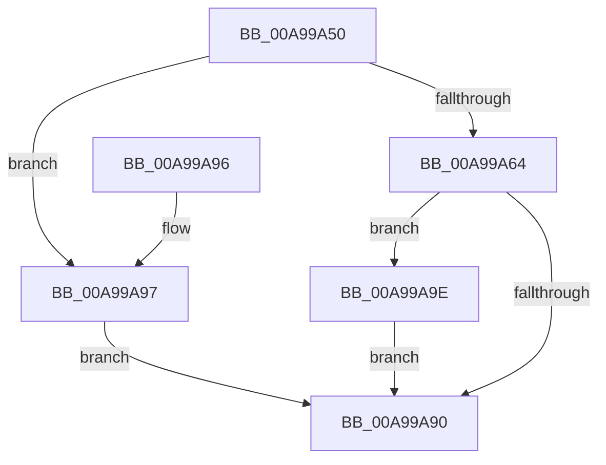

# ObGetHandleInformationEx

- RVA: `0x00A99A50`–`0x00A99AA6` (길이 `86` bytes)
- VA: `0x0000000140A99A50`
- 실행 섹션: `PAGE`
- PDB 이름 있음: `예`; PDB Function 태그: `아니요`
- unwind 정보 RVA: `0x0006E698`
- 디코드: `26`개 명령, `86/86` bytes 표시
- 미해석 바이트: `0` (있으면 어셈블리에 `.byte`로 보존)

> 이 문서는 커널 이미지의 기계어와 PDB 기호를 분석해 생성했습니다. 4번과 5번은 함수 원형과 자료형을 바이너리 사용 방식에서 추정한 C 해석이며 원본 소스 복구 결과는 아닙니다.

## 1. Dependencies

- 직접 호출 지점: **1**; 고유 호출 대상: **1**
- 직접 호출자로 확인된 함수: **1**
- RIP 상대 이미지 참조: **1**

### Outgoing calls
- `0x00A99A86` → [ExpSnapShotHandleTables](../8A/ExpSnapShotHandleTables_function_008A25C0.md) (function, `0x008A25C0`)

### Direct callers
- [ExpGetHandleInformationEx](ExpGetHandleInformationEx_function_00A999B8.md) at `0x00A99A33`

### Static image references
- `0x00A99A7F` → RVA `0x009D80F0` (`ObpCaptureHandleInformationEx`; read)

## 2. Other-region calls and transfers

- 다른 실행 섹션으로 향하는 call: **0**
- 별도 외부 분기/꼬리 이동을 확인하지 못했습니다.

## 3. Assembly (complete function range)

```asm
00A99A50  40 53                           push rbx
00A99A52  48 83 EC 30                     sub rsp, 0x30
00A99A56  83 64 24 50 00                  and dword ptr [rsp + 0x50], 0
00A99A5B  49 8B D9                        mov rbx, r9
00A99A5E  41 83 F8 10                     cmp r8d, 0x10
00A99A62  72 33                           jb 0x140a99a97
00A99A64  48 83 22 00                     and qword ptr [rdx], 0
00A99A68  48 8D 44 24 50                  lea rax, [rsp + 0x50]
00A99A6D  45 8B C8                        mov r9d, r8d
00A99A70  C6 44 24 28 01                  mov byte ptr [rsp + 0x28], 1
00A99A75  4C 8B C2                        mov r8, rdx
00A99A78  48 89 44 24 20                  mov qword ptr [rsp + 0x20], rax
00A99A7D  8B D1                           mov edx, ecx
00A99A7F  48 8D 0D 6A E6 F3 FF            lea rcx, [rip - 0xc1996]
00A99A86  E8 35 8B E0 FF                  call 0x1408a25c0
00A99A8B  48 85 DB                        test rbx, rbx
00A99A8E  75 0E                           jne 0x140a99a9e
00A99A90  48 83 C4 30                     add rsp, 0x30
00A99A94  5B                              pop rbx
00A99A95  C3                              ret
00A99A96  CC                              int3
00A99A97  B8 04 00 00 C0                  mov eax, 0xc0000004
00A99A9C  EB F2                           jmp 0x140a99a90
00A99A9E  8B 4C 24 50                     mov ecx, dword ptr [rsp + 0x50]
00A99AA2  89 0B                           mov dword ptr [rbx], ecx
00A99AA4  EB EA                           jmp 0x140a99a90
```

## 4. C-style interpretation (structured pseudocode)

```c
__int64 __fastcall ObGetHandleInformationEx(int a1, __int64 a2, int a3, __int64 a4)
{
    __int64 result;
    __int64 v_rsp;
    unsigned __int8 v_stack_m10;
    unsigned __int64 v_stack_m18;
    unsigned int v_stack_p18;
    unsigned int v_stack_p50;

    v_rsp = (v_rsp) - (48);
    if (a3 < 16) goto loc_00A99A97;
    v_stack_m10 = 1;
    v_stack_m18 = v_stack_p18;
    result = ExpSnapShotHandleTables(v_rip - 792982, (unsigned int)(a1), a2, (unsigned int)(a3));
    if (a4 != 0) goto loc_00A99A9E;
loc_00A99A90:
    v_rsp = (v_rsp) + (48);
    return result;
loc_00A99A97:
    goto loc_00A99A90;
loc_00A99A9E:
    *(unsigned int *)(a4) = (unsigned int)((unsigned int)(v_stack_p50));
    goto loc_00A99A90;
}
```

## 5. (Beta) C Style

```c
int64_t ObGetHandleInformationEx(int32_t Arg1, void *Arg2, int32_t Arg3, int64_t Arg4)
{
    uint8_t *arg2 = (uint8_t *)Arg2;

    int64_t result;
    int64_t local_rsp;
    uint8_t v_stack_m10;
    uint64_t v_stack_m18;
    uint32_t v_stack_p18;
    uint32_t v_stack_p50;

    local_rsp = (local_rsp) - (48);
    if (Arg3 < 16) goto loc_00A99A97;
    v_stack_m10 = 1;
    v_stack_m18 = v_stack_p18;
    result = ExpSnapShotHandleTables(v_rip - 792982, (uint32_t)(Arg1), Arg2, (uint32_t)(Arg3));
    if (Arg4 != 0) goto loc_00A99A9E;
loc_00A99A90:
    local_rsp = (local_rsp) + (48);
    return result;
loc_00A99A97:
    goto loc_00A99A90;
loc_00A99A9E:
    *(uint32_t *)(Arg4) = (uint32_t)((uint32_t)(v_stack_p50));
    goto loc_00A99A90;
}
```

### 관측된 메모리 오프셋

구조체 형식이 확인되지 않은 접근은 인자 기준의 오프셋으로만 기록했습니다.

| 기준 인자 | 오프셋 표현 | 폭 (bit) | 접근 |
|---|---:|---:|---|
| `Arg2` | `+ 0x0` | `64` | `R/W` |

## 6. Execution-region graph

[열기: 2D/3D 그래프와 함수 탐색 컨트롤 패널](../../../control-panel.html?section=page&rva=0x00A99A50&view=graph)

- 2D 그래프는 위에서 아래로 흐르고, 3D 그래프는 빈 공간을 드래그해 회전합니다. Shift+드래그는 이동, 휠은 확대·축소, 함수 노드 선택은 대상 보고서 이동입니다.

### Static fallback


