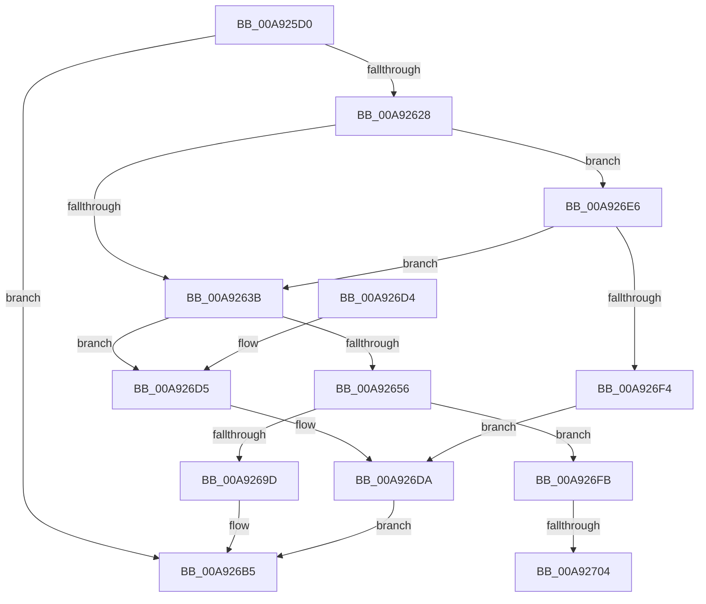

# ObpSetDeviceMap

- RVA: `0x00A925D0`–`0x00A9271A` (길이 `330` bytes)
- VA: `0x0000000140A925D0`
- 실행 섹션: `PAGE`
- PDB 이름 있음: `예`; PDB Function 태그: `예`
- unwind 정보 RVA: `0x000B93F8`
- 디코드: `83`개 명령, `330/330` bytes 표시
- 미해석 바이트: `0` (있으면 어셈블리에 `.byte`로 보존)

> 이 문서는 커널 이미지의 기계어와 PDB 기호를 분석해 생성했습니다. 4번과 5번은 함수 원형과 자료형을 바이너리 사용 방식에서 추정한 C 해석이며 원본 소스 복구 결과는 아닙니다.

## 1. Dependencies

- 직접 호출 지점: **7**; 고유 호출 대상: **6**
- 직접 호출자로 확인된 함수: **3**
- RIP 상대 이미지 참조: **1**

### Outgoing calls
- `0x00A9261B` → [ObReferenceObjectByHandle](../86/ObReferenceObjectByHandle_function_00868DB0.md) (function, `0x00868DB0`)
- `0x00A92649` → [ExAllocatePool2](../../poolcode/B8/ExAllocatePool2_function_00B820F0.md) (function, `0x00B820F0`)
- `0x00A92691` → [ObOpenObjectByPointer](../8B/ObOpenObjectByPointer_function_008B7420.md) (function, `0x008B7420`)
- `0x00A926A0` → [ObfDereferenceObject](../../text/2F/ObfDereferenceObject_function_002F9350.md) (function, `0x002F9350`)
- `0x00A926AD` → [ExFreePoolWithTag](../../poolcode/B8/ExFreePoolWithTag_function_00B82870.md) (function, `0x00B82870`)
- `0x00A926DD` → [ObfDereferenceObject](../../text/2F/ObfDereferenceObject_function_002F9350.md) (function, `0x002F9350`)
- `0x00A9270C` → [ObfReferenceObjectWithTag](../../text/21/ObfReferenceObjectWithTag_function_00210710.md) (function, `0x00210710`)

### Direct callers
- [ObpCreateDosDevicesDirectory](../74/ObpCreateDosDevicesDirectory_function_0074E03C.md) at `0x0074E145`
- [NtSetInformationProcess](../AE/NtSetInformationProcess_function_00AE5370.md) at `0x00AE67C5`
- [sub_00B2884E](../B2/Unknown_function_00B2884E.md) at `0x00B28949`

### Static image references
- `0x00A92602` → RVA `0x00F0F650` (`.data`; read)

## 2. Other-region calls and transfers

- 다른 실행 섹션으로 향하는 call: **5**
  - `0x00A92649` → [ExAllocatePool2](../../poolcode/B8/ExAllocatePool2_function_00B820F0.md) (`PAGE` → `POOLCODE`)
  - `0x00A926A0` → [ObfDereferenceObject](../../text/2F/ObfDereferenceObject_function_002F9350.md) (`PAGE` → `.text`)
  - `0x00A926AD` → [ExFreePoolWithTag](../../poolcode/B8/ExFreePoolWithTag_function_00B82870.md) (`PAGE` → `POOLCODE`)
  - `0x00A926DD` → [ObfDereferenceObject](../../text/2F/ObfDereferenceObject_function_002F9350.md) (`PAGE` → `.text`)
  - `0x00A9270C` → [ObfReferenceObjectWithTag](../../text/21/ObfReferenceObjectWithTag_function_00210710.md) (`PAGE` → `.text`)
- call이 아닌 외부 분기/꼬리 이동: **2**
  - `0x00A926FE` → [sub_00B47284](../B4/Unknown_function_00B47284.md) (`tail-transfer`)
  - `0x00A92715` → [sub_00B47284](../B4/Unknown_function_00B47284.md) (`tail-transfer`)

## 3. Assembly (complete function range)

```asm
00A925D0  4C 8B DC                        mov r11, rsp
00A925D3  49 89 5B 08                     mov qword ptr [r11 + 8], rbx
00A925D7  49 89 6B 10                     mov qword ptr [r11 + 0x10], rbp
00A925DB  49 89 73 18                     mov qword ptr [r11 + 0x18], rsi
00A925DF  49 89 7B 20                     mov qword ptr [r11 + 0x20], rdi
00A925E3  41 54                           push r12
00A925E5  41 55                           push r13
00A925E7  41 56                           push r14
00A925E9  48 83 EC 50                     sub rsp, 0x50
00A925ED  45 33 E4                        xor r12d, r12d
00A925F0  48 8B E9                        mov rbp, rcx
00A925F3  49 8D 4B D8                     lea rcx, [r11 - 0x28]
00A925F7  4D 89 63 C0                     mov qword ptr [r11 - 0x40], r12
00A925FB  49 8B C0                        mov rax, r8
00A925FE  49 89 4B B8                     mov qword ptr [r11 - 0x48], rcx
00A92602  4C 8B 05 47 D0 47 00            mov r8, qword ptr [rip + 0x47d047]
00A92609  4C 8B EA                        mov r13, rdx
00A9260C  41 8D 54 24 02                  lea edx, [r12 + 2]
00A92611  4D 89 63 D8                     mov qword ptr [r11 - 0x28], r12
00A92615  48 8B C8                        mov rcx, rax
00A92618  41 8B DC                        mov ebx, r12d
00A9261B  E8 90 67 DD FF                  call 0x140868db0
00A92620  85 C0                           test eax, eax
00A92622  0F 88 8D 00 00 00               js 0x140a926b5
00A92628  F6 84 24 90 00 00 00 04         test byte ptr [rsp + 0x90], 4
00A92630  48 8B 74 24 40                  mov rsi, qword ptr [rsp + 0x40]
00A92635  0F 84 AB 00 00 00               je 0x140a926e6
00A9263B  BA 28 01 00 00                  mov edx, 0x128
00A92640  41 B8 4F 62 44 6D               mov r8d, 0x6d44624f
00A92646  8D 4A D8                        lea ecx, [rdx - 0x28]
00A92649  E8 A2 FA 0E 00                  call 0x140b820f0
00A9264E  48 8B F8                        mov rdi, rax
00A92651  48 85 C0                        test rax, rax
00A92654  74 7F                           je 0x140a926d5
00A92656  48 C7 80 F0 00 00 00 01 00 00 00  mov qword ptr [rax + 0xf0], 1
00A92661  41 B9 0F 00 0F 00               mov r9d, 0xf000f
00A92667  48 89 30                        mov qword ptr [rax], rsi
00A9266A  45 33 C0                        xor r8d, r8d
00A9266D  48 05 F8 00 00 00               add rax, 0xf8
00A92673  BA 00 02 00 00                  mov edx, 0x200
00A92678  48 89 44 24 30                  mov qword ptr [rsp + 0x30], rax
00A9267D  48 8B CE                        mov rcx, rsi
00A92680  48 8B 05 C9 CF 47 00            mov rax, qword ptr [rip + 0x47cfc9]
00A92687  44 88 64 24 28                  mov byte ptr [rsp + 0x28], r12b
00A9268C  48 89 44 24 20                  mov qword ptr [rsp + 0x20], rax
00A92691  E8 8A 4D E2 FF                  call 0x1408b7420
00A92696  44 8B F0                        mov r14d, eax
00A92699  85 C0                           test eax, eax
00A9269B  79 5E                           jns 0x140a926fb
00A9269D  48 8B CE                        mov rcx, rsi
00A926A0  E8 AB 6C 86 FF                  call 0x1402f9350
00A926A5  BA 4F 62 44 6D                  mov edx, 0x6d44624f
00A926AA  48 8B CF                        mov rcx, rdi
00A926AD  E8 BE 01 0F 00                  call 0x140b82870
00A926B2  41 8B C6                        mov eax, r14d
00A926B5  4C 8D 5C 24 50                  lea r11, [rsp + 0x50]
00A926BA  49 8B 5B 20                     mov rbx, qword ptr [r11 + 0x20]
00A926BE  49 8B 6B 28                     mov rbp, qword ptr [r11 + 0x28]
00A926C2  49 8B 73 30                     mov rsi, qword ptr [r11 + 0x30]
00A926C6  49 8B 7B 38                     mov rdi, qword ptr [r11 + 0x38]
00A926CA  49 8B E3                        mov rsp, r11
00A926CD  41 5E                           pop r14
00A926CF  41 5D                           pop r13
00A926D1  41 5C                           pop r12
00A926D3  C3                              ret
00A926D4  CC                              int3
00A926D5  BB 9A 00 00 C0                  mov ebx, 0xc000009a
00A926DA  48 8B CE                        mov rcx, rsi
00A926DD  E8 6E 6C 86 FF                  call 0x1402f9350
00A926E2  8B C3                           mov eax, ebx
00A926E4  EB CF                           jmp 0x140a926b5
00A926E6  8B 86 50 01 00 00               mov eax, dword ptr [rsi + 0x150]
00A926EC  A8 04                           test al, 4
00A926EE  0F 84 47 FF FF FF               je 0x140a9263b
00A926F4  BB 0D 00 00 C0                  mov ebx, 0xc000000d
00A926F9  EB DF                           jmp 0x140a926da
00A926FB  48 85 ED                        test rbp, rbp
00A926FE  0F 84 80 4B 0B 00               je 0x140b47284
00A92704  BA 4F 62 44 6D                  mov edx, 0x6d44624f
00A92709  48 8B CD                        mov rcx, rbp
00A9270C  E8 FF DF 77 FF                  call 0x140210710
00A92711  48 89 6F 10                     mov qword ptr [rdi + 0x10], rbp
00A92715  E9 6A 4B 0B 00                  jmp 0x140b47284
```

## 4. C-style interpretation (structured pseudocode)

```c
__int64 __fastcall ObpSetDeviceMap(__int64 a1, __int64 a2, __int64 a3, __int64 a4, unsigned __int8 a5)
{
    __int64 result;
    __int64 v_r12;
    __int64 v_rsp;
    unsigned __int64 v_stack_m18;
    unsigned __int64 v_stack_m28;
    unsigned __int64 v_stack_m38;
    unsigned __int8 v_stack_m40;
    unsigned __int64 v_stack_m48;

    *(unsigned __int64 *)(v_rsp + 8) = v_rbx;
    *(unsigned __int64 *)(v_rsp + 16) = v_rbp;
    *(unsigned __int64 *)(v_rsp + 24) = v_rsi;
    *(unsigned __int64 *)(v_rsp + 32) = v_rdi;
    v_rsp = (v_rsp) - (80);
    v_r12 = 0;
    *(unsigned __int64 *)(v_rsp - 64) = 0;
    *(unsigned __int64 *)(v_rsp - 72) = v_rsp - 40;
    *(unsigned __int64 *)(v_rsp - 40) = 0;
    result = ObReferenceObjectByHandle(a3, v_r12 + 2, *(unsigned __int64 *)(v_rip + 4706375), a4);
    if (sign_flag) goto loc_00A926B5;
    if (((a5) & (4)) == 0) goto loc_00A926E6;
loc_00A9263B:
    result = ExAllocatePool2(296 - 40, 296, (unsigned int)(0x6D44624FULL), a4);
    if (result == 0) goto loc_00A926D5;
    *(unsigned __int64 *)(result + 240) = 1;
    *(unsigned __int64 *)(result) = v_stack_m28;
    a3 = 0;
    result = (result) + (248);
    v_stack_m38 = result;
    v_stack_m40 = 0;
    v_stack_m48 = *(unsigned __int64 *)(v_rip + 4706249);
    result = ObOpenObjectByPointer(v_stack_m28, 512, a3, (unsigned int)(0xF000FULL));
    if (!sign_flag) goto loc_00A926FB;
    result = ObfDereferenceObject(v_stack_m28, 512, a3, (unsigned int)(0xF000FULL));
    result = ExFreePoolWithTag(result, (unsigned int)(0x6D44624FULL), a3, (unsigned int)(0xF000FULL));
loc_00A926B5:
    return (unsigned int)((unsigned int)((unsigned int)((unsigned int)(result))));
loc_00A926D5:
loc_00A926DA:
    result = ObfDereferenceObject(*(unsigned __int64 *)(v_stack_m18 + 48), (unsigned int)(0x6D44624FULL), a3, (unsigned int)(0xF000FULL));
    goto loc_00A926B5;
loc_00A926E6:
    if ((((unsigned __int8)((unsigned int)(*(unsigned int *)(*(unsigned __int64 *)(v_stack_m18 + 48) + 336)))) & (4)) == 0) goto loc_00A9263B;
    goto loc_00A926DA;
loc_00A926FB:
    result = ObfReferenceObjectWithTag(*(unsigned __int64 *)(v_stack_m18 + 40), (unsigned int)(0x6D44624FULL), a3, (unsigned int)(0xF000FULL));
    *(unsigned __int64 *)(*(unsigned __int64 *)(v_stack_m18 + 56) + 16) = *(unsigned __int64 *)(v_stack_m18 + 40);
}
```

## 5. (Beta) C Style

```c
int64_t ObpSetDeviceMap(int64_t Arg1, int64_t Arg2, int64_t Arg3, int64_t Arg4, uint8_t Arg5)
{
    int64_t result;
    int64_t local_r12;
    int64_t local_rsp;
    uint64_t v_stack_m18;
    uint64_t v_stack_m28;
    uint64_t v_stack_m38;
    uint8_t v_stack_m40;
    uint64_t v_stack_m48;

    *(uint64_t *)(local_rsp + 0x8) = local_rbx;
    *(uint64_t *)(local_rsp + 0x10) = local_rbp;
    *(uint64_t *)(local_rsp + 0x18) = local_rsi;
    *(uint64_t *)(local_rsp + 0x20) = local_rdi;
    local_rsp = (local_rsp) - (80);
    local_r12 = 0;
    *(uint64_t *)(local_rsp - 0x40) = 0;
    *(uint64_t *)(local_rsp - 0x48) = local_rsp - 40;
    *(uint64_t *)(local_rsp - 0x28) = 0;
    result = ObReferenceObjectByHandle(Arg3, local_r12 + 2, *(uint64_t *)(v_rip + 0x47D047), Arg4);
    if (sign_flag) goto loc_00A926B5;
    if (((Arg5) & (4)) == 0) goto loc_00A926E6;
loc_00A9263B:
    result = ExAllocatePool2(296 - 40, 296, (uint32_t)(0x6D44624FULL), Arg4);
    if (result == 0) goto loc_00A926D5;
    *(uint64_t *)(result + 0xF0) = 1;
    *(uint64_t *)(result) = v_stack_m28;
    Arg3 = 0;
    result = (result) + (248);
    v_stack_m38 = result;
    v_stack_m40 = 0;
    v_stack_m48 = *(uint64_t *)(v_rip + 0x47CFC9);
    result = ObOpenObjectByPointer(v_stack_m28, 512, Arg3, (uint32_t)(0xF000FULL));
    if (!sign_flag) goto loc_00A926FB;
    result = ObfDereferenceObject(v_stack_m28, 512, Arg3, (uint32_t)(0xF000FULL));
    result = ExFreePoolWithTag(result, (uint32_t)(0x6D44624FULL), Arg3, (uint32_t)(0xF000FULL));
loc_00A926B5:
    return (uint32_t)((uint32_t)((uint32_t)((uint32_t)(result))));
loc_00A926D5:
loc_00A926DA:
    result = ObfDereferenceObject(*(uint64_t *)(v_stack_m18 + 0x30), (uint32_t)(0x6D44624FULL), Arg3, (uint32_t)(0xF000FULL));
    goto loc_00A926B5;
loc_00A926E6:
    if ((((uint8_t)((uint32_t)(*(uint32_t *)(*(uint64_t *)(v_stack_m18 + 0x30) + 0x150)))) & (4)) == 0) goto loc_00A9263B;
    goto loc_00A926DA;
loc_00A926FB:
    result = ObfReferenceObjectWithTag(*(uint64_t *)(v_stack_m18 + 0x28), (uint32_t)(0x6D44624FULL), Arg3, (uint32_t)(0xF000FULL));
    *(uint64_t *)(*(uint64_t *)(v_stack_m18 + 0x38) + 0x10) = *(uint64_t *)(v_stack_m18 + 0x28);
}
```

## 6. Execution-region graph

[열기: 2D/3D 그래프와 함수 탐색 컨트롤 패널](../../../control-panel.html?section=page&rva=0x00A925D0&view=graph)

- 2D 그래프는 위에서 아래로 흐르고, 3D 그래프는 빈 공간을 드래그해 회전합니다. Shift+드래그는 이동, 휠은 확대·축소, 함수 노드 선택은 대상 보고서 이동입니다.

### Static fallback


