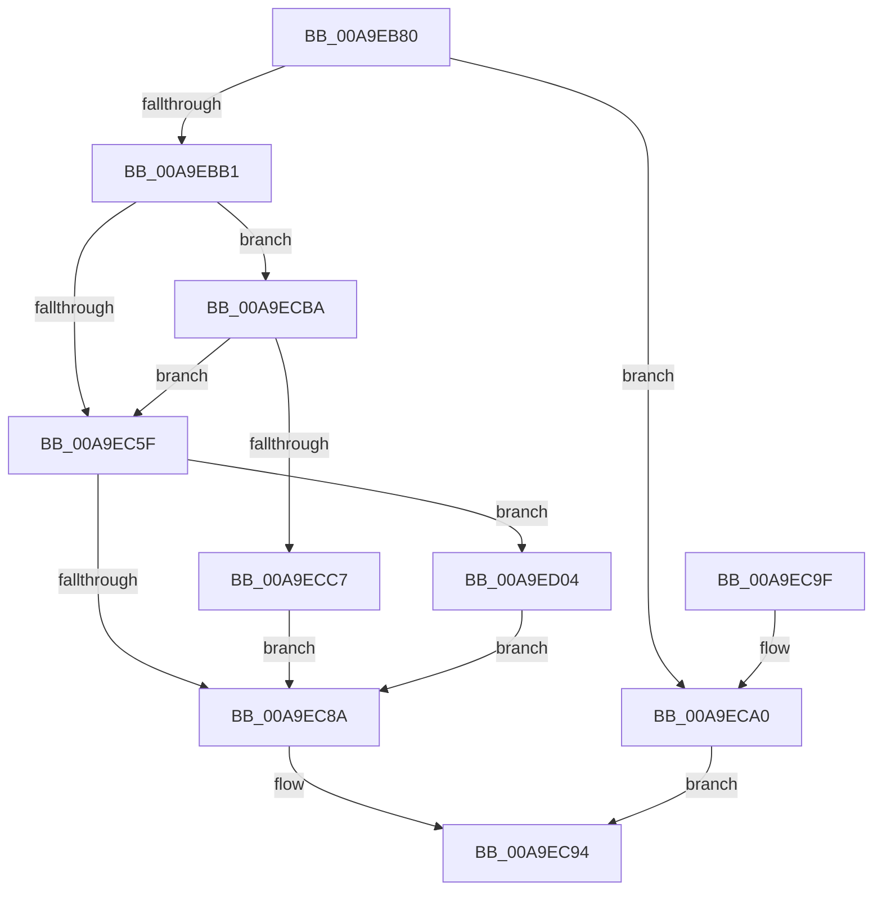

# PerfDiagpSaveActiveDCLLogFileName

- RVA: `0x00A9EB80`–`0x00A9ED33` (길이 `435` bytes)
- VA: `0x0000000140A9EB80`
- 실행 섹션: `PAGE`
- PDB 이름 있음: `예`; PDB Function 태그: `아니요`
- unwind 정보 RVA: `0x000BA97C`
- 디코드: `91`개 명령, `435/435` bytes 표시
- 미해석 바이트: `0` (있으면 어셈블리에 `.byte`로 보존)

> 이 문서는 커널 이미지의 기계어와 PDB 기호를 분석해 생성했습니다. 4번과 5번은 함수 원형과 자료형을 바이너리 사용 방식에서 추정한 C 해석이며 원본 소스 복구 결과는 아닙니다.

## 1. Dependencies

- 직접 호출 지점: **11**; 고유 호출 대상: **10**
- 직접 호출자로 확인된 함수: **1**
- RIP 상대 이미지 참조: **15**

### Outgoing calls
- `0x00A9EBA0` → [ExAllocatePool2](../../poolcode/B8/ExAllocatePool2_function_00B820F0.md) (function, `0x00B820F0`)
- `0x00A9EBC0` → [memset](../../text/6C/memset_function_006C6C40.md) (function, `0x006C6C40`)
- `0x00A9EC07` → [RtlInitUnicodeString](../../text/42/RtlInitUnicodeString_function_0042A780.md) (function, `0x0042A780`)
- `0x00A9EC52` → [NtTraceControl](NtTraceControl_function_00A9ED40.md) (function, `0x00A9ED40`)
- `0x00A9EC81` → [RtlpGetRegistryHandle](../8C/RtlpGetRegistryHandle_function_008C955C.md) (function, `0x008C955C`)
- `0x00A9EC8F` → [ExFreePoolWithTag](../../poolcode/B8/ExFreePoolWithTag_function_00B82870.md) (function, `0x00B82870`)
- `0x00A9ECB3` → [RtlDeleteRegistryValue](../AD/RtlDeleteRegistryValue_function_00ADA1B0.md) (function, `0x00ADA1B0`)
- `0x00A9ECFD` → [RtlWriteRegistryValue](../A6/RtlWriteRegistryValue_function_00A6C620.md) (function, `0x00A6C620`)
- `0x00A9ED10` → [RtlInitUnicodeString](../../text/42/RtlInitUnicodeString_function_0042A780.md) (function, `0x0042A780`)
- `0x00A9ED1F` → [ZwDeleteValueKey](../../text/6A/ZwDeleteValueKey_function_006AECB0.md) (function, `0x006AECB0`)
- `0x00A9ED29` → [ZwClose](../../text/6A/ZwClose_function_006AD2B0.md) (function, `0x006AD2B0`)

### Direct callers
- [PerfDiagpProxyWorker](../7A/PerfDiagpProxyWorker_function_007AEF20.md) at `0x007AF020`

### Static image references
- `0x00A9EBB3` → RVA `0x00EFFCD0` (`.data`; read)
- `0x00A9EBC5` → RVA `0x00B06840` (` ?? ::NNGAKEGL::`string'`; read)
- `0x00A9EBCC` → RVA `0x00B06858` (`PAGE`; read)
- `0x00A9EBD2` → RVA `0x00EFFCAC` (`.data`; read)
- `0x00A9EBD9` → RVA `0x00EFFD60` (`.data`; read)
- `0x00A9EBE0` → RVA `0x00EFFCFC` (`.data`; write)
- `0x00A9EBF1` → RVA `0x00EFFCC4` (`.data`; write)
- `0x00A9EBF7` → RVA `0x00B06850` (`PAGE`; read)
- `0x00A9EBFF` → RVA `0x00EFFCBC` (`.data`; write)
- `0x00A9EC11` → RVA `0x00EFFD58` (`.data`; write)
- `0x00A9EC18` → RVA `0x00EFFD52` (`.data`; write)
- `0x00A9EC2B` → RVA `0x00EFFCD0` (`.data`; write)
- `0x00A9EC72` → RVA `0x00B06860` (` ?? ::NNGAKEGL::`string'`; read)
- `0x00A9ECA0` → RVA `0x00B06A40` (` ?? ::NNGAKEGL::`string'`; read)
- `0x00A9ECBA` → RVA `0x00EFFD50` (`.data`; read)

## 2. Other-region calls and transfers

- 다른 실행 섹션으로 향하는 call: **7**
  - `0x00A9EBA0` → [ExAllocatePool2](../../poolcode/B8/ExAllocatePool2_function_00B820F0.md) (`PAGE` → `POOLCODE`)
  - `0x00A9EBC0` → [memset](../../text/6C/memset_function_006C6C40.md) (`PAGE` → `.text`)
  - `0x00A9EC07` → [RtlInitUnicodeString](../../text/42/RtlInitUnicodeString_function_0042A780.md) (`PAGE` → `.text`)
  - `0x00A9EC8F` → [ExFreePoolWithTag](../../poolcode/B8/ExFreePoolWithTag_function_00B82870.md) (`PAGE` → `POOLCODE`)
  - `0x00A9ED10` → [RtlInitUnicodeString](../../text/42/RtlInitUnicodeString_function_0042A780.md) (`PAGE` → `.text`)
  - `0x00A9ED1F` → [ZwDeleteValueKey](../../text/6A/ZwDeleteValueKey_function_006AECB0.md) (`PAGE` → `.text`)
  - `0x00A9ED29` → [ZwClose](../../text/6A/ZwClose_function_006AD2B0.md) (`PAGE` → `.text`)
- 별도 외부 분기/꼬리 이동을 확인하지 못했습니다.

## 3. Assembly (complete function range)

```asm
00A9EB80  48 89 5C 24 18                  mov qword ptr [rsp + 0x18], rbx
00A9EB85  55                              push rbp
00A9EB86  48 83 EC 40                     sub rsp, 0x40
00A9EB8A  33 ED                           xor ebp, ebp
00A9EB8C  BA 0A 02 00 00                  mov edx, 0x20a
00A9EB91  B9 00 01 00 00                  mov ecx, 0x100
00A9EB96  89 6C 24 50                     mov dword ptr [rsp + 0x50], ebp
00A9EB9A  41 B8 50 52 46 64               mov r8d, 0x64465250
00A9EBA0  E8 4B 35 0E 00                  call 0x140b820f0
00A9EBA5  48 8B D8                        mov rbx, rax
00A9EBA8  48 85 C0                        test rax, rax
00A9EBAB  0F 84 EF 00 00 00               je 0x140a9eca0
00A9EBB1  33 D2                           xor edx, edx
00A9EBB3  48 8D 0D 16 11 46 00            lea rcx, [rip + 0x461116]
00A9EBBA  41 B8 B0 00 00 00               mov r8d, 0xb0
00A9EBC0  E8 7B 80 C2 FF                  call 0x1406c6c40
00A9EBC5  0F 10 05 74 7C 06 00            movups xmm0, xmmword ptr [rip + 0x67c74]
00A9EBCC  8B 05 86 7C 06 00               mov eax, dword ptr [rip + 0x67c86]
00A9EBD2  48 8D 15 D3 10 46 00            lea rdx, [rip + 0x4610d3]
00A9EBD9  48 8D 0D 80 11 46 00            lea rcx, [rip + 0x461180]
00A9EBE0  C7 05 12 11 46 00 00 00 02 00   mov dword ptr [rip + 0x461112], 0x20000
00A9EBEA  0F 11 05 BB 10 46 00            movups xmmword ptr [rip + 0x4610bb], xmm0
00A9EBF1  89 05 CD 10 46 00               mov dword ptr [rip + 0x4610cd], eax
00A9EBF7  F2 0F 10 05 51 7C 06 00         movsd xmm0, qword ptr [rip + 0x67c51]
00A9EBFF  F2 0F 11 05 B5 10 46 00         movsd qword ptr [rip + 0x4610b5], xmm0
00A9EC07  E8 74 BB 98 FF                  call 0x14042a780
00A9EC0C  B8 08 02 00 00                  mov eax, 0x208
00A9EC11  48 89 1D 40 11 46 00            mov qword ptr [rip + 0x461140], rbx
00A9EC18  66 89 05 33 11 46 00            mov word ptr [rip + 0x461133], ax
00A9EC1F  4C 8D 0D AA 10 46 00            lea r9, [rip + 0x4610aa]
00A9EC26  48 8D 44 24 50                  lea rax, [rsp + 0x50]
00A9EC2B  C7 05 9B 10 46 00 B0 00 00 00   mov dword ptr [rip + 0x46109b], 0xb0
00A9EC35  48 89 44 24 28                  mov qword ptr [rsp + 0x28], rax
00A9EC3A  48 8D 15 8F 10 46 00            lea rdx, [rip + 0x46108f]
00A9EC41  41 B8 B0 00 00 00               mov r8d, 0xb0
00A9EC47  C7 44 24 20 B0 00 00 00         mov dword ptr [rsp + 0x20], 0xb0
00A9EC4F  8D 4D 03                        lea ecx, [rbp + 3]
00A9EC52  E8 E9 00 00 00                  call 0x140a9ed40
00A9EC57  44 8D 55 02                     lea r10d, [rbp + 2]
00A9EC5B  85 C0                           test eax, eax
00A9EC5D  79 5B                           jns 0x140a9ecba
00A9EC5F  0F 57 C0                        xorps xmm0, xmm0
00A9EC62  48 89 6C 24 58                  mov qword ptr [rsp + 0x58], rbp
00A9EC67  4C 8D 4C 24 58                  lea r9, [rsp + 0x58]
00A9EC6C  41 B8 01 00 00 00               mov r8d, 1
00A9EC72  48 8D 15 E7 7B 06 00            lea rdx, [rip + 0x67be7]
00A9EC79  41 8B CA                        mov ecx, r10d
00A9EC7C  0F 11 44 24 30                  movups xmmword ptr [rsp + 0x30], xmm0
00A9EC81  E8 D6 A8 E2 FF                  call 0x1408c955c
00A9EC86  85 C0                           test eax, eax
00A9EC88  79 7A                           jns 0x140a9ed04
00A9EC8A  33 D2                           xor edx, edx
00A9EC8C  48 8B CB                        mov rcx, rbx
00A9EC8F  E8 DC 3B 0E 00                  call 0x140b82870
00A9EC94  48 8B 5C 24 60                  mov rbx, qword ptr [rsp + 0x60]
00A9EC99  48 83 C4 40                     add rsp, 0x40
00A9EC9D  5D                              pop rbp
00A9EC9E  C3                              ret
00A9EC9F  CC                              int3
00A9ECA0  4C 8D 05 99 7D 06 00            lea r8, [rip + 0x67d99]
00A9ECA7  B9 02 00 00 00                  mov ecx, 2
00A9ECAC  48 8D 15 AD 7B 06 00            lea rdx, [rip + 0x67bad]
00A9ECB3  E8 F8 B4 03 00                  call 0x140ada1b0
00A9ECB8  EB DA                           jmp 0x140a9ec94
00A9ECBA  0F B7 0D 8F 10 46 00            movzx ecx, word ptr [rip + 0x46108f]
00A9ECC1  66 41 3B CA                     cmp cx, r10w
00A9ECC5  72 98                           jb 0x140a9ec5f
00A9ECC7  66 D1 E9                        shr cx, 1
00A9ECCA  48 8D 15 8F 7B 06 00            lea rdx, [rip + 0x67b8f]
00A9ECD1  0F B7 C1                        movzx eax, cx
00A9ECD4  41 B8 01 00 00 00               mov r8d, 1
00A9ECDA  66 41 03 C8                     add cx, r8w
00A9ECDE  45 8B C8                        mov r9d, r8d
00A9ECE1  4C 8D 05 58 7D 06 00            lea r8, [rip + 0x67d58]
00A9ECE8  66 89 2C 43                     mov word ptr [rbx + rax*2], bp
00A9ECEC  0F B7 C1                        movzx eax, cx
00A9ECEF  41 8B CA                        mov ecx, r10d
00A9ECF2  03 C0                           add eax, eax
00A9ECF4  89 44 24 28                     mov dword ptr [rsp + 0x28], eax
00A9ECF8  48 89 5C 24 20                  mov qword ptr [rsp + 0x20], rbx
00A9ECFD  E8 1E D9 FC FF                  call 0x140a6c620
00A9ED02  EB 86                           jmp 0x140a9ec8a
00A9ED04  48 8D 15 35 7D 06 00            lea rdx, [rip + 0x67d35]
00A9ED0B  48 8D 4C 24 30                  lea rcx, [rsp + 0x30]
00A9ED10  E8 6B BA 98 FF                  call 0x14042a780
00A9ED15  48 8B 4C 24 58                  mov rcx, qword ptr [rsp + 0x58]
00A9ED1A  48 8D 54 24 30                  lea rdx, [rsp + 0x30]
00A9ED1F  E8 8C FF C0 FF                  call 0x1406aecb0
00A9ED24  48 8B 4C 24 58                  mov rcx, qword ptr [rsp + 0x58]
00A9ED29  E8 82 E5 C0 FF                  call 0x1406ad2b0
00A9ED2E  E9 57 FF FF FF                  jmp 0x140a9ec8a
```

## 4. C-style interpretation (structured pseudocode)

```c
__int64 __fastcall PerfDiagpSaveActiveDCLLogFileName(void)
{
    __int64 result;
    __int64 v_rbp;
    __int64 v_rsp;
    unsigned __int64 v_stack_m18;
    unsigned __int64 v_stack_m20;
    unsigned int v_stack_m28;
    unsigned __int64 v_stack_p10;
    unsigned __int64 v_stack_p18;
    unsigned __int64 v_stack_p20;
    unsigned int v_stack_p28;
    unsigned __int64 v_stack_p30;
    unsigned __int64 v_stack_p58;
    unsigned int v_stack_p8;

    v_stack_p18 = v_rbx;
    v_rsp = (v_rsp) - (64);
    v_rbp = 0;
    v_stack_p8 = 0;
    result = ExAllocatePool2(256, 522, (unsigned int)(0x64465250ULL), a4);
    if (result == 0) goto loc_00A9ECA0;
    a2 = 0;
    result = memset(v_rip + 4591894, a2, 176, a4);
    *(unsigned int *)(v_rip + 4591890) = 0x20000ULL;
    *(unsigned __int64 *)(v_rip + 4591803) = v_xmm0;
    *(unsigned int *)(v_rip + 4591821) = (unsigned int)((unsigned int)(*(unsigned int *)(v_rip + 425094)));
    *(unsigned __int64 *)(v_rip + 4591797) = v_xmm0;
    result = RtlInitUnicodeString(v_rip + 4592000, v_rip + 4591827, 176, a4);
    *(unsigned __int64 *)(v_rip + 4591936) = result;
    *(unsigned __int16 *)(v_rip + 4591923) = 520;
    *(unsigned int *)(v_rip + 4591771) = 176;
    v_stack_m20 = v_stack_p8;
    v_stack_m28 = 176;
    result = NtTraceControl(v_rbp + 3, v_rip + 4591759, 176, v_rip + 4591786);
    if (!sign_flag) goto loc_00A9ECBA;
loc_00A9EC5F:
    v_stack_p10 = 0;
    v_stack_m18 = v_xmm0;
    result = RtlpGetRegistryHandle((unsigned int)((unsigned int)(v_rbp + 2)), v_rip + 424935, 1, v_stack_p10);
    if (!sign_flag) goto loc_00A9ED04;
loc_00A9EC8A:
    a2 = 0;
    result = ExFreePoolWithTag(result, a2, 1, v_stack_p10);
loc_00A9EC94:
    v_rsp = (v_rsp) + (64);
    return result;
loc_00A9ECA0:
    result = RtlDeleteRegistryValue(2, v_rip + 424877, v_rip + 425369, v_stack_p10);
    goto loc_00A9EC94;
loc_00A9ECBA:
    if (((unsigned __int16)(*(unsigned __int16 *)(v_rip + 4591759))) < ((unsigned __int16)(v_rbp + 2))) goto loc_00A9EC5F;
    a1 = (unsigned __int16)((*(unsigned __int16 *)(v_rip + 4591759)) >> (1));
    a1 = (unsigned __int16)((a1) + (1));
    *(unsigned __int16 *)(v_stack_p18 + (unsigned __int16)(a1) * 2) = 0;
    result = (unsigned int)(((unsigned __int16)(a1)) + ((unsigned int)((unsigned __int16)(a1))));
    v_stack_p28 = (unsigned int)(result);
    v_stack_p20 = v_stack_p18;
    result = RtlWriteRegistryValue((unsigned int)((unsigned int)(v_rbp + 2)), v_rip + 424847, v_rip + 425304, 1);
    goto loc_00A9EC8A;
loc_00A9ED04:
    result = RtlInitUnicodeString(v_stack_p30, v_rip + 425269, v_rip + 425304, 1);
    result = ZwDeleteValueKey(v_stack_p58, v_stack_p30, v_rip + 425304, 1);
    result = ZwClose(v_stack_p58, v_stack_p30, v_rip + 425304, 1);
    goto loc_00A9EC8A;
}
```

## 5. (Beta) C Style

```c
void PerfDiagpSaveActiveDCLLogFileName(void)
{
    int64_t result;
    int64_t local_rbp;
    int64_t local_rsp;
    uint64_t v_stack_m18;
    uint64_t v_stack_m20;
    uint32_t v_stack_m28;
    uint64_t v_stack_p10;
    uint64_t v_stack_p18;
    uint64_t v_stack_p20;
    uint32_t v_stack_p28;
    uint64_t v_stack_p30;
    uint64_t v_stack_p58;
    uint32_t v_stack_p8;

    v_stack_p18 = local_rbx;
    local_rsp = (local_rsp) - (64);
    local_rbp = 0;
    v_stack_p8 = 0;
    result = ExAllocatePool2(256, 522, (uint32_t)(0x64465250ULL), a4);
    if (result == 0) goto loc_00A9ECA0;
    a2 = 0;
    result = memset(v_rip + 4591894, a2, 176, a4);
    *(uint32_t *)(v_rip + 0x461112) = 0x20000ULL;
    *(uint64_t *)(v_rip + 0x4610BB) = v_xmm0;
    *(uint32_t *)(v_rip + 0x4610CD) = (uint32_t)((uint32_t)(*(uint32_t *)(v_rip + 0x67C86)));
    *(uint64_t *)(v_rip + 0x4610B5) = v_xmm0;
    result = RtlInitUnicodeString(v_rip + 4592000, v_rip + 4591827, 176, a4);
    *(uint64_t *)(v_rip + 0x461140) = result;
    *(uint16_t *)(v_rip + 0x461133) = 520;
    *(uint32_t *)(v_rip + 0x46109B) = 176;
    v_stack_m20 = v_stack_p8;
    v_stack_m28 = 176;
    result = NtTraceControl(local_rbp + 3, v_rip + 4591759, 176, v_rip + 4591786);
    if (!sign_flag) goto loc_00A9ECBA;
loc_00A9EC5F:
    v_stack_p10 = 0;
    v_stack_m18 = v_xmm0;
    result = RtlpGetRegistryHandle((uint32_t)((uint32_t)(local_rbp + 2)), v_rip + 424935, 1, v_stack_p10);
    if (!sign_flag) goto loc_00A9ED04;
loc_00A9EC8A:
    a2 = 0;
    result = ExFreePoolWithTag(result, a2, 1, v_stack_p10);
loc_00A9EC94:
    local_rsp = (local_rsp) + (64);
    return result;
loc_00A9ECA0:
    result = RtlDeleteRegistryValue(2, v_rip + 424877, v_rip + 425369, v_stack_p10);
    goto loc_00A9EC94;
loc_00A9ECBA:
    if (((uint16_t)(*(uint16_t *)(v_rip + 0x46108F))) < ((uint16_t)(local_rbp + 2))) goto loc_00A9EC5F;
    a1 = (uint16_t)((*(uint16_t *)(v_rip + 0x46108F)) >> (1));
    a1 = (uint16_t)((a1) + (1));
    *(uint16_t *)(v_stack_p18 + (uint16_t)(a1) * 2) = 0;
    result = (uint32_t)(((uint16_t)(a1)) + ((uint32_t)((uint16_t)(a1))));
    v_stack_p28 = (uint32_t)(result);
    v_stack_p20 = v_stack_p18;
    result = RtlWriteRegistryValue((uint32_t)((uint32_t)(local_rbp + 2)), v_rip + 424847, v_rip + 425304, 1);
    goto loc_00A9EC8A;
loc_00A9ED04:
    result = RtlInitUnicodeString(v_stack_p30, v_rip + 425269, v_rip + 425304, 1);
    result = ZwDeleteValueKey(v_stack_p58, v_stack_p30, v_rip + 425304, 1);
    result = ZwClose(v_stack_p58, v_stack_p30, v_rip + 425304, 1);
    goto loc_00A9EC8A;
}
```

## 6. Execution-region graph

[열기: 2D/3D 그래프와 함수 탐색 컨트롤 패널](../../../control-panel.html?section=page&rva=0x00A9EB80&view=graph)

- 2D 그래프는 위에서 아래로 흐르고, 3D 그래프는 빈 공간을 드래그해 회전합니다. Shift+드래그는 이동, 휠은 확대·축소, 함수 노드 선택은 대상 보고서 이동입니다.

### Static fallback


