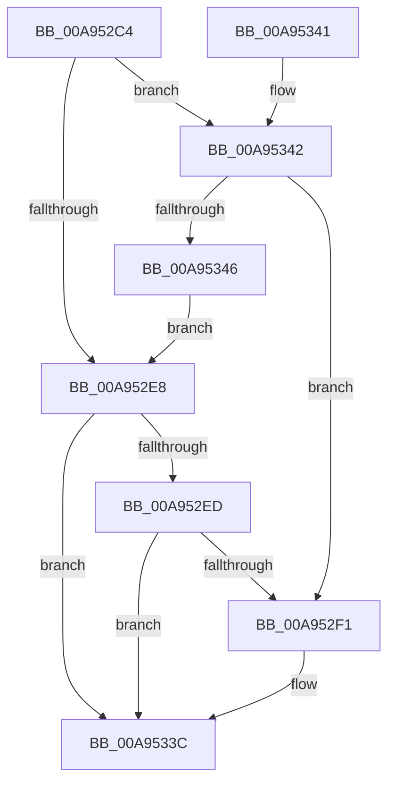

# PfSnPowerBoostUpdate

- RVA: `0x00A952C4`–`0x00A95348` (길이 `132` bytes)
- VA: `0x0000000140A952C4`
- 실행 섹션: `PAGE`
- PDB 이름 있음: `예`; PDB Function 태그: `아니요`
- unwind 정보 RVA: `0x000B9748`
- 디코드: `39`개 명령, `132/132` bytes 표시
- 미해석 바이트: `0` (있으면 어셈블리에 `.byte`로 보존)

> 이 문서는 커널 이미지의 기계어와 PDB 기호를 분석해 생성했습니다. 4번과 5번은 함수 원형과 자료형을 바이너리 사용 방식에서 추정한 C 해석이며 원본 소스 복구 결과는 아닙니다.

## 1. Dependencies

- 직접 호출 지점: **1**; 고유 호출 대상: **1**
- 직접 호출자로 확인된 함수: **1**
- RIP 상대 이미지 참조: **2**

### Outgoing calls
- `0x00A95337` → [ExpNtUpdateWnfStateData](../90/ExpNtUpdateWnfStateData_function_0090A7A0.md) (function, `0x0090A7A0`)

### Direct callers
- [PfSnPowerBoostWorker](../75/PfSnPowerBoostWorker_function_007523C0.md) at `0x007523CB`

### Static image references
- `0x00A952D3` → RVA `0x00E67364` (`.data`; read/write)
- `0x00A9532C` → RVA `0x0001C330` (`.rdata`; read)

## 2. Other-region calls and transfers

- 다른 실행 섹션으로 향하는 call: **0**
- 별도 외부 분기/꼬리 이동을 확인하지 못했습니다.

## 3. Assembly (complete function range)

```asm
00A952C4  48 83 EC 48                     sub rsp, 0x48
00A952C8  8B C1                           mov eax, ecx
00A952CA  F7 D8                           neg eax
00A952CC  1B D2                           sbb edx, edx
00A952CE  83 E2 02                        and edx, 2
00A952D1  FF CA                           dec edx
00A952D3  F0 0F C1 15 89 20 3D 00         lock xadd dword ptr [rip + 0x3d2089], edx
00A952DB  45 33 C0                        xor r8d, r8d
00A952DE  41 B9 01 00 00 00               mov r9d, 1
00A952E4  85 D2                           test edx, edx
00A952E6  74 5A                           je 0x140a95342
00A952E8  41 3B D1                        cmp edx, r9d
00A952EB  75 4F                           jne 0x140a9533c
00A952ED  85 C9                           test ecx, ecx
00A952EF  75 4B                           jne 0x140a9533c
00A952F1  41 23 C9                        and ecx, r9d
00A952F4  4C 89 44 24 58                  mov qword ptr [rsp + 0x58], r8
00A952F9  8B 44 24 58                     mov eax, dword ptr [rsp + 0x58]
00A952FD  48 8D 54 24 58                  lea rdx, [rsp + 0x58]
00A95302  83 4C 24 5C FF                  or dword ptr [rsp + 0x5c], 0xffffffff
00A95307  03 C9                           add ecx, ecx
00A95309  44 89 4C 24 38                  mov dword ptr [rsp + 0x38], r9d
00A9530E  83 E0 FD                        and eax, 0xfffffffd
00A95311  44 89 44 24 30                  mov dword ptr [rsp + 0x30], r8d
00A95316  0B C8                           or ecx, eax
00A95318  41 0B C9                        or ecx, r9d
00A9531B  44 89 44 24 28                  mov dword ptr [rsp + 0x28], r8d
00A95320  45 33 C9                        xor r9d, r9d
00A95323  89 4C 24 58                     mov dword ptr [rsp + 0x58], ecx
00A95327  4C 89 44 24 20                  mov qword ptr [rsp + 0x20], r8
00A9532C  48 8D 0D FD 6F 58 FF            lea rcx, [rip - 0xa79003]
00A95333  45 8D 41 08                     lea r8d, [r9 + 8]
00A95337  E8 64 54 E7 FF                  call 0x14090a7a0
00A9533C  48 83 C4 48                     add rsp, 0x48
00A95340  C3                              ret
00A95341  CC                              int3
00A95342  85 C9                           test ecx, ecx
00A95344  75 AB                           jne 0x140a952f1
00A95346  EB A0                           jmp 0x140a952e8
```

## 4. C-style interpretation (structured pseudocode)

```c
__int64 __fastcall PfSnPowerBoostUpdate(int a1, int a2, int a3)
{
    __int64 result;
    __int64 v_rsp;
    unsigned int v_stack_m10;
    unsigned int v_stack_m18;
    unsigned int v_stack_m20;
    unsigned __int64 v_stack_m28;
    unsigned __int64 v_stack_p10;
    unsigned int v_stack_p14;

    v_rsp = (v_rsp) - (72);
    result = (unsigned int)(-((unsigned int)(a1)));
    a2 = (unsigned int)((a2) & (2));
    a2 = (unsigned int)((a2) - 1);
    a3 = 0;
    if (a2 == 0) goto loc_00A95342;
loc_00A952E8:
    if (a2 != 1) goto loc_00A9533C;
    if (a1 == 0) {
        a1 = (unsigned int)((a1) & (1));
        v_stack_p10 = 0;
        result = v_stack_p10;
        a2 = v_stack_p10;
        a1 = (unsigned int)((a1) + (a1));
        v_stack_m10 = 1;
        result = (unsigned int)((result) & (0xFFFFFFFDULL));
        v_stack_m18 = 0;
        a1 = (unsigned int)((a1) | ((unsigned int)(result)));
        a1 = (unsigned int)((a1) | (1));
        v_stack_m20 = 0;
        a4 = 0;
        v_stack_p10 = a1;
        v_stack_m28 = 0;
        a1 = v_rip - 10981379;
        a3 = a4 + 8;
        result = ExpNtUpdateWnfStateData(a1, a2, a3, a4);
    }
    v_rsp = (v_rsp) + (72);
    return result;
loc_00A95342:
    if (a1 != 0) goto loc_00A952F1;
    goto loc_00A952E8;
}
```

## 5. (Beta) C Style

```c
int64_t PfSnPowerBoostUpdate(int32_t Arg1, int32_t Arg2, int32_t Arg3)
{
    int64_t result;
    int64_t local_rsp;
    uint32_t v_stack_m10;
    uint32_t v_stack_m18;
    uint32_t v_stack_m20;
    uint64_t v_stack_m28;
    uint64_t v_stack_p10;
    uint32_t v_stack_p14;

    local_rsp = (local_rsp) - (72);
    result = (uint32_t)(-((uint32_t)(Arg1)));
    Arg2 = (uint32_t)((Arg2) & (2));
    Arg2 = (uint32_t)((Arg2) - 1);
    Arg3 = 0;
    if (Arg2 == 0) goto loc_00A95342;
loc_00A952E8:
    if (Arg2 != 1) goto loc_00A9533C;
    if (Arg1 == 0) {
        Arg1 = (uint32_t)((Arg1) & (1));
        v_stack_p10 = 0;
        result = v_stack_p10;
        Arg2 = v_stack_p10;
        Arg1 = (uint32_t)((Arg1) + (Arg1));
        v_stack_m10 = 1;
        result = (uint32_t)((result) & (0xFFFFFFFDULL));
        v_stack_m18 = 0;
        Arg1 = (uint32_t)((Arg1) | ((uint32_t)(result)));
        Arg1 = (uint32_t)((Arg1) | (1));
        v_stack_m20 = 0;
        a4 = 0;
        v_stack_p10 = Arg1;
        v_stack_m28 = 0;
        Arg1 = v_rip - 10981379;
        Arg3 = a4 + 8;
        result = ExpNtUpdateWnfStateData(Arg1, Arg2, Arg3, a4);
    }
    local_rsp = (local_rsp) + (72);
    return result;
loc_00A95342:
    if (Arg1 != 0) goto loc_00A952F1;
    goto loc_00A952E8;
}
```

## 6. Execution-region graph

[열기: 2D/3D 그래프와 함수 탐색 컨트롤 패널](../../../control-panel.html?section=page&rva=0x00A952C4&view=graph)

- 2D 그래프는 위에서 아래로 흐르고, 3D 그래프는 빈 공간을 드래그해 회전합니다. Shift+드래그는 이동, 휠은 확대·축소, 함수 노드 선택은 대상 보고서 이동입니다.

### Static fallback


