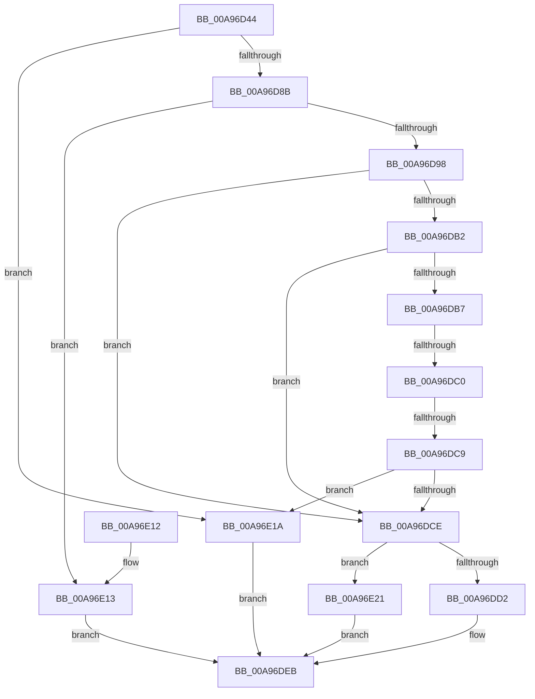

# PfpProcessScenarioPhase

- RVA: `0x00A96D44`–`0x00A96E28` (길이 `228` bytes)
- VA: `0x0000000140A96D44`
- 실행 섹션: `PAGE`
- PDB 이름 있음: `예`; PDB Function 태그: `예`
- unwind 정보 RVA: `0x000B9C84`
- 디코드: `68`개 명령, `228/228` bytes 표시
- 미해석 바이트: `0` (있으면 어셈블리에 `.byte`로 보존)

> 이 문서는 커널 이미지의 기계어와 PDB 기호를 분석해 생성했습니다. 4번과 5번은 함수 원형과 자료형을 바이너리 사용 방식에서 추정한 C 해석이며 원본 소스 복구 결과는 아닙니다.

## 1. Dependencies

- 직접 호출 지점: **2**; 고유 호출 대상: **2**
- 직접 호출자로 확인된 함수: **2**
- RIP 상대 이미지 참조: **1**

### Outgoing calls
- `0x00A96DE6` → [PfPowerActionNotify](../../pagelk/B7/PfPowerActionNotify_function_00B7AC98.md) (function, `0x00B7AC98`)
- `0x00A96DF4` → [_security_check_cookie](../../text/6A/_security_check_cookie_function_006AC640.md) (function, `0x006AC640`)

### Direct callers
- [PfSetSuperfetchInformation](../AD/PfSetSuperfetchInformation_function_00ADE6E8.md) at `0x00ADEA0E`
- [sub_00B27DF8](../B2/Unknown_function_00B27DF8.md) at `0x00B27EE8`

### Static image references
- `0x00A96D5F` → RVA `0x00E0A740` (`.data`; read)

## 2. Other-region calls and transfers

- 다른 실행 섹션으로 향하는 call: **2**
  - `0x00A96DE6` → [PfPowerActionNotify](../../pagelk/B7/PfPowerActionNotify_function_00B7AC98.md) (`PAGE` → `PAGELK`)
  - `0x00A96DF4` → [_security_check_cookie](../../text/6A/_security_check_cookie_function_006AC640.md) (`PAGE` → `.text`)
- call이 아닌 외부 분기/꼬리 이동: **2**
  - `0x00A96DBA` → [sub_00B47AE6 + 0x80](../B4/Unknown_function_00B47AE6.md) (`tail-transfer`)
  - `0x00A96DC3` → [sub_00B47AE6](../B4/Unknown_function_00B47AE6.md) (`tail-transfer`)

## 3. Assembly (complete function range)

```asm
00A96D44  48 89 5C 24 10                  mov qword ptr [rsp + 0x10], rbx
00A96D49  48 89 74 24 18                  mov qword ptr [rsp + 0x18], rsi
00A96D4E  48 89 7C 24 20                  mov qword ptr [rsp + 0x20], rdi
00A96D53  55                              push rbp
00A96D54  41 56                           push r14
00A96D56  41 57                           push r15
00A96D58  48 8B EC                        mov rbp, rsp
00A96D5B  48 83 EC 40                     sub rsp, 0x40
00A96D5F  48 8B 05 DA 39 37 00            mov rax, qword ptr [rip + 0x3739da]
00A96D66  48 33 C4                        xor rax, rsp
00A96D69  48 89 45 F8                     mov qword ptr [rbp - 8], rax
00A96D6D  33 C0                           xor eax, eax
00A96D6F  33 FF                           xor edi, edi
00A96D71  0F 57 C0                        xorps xmm0, xmm0
00A96D74  89 45 F0                        mov dword ptr [rbp - 0x10], eax
00A96D77  48 8B F1                        mov rsi, rcx
00A96D7A  0F 11 45 E0                     movups xmmword ptr [rbp - 0x20], xmm0
00A96D7E  44 8D 70 04                     lea r14d, [rax + 4]
00A96D82  44 39 31                        cmp dword ptr [rcx], r14d
00A96D85  0F 85 8F 00 00 00               jne 0x140a96e1a
00A96D8B  44 8B 49 04                     mov r9d, dword ptr [rcx + 4]
00A96D8F  41 8D 41 FF                     lea eax, [r9 - 1]
00A96D93  41 3B C6                        cmp eax, r14d
00A96D96  77 7B                           ja 0x140a96e13
00A96D98  44 8B 41 10                     mov r8d, dword ptr [rcx + 0x10]
00A96D9C  44 8D 7F 01                     lea r15d, [rdi + 1]
00A96DA0  45 84 C7                        test r15b, r8b
00A96DA3  44 8B D7                        mov r10d, edi
00A96DA6  41 8B C9                        mov ecx, r9d
00A96DA9  45 0F 45 D7                     cmovne r10d, r15d
00A96DAD  41 2B CF                        sub ecx, r15d
00A96DB0  74 1C                           je 0x140a96dce
00A96DB2  41 2B CF                        sub ecx, r15d
00A96DB5  74 17                           je 0x140a96dce
00A96DB7  41 2B CF                        sub ecx, r15d
00A96DBA  0F 84 A6 0D 0B 00               je 0x140b47b66
00A96DC0  41 2B CF                        sub ecx, r15d
00A96DC3  0F 84 1D 0D 0B 00               je 0x140b47ae6
00A96DC9  41 3B CF                        cmp ecx, r15d
00A96DCC  75 4C                           jne 0x140a96e1a
00A96DCE  84 D2                           test dl, dl
00A96DD0  75 4F                           jne 0x140a96e21
00A96DD2  8B 4E 08                        mov ecx, dword ptr [rsi + 8]
00A96DD5  41 8B D2                        mov edx, r10d
00A96DD8  41 0B D6                        or edx, r14d
00A96DDB  49 D1 E8                        shr r8, 1
00A96DDE  41 83 F9 05                     cmp r9d, 5
00A96DE2  41 0F 45 D2                     cmovne edx, r10d
00A96DE6  E8 AD 3E 0E 00                  call 0x140b7ac98
00A96DEB  8B C7                           mov eax, edi
00A96DED  48 8B 4D F8                     mov rcx, qword ptr [rbp - 8]
00A96DF1  48 33 CC                        xor rcx, rsp
00A96DF4  E8 47 58 C1 FF                  call 0x1406ac640
00A96DF9  48 8B 5C 24 68                  mov rbx, qword ptr [rsp + 0x68]
00A96DFE  48 8B 74 24 70                  mov rsi, qword ptr [rsp + 0x70]
00A96E03  48 8B 7C 24 78                  mov rdi, qword ptr [rsp + 0x78]
00A96E08  48 83 C4 40                     add rsp, 0x40
00A96E0C  41 5F                           pop r15
00A96E0E  41 5E                           pop r14
00A96E10  5D                              pop rbp
00A96E11  C3                              ret
00A96E12  CC                              int3
00A96E13  BF 7B 00 00 C0                  mov edi, 0xc000007b
00A96E18  EB D1                           jmp 0x140a96deb
00A96E1A  BF 0D 00 00 C0                  mov edi, 0xc000000d
00A96E1F  EB CA                           jmp 0x140a96deb
00A96E21  BF 22 00 00 C0                  mov edi, 0xc0000022
00A96E26  EB C3                           jmp 0x140a96deb
```

## 4. C-style interpretation (structured pseudocode)

```c
__int64 __fastcall PfpProcessScenarioPhase(__int64 a1, unsigned __int8 a2)
{
    __int64 result;
    __int64 v_r10;
    __int64 v_rdi;
    __int64 v_rsp;
    unsigned __int64 v_stack_m20;
    unsigned int v_stack_m28;
    unsigned __int64 v_stack_m38;
    unsigned __int64 v_stack_p10;
    unsigned __int64 v_stack_p18;
    unsigned __int64 v_stack_p20;

    v_stack_p10 = v_rbx;
    v_stack_p18 = v_rsi;
    v_stack_p20 = v_rdi;
    v_rsp = (v_rsp) - (64);
    result = (*(unsigned __int64 *)(v_rip + 3619290)) ^ (v_rsp);
    v_stack_m20 = result;
    result = 0;
    v_rdi = 0;
    v_stack_m28 = 0;
    v_stack_m38 = v_xmm0;
    if ((*(unsigned int *)(a1)) != ((unsigned int)(result + 4))) goto loc_00A96E1A;
    if (((unsigned int)((unsigned int)(*(unsigned int *)(a1 + 4)) - 1)) > ((unsigned int)(result + 4))) goto loc_00A96E13;
    v_r10 = 0;
    if ((((unsigned __int8)(v_rdi + 1)) & ((unsigned __int8)((unsigned int)(*(unsigned int *)(a1 + 16))))) != 0) { v_r10 = (unsigned int)(v_rdi + 1); }
    a1 = (unsigned int)(((unsigned int)((unsigned int)((unsigned int)(*(unsigned int *)(a1 + 4))))) - ((unsigned int)(v_rdi + 1)));
    if (condition_is_equal) goto loc_00A96DCE;
    a1 = (unsigned int)((a1) - ((unsigned int)(v_rdi + 1)));
    if (condition_is_equal) goto loc_00A96DCE;
    a1 = (unsigned int)((a1) - ((unsigned int)(v_rdi + 1)));
    a1 = (unsigned int)((a1) - ((unsigned int)(v_rdi + 1)));
    if (((unsigned int)(a1)) != ((unsigned int)(v_rdi + 1))) goto loc_00A96E1A;
loc_00A96DCE:
    if (a2 != 0) goto loc_00A96E21;
    a2 = (unsigned int)(((unsigned int)((unsigned int)(v_r10))) | ((unsigned int)(result + 4)));
    a3 = ((unsigned int)(*(unsigned int *)(a1 + 16))) >> (1);
    if (((unsigned int)((unsigned int)(*(unsigned int *)(a1 + 4)))) != 5) { a2 = (unsigned int)(v_r10); }
    result = PfPowerActionNotify((unsigned int)(*(unsigned int *)(a1 + 8)), a2, a3, (unsigned int)(*(unsigned int *)(a1 + 4)));
loc_00A96DEB:
    a1 = (v_stack_m20) ^ (v_rsp);
    result = _security_check_cookie(a1, a2, a3, (unsigned int)(*(unsigned int *)(a1 + 4)));
    v_rsp = (v_rsp) + (64);
    return result;
loc_00A96E13:
    goto loc_00A96DEB;
loc_00A96E1A:
    goto loc_00A96DEB;
loc_00A96E21:
    goto loc_00A96DEB;
}
```

## 5. (Beta) C Style

```c
int64_t PfpProcessScenarioPhase(void *Arg1, uint8_t Arg2)
{
    uint8_t *arg1 = (uint8_t *)Arg1;

    int64_t result;
    int64_t local_r10;
    int64_t local_rdi;
    int64_t local_rsp;
    uint64_t v_stack_m20;
    uint32_t v_stack_m28;
    uint64_t v_stack_m38;
    uint64_t v_stack_p10;
    uint64_t v_stack_p18;
    uint64_t v_stack_p20;

    v_stack_p10 = local_rbx;
    v_stack_p18 = local_rsi;
    v_stack_p20 = local_rdi;
    local_rsp = (local_rsp) - (64);
    result = (*(uint64_t *)(v_rip + 0x3739DA)) ^ (local_rsp);
    v_stack_m20 = result;
    result = 0;
    local_rdi = 0;
    v_stack_m28 = 0;
    v_stack_m38 = v_xmm0;
    if ((*(uint32_t *)(arg1)) != ((uint32_t)(result + 4))) goto loc_00A96E1A;
    if (((uint32_t)((uint32_t)(*(uint32_t *)(arg1 + 0x4)) - 1)) > ((uint32_t)(result + 4))) goto loc_00A96E13;
    local_r10 = 0;
    if ((((uint8_t)(local_rdi + 1)) & ((uint8_t)((uint32_t)(*(uint32_t *)(arg1 + 0x10))))) != 0) { local_r10 = (uint32_t)(local_rdi + 1); }
    Arg1 = (uint32_t)(((uint32_t)((uint32_t)((uint32_t)(*(uint32_t *)(arg1 + 0x4))))) - ((uint32_t)(local_rdi + 1)));
    if (condition_is_equal) goto loc_00A96DCE;
    Arg1 = (uint32_t)((Arg1) - ((uint32_t)(local_rdi + 1)));
    if (condition_is_equal) goto loc_00A96DCE;
    Arg1 = (uint32_t)((Arg1) - ((uint32_t)(local_rdi + 1)));
    Arg1 = (uint32_t)((Arg1) - ((uint32_t)(local_rdi + 1)));
    if (((uint32_t)(Arg1)) != ((uint32_t)(local_rdi + 1))) goto loc_00A96E1A;
loc_00A96DCE:
    if (Arg2 != 0) goto loc_00A96E21;
    Arg2 = (uint32_t)(((uint32_t)((uint32_t)(local_r10))) | ((uint32_t)(result + 4)));
    a3 = ((uint32_t)(*(uint32_t *)(arg1 + 0x10))) >> (1);
    if (((uint32_t)((uint32_t)(*(uint32_t *)(arg1 + 0x4)))) != 5) { Arg2 = (uint32_t)(local_r10); }
    result = PfPowerActionNotify((uint32_t)(*(uint32_t *)(arg1 + 0x8)), Arg2, a3, (uint32_t)(*(uint32_t *)(arg1 + 0x4)));
loc_00A96DEB:
    Arg1 = (v_stack_m20) ^ (local_rsp);
    result = _security_check_cookie(Arg1, Arg2, a3, (uint32_t)(*(uint32_t *)(arg1 + 0x4)));
    local_rsp = (local_rsp) + (64);
    return result;
loc_00A96E13:
    goto loc_00A96DEB;
loc_00A96E1A:
    goto loc_00A96DEB;
loc_00A96E21:
    goto loc_00A96DEB;
}
```

### 관측된 메모리 오프셋

구조체 형식이 확인되지 않은 접근은 인자 기준의 오프셋으로만 기록했습니다.

| 기준 인자 | 오프셋 표현 | 폭 (bit) | 접근 |
|---|---:|---:|---|
| `Arg1` | `+ 0x0` | `32` | `R` |
| `Arg1` | `+ 0x4` | `32` | `R` |
| `Arg1` | `+ 0x8` | `32` | `R` |
| `Arg1` | `+ 0x10` | `32` | `R` |

## 6. Execution-region graph

[열기: 2D/3D 그래프와 함수 탐색 컨트롤 패널](../../../control-panel.html?section=page&rva=0x00A96D44&view=graph)

- 2D 그래프는 위에서 아래로 흐르고, 3D 그래프는 빈 공간을 드래그해 회전합니다. Shift+드래그는 이동, 휠은 확대·축소, 함수 노드 선택은 대상 보고서 이동입니다.

### Static fallback


