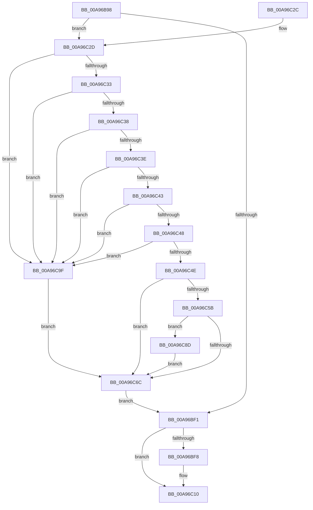

# PiCMGetDeviceDepth

- RVA: `0x00A96B98`–`0x00A96CA6` (길이 `270` bytes)
- VA: `0x0000000140A96B98`
- 실행 섹션: `PAGE`
- PDB 이름 있음: `예`; PDB Function 태그: `아니요`
- unwind 정보 RVA: `0x000B9C34`
- 디코드: `81`개 명령, `270/270` bytes 표시
- 미해석 바이트: `0` (있으면 어셈블리에 `.byte`로 보존)

> 이 문서는 커널 이미지의 기계어와 PDB 기호를 분석해 생성했습니다. 4번과 5번은 함수 원형과 자료형을 바이너리 사용 방식에서 추정한 C 해석이며 원본 소스 복구 결과는 아닙니다.

## 1. Dependencies

- 직접 호출 지점: **6**; 고유 호출 대상: **6**
- 직접 호출자로 확인된 함수: **1**
- RIP 상대 이미지 참조: **0**

### Outgoing calls
- `0x00A96BE6` → [PiCMCaptureObjectInputData](../8E/PiCMCaptureObjectInputData_function_008E8220.md) (function, `0x008E8220`)
- `0x00A96C0B` → [PiControlFreeUserModeCallersBuffer](../../text/44/PiControlFreeUserModeCallersBuffer_function_00448990.md) (function, `0x00448990`)
- `0x00A96C52` → [CmValidateDeviceName](../8F/CmValidateDeviceName_function_008F3CF0.md) (function, `0x008F3CF0`)
- `0x00A96C63` → [RtlInitUnicodeStringEx](../../text/46/RtlInitUnicodeStringEx_function_00463960.md) (function, `0x00463960`)
- `0x00A96C81` → [PiCMReturnDepthResultData](PiCMReturnDepthResultData_function_00A96CAC.md) (function, `0x00A96CAC`)
- `0x00A96C95` → [PiGetDeviceDepth](../A5/PiGetDeviceDepth_function_00A5EBA0.md) (function, `0x00A5EBA0`)

### Direct callers
- [PiCMHandleIoctl](../8E/PiCMHandleIoctl_function_008EB880.md) at `0x008EC12B`

### Static image references
- 디코드된 RIP-relative 메모리 참조가 없습니다.

## 2. Other-region calls and transfers

- 다른 실행 섹션으로 향하는 call: **2**
  - `0x00A96C0B` → [PiControlFreeUserModeCallersBuffer](../../text/44/PiControlFreeUserModeCallersBuffer_function_00448990.md) (`PAGE` → `.text`)
  - `0x00A96C63` → [RtlInitUnicodeStringEx](../../text/46/RtlInitUnicodeStringEx_function_00463960.md) (`PAGE` → `.text`)
- 별도 외부 분기/꼬리 이동을 확인하지 못했습니다.

## 3. Assembly (complete function range)

```asm
00A96B98  48 89 74 24 08                  mov qword ptr [rsp + 8], rsi
00A96B9D  48 89 7C 24 10                  mov qword ptr [rsp + 0x10], rdi
00A96BA2  4C 89 64 24 18                  mov qword ptr [rsp + 0x18], r12
00A96BA7  55                              push rbp
00A96BA8  41 56                           push r14
00A96BAA  41 57                           push r15
00A96BAC  48 8B EC                        mov rbp, rsp
00A96BAF  48 83 EC 70                     sub rsp, 0x70
00A96BB3  4C 8B 65 48                     mov r12, qword ptr [rbp + 0x48]
00A96BB7  0F 57 C9                        xorps xmm1, xmm1
00A96BBA  33 C0                           xor eax, eax
00A96BBC  45 8B F1                        mov r14d, r9d
00A96BBF  4D 8B F8                        mov r15, r8
00A96BC2  48 89 45 F0                     mov qword ptr [rbp - 0x10], rax
00A96BC6  44 8B 45 40                     mov r8d, dword ptr [rbp + 0x40]
00A96BCA  4C 8D 4D D0                     lea r9, [rbp - 0x30]
00A96BCE  41 21 04 24                     and dword ptr [r12], eax
00A96BD2  0F 57 C0                        xorps xmm0, xmm0
00A96BD5  33 F6                           xor esi, esi
00A96BD7  0F 11 45 C0                     movups xmmword ptr [rbp - 0x40], xmm0
00A96BDB  89 75 48                        mov dword ptr [rbp + 0x48], esi
00A96BDE  0F 11 4D D0                     movups xmmword ptr [rbp - 0x30], xmm1
00A96BE2  0F 11 4D E0                     movups xmmword ptr [rbp - 0x20], xmm1
00A96BE6  E8 35 16 E5 FF                  call 0x1408e8220
00A96BEB  8B F8                           mov edi, eax
00A96BED  85 C0                           test eax, eax
00A96BEF  79 3C                           jns 0x140a96c2d
00A96BF1  48 83 7D E0 00                  cmp qword ptr [rbp - 0x20], 0
00A96BF6  74 18                           je 0x140a96c10
00A96BF8  65 48 8B 0C 25 88 01 00 00      mov rcx, qword ptr gs:[0x188]
00A96C01  48 8B 55 E0                     mov rdx, qword ptr [rbp - 0x20]
00A96C05  8A 89 32 02 00 00               mov cl, byte ptr [rcx + 0x232]
00A96C0B  E8 80 1D 9B FF                  call 0x140448990
00A96C10  4C 8D 5C 24 70                  lea r11, [rsp + 0x70]
00A96C15  8B C7                           mov eax, edi
00A96C17  49 8B 73 20                     mov rsi, qword ptr [r11 + 0x20]
00A96C1B  49 8B 7B 28                     mov rdi, qword ptr [r11 + 0x28]
00A96C1F  4D 8B 63 30                     mov r12, qword ptr [r11 + 0x30]
00A96C23  49 8B E3                        mov rsp, r11
00A96C26  41 5F                           pop r15
00A96C28  41 5E                           pop r14
00A96C2A  5D                              pop rbp
00A96C2B  C3                              ret
00A96C2C  CC                              int3
00A96C2D  48 39 75 E0                     cmp qword ptr [rbp - 0x20], rsi
00A96C31  74 6C                           je 0x140a96c9f
00A96C33  39 75 D4                        cmp dword ptr [rbp - 0x2c], esi
00A96C36  75 67                           jne 0x140a96c9f
00A96C38  83 7D D8 01                     cmp dword ptr [rbp - 0x28], 1
00A96C3C  75 61                           jne 0x140a96c9f
00A96C3E  39 75 EC                        cmp dword ptr [rbp - 0x14], esi
00A96C41  75 5C                           jne 0x140a96c9f
00A96C43  4D 85 FF                        test r15, r15
00A96C46  74 57                           je 0x140a96c9f
00A96C48  41 83 FE 0C                     cmp r14d, 0xc
00A96C4C  72 51                           jb 0x140a96c9f
00A96C4E  48 8B 55 E0                     mov rdx, qword ptr [rbp - 0x20]
00A96C52  E8 99 D0 E5 FF                  call 0x1408f3cf0
00A96C57  85 C0                           test eax, eax
00A96C59  78 11                           js 0x140a96c6c
00A96C5B  48 8B 55 E0                     mov rdx, qword ptr [rbp - 0x20]
00A96C5F  48 8D 4D C0                     lea rcx, [rbp - 0x40]
00A96C63  E8 F8 CC 9C FF                  call 0x140463960
00A96C68  85 C0                           test eax, eax
00A96C6A  79 21                           jns 0x140a96c8d
00A96C6C  44 8B 45 F0                     mov r8d, dword ptr [rbp - 0x10]
00A96C70  4D 8B CF                        mov r9, r15
00A96C73  4C 89 64 24 28                  mov qword ptr [rsp + 0x28], r12
00A96C78  8B D6                           mov edx, esi
00A96C7A  8B C8                           mov ecx, eax
00A96C7C  44 89 74 24 20                  mov dword ptr [rsp + 0x20], r14d
00A96C81  E8 26 00 00 00                  call 0x140a96cac
00A96C86  8B F8                           mov edi, eax
00A96C88  E9 64 FF FF FF                  jmp 0x140a96bf1
00A96C8D  48 8D 55 48                     lea rdx, [rbp + 0x48]
00A96C91  48 8D 4D C0                     lea rcx, [rbp - 0x40]
00A96C95  E8 06 7F FC FF                  call 0x140a5eba0
00A96C9A  8B 75 48                        mov esi, dword ptr [rbp + 0x48]
00A96C9D  EB CD                           jmp 0x140a96c6c
00A96C9F  B8 0D 00 00 C0                  mov eax, 0xc000000d
00A96CA4  EB C6                           jmp 0x140a96c6c
```

## 4. C-style interpretation (structured pseudocode)

```c
__int64 __fastcall PiCMGetDeviceDepth(__int64 a1, __int64 a2, __int64 a3, int a4, unsigned int a5, unsigned int a6)
{
    __int64 result;
    __int64 v_rsi;
    __int64 v_rsp;
    unsigned __int64 v_stack_m18;
    unsigned __int64 v_stack_m28;
    unsigned int v_stack_m2C;
    unsigned __int64 v_stack_m38;
    unsigned int v_stack_m40;
    unsigned int v_stack_m44;
    unsigned __int64 v_stack_m48;
    unsigned int v_stack_m50;
    unsigned __int64 v_stack_m58;
    unsigned __int64 v_stack_p10;
    unsigned __int64 v_stack_p18;
    unsigned int v_stack_p30;
    unsigned __int64 v_stack_p8;

    v_stack_p8 = v_rsi;
    v_stack_p10 = v_rdi;
    v_stack_p18 = v_r12;
    v_rsp = (v_rsp) - (112);
    result = 0;
    v_stack_m28 = 0;
    v_rsi = 0;
    v_stack_m58 = v_xmm0;
    v_stack_p30 = 0;
    v_stack_m48 = v_xmm1;
    v_stack_m38 = v_xmm1;
    result = PiCMCaptureObjectInputData(a1, a2, (unsigned int)(a5), v_stack_m48);
    if (!sign_flag) goto loc_00A96C2D;
loc_00A96BF1:
    if (v_stack_m38 != 0) {
        a1 = *(unsigned __int64 *)(gs_base + (0 + 392));
        a2 = v_stack_m38;
        a1 = *(unsigned __int8 *)(a1 + 562);
        result = PiControlFreeUserModeCallersBuffer(a1, a2, (unsigned int)(a5), v_stack_m48);
    }
    return (unsigned int)((unsigned int)((unsigned int)((unsigned int)(result))));
loc_00A96C2D:
    if (v_stack_m38 == (*(unsigned __int64 *)(v_stack_m18 + 32))) goto loc_00A96C9F;
    if (v_stack_m44 != ((unsigned int)(*(unsigned __int64 *)(v_stack_m18 + 32)))) goto loc_00A96C9F;
    if (v_stack_m40 != 1) goto loc_00A96C9F;
    if (v_stack_m2C != ((unsigned int)(*(unsigned __int64 *)(v_stack_m18 + 32)))) goto loc_00A96C9F;
    if (a3 == 0) goto loc_00A96C9F;
    if (((unsigned int)((unsigned int)(a4))) < 12) goto loc_00A96C9F;
    result = CmValidateDeviceName(a1, v_stack_m38, (unsigned int)(a5), v_stack_m48);
    if (sign_flag) goto loc_00A96C6C;
    result = RtlInitUnicodeStringEx(v_stack_m58, v_stack_m38, (unsigned int)(a5), v_stack_m48);
    if (!sign_flag) goto loc_00A96C8D;
loc_00A96C6C:
    v_stack_m48 = *(unsigned __int64 *)(v_stack_m18 + 48);
    v_stack_m50 = (unsigned int)((unsigned int)(a4));
    result = PiCMReturnDepthResultData((unsigned int)((unsigned int)(result)), (unsigned int)((unsigned int)(*(unsigned __int64 *)(v_stack_m18 + 32))), (unsigned int)(v_stack_m28), a3);
    goto loc_00A96BF1;
loc_00A96C8D:
    result = PiGetDeviceDepth(v_stack_m58, a6, (unsigned int)(v_stack_m28), a3);
    goto loc_00A96C6C;
loc_00A96C9F:
    goto loc_00A96C6C;
}
```

## 5. (Beta) C Style

```c
int64_t PiCMGetDeviceDepth(int64_t Arg1, int64_t Arg2, int64_t Arg3, int32_t Arg4, uint32_t Arg5, void *Arg6)
{
    uint8_t *arg6 = (uint8_t *)Arg6;

    int64_t result;
    int64_t local_rsi;
    int64_t local_rsp;
    uint64_t v_stack_m18;
    uint64_t v_stack_m28;
    uint32_t v_stack_m2C;
    uint64_t v_stack_m38;
    uint32_t v_stack_m40;
    uint32_t v_stack_m44;
    uint64_t v_stack_m48;
    uint32_t v_stack_m50;
    uint64_t v_stack_m58;
    uint64_t v_stack_p10;
    uint64_t v_stack_p18;
    uint32_t v_stack_p30;
    uint64_t v_stack_p8;

    v_stack_p8 = local_rsi;
    v_stack_p10 = local_rdi;
    v_stack_p18 = local_r12;
    local_rsp = (local_rsp) - (112);
    result = 0;
    v_stack_m28 = 0;
    local_rsi = 0;
    v_stack_m58 = v_xmm0;
    v_stack_p30 = 0;
    v_stack_m48 = v_xmm1;
    v_stack_m38 = v_xmm1;
    result = PiCMCaptureObjectInputData(Arg1, Arg2, (uint32_t)(Arg5), v_stack_m48);
    if (!sign_flag) goto loc_00A96C2D;
loc_00A96BF1:
    if (v_stack_m38 != 0) {
        Arg1 = *(uint64_t *)(gs_base + (0 + 0x188));
        Arg2 = v_stack_m38;
        Arg1 = *(uint8_t *)(Arg1 + 0x232);
        result = PiControlFreeUserModeCallersBuffer(Arg1, Arg2, (uint32_t)(Arg5), v_stack_m48);
    }
    return (uint32_t)((uint32_t)((uint32_t)((uint32_t)(result))));
loc_00A96C2D:
    if (v_stack_m38 == (*(uint64_t *)(v_stack_m18 + 0x20))) goto loc_00A96C9F;
    if (v_stack_m44 != ((uint32_t)(*(uint64_t *)(v_stack_m18 + 0x20)))) goto loc_00A96C9F;
    if (v_stack_m40 != 1) goto loc_00A96C9F;
    if (v_stack_m2C != ((uint32_t)(*(uint64_t *)(v_stack_m18 + 0x20)))) goto loc_00A96C9F;
    if (Arg3 == 0) goto loc_00A96C9F;
    if (((uint32_t)((uint32_t)(Arg4))) < 12) goto loc_00A96C9F;
    result = CmValidateDeviceName(Arg1, v_stack_m38, (uint32_t)(Arg5), v_stack_m48);
    if (sign_flag) goto loc_00A96C6C;
    result = RtlInitUnicodeStringEx(v_stack_m58, v_stack_m38, (uint32_t)(Arg5), v_stack_m48);
    if (!sign_flag) goto loc_00A96C8D;
loc_00A96C6C:
    v_stack_m48 = *(uint64_t *)(v_stack_m18 + 0x30);
    v_stack_m50 = (uint32_t)((uint32_t)(Arg4));
    result = PiCMReturnDepthResultData((uint32_t)((uint32_t)(result)), (uint32_t)((uint32_t)(*(uint64_t *)(v_stack_m18 + 0x20))), (uint32_t)(v_stack_m28), Arg3);
    goto loc_00A96BF1;
loc_00A96C8D:
    result = PiGetDeviceDepth(v_stack_m58, Arg6, (uint32_t)(v_stack_m28), Arg3);
    goto loc_00A96C6C;
loc_00A96C9F:
    goto loc_00A96C6C;
}
```

### 관측된 메모리 오프셋

구조체 형식이 확인되지 않은 접근은 인자 기준의 오프셋으로만 기록했습니다.

| 기준 인자 | 오프셋 표현 | 폭 (bit) | 접근 |
|---|---:|---:|---|
| `Arg6` | `+ 0x0` | `32` | `R/W` |

## 6. Execution-region graph

[열기: 2D/3D 그래프와 함수 탐색 컨트롤 패널](../../../control-panel.html?section=page&rva=0x00A96B98&view=graph)

- 2D 그래프는 위에서 아래로 흐르고, 3D 그래프는 빈 공간을 드래그해 회전합니다. Shift+드래그는 이동, 휠은 확대·축소, 함수 노드 선택은 대상 보고서 이동입니다.

### Static fallback


