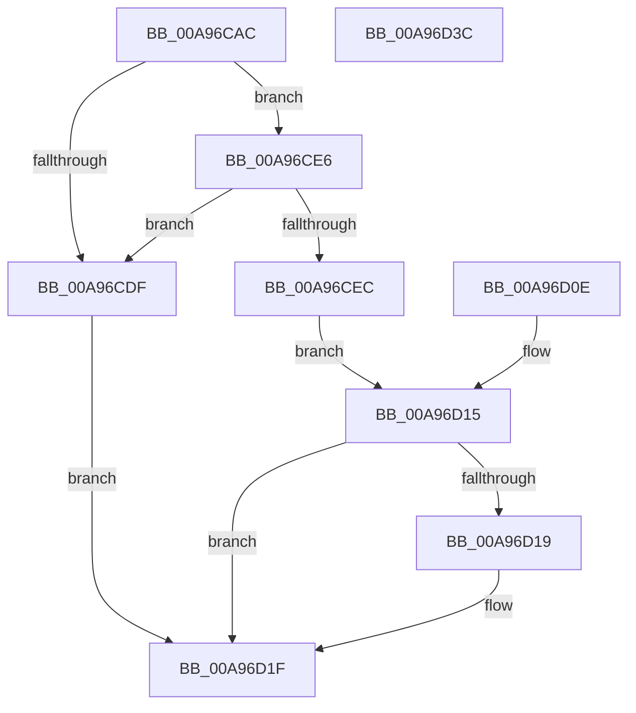

# PiCMReturnDepthResultData

- RVA: `0x00A96CAC`–`0x00A96D3D` (길이 `145` bytes)
- VA: `0x0000000140A96CAC`
- 실행 섹션: `PAGE`
- PDB 이름 있음: `예`; PDB Function 태그: `아니요`
- unwind 정보 RVA: `0x000B9C50`
- 디코드: `41`개 명령, `145/145` bytes 표시
- 미해석 바이트: `0` (있으면 어셈블리에 `.byte`로 보존)

> 이 문서는 커널 이미지의 기계어와 PDB 기호를 분석해 생성했습니다. 4번과 5번은 함수 원형과 자료형을 바이너리 사용 방식에서 추정한 C 해석이며 원본 소스 복구 결과는 아닙니다.

## 1. Dependencies

- 직접 호출 지점: **1**; 고유 호출 대상: **1**
- 직접 호출자로 확인된 함수: **1**
- RIP 상대 이미지 참조: **0**

### Outgoing calls
- `0x00A96CF9` → [ProbeForWrite](../8E/ProbeForWrite_function_008E91C0.md) (function, `0x008E91C0`)

### Direct callers
- [PiCMGetDeviceDepth](PiCMGetDeviceDepth_function_00A96B98.md) at `0x00A96C81`

### Static image references
- 디코드된 RIP-relative 메모리 참조가 없습니다.

## 2. Other-region calls and transfers

- 다른 실행 섹션으로 향하는 call: **0**
- 별도 외부 분기/꼬리 이동을 확인하지 못했습니다.

## 3. Assembly (complete function range)

```asm
00A96CAC  48 8B C4                        mov rax, rsp
00A96CAF  48 89 58 08                     mov qword ptr [rax + 8], rbx
00A96CB3  48 89 70 10                     mov qword ptr [rax + 0x10], rsi
00A96CB7  48 89 78 18                     mov qword ptr [rax + 0x18], rdi
00A96CBB  4C 89 70 20                     mov qword ptr [rax + 0x20], r14
00A96CBF  41 57                           push r15
00A96CC1  48 83 EC 20                     sub rsp, 0x20
00A96CC5  49 8B F1                        mov rsi, r9
00A96CC8  44 8B F2                        mov r14d, edx
00A96CCB  44 8B F9                        mov r15d, ecx
00A96CCE  48 8B 7C 24 58                  mov rdi, qword ptr [rsp + 0x58]
00A96CD3  83 27 00                        and dword ptr [rdi], 0
00A96CD6  33 DB                           xor ebx, ebx
00A96CD8  83 7C 24 50 0C                  cmp dword ptr [rsp + 0x50], 0xc
00A96CDD  73 07                           jae 0x140a96ce6
00A96CDF  BB 0D 00 00 C0                  mov ebx, 0xc000000d
00A96CE4  EB 39                           jmp 0x140a96d1f
00A96CE6  41 83 F8 0C                     cmp r8d, 0xc
00A96CEA  75 F3                           jne 0x140a96cdf
00A96CEC  8B 54 24 50                     mov edx, dword ptr [rsp + 0x50]
00A96CF0  41 B8 04 00 00 00               mov r8d, 4
00A96CF6  48 8B CE                        mov rcx, rsi
00A96CF9  E8 C2 24 E5 FF                  call 0x1408e91c0
00A96CFE  C7 06 0C 00 00 00               mov dword ptr [rsi], 0xc
00A96D04  44 89 7E 04                     mov dword ptr [rsi + 4], r15d
00A96D08  44 89 76 08                     mov dword ptr [rsi + 8], r14d
00A96D0C  EB 07                           jmp 0x140a96d15
00A96D0E  8B D8                           mov ebx, eax
00A96D10  48 8B 7C 24 58                  mov rdi, qword ptr [rsp + 0x58]
00A96D15  85 DB                           test ebx, ebx
00A96D17  78 06                           js 0x140a96d1f
00A96D19  C7 07 0C 00 00 00               mov dword ptr [rdi], 0xc
00A96D1F  8B C3                           mov eax, ebx
00A96D21  48 8B 5C 24 30                  mov rbx, qword ptr [rsp + 0x30]
00A96D26  48 8B 74 24 38                  mov rsi, qword ptr [rsp + 0x38]
00A96D2B  48 8B 7C 24 40                  mov rdi, qword ptr [rsp + 0x40]
00A96D30  4C 8B 74 24 48                  mov r14, qword ptr [rsp + 0x48]
00A96D35  48 83 C4 20                     add rsp, 0x20
00A96D39  41 5F                           pop r15
00A96D3B  C3                              ret
00A96D3C  CC                              int3
```

## 4. C-style interpretation (structured pseudocode)

```c
__int64 __fastcall PiCMReturnDepthResultData(int a1, int a2, int a3, __int64 a4, unsigned int a5, __int64 a6)
{
    __int64 result;
    __int64 v_rbx;
    __int64 v_rsp;
    unsigned __int64 v_stack_p10;
    unsigned __int64 v_stack_p18;
    unsigned __int64 v_stack_p20;
    unsigned __int64 v_stack_p30;
    unsigned __int64 v_stack_p8;

    *(unsigned __int64 *)(v_rsp + 8) = v_rbx;
    *(unsigned __int64 *)(v_rsp + 16) = v_rsi;
    *(unsigned __int64 *)(v_rsp + 24) = v_rdi;
    *(unsigned __int64 *)(v_rsp + 32) = v_r14;
    v_rsp = (v_rsp) - (32);
    v_rbx = 0;
    if (a5 >= 12) goto loc_00A96CE6;
loc_00A96CDF:
    goto loc_00A96D1F;
loc_00A96CE6:
    if (a3 != 12) goto loc_00A96CDF;
    result = ProbeForWrite(a4, (unsigned int)(a5), 4, a4);
    *(unsigned int *)(a4) = 12;
    *(unsigned int *)(a4 + 4) = (unsigned int)((unsigned int)(a1));
    *(unsigned int *)(a4 + 8) = (unsigned int)((unsigned int)(a2));
    goto loc_00A96D15;
loc_00A96D15:
    if (!(sign_flag)) {
        *(unsigned int *)(a6) = 12;
    }
    v_rsp = (v_rsp) + (32);
    return (unsigned int)((unsigned int)((unsigned int)(0xC000000DULL)));
}
```

## 5. (Beta) C Style

```c
int64_t PiCMReturnDepthResultData(int32_t Arg1, int32_t Arg2, int32_t Arg3, void *Arg4, uint32_t Arg5, void *Arg6)
{
    uint8_t *arg4 = (uint8_t *)Arg4;
    uint8_t *arg6 = (uint8_t *)Arg6;

    int64_t result;
    int64_t local_rbx;
    int64_t local_rsp;
    uint64_t v_stack_p10;
    uint64_t v_stack_p18;
    uint64_t v_stack_p20;
    uint64_t v_stack_p30;
    uint64_t v_stack_p8;

    *(uint64_t *)(local_rsp + 0x8) = local_rbx;
    *(uint64_t *)(local_rsp + 0x10) = local_rsi;
    *(uint64_t *)(local_rsp + 0x18) = local_rdi;
    *(uint64_t *)(local_rsp + 0x20) = local_r14;
    local_rsp = (local_rsp) - (32);
    local_rbx = 0;
    if (Arg5 >= 12) goto loc_00A96CE6;
loc_00A96CDF:
    goto loc_00A96D1F;
loc_00A96CE6:
    if (Arg3 != 12) goto loc_00A96CDF;
    result = ProbeForWrite(Arg4, (uint32_t)(Arg5), 4, Arg4);
    *(uint32_t *)(arg4) = 12;
    *(uint32_t *)(arg4 + 0x4) = (uint32_t)((uint32_t)(Arg1));
    *(uint32_t *)(arg4 + 0x8) = (uint32_t)((uint32_t)(Arg2));
    goto loc_00A96D15;
loc_00A96D15:
    if (!(sign_flag)) {
        *(uint32_t *)(arg6) = 12;
    }
    local_rsp = (local_rsp) + (32);
    return (uint32_t)((uint32_t)((uint32_t)(0xC000000DULL)));
}
```

### 관측된 메모리 오프셋

구조체 형식이 확인되지 않은 접근은 인자 기준의 오프셋으로만 기록했습니다.

| 기준 인자 | 오프셋 표현 | 폭 (bit) | 접근 |
|---|---:|---:|---|
| `Arg4` | `+ 0x0` | `32` | `W` |
| `Arg4` | `+ 0x4` | `32` | `W` |
| `Arg4` | `+ 0x8` | `32` | `W` |
| `Arg6` | `+ 0x0` | `32` | `R/W` |
| `Arg6` | `+ 0x0` | `32` | `W` |

## 6. Execution-region graph

[열기: 2D/3D 그래프와 함수 탐색 컨트롤 패널](../../../control-panel.html?section=page&rva=0x00A96CAC&view=graph)

- 2D 그래프는 위에서 아래로 흐르고, 3D 그래프는 빈 공간을 드래그해 회전합니다. Shift+드래그는 이동, 휠은 확대·축소, 함수 노드 선택은 대상 보고서 이동입니다.

### Static fallback


