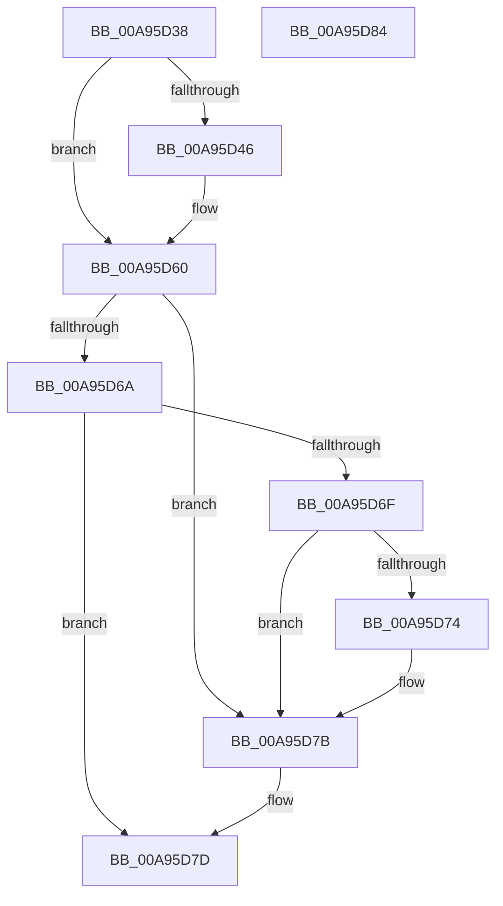

# PiCslIsConsoleLocked

- RVA: `0x00A95D38`–`0x00A95D85` (길이 `77` bytes)
- VA: `0x0000000140A95D38`
- 실행 섹션: `PAGE`
- PDB 이름 있음: `예`; PDB Function 태그: `아니요`
- unwind 정보 RVA: `0x0005D2F4`
- 디코드: `25`개 명령, `77/77` bytes 표시
- 미해석 바이트: `0` (있으면 어셈블리에 `.byte`로 보존)

> 이 문서는 커널 이미지의 기계어와 PDB 기호를 분석해 생성했습니다. 4번과 5번은 함수 원형과 자료형을 바이너리 사용 방식에서 추정한 C 해석이며 원본 소스 복구 결과는 아닙니다.

## 1. Dependencies

- 직접 호출 지점: **1**; 고유 호출 대상: **1**
- 직접 호출자로 확인된 함수: **3**
- RIP 상대 이미지 참조: **2**

### Outgoing calls
- `0x00A95D5A` → [KeBugCheckEx](../../text/4F/KeBugCheckEx_function_004FD660.md) (function, `0x004FD660`)

### Direct callers
- [PipDmgEnforceEnumerationPolicy](../73/PipDmgEnforceEnumerationPolicy_function_0073BEB4.md) at `0x0073BF16`
- [PipDmgReevaluateQueue](../73/PipDmgReevaluateQueue_function_0073C1A4.md) at `0x0073C1C4`
- [PnpSurpriseFailUnsafeDmaDevices](PnpSurpriseFailUnsafeDmaDevices_function_00A95B90.md) at `0x00A95BAF`

### Static image references
- `0x00A95D3E` → RVA `0x00F8A998` (`.data`; read)
- `0x00A95D60` → RVA `0x00F8A99C` (`.data`; read)

## 2. Other-region calls and transfers

- 다른 실행 섹션으로 향하는 call: **1**
  - `0x00A95D5A` → [KeBugCheckEx](../../text/4F/KeBugCheckEx_function_004FD660.md) (`PAGE` → `.text`)
- 별도 외부 분기/꼬리 이동을 확인하지 못했습니다.

## 3. Assembly (complete function range)

```asm
00A95D38  48 83 EC 38                     sub rsp, 0x38
00A95D3C  33 D2                           xor edx, edx
00A95D3E  38 15 54 4C 4F 00               cmp byte ptr [rip + 0x4f4c54], dl
00A95D44  75 1A                           jne 0x140a95d60
00A95D46  45 33 C9                        xor r9d, r9d
00A95D49  48 89 54 24 20                  mov qword ptr [rsp + 0x20], rdx
00A95D4E  45 33 C0                        xor r8d, r8d
00A95D51  B9 CA 00 00 00                  mov ecx, 0xca
00A95D56  41 8D 51 10                     lea edx, [r9 + 0x10]
00A95D5A  E8 01 79 A6 FF                  call 0x1404fd660
00A95D5F  CC                              int3
00A95D60  8B 0D 36 4C 4F 00               mov ecx, dword ptr [rip + 0x4f4c36]
00A95D66  85 C9                           test ecx, ecx
00A95D68  74 11                           je 0x140a95d7b
00A95D6A  83 E9 01                        sub ecx, 1
00A95D6D  74 0E                           je 0x140a95d7d
00A95D6F  83 F9 01                        cmp ecx, 1
00A95D72  74 07                           je 0x140a95d7b
00A95D74  B9 05 00 00 00                  mov ecx, 5
00A95D79  CD 29                           int 0x29
00A95D7B  B2 01                           mov dl, 1
00A95D7D  8A C2                           mov al, dl
00A95D7F  48 83 C4 38                     add rsp, 0x38
00A95D83  C3                              ret
00A95D84  CC                              int3
```

## 4. C-style interpretation (structured pseudocode)

```c
__int64 __fastcall PiCslIsConsoleLocked(__int64 a1, int a2, int a3, int a4)
{
    __int64 result;
    __int64 v_rsp;
    unsigned __int64 v_stack_m18;

    v_rsp = (v_rsp) - (56);
    a2 = 0;
    if ((*(unsigned __int8 *)(v_rip + 5196884)) == 0) {
        a4 = 0;
        v_stack_m18 = 0;
        a3 = 0;
        a1 = 202;
        a2 = a4 + 16;
        result = KeBugCheckEx(a1, a2, a3, a4);
    }
    if ((unsigned int)((unsigned int)(*(unsigned int *)(v_rip + 5196854))) == 0) goto loc_00A95D7B;
    a1 = (unsigned int)(((unsigned int)(*(unsigned int *)(v_rip + 5196854))) - (1));
    if (condition_is_equal) goto loc_00A95D7D;
    if (((unsigned int)(a1)) != 1) {
        a1 = 5;
    }
loc_00A95D7D:
    v_rsp = (v_rsp) + (56);
    return 1;
}
```

## 5. (Beta) C Style

```c
int64_t PiCslIsConsoleLocked(int64_t Arg1, int32_t Arg2, int32_t Arg3, int32_t Arg4)
{
    int64_t result;
    int64_t local_rsp;
    uint64_t v_stack_m18;

    local_rsp = (local_rsp) - (56);
    Arg2 = 0;
    if ((*(uint8_t *)(v_rip + 0x4F4C54)) == 0) {
        Arg4 = 0;
        v_stack_m18 = 0;
        Arg3 = 0;
        Arg1 = 202;
        Arg2 = Arg4 + 16;
        result = KeBugCheckEx(Arg1, Arg2, Arg3, Arg4);
    }
    if ((uint32_t)((uint32_t)(*(uint32_t *)(v_rip + 0x4F4C36))) == 0) goto loc_00A95D7B;
    Arg1 = (uint32_t)(((uint32_t)(*(uint32_t *)(v_rip + 0x4F4C36))) - (1));
    if (condition_is_equal) goto loc_00A95D7D;
    if (((uint32_t)(Arg1)) != 1) {
        Arg1 = 5;
    }
loc_00A95D7D:
    local_rsp = (local_rsp) + (56);
    return 1;
}
```

## 6. Execution-region graph

[열기: 2D/3D 그래프와 함수 탐색 컨트롤 패널](../../../control-panel.html?section=page&rva=0x00A95D38&view=graph)

- 2D 그래프는 위에서 아래로 흐르고, 3D 그래프는 빈 공간을 드래그해 회전합니다. Shift+드래그는 이동, 휠은 확대·축소, 함수 노드 선택은 대상 보고서 이동입니다.

### Static fallback


