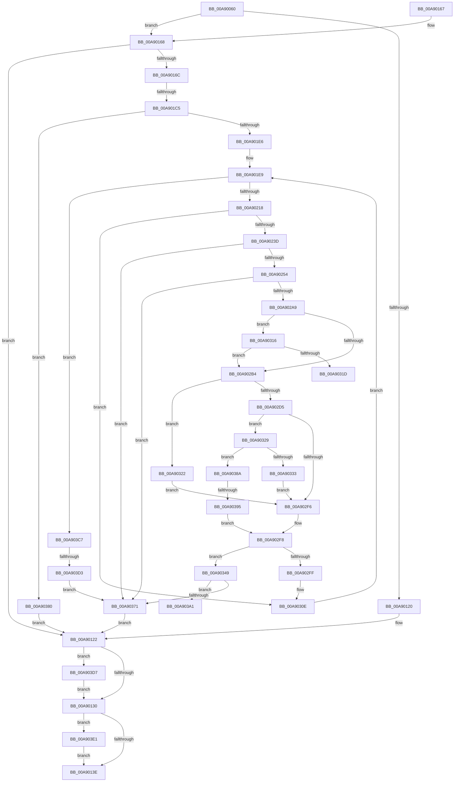

# PiDevCfgConfigureDeviceInterfaces

- RVA: `0x00A90060`–`0x00A903EB` (길이 `907` bytes)
- VA: `0x0000000140A90060`
- 실행 섹션: `PAGE`
- PDB 이름 있음: `예`; PDB Function 태그: `예`
- unwind 정보 RVA: `0x000B8E58`
- 디코드: `226`개 명령, `907/907` bytes 표시
- 미해석 바이트: `0` (있으면 어셈블리에 `.byte`로 보존)

> 이 문서는 커널 이미지의 기계어와 PDB 기호를 분석해 생성했습니다. 4번과 5번은 함수 원형과 자료형을 바이너리 사용 방식에서 추정한 C 해석이며 원본 소스 복구 결과는 아닙니다.

## 1. Dependencies

- 직접 호출 지점: **16**; 고유 호출 대상: **11**
- 직접 호출자로 확인된 함수: **1**
- RIP 상대 이미지 참조: **3**

### Outgoing calls
- `0x00A9010E` → [ZwOpenKey](../../text/6A/ZwOpenKey_function_006AD310.md) (function, `0x006AD310`)
- `0x00A90147` → [_security_check_cookie](../../text/6A/_security_check_cookie_function_006AC640.md) (function, `0x006AC640`)
- `0x00A901B5` → [ZwOpenKey](../../text/6A/ZwOpenKey_function_006AD310.md) (function, `0x006AD310`)
- `0x00A901D5` → [ExAllocatePool2](../../poolcode/B8/ExAllocatePool2_function_00B820F0.md) (function, `0x00B820F0`)
- `0x00A90209` → [ZwEnumerateKey](../../text/6A/ZwEnumerateKey_function_006AD710.md) (function, `0x006AD710`)
- `0x00A90230` → [wcsicmp](../../text/50/wcsicmp_function_00500080.md) (function, `0x00500080`)
- `0x00A90245` → [RtlInitUnicodeStringEx](../../text/46/RtlInitUnicodeStringEx_function_00463960.md) (function, `0x00463960`)
- `0x00A9029A` → [ZwOpenKey](../../text/6A/ZwOpenKey_function_006AD310.md) (function, `0x006AD310`)
- `0x00A902ED` → [RtlGUIDFromString](../8F/RtlGUIDFromString_function_008F1EF0.md) (function, `0x008F1EF0`)
- `0x00A90304` → [ZwClose](../../text/6A/ZwClose_function_006AD2B0.md) (function, `0x006AD2B0`)
- `0x00A90366` → [IopRegisterDeviceInterface](../95/IopRegisterDeviceInterface_function_009501B0.md) (function, `0x009501B0`)
- `0x00A90376` → [ExFreePoolWithTag](../../poolcode/B8/ExFreePoolWithTag_function_00B82870.md) (function, `0x00B82870`)
- `0x00A903AE` → [PiDevCfgConfigureDeviceInterface](../96/PiDevCfgConfigureDeviceInterface_function_00963C18.md) (function, `0x00963C18`)
- `0x00A903BC` → [ExFreePoolWithTag](../../poolcode/B8/ExFreePoolWithTag_function_00B82870.md) (function, `0x00B82870`)
- `0x00A903D7` → [ZwClose](../../text/6A/ZwClose_function_006AD2B0.md) (function, `0x006AD2B0`)
- `0x00A903E1` → [ZwClose](../../text/6A/ZwClose_function_006AD2B0.md) (function, `0x006AD2B0`)

### Direct callers
- [PiDevCfgConfigureDeviceKeys](../96/PiDevCfgConfigureDeviceKeys_function_00964BA8.md) at `0x00964C65`

### Static image references
- `0x00A9007C` → RVA `0x00E0A740` (`.data`; read)
- `0x00A900A5` → RVA `0x00AFF290` (` ?? ::NNGAKEGL::`string'`; read)
- `0x00A9016C` → RVA `0x00AFD260` (` ?? ::NNGAKEGL::`string'`; read)

## 2. Other-region calls and transfers

- 다른 실행 섹션으로 향하는 call: **13**
  - `0x00A9010E` → [ZwOpenKey](../../text/6A/ZwOpenKey_function_006AD310.md) (`PAGE` → `.text`)
  - `0x00A90147` → [_security_check_cookie](../../text/6A/_security_check_cookie_function_006AC640.md) (`PAGE` → `.text`)
  - `0x00A901B5` → [ZwOpenKey](../../text/6A/ZwOpenKey_function_006AD310.md) (`PAGE` → `.text`)
  - `0x00A901D5` → [ExAllocatePool2](../../poolcode/B8/ExAllocatePool2_function_00B820F0.md) (`PAGE` → `POOLCODE`)
  - `0x00A90209` → [ZwEnumerateKey](../../text/6A/ZwEnumerateKey_function_006AD710.md) (`PAGE` → `.text`)
  - `0x00A90230` → [wcsicmp](../../text/50/wcsicmp_function_00500080.md) (`PAGE` → `.text`)
  - `0x00A90245` → [RtlInitUnicodeStringEx](../../text/46/RtlInitUnicodeStringEx_function_00463960.md) (`PAGE` → `.text`)
  - `0x00A9029A` → [ZwOpenKey](../../text/6A/ZwOpenKey_function_006AD310.md) (`PAGE` → `.text`)
  - `0x00A90304` → [ZwClose](../../text/6A/ZwClose_function_006AD2B0.md) (`PAGE` → `.text`)
  - `0x00A90376` → [ExFreePoolWithTag](../../poolcode/B8/ExFreePoolWithTag_function_00B82870.md) (`PAGE` → `POOLCODE`)
  - `0x00A903BC` → [ExFreePoolWithTag](../../poolcode/B8/ExFreePoolWithTag_function_00B82870.md) (`PAGE` → `POOLCODE`)
  - `0x00A903D7` → [ZwClose](../../text/6A/ZwClose_function_006AD2B0.md) (`PAGE` → `.text`)
  - `0x00A903E1` → [ZwClose](../../text/6A/ZwClose_function_006AD2B0.md) (`PAGE` → `.text`)
- call이 아닌 외부 분기/꼬리 이동: **5**
  - `0x00A901BF` → [sub_00B467A6](../B4/Unknown_function_00B467A6.md) (`tail-transfer`)
  - `0x00A9031D` → [sub_00B467A6 + 0x81](../B4/Unknown_function_00B467A6.md) (`tail-transfer`)
  - `0x00A9038F` → [sub_00B467A6 + 0x1D3](../B4/Unknown_function_00B467A6.md) (`tail-transfer`)
  - `0x00A903C2` → [sub_00B467A6 + 0x19B](../B4/Unknown_function_00B467A6.md) (`tail-transfer`)
  - `0x00A903CD` → [sub_00B467A6 + 0x1DD](../B4/Unknown_function_00B467A6.md) (`tail-transfer`)

## 3. Assembly (complete function range)

```asm
00A90060  48 89 5C 24 20                  mov qword ptr [rsp + 0x20], rbx
00A90065  55                              push rbp
00A90066  56                              push rsi
00A90067  57                              push rdi
00A90068  41 54                           push r12
00A9006A  41 55                           push r13
00A9006C  41 56                           push r14
00A9006E  41 57                           push r15
00A90070  48 8D 6C 24 C0                  lea rbp, [rsp - 0x40]
00A90075  48 81 EC 40 01 00 00            sub rsp, 0x140
00A9007C  48 8B 05 BD A6 37 00            mov rax, qword ptr [rip + 0x37a6bd]
00A90083  48 33 C4                        xor rax, rsp
00A90086  48 89 45 30                     mov qword ptr [rbp + 0x30], rax
00A9008A  33 F6                           xor esi, esi
00A9008C  48 89 4D D0                     mov qword ptr [rbp - 0x30], rcx
00A90090  0F 57 C0                        xorps xmm0, xmm0
00A90093  48 89 55 A8                     mov qword ptr [rbp - 0x58], rdx
00A90097  33 C0                           xor eax, eax
00A90099  48 89 74 24 50                  mov qword ptr [rsp + 0x50], rsi
00A9009E  48 89 45 00                     mov qword ptr [rbp], rax
00A900A2  4D 8B E0                        mov r12, r8
00A900A5  48 8D 05 E4 F1 06 00            lea rax, [rip + 0x6f1e4]
00A900AC  48 C7 45 80 14 00 16 00         mov qword ptr [rbp - 0x80], 0x160014
00A900B4  48 89 45 88                     mov qword ptr [rbp - 0x78], rax
00A900B8  4C 8D 45 A0                     lea r8, [rbp - 0x60]
00A900BC  48 8D 45 80                     lea rax, [rbp - 0x80]
00A900C0  48 89 75 98                     mov qword ptr [rbp - 0x68], rsi
00A900C4  48 8B F9                        mov rdi, rcx
00A900C7  48 89 45 B0                     mov qword ptr [rbp - 0x50], rax
00A900CB  0F 57 C9                        xorps xmm1, xmm1
00A900CE  48 89 74 24 58                  mov qword ptr [rsp + 0x58], rsi
00A900D3  BA 19 00 02 00                  mov edx, 0x20019
00A900D8  89 74 24 60                     mov dword ptr [rsp + 0x60], esi
00A900DC  48 8D 4C 24 68                  lea rcx, [rsp + 0x68]
00A900E1  48 C7 45 A0 30 00 00 00         mov qword ptr [rbp - 0x60], 0x30
00A900E9  0F 11 45 F0                     movups xmmword ptr [rbp - 0x10], xmm0
00A900ED  44 8B F6                        mov r14d, esi
00A900F0  48 C7 45 B8 40 02 00 00         mov qword ptr [rbp - 0x48], 0x240
00A900F8  0F 11 45 E0                     movups xmmword ptr [rbp - 0x20], xmm0
00A900FC  48 89 74 24 68                  mov qword ptr [rsp + 0x68], rsi
00A90101  0F 11 4D 10                     movups xmmword ptr [rbp + 0x10], xmm1
00A90105  0F 11 45 20                     movups xmmword ptr [rbp + 0x20], xmm0
00A90109  F3 0F 7F 45 C0                  movdqu xmmword ptr [rbp - 0x40], xmm0
00A9010E  E8 FD D1 C1 FF                  call 0x1406ad310
00A90113  41 BF 34 00 00 C0               mov r15d, 0xc0000034
00A90119  8B D8                           mov ebx, eax
00A9011B  41 3B C7                        cmp eax, r15d
00A9011E  75 48                           jne 0x140a90168
00A90120  8B DE                           mov ebx, esi
00A90122  48 8B 4C 24 50                  mov rcx, qword ptr [rsp + 0x50]
00A90127  48 85 C9                        test rcx, rcx
00A9012A  0F 85 A7 02 00 00               jne 0x140a903d7
00A90130  48 8B 4C 24 68                  mov rcx, qword ptr [rsp + 0x68]
00A90135  48 85 C9                        test rcx, rcx
00A90138  0F 85 A3 02 00 00               jne 0x140a903e1
00A9013E  8B C3                           mov eax, ebx
00A90140  48 8B 4D 30                     mov rcx, qword ptr [rbp + 0x30]
00A90144  48 33 CC                        xor rcx, rsp
00A90147  E8 F4 C4 C1 FF                  call 0x1406ac640
00A9014C  48 8B 9C 24 98 01 00 00         mov rbx, qword ptr [rsp + 0x198]
00A90154  48 81 C4 40 01 00 00            add rsp, 0x140
00A9015B  41 5F                           pop r15
00A9015D  41 5E                           pop r14
00A9015F  41 5D                           pop r13
00A90161  41 5C                           pop r12
00A90163  5F                              pop rdi
00A90164  5E                              pop rsi
00A90165  5D                              pop rbp
00A90166  C3                              ret
00A90167  CC                              int3
00A90168  85 C0                           test eax, eax
00A9016A  78 B6                           js 0x140a90122
00A9016C  48 8D 05 ED D0 06 00            lea rax, [rip + 0x6d0ed]
00A90173  C7 45 80 02 00 04 00            mov dword ptr [rbp - 0x80], 0x40002
00A9017A  48 89 45 88                     mov qword ptr [rbp - 0x78], rax
00A9017E  4C 8D 45 A0                     lea r8, [rbp - 0x60]
00A90182  48 8B 44 24 68                  mov rax, qword ptr [rsp + 0x68]
00A90187  48 8D 4C 24 50                  lea rcx, [rsp + 0x50]
00A9018C  48 89 45 A8                     mov qword ptr [rbp - 0x58], rax
00A90190  0F 57 C0                        xorps xmm0, xmm0
00A90193  48 8D 45 80                     lea rax, [rbp - 0x80]
00A90197  48 C7 45 A0 30 00 00 00         mov qword ptr [rbp - 0x60], 0x30
00A9019F  BA 19 00 02 00                  mov edx, 0x20019
00A901A4  48 89 45 B0                     mov qword ptr [rbp - 0x50], rax
00A901A8  48 C7 45 B8 40 02 00 00         mov qword ptr [rbp - 0x48], 0x240
00A901B0  F3 0F 7F 45 C0                  movdqu xmmword ptr [rbp - 0x40], xmm0
00A901B5  E8 56 D1 C1 FF                  call 0x1406ad310
00A901BA  8B D8                           mov ebx, eax
00A901BC  41 3B C7                        cmp eax, r15d
00A901BF  0F 85 E1 65 0B 00               jne 0x140b467a6
00A901C5  BA 6E 02 00 00                  mov edx, 0x26e
00A901CA  B9 00 01 00 00                  mov ecx, 0x100
00A901CF  41 B8 50 70 64 63               mov r8d, 0x63647050
00A901D5  E8 16 1F 0F 00                  call 0x140b820f0
00A901DA  4C 8B F8                        mov r15, rax
00A901DD  48 85 C0                        test rax, rax
00A901E0  0F 84 9A 01 00 00               je 0x140a90380
00A901E6  44 8B EE                        mov r13d, esi
00A901E9  48 8B 4C 24 68                  mov rcx, qword ptr [rsp + 0x68]
00A901EE  48 8D 44 24 60                  lea rax, [rsp + 0x60]
00A901F3  48 89 44 24 28                  mov qword ptr [rsp + 0x28], rax
00A901F8  4D 8B CF                        mov r9, r15
00A901FB  45 33 C0                        xor r8d, r8d
00A901FE  C7 44 24 20 6E 02 00 00         mov dword ptr [rsp + 0x20], 0x26e
00A90206  41 8B D5                        mov edx, r13d
00A90209  E8 02 D5 C1 FF                  call 0x1406ad710
00A9020E  8B D8                           mov ebx, eax
00A90210  85 C0                           test eax, eax
00A90212  0F 88 AF 01 00 00               js 0x140a903c7
00A90218  41 8B 47 0C                     mov eax, dword ptr [r15 + 0xc]
00A9021C  48 8D 15 3D D0 06 00            lea rdx, [rip + 0x6d03d]
00A90223  48 D1 E8                        shr rax, 1
00A90226  49 8D 4F 10                     lea rcx, [r15 + 0x10]
00A9022A  66 41 89 74 47 10               mov word ptr [r15 + rax*2 + 0x10], si
00A90230  E8 4B FE A6 FF                  call 0x140500080
00A90235  85 C0                           test eax, eax
00A90237  0F 84 D1 00 00 00               je 0x140a9030e
00A9023D  49 8D 57 10                     lea rdx, [r15 + 0x10]
00A90241  48 8D 4D E0                     lea rcx, [rbp - 0x20]
00A90245  E8 16 37 9D FF                  call 0x140463960
00A9024A  8B D8                           mov ebx, eax
00A9024C  85 C0                           test eax, eax
00A9024E  0F 88 1D 01 00 00               js 0x140a90371
00A90254  0F 28 45 E0                     movaps xmm0, xmmword ptr [rbp - 0x20]
00A90258  4C 8D 45 A0                     lea r8, [rbp - 0x60]
00A9025C  48 8B 44 24 68                  mov rax, qword ptr [rsp + 0x68]
00A90261  48 8D 4C 24 50                  lea rcx, [rsp + 0x50]
00A90266  66 0F 7F 44 24 70               movdqa xmmword ptr [rsp + 0x70], xmm0
00A9026C  BA 19 00 02 00                  mov edx, 0x20019
00A90271  48 89 45 A8                     mov qword ptr [rbp - 0x58], rax
00A90275  0F 57 C0                        xorps xmm0, xmm0
00A90278  48 8D 45 E0                     lea rax, [rbp - 0x20]
00A9027C  48 C7 45 A0 30 00 00 00         mov qword ptr [rbp - 0x60], 0x30
00A90284  48 89 45 B0                     mov qword ptr [rbp - 0x50], rax
00A90288  F3 0F 7F 45 C0                  movdqu xmmword ptr [rbp - 0x40], xmm0
00A9028D  48 C7 45 B8 40 02 00 00         mov qword ptr [rbp - 0x48], 0x240
00A90295  48 89 74 24 50                  mov qword ptr [rsp + 0x50], rsi
00A9029A  E8 71 D0 C1 FF                  call 0x1406ad310
00A9029F  8B D8                           mov ebx, eax
00A902A1  85 C0                           test eax, eax
00A902A3  0F 88 C8 00 00 00               js 0x140a90371
00A902A9  89 75 90                        mov dword ptr [rbp - 0x70], esi
00A902AC  48 8B FE                        mov rdi, rsi
00A902AF  4D 85 E4                        test r12, r12
00A902B2  75 62                           jne 0x140a90316
00A902B4  48 8B 74 24 78                  mov rsi, qword ptr [rsp + 0x78]
00A902B9  0F B7 4C 24 72                  movzx ecx, word ptr [rsp + 0x72]
00A902BE  0F B7 44 24 70                  movzx eax, word ptr [rsp + 0x70]
00A902C3  BF 4C 00 00 00                  mov edi, 0x4c
00A902C8  0F 57 C0                        xorps xmm0, xmm0
00A902CB  0F 11 44 24 70                  movups xmmword ptr [rsp + 0x70], xmm0
00A902D0  66 3B C7                        cmp ax, di
00A902D3  72 4D                           jb 0x140a90322
00A902D5  66 89 4C 24 72                  mov word ptr [rsp + 0x72], cx
00A902DA  48 8D 55 20                     lea rdx, [rbp + 0x20]
00A902DE  48 8D 4C 24 70                  lea rcx, [rsp + 0x70]
00A902E3  48 89 74 24 78                  mov qword ptr [rsp + 0x78], rsi
00A902E8  66 89 7C 24 70                  mov word ptr [rsp + 0x70], di
00A902ED  E8 FE 1B E6 FF                  call 0x1408f1ef0
00A902F2  85 C0                           test eax, eax
00A902F4  79 33                           jns 0x140a90329
00A902F6  33 F6                           xor esi, esi
00A902F8  C1 E8 1F                        shr eax, 0x1f
00A902FB  84 C0                           test al, al
00A902FD  74 4A                           je 0x140a90349
00A902FF  48 8B 4C 24 50                  mov rcx, qword ptr [rsp + 0x50]
00A90304  E8 A7 CF C1 FF                  call 0x1406ad2b0
00A90309  48 89 74 24 50                  mov qword ptr [rsp + 0x50], rsi
00A9030E  41 FF C5                        inc r13d
00A90311  E9 D3 FE FF FF                  jmp 0x140a901e9
00A90316  49 39 74 24 10                  cmp qword ptr [r12 + 0x10], rsi
00A9031B  74 97                           je 0x140a902b4
00A9031D  E9 05 65 0B 00                  jmp 0x140b46827
00A90322  B8 01 00 00 C0                  mov eax, 0xc0000001
00A90327  EB CD                           jmp 0x140a902f6
00A90329  0F B7 4E 4C                     movzx ecx, word ptr [rsi + 0x4c]
00A9032D  66 83 F9 23                     cmp cx, 0x23
00A90331  75 57                           jne 0x140a9038a
00A90333  48 8D 56 4E                     lea rdx, [rsi + 0x4e]
00A90337  0F B7 0A                        movzx ecx, word ptr [rdx]
00A9033A  66 F7 D9                        neg cx
00A9033D  4D 1B F6                        sbb r14, r14
00A90340  4C 23 F2                        and r14, rdx
00A90343  4C 89 75 98                     mov qword ptr [rbp - 0x68], r14
00A90347  EB AD                           jmp 0x140a902f6
00A90349  48 8B 4D D0                     mov rcx, qword ptr [rbp - 0x30]
00A9034D  48 8D 44 24 58                  lea rax, [rsp + 0x58]
00A90352  48 89 74 24 28                  mov qword ptr [rsp + 0x28], rsi
00A90357  48 8D 55 20                     lea rdx, [rbp + 0x20]
00A9035B  41 B1 01                        mov r9b, 1
00A9035E  48 89 44 24 20                  mov qword ptr [rsp + 0x20], rax
00A90363  4D 8B C6                        mov r8, r14
00A90366  E8 45 FE EB FF                  call 0x1409501b0
00A9036B  8B D8                           mov ebx, eax
00A9036D  85 C0                           test eax, eax
00A9036F  79 30                           jns 0x140a903a1
00A90371  33 D2                           xor edx, edx
00A90373  49 8B CF                        mov rcx, r15
00A90376  E8 F5 24 0F 00                  call 0x140b82870
00A9037B  E9 A2 FD FF FF                  jmp 0x140a90122
00A90380  BB 9A 00 00 C0                  mov ebx, 0xc000009a
00A90385  E9 98 FD FF FF                  jmp 0x140a90122
00A9038A  33 F6                           xor esi, esi
00A9038C  66 85 C9                        test cx, cx
00A9038F  0F 85 E4 65 0B 00               jne 0x140b46979
00A90395  44 8B F6                        mov r14d, esi
00A90398  48 89 75 98                     mov qword ptr [rbp - 0x68], rsi
00A9039C  E9 57 FF FF FF                  jmp 0x140a902f8
00A903A1  48 8B 54 24 50                  mov rdx, qword ptr [rsp + 0x50]
00A903A6  4D 8B C4                        mov r8, r12
00A903A9  48 8B 4C 24 58                  mov rcx, qword ptr [rsp + 0x58]
00A903AE  E8 65 38 ED FF                  call 0x140963c18
00A903B3  48 8B 4C 24 58                  mov rcx, qword ptr [rsp + 0x58]
00A903B8  33 D2                           xor edx, edx
00A903BA  8B D8                           mov ebx, eax
00A903BC  E8 AF 24 0F 00                  call 0x140b82870
00A903C1  90                              nop
00A903C2  E9 7A 65 0B 00                  jmp 0x140b46941
00A903C7  81 FB 1A 00 00 80               cmp ebx, 0x8000001a
00A903CD  0F 85 B0 65 0B 00               jne 0x140b46983
00A903D3  8B DE                           mov ebx, esi
00A903D5  EB 9A                           jmp 0x140a90371
00A903D7  E8 D4 CE C1 FF                  call 0x1406ad2b0
00A903DC  E9 4F FD FF FF                  jmp 0x140a90130
00A903E1  E8 CA CE C1 FF                  call 0x1406ad2b0
00A903E6  E9 53 FD FF FF                  jmp 0x140a9013e
```

## 4. C-style interpretation (structured pseudocode)

```c
__int64 __fastcall PiDevCfgConfigureDeviceInterfaces(__int64 a1, __int64 a2, __int64 a3)
{
    __int64 result;
    __int64 v_r13;
    __int64 v_r14;
    __int64 v_rsi;
    __int64 v_rsp;
    unsigned __int64 v_stack_m110;
    unsigned int v_stack_m118;
    unsigned __int64 v_stack_m120;
    unsigned __int64 v_stack_m128;
    unsigned __int64 v_stack_m48;
    unsigned __int64 v_stack_m58;
    unsigned __int64 v_stack_m68;
    unsigned __int64 v_stack_m78;
    unsigned __int64 v_stack_m88;
    unsigned __int64 v_stack_m98;
    unsigned __int64 v_stack_mA8;
    unsigned __int64 v_stack_mB8;
    unsigned __int64 v_stack_mC0;
    unsigned __int64 v_stack_mC8;
    unsigned __int64 v_stack_mD0;
    unsigned __int64 v_stack_mD8;
    unsigned __int64 v_stack_mE0;
    unsigned int v_stack_mE8;
    unsigned __int64 v_stack_mF0;
    unsigned __int64 v_stack_mF8;
    unsigned __int64 v_stack_p20;
    unsigned __int64 v_stack_p28;
    unsigned __int64 v_stack_p50;
    unsigned __int64 v_stack_p58;
    unsigned __int64 v_stack_p60;
    unsigned __int64 v_stack_p68;
    unsigned __int64 v_stack_p70;
    unsigned __int16 v_stack_p72;
    unsigned __int64 v_stack_p78;

    v_stack_p20 = v_rbx;
    v_rsp = (v_rsp) - (320);
    result = (*(unsigned __int64 *)(v_rip + 3647165)) ^ (v_rsp);
    v_stack_m48 = result;
    v_rsi = 0;
    v_stack_mA8 = a1;
    v_stack_mD0 = a2;
    result = 0;
    v_stack_m128 = 0;
    v_stack_m78 = 0;
    v_stack_mF8 = 0x160014ULL;
    v_stack_mF0 = v_rip + 455140;
    v_stack_mE0 = 0;
    v_stack_mC8 = v_stack_mF8;
    v_stack_m120 = 0;
    v_stack_m118 = 0;
    v_stack_mD8 = 48;
    v_stack_m88 = v_xmm0;
    v_stack_mC0 = 576;
    v_stack_m98 = v_xmm0;
    v_stack_m110 = 0;
    v_stack_m68 = v_xmm1;
    v_stack_m58 = v_xmm0;
    v_stack_mB8 = v_xmm0;
    result = ZwOpenKey(v_stack_m110, (unsigned int)(0x20019ULL), v_stack_mD8, a4);
    if (((unsigned int)(result)) != ((unsigned int)((unsigned int)(0xC0000034ULL)))) goto loc_00A90168;
loc_00A90122:
    if (v_stack_m128 != 0) goto loc_00A903D7;
loc_00A90130:
    if (v_stack_m110 != 0) goto loc_00A903E1;
loc_00A9013E:
    a1 = (v_stack_m48) ^ (v_rsp);
    result = _security_check_cookie(a1, (unsigned int)(0x20019ULL), v_stack_mD8, a4);
    v_rsp = (v_rsp) + (320);
    return result;
loc_00A90168:
    if (sign_flag) goto loc_00A90122;
    v_stack_mF8 = 0x40002ULL;
    v_stack_mF0 = v_rip + 446701;
    v_stack_mD0 = v_stack_p68;
    v_stack_mD8 = 48;
    v_stack_mC8 = v_stack_mF8;
    v_stack_mC0 = 576;
    v_stack_mB8 = v_xmm0;
    result = ZwOpenKey(v_stack_p50, (unsigned int)(0x20019ULL), v_stack_mD8, a4);
    result = ExAllocatePool2(256, 622, (unsigned int)(0x63647050ULL), a4);
    if (result == 0) goto loc_00A90380;
loc_00A901E9:
    v_stack_p28 = v_stack_p60;
    a3 = 0;
    v_stack_p20 = 622;
    result = ZwEnumerateKey(v_stack_p68, 0, a3, result);
    if (sign_flag) goto loc_00A903C7;
    result = ((unsigned int)(*(unsigned int *)(result + 12))) >> (1);
    *(unsigned __int16 *)(result + result * 2 + 16) = 0;
    result = wcsicmp(result + 16, v_rip + 446525, a3, result);
    if ((unsigned int)(result) == 0) goto loc_00A9030E;
    result = RtlInitUnicodeStringEx(v_stack_m98, result + 16, a3, result);
    if (sign_flag) goto loc_00A90371;
    v_stack_p70 = v_xmm0;
    v_stack_mD0 = v_stack_p68;
    v_stack_mD8 = 48;
    v_stack_mC8 = v_stack_m98;
    v_stack_mB8 = v_xmm0;
    v_stack_mC0 = 576;
    v_stack_p50 = 0;
    result = ZwOpenKey(v_stack_p50, (unsigned int)(0x20019ULL), v_stack_mD8, result);
    if (sign_flag) goto loc_00A90371;
    v_stack_mE8 = 0;
    if (0 != 0) goto loc_00A90316;
loc_00A902B4:
    v_stack_p70 = v_xmm0;
    if (((unsigned __int16)(v_stack_p70)) < 76) goto loc_00A90322;
    v_stack_p72 = (unsigned __int16)(v_stack_p72);
    v_stack_p78 = v_stack_p78;
    v_stack_p70 = 76;
    result = RtlGUIDFromString(v_stack_p70, v_stack_m58, v_stack_mD8, result);
    if (!sign_flag) goto loc_00A90329;
loc_00A902F6:
    v_rsi = 0;
loc_00A902F8:
    result = (unsigned int)((result) >> (31));
    if ((unsigned __int8)(result) == 0) goto loc_00A90349;
    result = ZwClose(v_stack_p50, v_stack_m58, v_stack_mD8, result);
    v_stack_p50 = 0;
loc_00A9030E:
    v_r13 = (unsigned int)((0) + 1);
    goto loc_00A901E9;
loc_00A90316:
    if ((*(unsigned __int64 *)(a3 + 16)) == 0) goto loc_00A902B4;
loc_00A90322:
    goto loc_00A902F6;
loc_00A90329:
    if (((unsigned __int16)(*(unsigned __int16 *)(v_rsi + 76))) != 35) goto loc_00A9038A;
    a1 = (unsigned __int16)(-(*(unsigned __int16 *)(v_rsi + 78)));
    v_r14 = (0) & (v_rsi + 78);
    v_stack_mE0 = v_r14;
    goto loc_00A902F6;
loc_00A90349:
    v_stack_p28 = 0;
    v_stack_p20 = v_stack_p58;
    result = IopRegisterDeviceInterface(v_stack_mA8, v_stack_m58, v_r14, 1);
    if (!sign_flag) goto loc_00A903A1;
loc_00A90371:
    a2 = 0;
    result = ExFreePoolWithTag(result, a2, v_r14, 1);
    goto loc_00A90122;
loc_00A90380:
    goto loc_00A90122;
loc_00A9038A:
    v_rsi = 0;
    v_stack_mE0 = 0;
    goto loc_00A902F8;
loc_00A903A1:
    result = PiDevCfgConfigureDeviceInterface(v_stack_p58, v_stack_p50, 0, 1);
    a2 = 0;
    result = ExFreePoolWithTag(v_stack_p58, a2, 0, 1);
loc_00A903C7:
    goto loc_00A90371;
loc_00A903D7:
    result = ZwClose(v_stack_p58, a2, 0, 1);
    goto loc_00A90130;
loc_00A903E1:
    result = ZwClose(v_stack_p58, a2, 0, 1);
    goto loc_00A9013E;
}
```

## 5. (Beta) C Style

```c
int64_t PiDevCfgConfigureDeviceInterfaces(int64_t Arg1, int64_t Arg2, int64_t Arg3)
{
    int64_t result;
    int64_t local_r13;
    int64_t local_r14;
    int64_t local_rsi;
    int64_t local_rsp;
    uint64_t v_stack_m110;
    uint32_t v_stack_m118;
    uint64_t v_stack_m120;
    uint64_t v_stack_m128;
    uint64_t v_stack_m48;
    uint64_t v_stack_m58;
    uint64_t v_stack_m68;
    uint64_t v_stack_m78;
    uint64_t v_stack_m88;
    uint64_t v_stack_m98;
    uint64_t v_stack_mA8;
    uint64_t v_stack_mB8;
    uint64_t v_stack_mC0;
    uint64_t v_stack_mC8;
    uint64_t v_stack_mD0;
    uint64_t v_stack_mD8;
    uint64_t v_stack_mE0;
    uint32_t v_stack_mE8;
    uint64_t v_stack_mF0;
    uint64_t v_stack_mF8;
    uint64_t v_stack_p20;
    uint64_t v_stack_p28;
    uint64_t v_stack_p50;
    uint64_t v_stack_p58;
    uint64_t v_stack_p60;
    uint64_t v_stack_p68;
    uint64_t v_stack_p70;
    uint16_t v_stack_p72;
    uint64_t v_stack_p78;

    v_stack_p20 = local_rbx;
    local_rsp = (local_rsp) - (320);
    result = (*(uint64_t *)(v_rip + 0x37A6BD)) ^ (local_rsp);
    v_stack_m48 = result;
    local_rsi = 0;
    v_stack_mA8 = Arg1;
    v_stack_mD0 = Arg2;
    result = 0;
    v_stack_m128 = 0;
    v_stack_m78 = 0;
    v_stack_mF8 = 0x160014ULL;
    v_stack_mF0 = v_rip + 455140;
    v_stack_mE0 = 0;
    v_stack_mC8 = v_stack_mF8;
    v_stack_m120 = 0;
    v_stack_m118 = 0;
    v_stack_mD8 = 48;
    v_stack_m88 = v_xmm0;
    v_stack_mC0 = 576;
    v_stack_m98 = v_xmm0;
    v_stack_m110 = 0;
    v_stack_m68 = v_xmm1;
    v_stack_m58 = v_xmm0;
    v_stack_mB8 = v_xmm0;
    result = ZwOpenKey(v_stack_m110, (uint32_t)(0x20019ULL), v_stack_mD8, a4);
    if (((uint32_t)(result)) != ((uint32_t)((uint32_t)(0xC0000034ULL)))) goto loc_00A90168;
loc_00A90122:
    if (v_stack_m128 != 0) goto loc_00A903D7;
loc_00A90130:
    if (v_stack_m110 != 0) goto loc_00A903E1;
loc_00A9013E:
    Arg1 = (v_stack_m48) ^ (local_rsp);
    result = _security_check_cookie(Arg1, (uint32_t)(0x20019ULL), v_stack_mD8, a4);
    local_rsp = (local_rsp) + (320);
    return result;
loc_00A90168:
    if (sign_flag) goto loc_00A90122;
    v_stack_mF8 = 0x40002ULL;
    v_stack_mF0 = v_rip + 446701;
    v_stack_mD0 = v_stack_p68;
    v_stack_mD8 = 48;
    v_stack_mC8 = v_stack_mF8;
    v_stack_mC0 = 576;
    v_stack_mB8 = v_xmm0;
    result = ZwOpenKey(v_stack_p50, (uint32_t)(0x20019ULL), v_stack_mD8, a4);
    result = ExAllocatePool2(256, 622, (uint32_t)(0x63647050ULL), a4);
    if (result == 0) goto loc_00A90380;
loc_00A901E9:
    v_stack_p28 = v_stack_p60;
    Arg3 = 0;
    v_stack_p20 = 622;
    result = ZwEnumerateKey(v_stack_p68, 0, Arg3, result);
    if (sign_flag) goto loc_00A903C7;
    result = ((uint32_t)(*(uint32_t *)(result + 0xC))) >> (1);
    *(uint16_t *)(result + result * 2 + 0x10) = 0;
    result = wcsicmp(result + 16, v_rip + 446525, Arg3, result);
    if ((uint32_t)(result) == 0) goto loc_00A9030E;
    result = RtlInitUnicodeStringEx(v_stack_m98, result + 16, Arg3, result);
    if (sign_flag) goto loc_00A90371;
    v_stack_p70 = v_xmm0;
    v_stack_mD0 = v_stack_p68;
    v_stack_mD8 = 48;
    v_stack_mC8 = v_stack_m98;
    v_stack_mB8 = v_xmm0;
    v_stack_mC0 = 576;
    v_stack_p50 = 0;
    result = ZwOpenKey(v_stack_p50, (uint32_t)(0x20019ULL), v_stack_mD8, result);
    if (sign_flag) goto loc_00A90371;
    v_stack_mE8 = 0;
    if (0 != 0) goto loc_00A90316;
loc_00A902B4:
    v_stack_p70 = v_xmm0;
    if (((uint16_t)(v_stack_p70)) < 76) goto loc_00A90322;
    v_stack_p72 = (uint16_t)(v_stack_p72);
    v_stack_p78 = v_stack_p78;
    v_stack_p70 = 76;
    result = RtlGUIDFromString(v_stack_p70, v_stack_m58, v_stack_mD8, result);
    if (!sign_flag) goto loc_00A90329;
loc_00A902F6:
    local_rsi = 0;
loc_00A902F8:
    result = (uint32_t)((result) >> (31));
    if ((uint8_t)(result) == 0) goto loc_00A90349;
    result = ZwClose(v_stack_p50, v_stack_m58, v_stack_mD8, result);
    v_stack_p50 = 0;
loc_00A9030E:
    local_r13 = (uint32_t)((0) + 1);
    goto loc_00A901E9;
loc_00A90316:
    if ((*(uint64_t *)(Arg3 + 0x10)) == 0) goto loc_00A902B4;
loc_00A90322:
    goto loc_00A902F6;
loc_00A90329:
    if (((uint16_t)(*(uint16_t *)(local_rsi + 0x4C))) != 35) goto loc_00A9038A;
    Arg1 = (uint16_t)(-(*(uint16_t *)(local_rsi + 0x4E)));
    local_r14 = (0) & (local_rsi + 78);
    v_stack_mE0 = local_r14;
    goto loc_00A902F6;
loc_00A90349:
    v_stack_p28 = 0;
    v_stack_p20 = v_stack_p58;
    result = IopRegisterDeviceInterface(v_stack_mA8, v_stack_m58, local_r14, 1);
    if (!sign_flag) goto loc_00A903A1;
loc_00A90371:
    Arg2 = 0;
    result = ExFreePoolWithTag(result, Arg2, local_r14, 1);
    goto loc_00A90122;
loc_00A90380:
    goto loc_00A90122;
loc_00A9038A:
    local_rsi = 0;
    v_stack_mE0 = 0;
    goto loc_00A902F8;
loc_00A903A1:
    result = PiDevCfgConfigureDeviceInterface(v_stack_p58, v_stack_p50, 0, 1);
    Arg2 = 0;
    result = ExFreePoolWithTag(v_stack_p58, Arg2, 0, 1);
loc_00A903C7:
    goto loc_00A90371;
loc_00A903D7:
    result = ZwClose(v_stack_p58, Arg2, 0, 1);
    goto loc_00A90130;
loc_00A903E1:
    result = ZwClose(v_stack_p58, Arg2, 0, 1);
    goto loc_00A9013E;
}
```

## 6. Execution-region graph

[열기: 2D/3D 그래프와 함수 탐색 컨트롤 패널](../../../control-panel.html?section=page&rva=0x00A90060&view=graph)

- 2D 그래프는 위에서 아래로 흐르고, 3D 그래프는 빈 공간을 드래그해 회전합니다. Shift+드래그는 이동, 휠은 확대·축소, 함수 노드 선택은 대상 보고서 이동입니다.

### Static fallback


