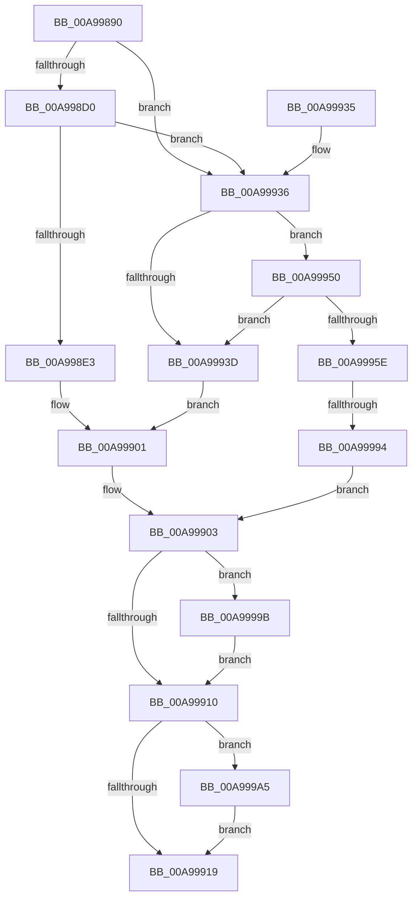

# PiDevCfgConfigureDeviceKeyCallback

- RVA: `0x00A99890`–`0x00A999B2` (길이 `290` bytes)
- VA: `0x0000000140A99890`
- 실행 섹션: `PAGE`
- PDB 이름 있음: `예`; PDB Function 태그: `예`
- unwind 정보 RVA: `0x000BA264`
- 디코드: `77`개 명령, `290/290` bytes 표시
- 미해석 바이트: `0` (있으면 어셈블리에 `.byte`로 보존)

> 이 문서는 커널 이미지의 기계어와 PDB 기호를 분석해 생성했습니다. 4번과 5번은 함수 원형과 자료형을 바이너리 사용 방식에서 추정한 C 해석이며 원본 소스 복구 결과는 아닙니다.

## 1. Dependencies

- 직접 호출 지점: **6**; 고유 호출 대상: **5**
- 직접 호출자로 확인된 함수: **0**
- RIP 상대 이미지 참조: **2**

### Outgoing calls
- `0x00A998DA` → [wcsicmp](../../text/50/wcsicmp_function_00500080.md) (function, `0x00500080`)
- `0x00A998FC` → [PiDevCfgCopyDeviceProperties](../70/PiDevCfgCopyDeviceProperties_function_007044F0.md) (function, `0x007044F0`)
- `0x00A99949` → [PiDevCfgCopyDeviceKeys](../99/PiDevCfgCopyDeviceKeys_function_00995E1C.md) (function, `0x00995E1C`)
- `0x00A99982` → [IopOpenRegistryKeyEx](../A5/IopOpenRegistryKeyEx_function_00A51B44.md) (function, `0x00A51B44`)
- `0x00A9999B` → [ZwClose](../../text/6A/ZwClose_function_006AD2B0.md) (function, `0x006AD2B0`)
- `0x00A999A8` → [ZwClose](../../text/6A/ZwClose_function_006AD2B0.md) (function, `0x006AD2B0`)

### Direct callers
- 이 함수 시작 RVA로 연결되는 직접 call은 확인되지 않았습니다. 간접 호출은 완전히 역산할 수 없습니다.

### Static image references
- `0x00A998D3` → RVA `0x00AFCD40` (` ?? ::NNGAKEGL::`string'`; read)
- `0x00A99962` → RVA `0x00AFF2B0` (` ?? ::NNGAKEGL::`string'`; read)

## 2. Other-region calls and transfers

- 다른 실행 섹션으로 향하는 call: **3**
  - `0x00A998DA` → [wcsicmp](../../text/50/wcsicmp_function_00500080.md) (`PAGE` → `.text`)
  - `0x00A9999B` → [ZwClose](../../text/6A/ZwClose_function_006AD2B0.md) (`PAGE` → `.text`)
  - `0x00A999A8` → [ZwClose](../../text/6A/ZwClose_function_006AD2B0.md) (`PAGE` → `.text`)
- call이 아닌 외부 분기/꼬리 이동: **1**
  - `0x00A9998E` → [sub_00B48128](../B4/Unknown_function_00B48128.md) (`tail-transfer`)

## 3. Assembly (complete function range)

```asm
00A99890  48 89 5C 24 08                  mov qword ptr [rsp + 8], rbx
00A99895  48 89 74 24 10                  mov qword ptr [rsp + 0x10], rsi
00A9989A  48 89 7C 24 20                  mov qword ptr [rsp + 0x20], rdi
00A9989F  55                              push rbp
00A998A0  41 54                           push r12
00A998A2  41 56                           push r14
00A998A4  48 8B EC                        mov rbp, rsp
00A998A7  48 83 EC 50                     sub rsp, 0x50
00A998AB  48 83 65 E0 00                  and qword ptr [rbp - 0x20], 0
00A998B0  33 FF                           xor edi, edi
00A998B2  0F 57 C0                        xorps xmm0, xmm0
00A998B5  48 89 7D 30                     mov qword ptr [rbp + 0x30], rdi
00A998B9  41 8B D9                        mov ebx, r9d
00A998BC  49 8B F0                        mov rsi, r8
00A998BF  4C 8B F2                        mov r14, rdx
00A998C2  44 8D 67 10                     lea r12d, [rdi + 0x10]
00A998C6  0F 11 45 E8                     movups xmmword ptr [rbp - 0x18], xmm0
00A998CA  45 39 60 10                     cmp dword ptr [r8 + 0x10], r12d
00A998CE  75 66                           jne 0x140a99936
00A998D0  49 8B 08                        mov rcx, qword ptr [r8]
00A998D3  48 8D 15 66 34 06 00            lea rdx, [rip + 0x63466]
00A998DA  E8 A1 67 A6 FF                  call 0x140500080
00A998DF  85 C0                           test eax, eax
00A998E1  75 53                           jne 0x140a99936
00A998E3  48 8B 45 50                     mov rax, qword ptr [rbp + 0x50]
00A998E7  44 8D 4F 01                     lea r9d, [rdi + 1]
00A998EB  4D 8B 46 08                     mov r8, qword ptr [r14 + 8]
00A998EF  48 8B 55 48                     mov rdx, qword ptr [rbp + 0x48]
00A998F3  48 8B 4D 40                     mov rcx, qword ptr [rbp + 0x40]
00A998F7  48 89 44 24 28                  mov qword ptr [rsp + 0x28], rax
00A998FC  E8 EF AB C6 FF                  call 0x1407044f0
00A99901  8B D8                           mov ebx, eax
00A99903  48 8B 4D E0                     mov rcx, qword ptr [rbp - 0x20]
00A99907  48 85 C9                        test rcx, rcx
00A9990A  0F 85 8B 00 00 00               jne 0x140a9999b
00A99910  48 85 FF                        test rdi, rdi
00A99913  0F 85 8C 00 00 00               jne 0x140a999a5
00A99919  4C 8D 5C 24 50                  lea r11, [rsp + 0x50]
00A9991E  8B C3                           mov eax, ebx
00A99920  49 8B 5B 20                     mov rbx, qword ptr [r11 + 0x20]
00A99924  49 8B 73 28                     mov rsi, qword ptr [r11 + 0x28]
00A99928  49 8B 7B 38                     mov rdi, qword ptr [r11 + 0x38]
00A9992C  49 8B E3                        mov rsp, r11
00A9992F  41 5E                           pop r14
00A99931  41 5C                           pop r12
00A99933  5D                              pop rbp
00A99934  C3                              ret
00A99935  CC                              int3
00A99936  8B 46 08                        mov eax, dword ptr [rsi + 8]
00A99939  A8 01                           test al, 1
00A9993B  75 13                           jne 0x140a99950
00A9993D  48 8B 55 48                     mov rdx, qword ptr [rbp + 0x48]
00A99941  48 8B 4D 40                     mov rcx, qword ptr [rbp + 0x40]
00A99945  4C 8B 4D 50                     mov r9, qword ptr [rbp + 0x50]
00A99949  E8 CE C4 EF FF                  call 0x140995e1c
00A9994E  EB B1                           jmp 0x140a99901
00A99950  81 E3 01 08 00 00               and ebx, 0x801
00A99956  81 FB 00 08 00 00               cmp ebx, 0x800
00A9995C  75 DF                           jne 0x140a9993d
00A9995E  48 8B 55 40                     mov rdx, qword ptr [rbp + 0x40]
00A99962  48 8D 05 47 59 06 00            lea rax, [rip + 0x65947]
00A99969  41 B9 19 00 02 00               mov r9d, 0x20019
00A9996F  48 89 45 F0                     mov qword ptr [rbp - 0x10], rax
00A99973  4C 8D 45 E8                     lea r8, [rbp - 0x18]
00A99977  C7 45 E8 0E 00 10 00            mov dword ptr [rbp - 0x18], 0x10000e
00A9997E  48 8D 4D E0                     lea rcx, [rbp - 0x20]
00A99982  E8 BD 81 FB FF                  call 0x140a51b44
00A99987  8B D8                           mov ebx, eax
00A99989  3D 34 00 00 C0                  cmp eax, 0xc0000034
00A9998E  0F 85 94 E7 0A 00               jne 0x140b48128
00A99994  33 DB                           xor ebx, ebx
00A99996  E9 68 FF FF FF                  jmp 0x140a99903
00A9999B  E8 10 39 C1 FF                  call 0x1406ad2b0
00A999A0  E9 6B FF FF FF                  jmp 0x140a99910
00A999A5  48 8B CF                        mov rcx, rdi
00A999A8  E8 03 39 C1 FF                  call 0x1406ad2b0
00A999AD  E9 67 FF FF FF                  jmp 0x140a99919
```

## 4. C-style interpretation (structured pseudocode)

```c
__int64 __fastcall PiDevCfgConfigureDeviceKeyCallback(__int64 a1, __int64 a2, __int64 a3, int a4, __int64 a5, __int64 a6, __int64 a7)
{
    __int64 result;
    __int64 v_rbx;
    __int64 v_rdi;
    __int64 v_rsp;
    unsigned __int64 v_stack_m18;
    unsigned __int64 v_stack_m28;
    unsigned __int64 v_stack_m30;
    unsigned __int64 v_stack_m38;
    unsigned __int64 v_stack_m40;
    unsigned __int64 v_stack_p10;
    unsigned __int64 v_stack_p18;
    unsigned __int64 v_stack_p20;
    unsigned __int64 v_stack_p8;

    v_stack_p8 = v_rbx;
    v_stack_p10 = v_rsi;
    v_stack_p20 = v_rdi;
    v_rsp = (v_rsp) - (80);
    v_rdi = 0;
    v_stack_p18 = 0;
    v_stack_m30 = v_xmm0;
    if ((*(unsigned int *)(a3 + 16)) != ((unsigned int)(v_rdi + 16))) goto loc_00A99936;
    result = wcsicmp(*(unsigned __int64 *)(a3), v_rip + 406630, a3, a4);
    if ((unsigned int)(result) != 0) goto loc_00A99936;
    v_stack_m40 = a7;
    result = PiDevCfgCopyDeviceProperties(a5, a6, *(unsigned __int64 *)(a2 + 8), v_rdi + 1);
loc_00A99901:
loc_00A99903:
    if (v_stack_m38 != 0) goto loc_00A9999B;
loc_00A99910:
    if (0 != 0) goto loc_00A999A5;
loc_00A99919:
    return (unsigned int)((unsigned int)((unsigned int)((unsigned int)(result))));
loc_00A99936:
    if ((((unsigned __int8)((unsigned int)(*(unsigned int *)(*(unsigned __int64 *)(v_stack_m18 + 40) + 8)))) & (1)) != 0) goto loc_00A99950;
loc_00A9993D:
    result = PiDevCfgCopyDeviceKeys(a5, a6, *(unsigned __int64 *)(a2 + 8), a7);
    goto loc_00A99901;
loc_00A99950:
    v_rbx = (unsigned int)((*(unsigned __int64 *)(v_stack_m18 + 32)) & (0x801ULL));
    if (((unsigned int)(v_rbx)) != 0x800ULL) goto loc_00A9993D;
    v_stack_m28 = v_rip + 416071;
    v_stack_m30 = 0x10000EULL;
    result = IopOpenRegistryKeyEx(v_stack_m38, a5, v_stack_m30, (unsigned int)(0x20019ULL));
    v_rbx = 0;
    goto loc_00A99903;
loc_00A9999B:
    result = ZwClose(v_stack_m38, a5, v_stack_m30, (unsigned int)(0x20019ULL));
    goto loc_00A99910;
loc_00A999A5:
    result = ZwClose(*(unsigned __int64 *)(v_stack_m18 + 56), a5, v_stack_m30, (unsigned int)(0x20019ULL));
    goto loc_00A99919;
}
```

## 5. (Beta) C Style

```c
int64_t PiDevCfgConfigureDeviceKeyCallback(int64_t Arg1, void *Arg2, void *Arg3, int32_t Arg4, int64_t Arg5, int64_t Arg6, int64_t Arg7)
{
    uint8_t *arg2 = (uint8_t *)Arg2;
    uint8_t *arg3 = (uint8_t *)Arg3;

    int64_t result;
    int64_t local_rbx;
    int64_t local_rdi;
    int64_t local_rsp;
    uint64_t v_stack_m18;
    uint64_t v_stack_m28;
    uint64_t v_stack_m30;
    uint64_t v_stack_m38;
    uint64_t v_stack_m40;
    uint64_t v_stack_p10;
    uint64_t v_stack_p18;
    uint64_t v_stack_p20;
    uint64_t v_stack_p8;

    v_stack_p8 = local_rbx;
    v_stack_p10 = local_rsi;
    v_stack_p20 = local_rdi;
    local_rsp = (local_rsp) - (80);
    local_rdi = 0;
    v_stack_p18 = 0;
    v_stack_m30 = v_xmm0;
    if ((*(uint32_t *)(arg3 + 0x10)) != ((uint32_t)(local_rdi + 16))) goto loc_00A99936;
    result = wcsicmp(*(uint64_t *)(arg3), v_rip + 406630, Arg3, Arg4);
    if ((uint32_t)(result) != 0) goto loc_00A99936;
    v_stack_m40 = Arg7;
    result = PiDevCfgCopyDeviceProperties(Arg5, Arg6, *(uint64_t *)(arg2 + 0x8), local_rdi + 1);
loc_00A99901:
loc_00A99903:
    if (v_stack_m38 != 0) goto loc_00A9999B;
loc_00A99910:
    if (0 != 0) goto loc_00A999A5;
loc_00A99919:
    return (uint32_t)((uint32_t)((uint32_t)((uint32_t)(result))));
loc_00A99936:
    if ((((uint8_t)((uint32_t)(*(uint32_t *)(*(uint64_t *)(v_stack_m18 + 0x28) + 0x8)))) & (1)) != 0) goto loc_00A99950;
loc_00A9993D:
    result = PiDevCfgCopyDeviceKeys(Arg5, Arg6, *(uint64_t *)(arg2 + 0x8), Arg7);
    goto loc_00A99901;
loc_00A99950:
    local_rbx = (uint32_t)((*(uint64_t *)(v_stack_m18 + 0x20)) & (0x801ULL));
    if (((uint32_t)(local_rbx)) != 0x800ULL) goto loc_00A9993D;
    v_stack_m28 = v_rip + 416071;
    v_stack_m30 = 0x10000EULL;
    result = IopOpenRegistryKeyEx(v_stack_m38, Arg5, v_stack_m30, (uint32_t)(0x20019ULL));
    local_rbx = 0;
    goto loc_00A99903;
loc_00A9999B:
    result = ZwClose(v_stack_m38, Arg5, v_stack_m30, (uint32_t)(0x20019ULL));
    goto loc_00A99910;
loc_00A999A5:
    result = ZwClose(*(uint64_t *)(v_stack_m18 + 0x38), Arg5, v_stack_m30, (uint32_t)(0x20019ULL));
    goto loc_00A99919;
}
```

### 관측된 메모리 오프셋

구조체 형식이 확인되지 않은 접근은 인자 기준의 오프셋으로만 기록했습니다.

| 기준 인자 | 오프셋 표현 | 폭 (bit) | 접근 |
|---|---:|---:|---|
| `Arg2` | `+ 0x8` | `64` | `R` |
| `Arg3` | `+ 0x0` | `64` | `R` |
| `Arg3` | `+ 0x8` | `32` | `R` |
| `Arg3` | `+ 0x10` | `32` | `R` |

## 6. Execution-region graph

[열기: 2D/3D 그래프와 함수 탐색 컨트롤 패널](../../../control-panel.html?section=page&rva=0x00A99890&view=graph)

- 2D 그래프는 위에서 아래로 흐르고, 3D 그래프는 빈 공간을 드래그해 회전합니다. Shift+드래그는 이동, 휠은 확대·축소, 함수 노드 선택은 대상 보고서 이동입니다.

### Static fallback


