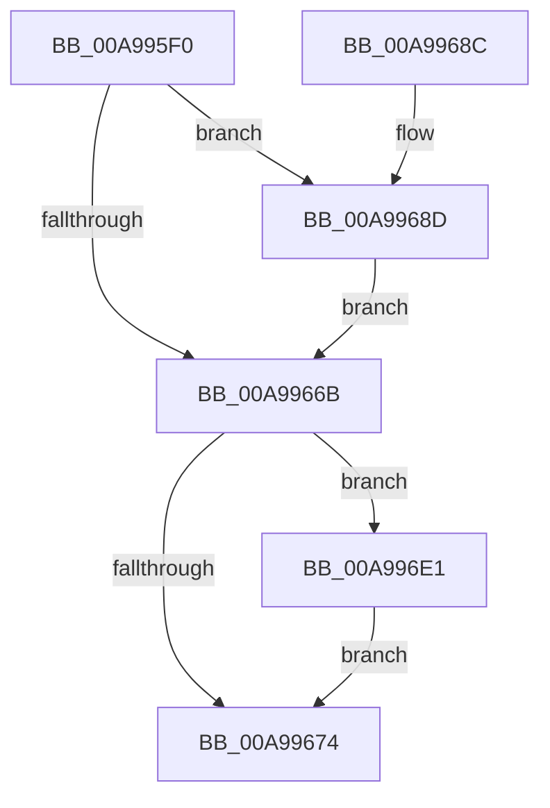

# PiDevCfgOpenDriverConfiguration

- RVA: `0x00A995F0`–`0x00A996E8` (길이 `248` bytes)
- VA: `0x0000000140A995F0`
- 실행 섹션: `PAGE`
- PDB 이름 있음: `예`; PDB Function 태그: `아니요`
- unwind 정보 RVA: `0x000BA1F8`
- 디코드: `63`개 명령, `248/248` bytes 표시
- 미해석 바이트: `0` (있으면 어셈블리에 `.byte`로 보존)

> 이 문서는 커널 이미지의 기계어와 PDB 기호를 분석해 생성했습니다. 4번과 5번은 함수 원형과 자료형을 바이너리 사용 방식에서 추정한 C 해석이며 원본 소스 복구 결과는 아닙니다.

## 1. Dependencies

- 직접 호출 지점: **4**; 고유 호출 대상: **3**
- 직접 호출자로 확인된 함수: **2**
- RIP 상대 이미지 참조: **1**

### Outgoing calls
- `0x00A99660` → [ZwOpenKey](../../text/6A/ZwOpenKey_function_006AD310.md) (function, `0x006AD310`)
- `0x00A99694` → [RtlInitUnicodeString](../../text/42/RtlInitUnicodeString_function_0042A780.md) (function, `0x0042A780`)
- `0x00A996D8` → [ZwOpenKey](../../text/6A/ZwOpenKey_function_006AD310.md) (function, `0x006AD310`)
- `0x00A996E1` → [ZwClose](../../text/6A/ZwClose_function_006AD2B0.md) (function, `0x006AD2B0`)

### Direct callers
- [PiDevCfgQueryDriverNode](../73/PiDevCfgQueryDriverNode_function_0073435C.md) at `0x00734AB1`
- [PiDevCfgQueryIncludedDriverNode](../73/PiDevCfgQueryIncludedDriverNode_function_00734D88.md) at `0x00734DF2`
- [PiDevCfgQueryIncludedDriverNode](../73/PiDevCfgQueryIncludedDriverNode_function_00734D88.md) at `0x00734EA3`
- [PiDevCfgQueryIncludedDriverNode](../73/PiDevCfgQueryIncludedDriverNode_function_00734D88.md) at `0x00734EDC`
- [PiDevCfgQueryIncludedDriverNode](../73/PiDevCfgQueryIncludedDriverNode_function_00734D88.md) at `0x00734FC0`

### Static image references
- `0x00A9960B` → RVA `0x00AFEEB0` (` ?? ::NNGAKEGL::`string'`; read)

## 2. Other-region calls and transfers

- 다른 실행 섹션으로 향하는 call: **4**
  - `0x00A99660` → [ZwOpenKey](../../text/6A/ZwOpenKey_function_006AD310.md) (`PAGE` → `.text`)
  - `0x00A99694` → [RtlInitUnicodeString](../../text/42/RtlInitUnicodeString_function_0042A780.md) (`PAGE` → `.text`)
  - `0x00A996D8` → [ZwOpenKey](../../text/6A/ZwOpenKey_function_006AD310.md) (`PAGE` → `.text`)
  - `0x00A996E1` → [ZwClose](../../text/6A/ZwClose_function_006AD2B0.md) (`PAGE` → `.text`)
- 별도 외부 분기/꼬리 이동을 확인하지 못했습니다.

## 3. Assembly (complete function range)

```asm
00A995F0  48 89 5C 24 10                  mov qword ptr [rsp + 0x10], rbx
00A995F5  48 89 74 24 18                  mov qword ptr [rsp + 0x18], rsi
00A995FA  48 89 7C 24 20                  mov qword ptr [rsp + 0x20], rdi
00A995FF  55                              push rbp
00A99600  48 8B EC                        mov rbp, rsp
00A99603  48 83 EC 60                     sub rsp, 0x60
00A99607  83 65 C4 00                     and dword ptr [rbp - 0x3c], 0
00A9960B  48 8D 05 9E 58 06 00            lea rax, [rip + 0x6589e]
00A99612  83 65 EC 00                     and dword ptr [rbp - 0x14], 0
00A99616  49 8B F8                        mov rdi, r8
00A99619  48 83 65 10 00                  and qword ptr [rbp + 0x10], 0
00A9961E  4C 8D 45 D0                     lea r8, [rbp - 0x30]
00A99622  48 89 45 C8                     mov qword ptr [rbp - 0x38], rax
00A99626  48 8B F2                        mov rsi, rdx
00A99629  48 8D 45 C0                     lea rax, [rbp - 0x40]
00A9962D  48 89 4D D8                     mov qword ptr [rbp - 0x28], rcx
00A99631  0F 57 C0                        xorps xmm0, xmm0
00A99634  48 C7 45 D0 30 00 00 00         mov qword ptr [rbp - 0x30], 0x30
00A9963C  83 65 D4 00                     and dword ptr [rbp - 0x2c], 0
00A99640  48 8D 4D 10                     lea rcx, [rbp + 0x10]
00A99644  BA 19 00 02 00                  mov edx, 0x20019
00A99649  48 89 45 E0                     mov qword ptr [rbp - 0x20], rax
00A9964D  C7 45 C0 1C 00 1E 00            mov dword ptr [rbp - 0x40], 0x1e001c
00A99654  C7 45 E8 40 02 00 00            mov dword ptr [rbp - 0x18], 0x240
00A9965B  F3 0F 7F 45 F0                  movdqu xmmword ptr [rbp - 0x10], xmm0
00A99660  E8 AB 3C C1 FF                  call 0x1406ad310
00A99665  8B D8                           mov ebx, eax
00A99667  85 C0                           test eax, eax
00A99669  79 22                           jns 0x140a9968d
00A9966B  48 8B 4D 10                     mov rcx, qword ptr [rbp + 0x10]
00A9966F  48 85 C9                        test rcx, rcx
00A99672  75 6D                           jne 0x140a996e1
00A99674  4C 8D 5C 24 60                  lea r11, [rsp + 0x60]
00A99679  8B C3                           mov eax, ebx
00A9967B  49 8B 5B 18                     mov rbx, qword ptr [r11 + 0x18]
00A9967F  49 8B 73 20                     mov rsi, qword ptr [r11 + 0x20]
00A99683  49 8B 7B 28                     mov rdi, qword ptr [r11 + 0x28]
00A99687  49 8B E3                        mov rsp, r11
00A9968A  5D                              pop rbp
00A9968B  C3                              ret
00A9968C  CC                              int3
00A9968D  48 8B D6                        mov rdx, rsi
00A99690  48 8D 4D C0                     lea rcx, [rbp - 0x40]
00A99694  E8 E7 10 99 FF                  call 0x14042a780
00A99699  48 8B 45 10                     mov rax, qword ptr [rbp + 0x10]
00A9969D  4C 8D 45 D0                     lea r8, [rbp - 0x30]
00A996A1  83 65 EC 00                     and dword ptr [rbp - 0x14], 0
00A996A5  0F 57 C0                        xorps xmm0, xmm0
00A996A8  48 83 27 00                     and qword ptr [rdi], 0
00A996AC  BA 19 00 02 00                  mov edx, 0x20019
00A996B1  48 89 45 D8                     mov qword ptr [rbp - 0x28], rax
00A996B5  48 8B CF                        mov rcx, rdi
00A996B8  48 8D 45 C0                     lea rax, [rbp - 0x40]
00A996BC  48 C7 45 D0 30 00 00 00         mov qword ptr [rbp - 0x30], 0x30
00A996C4  83 65 D4 00                     and dword ptr [rbp - 0x2c], 0
00A996C8  48 89 45 E0                     mov qword ptr [rbp - 0x20], rax
00A996CC  C7 45 E8 40 02 00 00            mov dword ptr [rbp - 0x18], 0x240
00A996D3  F3 0F 7F 45 F0                  movdqu xmmword ptr [rbp - 0x10], xmm0
00A996D8  E8 33 3C C1 FF                  call 0x1406ad310
00A996DD  8B D8                           mov ebx, eax
00A996DF  EB 8A                           jmp 0x140a9966b
00A996E1  E8 CA 3B C1 FF                  call 0x1406ad2b0
00A996E6  EB 8C                           jmp 0x140a99674
```

## 4. C-style interpretation (structured pseudocode)

```c
__int64 __fastcall PiDevCfgOpenDriverConfiguration(__int64 a1, __int64 a2, __int64 a3)
{
    __int64 result;
    __int64 v_rsp;
    unsigned __int64 v_stack_m18;
    unsigned int v_stack_m1C;
    unsigned int v_stack_m20;
    unsigned __int64 v_stack_m28;
    unsigned __int64 v_stack_m30;
    unsigned int v_stack_m34;
    unsigned __int64 v_stack_m38;
    unsigned __int64 v_stack_m40;
    unsigned int v_stack_m44;
    unsigned __int64 v_stack_m48;
    unsigned __int64 v_stack_m8;
    unsigned __int64 v_stack_p10;
    unsigned __int64 v_stack_p18;
    unsigned __int64 v_stack_p20;
    unsigned __int64 v_stack_p8;

    v_stack_p10 = v_rbx;
    v_stack_p18 = v_rsi;
    v_stack_p20 = v_rdi;
    v_rsp = (v_rsp) - (96);
    v_stack_m40 = v_rip + 415902;
    v_stack_m30 = a1;
    v_stack_m38 = 48;
    v_stack_m28 = v_stack_m48;
    v_stack_m48 = 0x1E001CULL;
    v_stack_m20 = 576;
    v_stack_m18 = v_xmm0;
    result = ZwOpenKey(v_stack_p8, (unsigned int)(0x20019ULL), v_stack_m38, a4);
    if (!sign_flag) goto loc_00A9968D;
loc_00A9966B:
    if (v_stack_p8 != 0) goto loc_00A996E1;
loc_00A99674:
    return (unsigned int)((unsigned int)((unsigned int)((unsigned int)(result))));
loc_00A9968D:
    result = RtlInitUnicodeString(v_stack_m48, *(unsigned __int64 *)(v_stack_m8 + 32), v_stack_m38, a4);
    v_stack_m30 = v_stack_p8;
    v_stack_m38 = 48;
    v_stack_m28 = v_stack_m48;
    v_stack_m20 = 576;
    v_stack_m18 = v_xmm0;
    result = ZwOpenKey(*(unsigned __int64 *)(v_stack_m8 + 40), (unsigned int)(0x20019ULL), v_stack_m38, a4);
    goto loc_00A9966B;
loc_00A996E1:
    result = ZwClose(*(unsigned __int64 *)(v_stack_m8 + 40), (unsigned int)(0x20019ULL), v_stack_m38, a4);
    goto loc_00A99674;
}
```

## 5. (Beta) C Style

```c
int64_t PiDevCfgOpenDriverConfiguration(int64_t Arg1, int64_t Arg2, void *Arg3)
{
    uint8_t *arg3 = (uint8_t *)Arg3;

    int64_t result;
    int64_t local_rsp;
    uint64_t v_stack_m18;
    uint32_t v_stack_m1C;
    uint32_t v_stack_m20;
    uint64_t v_stack_m28;
    uint64_t v_stack_m30;
    uint32_t v_stack_m34;
    uint64_t v_stack_m38;
    uint64_t v_stack_m40;
    uint32_t v_stack_m44;
    uint64_t v_stack_m48;
    uint64_t v_stack_m8;
    uint64_t v_stack_p10;
    uint64_t v_stack_p18;
    uint64_t v_stack_p20;
    uint64_t v_stack_p8;

    v_stack_p10 = local_rbx;
    v_stack_p18 = local_rsi;
    v_stack_p20 = local_rdi;
    local_rsp = (local_rsp) - (96);
    v_stack_m40 = v_rip + 415902;
    v_stack_m30 = Arg1;
    v_stack_m38 = 48;
    v_stack_m28 = v_stack_m48;
    v_stack_m48 = 0x1E001CULL;
    v_stack_m20 = 576;
    v_stack_m18 = v_xmm0;
    result = ZwOpenKey(v_stack_p8, (uint32_t)(0x20019ULL), v_stack_m38, a4);
    if (!sign_flag) goto loc_00A9968D;
loc_00A9966B:
    if (v_stack_p8 != 0) goto loc_00A996E1;
loc_00A99674:
    return (uint32_t)((uint32_t)((uint32_t)((uint32_t)(result))));
loc_00A9968D:
    result = RtlInitUnicodeString(v_stack_m48, *(uint64_t *)(v_stack_m8 + 0x20), v_stack_m38, a4);
    v_stack_m30 = v_stack_p8;
    v_stack_m38 = 48;
    v_stack_m28 = v_stack_m48;
    v_stack_m20 = 576;
    v_stack_m18 = v_xmm0;
    result = ZwOpenKey(*(uint64_t *)(v_stack_m8 + 0x28), (uint32_t)(0x20019ULL), v_stack_m38, a4);
    goto loc_00A9966B;
loc_00A996E1:
    result = ZwClose(*(uint64_t *)(v_stack_m8 + 0x28), (uint32_t)(0x20019ULL), v_stack_m38, a4);
    goto loc_00A99674;
}
```

### 관측된 메모리 오프셋

구조체 형식이 확인되지 않은 접근은 인자 기준의 오프셋으로만 기록했습니다.

| 기준 인자 | 오프셋 표현 | 폭 (bit) | 접근 |
|---|---:|---:|---|
| `Arg3` | `+ 0x0` | `64` | `R/W` |

## 6. Execution-region graph

[열기: 2D/3D 그래프와 함수 탐색 컨트롤 패널](../../../control-panel.html?section=page&rva=0x00A995F0&view=graph)

- 2D 그래프는 위에서 아래로 흐르고, 3D 그래프는 빈 공간을 드래그해 회전합니다. Shift+드래그는 이동, 휠은 확대·축소, 함수 노드 선택은 대상 보고서 이동입니다.

### Static fallback


