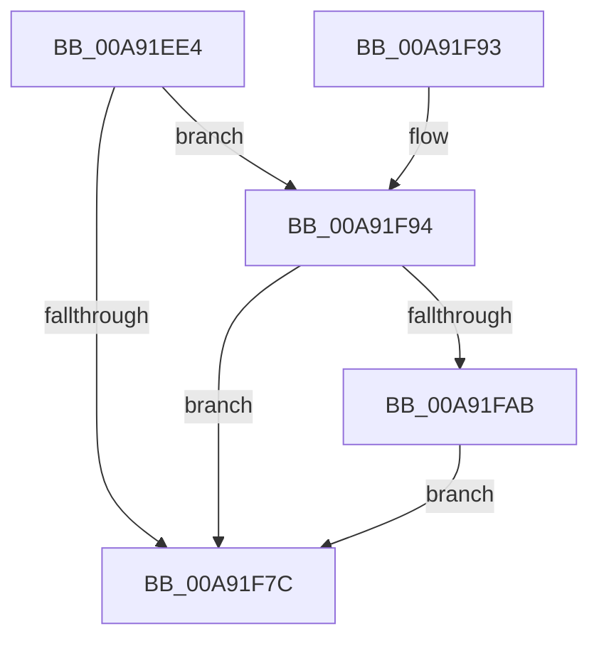

# PiDrvDbLoadHive

- RVA: `0x00A91EE4`–`0x00A91FB8` (길이 `212` bytes)
- VA: `0x0000000140A91EE4`
- 실행 섹션: `PAGE`
- PDB 이름 있음: `예`; PDB Function 태그: `아니요`
- unwind 정보 RVA: `0x000B92BC`
- 디코드: `55`개 명령, `212/212` bytes 표시
- 미해석 바이트: `0` (있으면 어셈블리에 `.byte`로 보존)

> 이 문서는 커널 이미지의 기계어와 PDB 기호를 분석해 생성했습니다. 4번과 5번은 함수 원형과 자료형을 바이너리 사용 방식에서 추정한 C 해석이며 원본 소스 복구 결과는 아닙니다.

## 1. Dependencies

- 직접 호출 지점: **3**; 고유 호출 대상: **3**
- 직접 호출자로 확인된 함수: **2**
- RIP 상대 이미지 참조: **0**

### Outgoing calls
- `0x00A91F71` → [ZwLoadKeyEx](../../text/6A/ZwLoadKeyEx_function_006AF330.md) (function, `0x006AF330`)
- `0x00A91FA0` → [ZwOpenKey](../../text/6A/ZwOpenKey_function_006AD310.md) (function, `0x006AD310`)
- `0x00A91FB1` → [ZwUnloadKey2](../../text/6B/ZwUnloadKey2_function_006B0C50.md) (function, `0x006B0C50`)

### Direct callers
- [PiDrvDbSetupNodeHive](../74/PiDrvDbSetupNodeHive_function_00743884.md) at `0x00743BDE`
- [PiDrvDbLoadNodeWorkerCallback](PiDrvDbLoadNodeWorkerCallback_function_00A91D40.md) at `0x00A91D9B`

### Static image references
- 디코드된 RIP-relative 메모리 참조가 없습니다.

## 2. Other-region calls and transfers

- 다른 실행 섹션으로 향하는 call: **3**
  - `0x00A91F71` → [ZwLoadKeyEx](../../text/6A/ZwLoadKeyEx_function_006AF330.md) (`PAGE` → `.text`)
  - `0x00A91FA0` → [ZwOpenKey](../../text/6A/ZwOpenKey_function_006AD310.md) (`PAGE` → `.text`)
  - `0x00A91FB1` → [ZwUnloadKey2](../../text/6B/ZwUnloadKey2_function_006B0C50.md) (`PAGE` → `.text`)
- 별도 외부 분기/꼬리 이동을 확인하지 못했습니다.

## 3. Assembly (complete function range)

```asm
00A91EE4  4C 8B DC                        mov r11, rsp
00A91EE7  49 89 5B 08                     mov qword ptr [r11 + 8], rbx
00A91EEB  49 89 7B 10                     mov qword ptr [r11 + 0x10], rdi
00A91EEF  55                              push rbp
00A91EF0  49 8D 6B A1                     lea rbp, [r11 - 0x5f]
00A91EF4  48 81 EC A0 00 00 00            sub rsp, 0xa0
00A91EFB  49 83 63 90 00                  and qword ptr [r11 - 0x70], 0
00A91F00  B8 40 02 00 00                  mov eax, 0x240
00A91F05  49 83 63 88 00                  and qword ptr [r11 - 0x78], 0
00A91F0A  0F 57 C0                        xorps xmm0, xmm0
00A91F0D  49 83 21 00                     and qword ptr [r9], 0
00A91F11  49 8B F9                        mov rdi, r9
00A91F14  83 64 24 28 00                  and dword ptr [rsp + 0x28], 0
00A91F19  41 0F BA E8 07                  bts r8d, 7
00A91F1E  48 83 64 24 20 00               and qword ptr [rsp + 0x20], 0
00A91F24  45 33 C9                        xor r9d, r9d
00A91F27  83 65 13 00                     and dword ptr [rbp + 0x13], 0
00A91F2B  83 65 43 00                     and dword ptr [rbp + 0x43], 0
00A91F2F  48 83 65 FF 00                  and qword ptr [rbp - 1], 0
00A91F34  48 83 65 2F 00                  and qword ptr [rbp + 0x2f], 0
00A91F39  48 89 4D 07                     mov qword ptr [rbp + 7], rcx
00A91F3D  48 8D 4D F7                     lea rcx, [rbp - 9]
00A91F41  48 89 55 37                     mov qword ptr [rbp + 0x37], rdx
00A91F45  48 8D 55 27                     lea rdx, [rbp + 0x27]
00A91F49  48 C7 45 F7 30 00 00 00         mov qword ptr [rbp - 9], 0x30
00A91F51  83 65 FB 00                     and dword ptr [rbp - 5], 0
00A91F55  48 C7 45 27 30 00 00 00         mov qword ptr [rbp + 0x27], 0x30
00A91F5D  83 65 2B 00                     and dword ptr [rbp + 0x2b], 0
00A91F61  89 45 0F                        mov dword ptr [rbp + 0xf], eax
00A91F64  F3 0F 7F 45 17                  movdqu xmmword ptr [rbp + 0x17], xmm0
00A91F69  89 45 3F                        mov dword ptr [rbp + 0x3f], eax
00A91F6C  F3 0F 7F 45 47                  movdqu xmmword ptr [rbp + 0x47], xmm0
00A91F71  E8 BA D3 C1 FF                  call 0x1406af330
00A91F76  8B D8                           mov ebx, eax
00A91F78  85 C0                           test eax, eax
00A91F7A  79 18                           jns 0x140a91f94
00A91F7C  4C 8D 9C 24 A0 00 00 00         lea r11, [rsp + 0xa0]
00A91F84  8B C3                           mov eax, ebx
00A91F86  49 8B 5B 10                     mov rbx, qword ptr [r11 + 0x10]
00A91F8A  49 8B 7B 18                     mov rdi, qword ptr [r11 + 0x18]
00A91F8E  49 8B E3                        mov rsp, r11
00A91F91  5D                              pop rbp
00A91F92  C3                              ret
00A91F93  CC                              int3
00A91F94  4C 8D 45 F7                     lea r8, [rbp - 9]
00A91F98  BA 00 00 00 02                  mov edx, 0x2000000
00A91F9D  48 8B CF                        mov rcx, rdi
00A91FA0  E8 6B B3 C1 FF                  call 0x1406ad310
00A91FA5  8B D8                           mov ebx, eax
00A91FA7  85 C0                           test eax, eax
00A91FA9  79 D1                           jns 0x140a91f7c
00A91FAB  33 D2                           xor edx, edx
00A91FAD  48 8D 4D F7                     lea rcx, [rbp - 9]
00A91FB1  E8 9A EC C1 FF                  call 0x1406b0c50
00A91FB6  EB C4                           jmp 0x140a91f7c
```

## 4. C-style interpretation (structured pseudocode)

```c
__int64 __fastcall PiDrvDbLoadHive(__int64 a1, __int64 a2, int a3, __int64 a4)
{
    __int64 result;
    __int64 v_rsp;
    unsigned __int64 v_stack_m8;
    unsigned int v_stack_m80;
    unsigned __int64 v_stack_m88;

    *(unsigned __int64 *)(v_rsp + 8) = v_rbx;
    *(unsigned __int64 *)(v_rsp + 16) = v_rdi;
    v_rsp = (v_rsp) - (160);
    a4 = 0;
    *(unsigned __int64 *)(v_rsp - 95 + 7) = a1;
    *(unsigned __int64 *)(v_rsp - 95 + 55) = a2;
    *(unsigned __int64 *)(v_rsp - 95 - 9) = 48;
    *(unsigned __int64 *)(v_rsp - 95 + 39) = 48;
    *(unsigned int *)(v_rsp - 95 + 15) = 576;
    *(unsigned __int64 *)(v_rsp - 95 + 23) = v_xmm0;
    *(unsigned int *)(v_rsp - 95 + 63) = 576;
    *(unsigned __int64 *)(v_rsp - 95 + 71) = v_xmm0;
    result = ZwLoadKeyEx(v_rsp - 95 - 9, v_rsp - 95 + 39, a3, a4);
    if (!sign_flag) goto loc_00A91F94;
loc_00A91F7C:
    return (unsigned int)((unsigned int)((unsigned int)((unsigned int)(result))));
loc_00A91F94:
    result = ZwOpenKey(*(unsigned __int64 *)(v_stack_m8 + 24), (unsigned int)(0x2000000ULL), v_rsp - 95 - 9, a4);
    if (!sign_flag) goto loc_00A91F7C;
    a2 = 0;
    result = ZwUnloadKey2(v_rsp - 95 - 9, a2, v_rsp - 95 - 9, a4);
    goto loc_00A91F7C;
}
```

## 5. (Beta) C Style

```c
int64_t PiDrvDbLoadHive(int64_t Arg1, int64_t Arg2, int32_t Arg3, void *Arg4)
{
    uint8_t *arg4 = (uint8_t *)Arg4;

    int64_t result;
    int64_t local_rsp;
    uint64_t v_stack_m8;
    uint32_t v_stack_m80;
    uint64_t v_stack_m88;

    *(uint64_t *)(local_rsp + 0x8) = local_rbx;
    *(uint64_t *)(local_rsp + 0x10) = local_rdi;
    local_rsp = (local_rsp) - (160);
    Arg4 = 0;
    *(uint64_t *)(local_rsp - 0x5F + 0x7) = Arg1;
    *(uint64_t *)(local_rsp - 0x5F + 0x37) = Arg2;
    *(uint64_t *)(local_rsp - 0x5F - 0x9) = 48;
    *(uint64_t *)(local_rsp - 0x5F + 0x27) = 48;
    *(uint32_t *)(local_rsp - 0x5F + 0xF) = 576;
    *(uint64_t *)(local_rsp - 0x5F + 0x17) = v_xmm0;
    *(uint32_t *)(local_rsp - 0x5F + 0x3F) = 576;
    *(uint64_t *)(local_rsp - 0x5F + 0x47) = v_xmm0;
    result = ZwLoadKeyEx(local_rsp - 95 - 9, local_rsp - 95 + 39, Arg3, Arg4);
    if (!sign_flag) goto loc_00A91F94;
loc_00A91F7C:
    return (uint32_t)((uint32_t)((uint32_t)((uint32_t)(result))));
loc_00A91F94:
    result = ZwOpenKey(*(uint64_t *)(v_stack_m8 + 0x18), (uint32_t)(0x2000000ULL), local_rsp - 95 - 9, Arg4);
    if (!sign_flag) goto loc_00A91F7C;
    Arg2 = 0;
    result = ZwUnloadKey2(local_rsp - 95 - 9, Arg2, local_rsp - 95 - 9, Arg4);
    goto loc_00A91F7C;
}
```

### 관측된 메모리 오프셋

구조체 형식이 확인되지 않은 접근은 인자 기준의 오프셋으로만 기록했습니다.

| 기준 인자 | 오프셋 표현 | 폭 (bit) | 접근 |
|---|---:|---:|---|
| `Arg4` | `+ 0x0` | `64` | `R/W` |

## 6. Execution-region graph

[열기: 2D/3D 그래프와 함수 탐색 컨트롤 패널](../../../control-panel.html?section=page&rva=0x00A91EE4&view=graph)

- 2D 그래프는 위에서 아래로 흐르고, 3D 그래프는 빈 공간을 드래그해 회전합니다. Shift+드래그는 이동, 휠은 확대·축소, 함수 노드 선택은 대상 보고서 이동입니다.

### Static fallback


