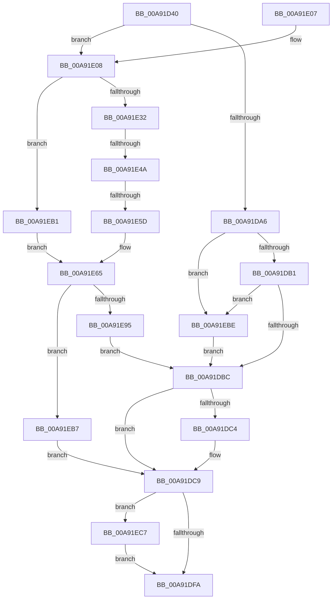

# PiDrvDbLoadNodeWorkerCallback

- RVA: `0x00A91D40`–`0x00A91EDE` (길이 `414` bytes)
- VA: `0x0000000140A91D40`
- 실행 섹션: `PAGE`
- PDB 이름 있음: `예`; PDB Function 태그: `예`
- unwind 정보 RVA: `0x000B9294`
- 디코드: `104`개 명령, `414/414` bytes 표시
- 미해석 바이트: `0` (있으면 어셈블리에 `.byte`로 보존)

> 이 문서는 커널 이미지의 기계어와 PDB 기호를 분석해 생성했습니다. 4번과 5번은 함수 원형과 자료형을 바이너리 사용 방식에서 추정한 C 해석이며 원본 소스 복구 결과는 아닙니다.

## 1. Dependencies

- 직접 호출 지점: **11**; 고유 호출 대상: **9**
- 직접 호출자로 확인된 함수: **0**
- RIP 상대 이미지 참조: **5**

### Outgoing calls
- `0x00A91D75` → [PnpDiagnosticTraceObject](../../text/26/PnpDiagnosticTraceObject_function_0026E834.md) (function, `0x0026E834`)
- `0x00A91D84` → [PnpDiagnosticTraceObject](../../text/26/PnpDiagnosticTraceObject_function_0026E834.md) (function, `0x0026E834`)
- `0x00A91D9B` → [PiDrvDbLoadHive](PiDrvDbLoadHive_function_00A91EE4.md) (function, `0x00A91EE4`)
- `0x00A91DDB` → [KeSetEvent](../../text/33/KeSetEvent_function_0033F310.md) (function, `0x0033F310`)
- `0x00A91DED` → [PnpDiagnosticTraceObjectWithStatus](../../text/4A/PnpDiagnosticTraceObjectWithStatus_function_004A9F58.md) (function, `0x004A9F58`)
- `0x00A91E29` → [SysCtxRegOpenKey](../8E/SysCtxRegOpenKey_function_008ED810.md) (function, `0x008ED810`)
- `0x00A91E69` → [ZwClose](../../text/6A/ZwClose_function_006AD2B0.md) (function, `0x006AD2B0`)
- `0x00A91E77` → [ZwResetEvent](../../text/6B/ZwResetEvent_function_006B01D0.md) (function, `0x006B01D0`)
- `0x00A91E86` → [PiDrvDbUnloadHive](PiDrvDbUnloadHive_function_00A91FC0.md) (function, `0x00A91FC0`)
- `0x00A91E9E` → [ZwSetEvent](../../text/6A/ZwSetEvent_function_006AD290.md) (function, `0x006AD290`)
- `0x00A91ED4` → [PnpDiagnosticTraceObjectWithStatus](../../text/4A/PnpDiagnosticTraceObjectWithStatus_function_004A9F58.md) (function, `0x004A9F58`)

### Direct callers
- 이 함수 시작 RVA로 연결되는 직접 call은 확인되지 않았습니다. 간접 호출은 완전히 역산할 수 없습니다.

### Static image references
- `0x00A91D64` → RVA `0x0001C1C0` (`.rdata`; read)
- `0x00A91D7D` → RVA `0x0001C1D0` (`.rdata`; read)
- `0x00A91DE3` → RVA `0x0001C1B0` (`.rdata`; read)
- `0x00A91E15` → RVA `0x00B00330` (` ?? ::NNGAKEGL::`string'`; read)
- `0x00A91ECA` → RVA `0x00027738` (`.rdata`; read)

## 2. Other-region calls and transfers

- 다른 실행 섹션으로 향하는 call: **8**
  - `0x00A91D75` → [PnpDiagnosticTraceObject](../../text/26/PnpDiagnosticTraceObject_function_0026E834.md) (`PAGE` → `.text`)
  - `0x00A91D84` → [PnpDiagnosticTraceObject](../../text/26/PnpDiagnosticTraceObject_function_0026E834.md) (`PAGE` → `.text`)
  - `0x00A91DDB` → [KeSetEvent](../../text/33/KeSetEvent_function_0033F310.md) (`PAGE` → `.text`)
  - `0x00A91DED` → [PnpDiagnosticTraceObjectWithStatus](../../text/4A/PnpDiagnosticTraceObjectWithStatus_function_004A9F58.md) (`PAGE` → `.text`)
  - `0x00A91E69` → [ZwClose](../../text/6A/ZwClose_function_006AD2B0.md) (`PAGE` → `.text`)
  - `0x00A91E77` → [ZwResetEvent](../../text/6B/ZwResetEvent_function_006B01D0.md) (`PAGE` → `.text`)
  - `0x00A91E9E` → [ZwSetEvent](../../text/6A/ZwSetEvent_function_006AD290.md) (`PAGE` → `.text`)
  - `0x00A91ED4` → [PnpDiagnosticTraceObjectWithStatus](../../text/4A/PnpDiagnosticTraceObjectWithStatus_function_004A9F58.md) (`PAGE` → `.text`)
- call이 아닌 외부 분기/꼬리 이동: **2**
  - `0x00A91E44` → [sub_00B46EDE](../B4/Unknown_function_00B46EDE.md) (`tail-transfer`)
  - `0x00A91E57` → [sub_00B46EDE + 0x88](../B4/Unknown_function_00B46EDE.md) (`tail-transfer`)

## 3. Assembly (complete function range)

```asm
00A91D40  40 55                           push rbp
00A91D42  53                              push rbx
00A91D43  56                              push rsi
00A91D44  57                              push rdi
00A91D45  41 56                           push r14
00A91D47  41 57                           push r15
00A91D49  48 8B EC                        mov rbp, rsp
00A91D4C  48 83 EC 68                     sub rsp, 0x68
00A91D50  48 83 65 50 00                  and qword ptr [rbp + 0x50], 0
00A91D55  48 8D 71 10                     lea rsi, [rcx + 0x10]
00A91D59  83 65 40 00                     and dword ptr [rbp + 0x40], 0
00A91D5D  48 8B D9                        mov rbx, rcx
00A91D60  83 65 48 00                     and dword ptr [rbp + 0x48], 0
00A91D64  48 8D 0D 55 A4 58 FF            lea rcx, [rip - 0xa75bab]
00A91D6B  48 8B D6                        mov rdx, rsi
00A91D6E  C7 45 38 01 00 00 00            mov dword ptr [rbp + 0x38], 1
00A91D75  E8 BA CA 7D FF                  call 0x14026e834
00A91D7A  48 8B D6                        mov rdx, rsi
00A91D7D  48 8D 0D 4C A4 58 FF            lea rcx, [rip - 0xa75bb4]
00A91D84  E8 AB CA 7D FF                  call 0x14026e834
00A91D89  4C 8D 73 20                     lea r14, [rbx + 0x20]
00A91D8D  45 33 C0                        xor r8d, r8d
00A91D90  49 8B CE                        mov rcx, r14
00A91D93  48 8D 53 30                     lea rdx, [rbx + 0x30]
00A91D97  4C 8D 4D 50                     lea r9, [rbp + 0x50]
00A91D9B  E8 44 01 00 00                  call 0x140a91ee4
00A91DA0  8B F8                           mov edi, eax
00A91DA2  85 C0                           test eax, eax
00A91DA4  79 62                           jns 0x140a91e08
00A91DA6  3D 34 00 00 C0                  cmp eax, 0xc0000034
00A91DAB  0F 84 0D 01 00 00               je 0x140a91ebe
00A91DB1  3D 3A 00 00 C0                  cmp eax, 0xc000003a
00A91DB6  0F 84 02 01 00 00               je 0x140a91ebe
00A91DBC  81 FF 89 01 00 C0               cmp edi, 0xc0000189
00A91DC2  75 05                           jne 0x140a91dc9
00A91DC4  BF EB 02 00 C0                  mov edi, 0xc00002eb
00A91DC9  48 8D 8B C8 00 00 00            lea rcx, [rbx + 0xc8]
00A91DD0  89 BB 00 01 00 00               mov dword ptr [rbx + 0x100], edi
00A91DD6  45 33 C0                        xor r8d, r8d
00A91DD9  33 D2                           xor edx, edx
00A91DDB  E8 30 D5 8A FF                  call 0x14033f310
00A91DE0  44 8B C7                        mov r8d, edi
00A91DE3  48 8D 0D C6 A3 58 FF            lea rcx, [rip - 0xa75c3a]
00A91DEA  48 8B D6                        mov rdx, rsi
00A91DED  E8 66 81 A1 FF                  call 0x1404a9f58
00A91DF2  85 FF                           test edi, edi
00A91DF4  0F 88 CD 00 00 00               js 0x140a91ec7
00A91DFA  48 83 C4 68                     add rsp, 0x68
00A91DFE  41 5F                           pop r15
00A91E00  41 5E                           pop r14
00A91E02  5F                              pop rdi
00A91E03  5E                              pop rsi
00A91E04  5B                              pop rbx
00A91E05  5D                              pop rbp
00A91E06  C3                              ret
00A91E07  CC                              int3
00A91E08  48 8B 55 50                     mov rdx, qword ptr [rbp + 0x50]
00A91E0C  4C 8D 7B 48                     lea r15, [rbx + 0x48]
00A91E10  4C 89 7C 24 28                  mov qword ptr [rsp + 0x28], r15
00A91E15  4C 8D 05 14 E5 06 00            lea r8, [rip + 0x6e514]
00A91E1C  45 33 C9                        xor r9d, r9d
00A91E1F  C7 44 24 20 00 00 00 02         mov dword ptr [rsp + 0x20], 0x2000000
00A91E27  33 C9                           xor ecx, ecx
00A91E29  E8 E2 B9 E5 FF                  call 0x1408ed810
00A91E2E  85 C0                           test eax, eax
00A91E30  78 7F                           js 0x140a91eb1
00A91E32  BF FF FF FF FF                  mov edi, 0xffffffff
00A91E37  41 BE 04 00 00 00               mov r14d, 4
00A91E3D  48 39 BB E0 01 00 00            cmp qword ptr [rbx + 0x1e0], rdi
00A91E44  0F 84 94 50 0B 00               je 0x140b46ede
00A91E4A  48 8D BB F0 01 00 00            lea rdi, [rbx + 0x1f0]
00A91E51  81 3F 03 01 00 00               cmp dword ptr [rdi], 0x103
00A91E57  0F 84 09 51 0B 00               je 0x140b46f66
00A91E5D  4C 8D 73 20                     lea r14, [rbx + 0x20]
00A91E61  48 8D 73 10                     lea rsi, [rbx + 0x10]
00A91E65  48 8B 4D 50                     mov rcx, qword ptr [rbp + 0x50]
00A91E69  E8 42 B4 C1 FF                  call 0x1406ad2b0
00A91E6E  48 8B 8B D8 01 00 00            mov rcx, qword ptr [rbx + 0x1d8]
00A91E75  33 D2                           xor edx, edx
00A91E77  E8 54 E3 C1 FF                  call 0x1406b01d0
00A91E7C  48 8B 93 D8 01 00 00            mov rdx, qword ptr [rbx + 0x1d8]
00A91E83  49 8B CE                        mov rcx, r14
00A91E86  E8 35 01 00 00                  call 0x140a91fc0
00A91E8B  44 8B F0                        mov r14d, eax
00A91E8E  3D 03 01 00 00                  cmp eax, 0x103
00A91E93  74 22                           je 0x140a91eb7
00A91E95  48 8B 8B D8 01 00 00            mov rcx, qword ptr [rbx + 0x1d8]
00A91E9C  33 D2                           xor edx, edx
00A91E9E  E8 ED B3 C1 FF                  call 0x1406ad290
00A91EA3  33 FF                           xor edi, edi
00A91EA5  45 85 F6                        test r14d, r14d
00A91EA8  41 0F 49 FE                     cmovns edi, r14d
00A91EAC  E9 0B FF FF FF                  jmp 0x140a91dbc
00A91EB1  C6 43 50 01                     mov byte ptr [rbx + 0x50], 1
00A91EB5  EB AE                           jmp 0x140a91e65
00A91EB7  33 FF                           xor edi, edi
00A91EB9  E9 0B FF FF FF                  jmp 0x140a91dc9
00A91EBE  C6 43 50 01                     mov byte ptr [rbx + 0x50], 1
00A91EC2  E9 F5 FE FF FF                  jmp 0x140a91dbc
00A91EC7  44 8B C7                        mov r8d, edi
00A91ECA  48 8D 0D 67 58 59 FF            lea rcx, [rip - 0xa6a799]
00A91ED1  48 8B D6                        mov rdx, rsi
00A91ED4  E8 7F 80 A1 FF                  call 0x1404a9f58
00A91ED9  E9 1C FF FF FF                  jmp 0x140a91dfa
```

## 4. C-style interpretation (structured pseudocode)

```c
__int64 __fastcall PiDrvDbLoadNodeWorkerCallback(__int64 a1, __int64 a2, int a3)
{
    __int64 result;
    __int64 v_rdi;
    __int64 v_rsp;
    unsigned int v_stack_p10;
    unsigned int v_stack_p18;
    unsigned __int64 v_stack_p20;
    unsigned __int64 v_stack_p28;
    unsigned int v_stack_p8;

    v_rsp = (v_rsp) - (104);
    v_stack_p8 = 1;
    result = PnpDiagnosticTraceObject(v_rip - 10967979, a1 + 16, a3, a4);
    result = PnpDiagnosticTraceObject(v_rip - 10967988, a1 + 16, a3, a4);
    a3 = 0;
    result = PiDrvDbLoadHive(a1 + 32, a1 + 48, a3, v_stack_p20);
    if (!sign_flag) goto loc_00A91E08;
    if (((unsigned int)(result)) == 0xC0000034ULL) goto loc_00A91EBE;
    if (((unsigned int)(result)) == 0xC000003AULL) goto loc_00A91EBE;
loc_00A91DBC:
    v_rdi = (unsigned int)((unsigned int)(result));
    if (((unsigned int)((unsigned int)((unsigned int)(result)))) == 0xC0000189ULL) {
        v_rdi = 0xC00002EBULL;
    }
    *(unsigned int *)(a1 + 256) = (unsigned int)(v_rdi);
    a3 = 0;
    a2 = 0;
    result = KeSetEvent(a1 + 200, a2, a3, v_stack_p20);
    result = PnpDiagnosticTraceObjectWithStatus(v_rip - 10968122, a1 + 16, (unsigned int)((unsigned int)(v_rdi)), v_stack_p20);
    if (sign_flag) goto loc_00A91EC7;
loc_00A91DFA:
    v_rsp = (v_rsp) + (104);
    return result;
loc_00A91E08:
    v_stack_p28 = a1 + 72;
    a4 = 0;
    v_stack_p20 = 0x2000000ULL;
    a1 = 0;
    result = SysCtxRegOpenKey(a1, v_stack_p20, v_rip + 451860, a4);
    if (sign_flag) goto loc_00A91EB1;
loc_00A91E65:
    result = ZwClose(v_stack_p20, v_stack_p20, v_rip + 451860, a4);
    a2 = 0;
    result = ZwResetEvent(*(unsigned __int64 *)(a1 + 472), a2, v_rip + 451860, a4);
    result = PiDrvDbUnloadHive(a1 + 32, *(unsigned __int64 *)(a1 + 472), v_rip + 451860, a4);
    if (((unsigned int)(result)) == 259) goto loc_00A91EB7;
    a2 = 0;
    result = ZwSetEvent(*(unsigned __int64 *)(a1 + 472), a2, v_rip + 451860, a4);
    v_rdi = 0;
    if (!sign_flag) { v_rdi = (unsigned int)((unsigned int)((unsigned int)(result))); }
    goto loc_00A91DBC;
loc_00A91EB1:
    *(unsigned __int8 *)(a1 + 80) = 1;
    goto loc_00A91E65;
loc_00A91EB7:
    v_rdi = 0;
    goto loc_00A91DC9;
loc_00A91EBE:
    *(unsigned __int8 *)(a1 + 80) = 1;
    goto loc_00A91DBC;
loc_00A91EC7:
    result = PnpDiagnosticTraceObjectWithStatus(v_rip - 10921881, a1 + 16, 0, a4);
    goto loc_00A91DFA;
}
```

## 5. (Beta) C Style

```c
int64_t PiDrvDbLoadNodeWorkerCallback(void *Arg1, int64_t Arg2, int32_t Arg3)
{
    uint8_t *arg1 = (uint8_t *)Arg1;

    int64_t result;
    int64_t local_rdi;
    int64_t local_rsp;
    uint32_t v_stack_p10;
    uint32_t v_stack_p18;
    uint64_t v_stack_p20;
    uint64_t v_stack_p28;
    uint32_t v_stack_p8;

    local_rsp = (local_rsp) - (104);
    v_stack_p8 = 1;
    result = PnpDiagnosticTraceObject(v_rip - 10967979, Arg1 + 16, Arg3, a4);
    result = PnpDiagnosticTraceObject(v_rip - 10967988, Arg1 + 16, Arg3, a4);
    Arg3 = 0;
    result = PiDrvDbLoadHive(Arg1 + 32, Arg1 + 48, Arg3, v_stack_p20);
    if (!sign_flag) goto loc_00A91E08;
    if (((uint32_t)(result)) == 0xC0000034ULL) goto loc_00A91EBE;
    if (((uint32_t)(result)) == 0xC000003AULL) goto loc_00A91EBE;
loc_00A91DBC:
    local_rdi = (uint32_t)((uint32_t)(result));
    if (((uint32_t)((uint32_t)((uint32_t)(result)))) == 0xC0000189ULL) {
        local_rdi = 0xC00002EBULL;
    }
    *(uint32_t *)(arg1 + 0x100) = (uint32_t)(local_rdi);
    Arg3 = 0;
    Arg2 = 0;
    result = KeSetEvent(Arg1 + 200, Arg2, Arg3, v_stack_p20);
    result = PnpDiagnosticTraceObjectWithStatus(v_rip - 10968122, Arg1 + 16, (uint32_t)((uint32_t)(local_rdi)), v_stack_p20);
    if (sign_flag) goto loc_00A91EC7;
loc_00A91DFA:
    local_rsp = (local_rsp) + (104);
    return result;
loc_00A91E08:
    v_stack_p28 = Arg1 + 72;
    a4 = 0;
    v_stack_p20 = 0x2000000ULL;
    Arg1 = 0;
    result = SysCtxRegOpenKey(Arg1, v_stack_p20, v_rip + 451860, a4);
    if (sign_flag) goto loc_00A91EB1;
loc_00A91E65:
    result = ZwClose(v_stack_p20, v_stack_p20, v_rip + 451860, a4);
    Arg2 = 0;
    result = ZwResetEvent(*(uint64_t *)(arg1 + 0x1D8), Arg2, v_rip + 451860, a4);
    result = PiDrvDbUnloadHive(Arg1 + 32, *(uint64_t *)(arg1 + 0x1D8), v_rip + 451860, a4);
    if (((uint32_t)(result)) == 259) goto loc_00A91EB7;
    Arg2 = 0;
    result = ZwSetEvent(*(uint64_t *)(arg1 + 0x1D8), Arg2, v_rip + 451860, a4);
    local_rdi = 0;
    if (!sign_flag) { local_rdi = (uint32_t)((uint32_t)((uint32_t)(result))); }
    goto loc_00A91DBC;
loc_00A91EB1:
    *(uint8_t *)(arg1 + 0x50) = 1;
    goto loc_00A91E65;
loc_00A91EB7:
    local_rdi = 0;
    goto loc_00A91DC9;
loc_00A91EBE:
    *(uint8_t *)(arg1 + 0x50) = 1;
    goto loc_00A91DBC;
loc_00A91EC7:
    result = PnpDiagnosticTraceObjectWithStatus(v_rip - 10921881, Arg1 + 16, 0, a4);
    goto loc_00A91DFA;
}
```

### 관측된 메모리 오프셋

구조체 형식이 확인되지 않은 접근은 인자 기준의 오프셋으로만 기록했습니다.

| 기준 인자 | 오프셋 표현 | 폭 (bit) | 접근 |
|---|---:|---:|---|
| `Arg1` | `+ 0x0` | `32` | `R` |
| `Arg1` | `+ 0x10` | `64` | `R` |
| `Arg1` | `+ 0x20` | `64` | `R` |
| `Arg1` | `+ 0x30` | `64` | `R` |
| `Arg1` | `+ 0x48` | `64` | `R` |
| `Arg1` | `+ 0x50` | `8` | `W` |
| `Arg1` | `+ 0xC8` | `64` | `R` |
| `Arg1` | `+ 0x100` | `32` | `W` |
| `Arg1` | `+ 0x1D8` | `64` | `R` |
| `Arg1` | `+ 0x1E0` | `64` | `R` |
| `Arg1` | `+ 0x1F0` | `64` | `R` |

## 6. Execution-region graph

[열기: 2D/3D 그래프와 함수 탐색 컨트롤 패널](../../../control-panel.html?section=page&rva=0x00A91D40&view=graph)

- 2D 그래프는 위에서 아래로 흐르고, 3D 그래프는 빈 공간을 드래그해 회전합니다. Shift+드래그는 이동, 휠은 확대·축소, 함수 노드 선택은 대상 보고서 이동입니다.

### Static fallback


