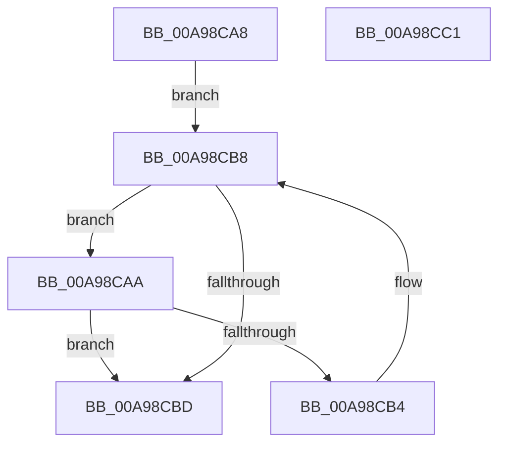

# PiHotSwapGetDetachableNode

- RVA: `0x00A98CA8`–`0x00A98CC2` (길이 `26` bytes)
- VA: `0x0000000140A98CA8`
- 실행 섹션: `PAGE`
- PDB 이름 있음: `예`; PDB Function 태그: `아니요`
- unwind 정보 RVA: `0x000DB714`
- 디코드: `10`개 명령, `26/26` bytes 표시
- 미해석 바이트: `0` (있으면 어셈블리에 `.byte`로 보존)

> 이 문서는 커널 이미지의 기계어와 PDB 기호를 분석해 생성했습니다. 4번과 5번은 함수 원형과 자료형을 바이너리 사용 방식에서 추정한 C 해석이며 원본 소스 복구 결과는 아닙니다.

## 1. Dependencies

- 직접 호출 지점: **0**; 고유 호출 대상: **0**
- 직접 호출자로 확인된 함수: **1**
- RIP 상대 이미지 참조: **0**

### Outgoing calls
- 직접 디코드된 call 명령이 없습니다.

### Direct callers
- [PpHotSwapGetDevnodeRemovalPolicy](../8F/PpHotSwapGetDevnodeRemovalPolicy_function_008FB1B4.md) at `0x008FB270`

### Static image references
- 디코드된 RIP-relative 메모리 참조가 없습니다.

## 2. Other-region calls and transfers

- 다른 실행 섹션으로 향하는 call: **0**
- 별도 외부 분기/꼬리 이동을 확인하지 못했습니다.

## 3. Assembly (complete function range)

```asm
00A98CA8  EB 0E                           jmp 0x140a98cb8
00A98CAA  8B 81 30 02 00 00               mov eax, dword ptr [rcx + 0x230]
00A98CB0  A8 18                           test al, 0x18
00A98CB2  75 09                           jne 0x140a98cbd
00A98CB4  48 8B 49 10                     mov rcx, qword ptr [rcx + 0x10]
00A98CB8  48 85 C9                        test rcx, rcx
00A98CBB  75 ED                           jne 0x140a98caa
00A98CBD  48 89 0A                        mov qword ptr [rdx], rcx
00A98CC0  C3                              ret
00A98CC1  CC                              int3
```

## 4. C-style interpretation (structured pseudocode)

```c
__int64 __fastcall PiHotSwapGetDetachableNode(__int64 a1, __int64 a2)
{
    goto loc_00A98CB8;
loc_00A98CAA:
    if ((((unsigned __int8)((unsigned int)(*(unsigned int *)(a1 + 560)))) & (24)) != 0) goto loc_00A98CBD;
loc_00A98CB8:
    if (*(unsigned __int64 *)(a1 + 16) != 0) goto loc_00A98CAA;
loc_00A98CBD:
    *(unsigned __int64 *)(a2) = *(unsigned __int64 *)(a1 + 16);
    return (unsigned int)(*(unsigned int *)(a1 + 560));
}
```

## 5. (Beta) C Style

```c
int64_t PiHotSwapGetDetachableNode(int64_t Arg1, void *Arg2)
{
    uint8_t *arg2 = (uint8_t *)Arg2;

    goto loc_00A98CB8;
loc_00A98CAA:
    if ((((uint8_t)((uint32_t)(*(uint32_t *)(Arg1 + 0x230)))) & (24)) != 0) goto loc_00A98CBD;
loc_00A98CB8:
    if (*(uint64_t *)(Arg1 + 0x10) != 0) goto loc_00A98CAA;
loc_00A98CBD:
    *(uint64_t *)(arg2) = *(uint64_t *)(Arg1 + 0x10);
    return (uint32_t)(*(uint32_t *)(Arg1 + 0x230));
}
```

### 관측된 메모리 오프셋

구조체 형식이 확인되지 않은 접근은 인자 기준의 오프셋으로만 기록했습니다.

| 기준 인자 | 오프셋 표현 | 폭 (bit) | 접근 |
|---|---:|---:|---|
| `Arg2` | `+ 0x0` | `64` | `W` |

## 6. Execution-region graph

[열기: 2D/3D 그래프와 함수 탐색 컨트롤 패널](../../../control-panel.html?section=page&rva=0x00A98CA8&view=graph)

- 2D 그래프는 위에서 아래로 흐르고, 3D 그래프는 빈 공간을 드래그해 회전합니다. Shift+드래그는 이동, 휠은 확대·축소, 함수 노드 선택은 대상 보고서 이동입니다.

### Static fallback


