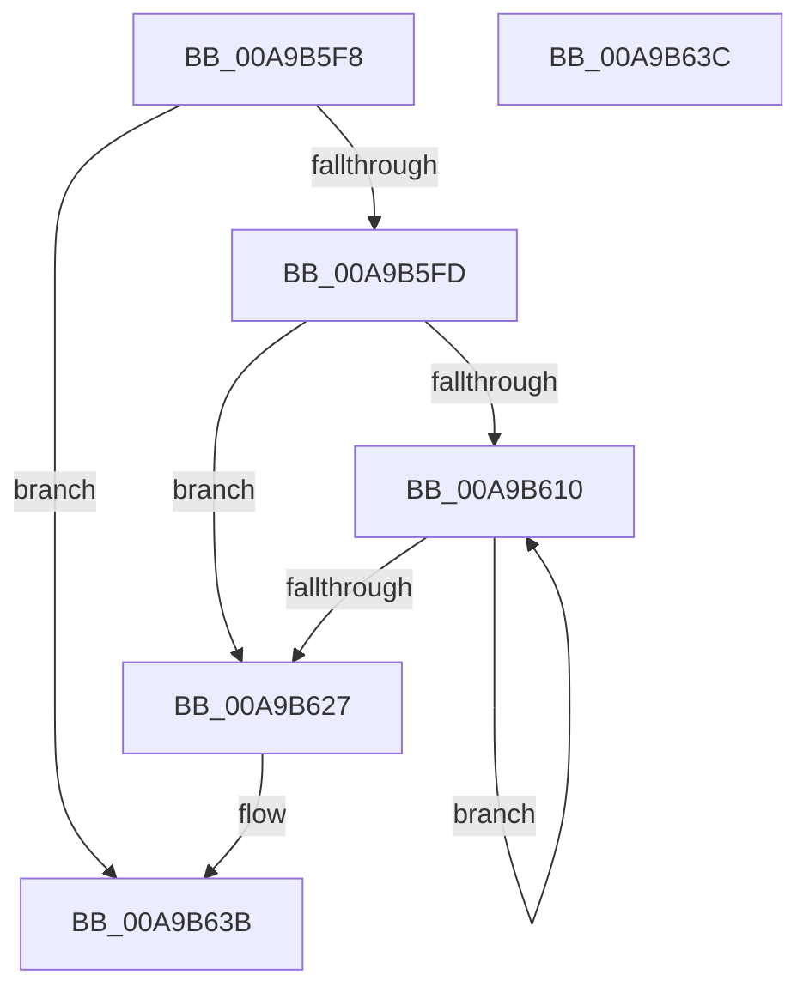

# PiPnpFreePdoDeviceList

- RVA: `0x00A9B5F8`–`0x00A9B63D` (길이 `69` bytes)
- VA: `0x0000000140A9B5F8`
- 실행 섹션: `PAGE`
- PDB 이름 있음: `예`; PDB Function 태그: `아니요`
- unwind 정보 RVA: `0x00084918`
- 디코드: `24`개 명령, `69/69` bytes 표시
- 미해석 바이트: `0` (있으면 어셈블리에 `.byte`로 보존)

> 이 문서는 커널 이미지의 기계어와 PDB 기호를 분석해 생성했습니다. 4번과 5번은 함수 원형과 자료형을 바이너리 사용 방식에서 추정한 C 해석이며 원본 소스 복구 결과는 아닙니다.

## 1. Dependencies

- 직접 호출 지점: **2**; 고유 호출 대상: **2**
- 직접 호출자로 확인된 함수: **2**
- RIP 상대 이미지 참조: **0**

### Outgoing calls
- `0x00A9B61C` → [ObfDereferenceObjectWithTag](../../text/2F/ObfDereferenceObjectWithTag_function_002F78E0.md) (function, `0x002F78E0`)
- `0x00A9B62C` → [ExFreePoolWithTag](../../poolcode/B8/ExFreePoolWithTag_function_00B82870.md) (function, `0x00B82870`)

### Direct callers
- [PnpFreeSystemPdoList](PnpFreeSystemPdoList_function_00A9B5E0.md) at `0x00A9B5E4`
- [PnpGetSystemPdoList](../AC/PnpGetSystemPdoList_function_00AC0780.md) at `0x00AC07F4`

### Static image references
- 디코드된 RIP-relative 메모리 참조가 없습니다.

## 2. Other-region calls and transfers

- 다른 실행 섹션으로 향하는 call: **2**
  - `0x00A9B61C` → [ObfDereferenceObjectWithTag](../../text/2F/ObfDereferenceObjectWithTag_function_002F78E0.md) (`PAGE` → `.text`)
  - `0x00A9B62C` → [ExFreePoolWithTag](../../poolcode/B8/ExFreePoolWithTag_function_00B82870.md) (`PAGE` → `POOLCODE`)
- 별도 외부 분기/꼬리 이동을 확인하지 못했습니다.

## 3. Assembly (complete function range)

```asm
00A9B5F8  48 85 C9                        test rcx, rcx
00A9B5FB  74 3E                           je 0x140a9b63b
00A9B5FD  48 89 5C 24 08                  mov qword ptr [rsp + 8], rbx
00A9B602  57                              push rdi
00A9B603  48 83 EC 20                     sub rsp, 0x20
00A9B607  33 DB                           xor ebx, ebx
00A9B609  48 8B F9                        mov rdi, rcx
00A9B60C  39 19                           cmp dword ptr [rcx], ebx
00A9B60E  76 17                           jbe 0x140a9b627
00A9B610  8B CB                           mov ecx, ebx
00A9B612  BA 50 6E 70 6C                  mov edx, 0x6c706e50
00A9B617  48 8B 4C CF 08                  mov rcx, qword ptr [rdi + rcx*8 + 8]
00A9B61C  E8 BF C2 85 FF                  call 0x1402f78e0
00A9B621  FF C3                           inc ebx
00A9B623  3B 1F                           cmp ebx, dword ptr [rdi]
00A9B625  72 E9                           jb 0x140a9b610
00A9B627  33 D2                           xor edx, edx
00A9B629  48 8B CF                        mov rcx, rdi
00A9B62C  E8 3F 72 0E 00                  call 0x140b82870
00A9B631  48 8B 5C 24 30                  mov rbx, qword ptr [rsp + 0x30]
00A9B636  48 83 C4 20                     add rsp, 0x20
00A9B63A  5F                              pop rdi
00A9B63B  C3                              ret
00A9B63C  CC                              int3
```

## 4. C-style interpretation (structured pseudocode)

```c
__int64 __fastcall PiPnpFreePdoDeviceList(__int64 a1)
{
    __int64 result;
    __int64 v_rbx;
    __int64 v_rsp;
    unsigned __int64 v_stack_p8;

    if (a1 == 0) goto loc_00A9B63B;
    v_stack_p8 = v_rbx;
    v_rsp = (v_rsp) - (32);
    v_rbx = 0;
    if ((*(unsigned int *)(a1)) <= 0) goto loc_00A9B627;
loc_00A9B610:
    result = ObfDereferenceObjectWithTag(*(unsigned __int64 *)(a1 + 0 * 8 + 8), (unsigned int)(0x6C706E50ULL), a3, a4);
    v_rbx = (unsigned int)((v_rbx) + 1);
    if (((unsigned int)(v_rbx)) < (*(unsigned int *)(a1))) goto loc_00A9B610;
loc_00A9B627:
    a2 = 0;
    result = ExFreePoolWithTag(a1, a2, a3, a4);
    v_rsp = (v_rsp) + (32);
loc_00A9B63B:
    return result;
}
```

## 5. (Beta) C Style

```c
int64_t PiPnpFreePdoDeviceList(int64_t Arg1)
{
    int64_t result;
    int64_t local_rbx;
    int64_t local_rsp;
    uint64_t v_stack_p8;

    if (Arg1 == 0) goto loc_00A9B63B;
    v_stack_p8 = local_rbx;
    local_rsp = (local_rsp) - (32);
    local_rbx = 0;
    if ((*(uint32_t *)(Arg1)) <= 0) goto loc_00A9B627;
loc_00A9B610:
    result = ObfDereferenceObjectWithTag(*(uint64_t *)(Arg1 + 0x0 * 8 + 0x8), (uint32_t)(0x6C706E50ULL), a3, a4);
    local_rbx = (uint32_t)((local_rbx) + 1);
    if (((uint32_t)(local_rbx)) < (*(uint32_t *)(Arg1))) goto loc_00A9B610;
loc_00A9B627:
    a2 = 0;
    result = ExFreePoolWithTag(Arg1, a2, a3, a4);
    local_rsp = (local_rsp) + (32);
loc_00A9B63B:
    return result;
}
```

## 6. Execution-region graph

[열기: 2D/3D 그래프와 함수 탐색 컨트롤 패널](../../../control-panel.html?section=page&rva=0x00A9B5F8&view=graph)

- 2D 그래프는 위에서 아래로 흐르고, 3D 그래프는 빈 공간을 드래그해 회전합니다. Shift+드래그는 이동, 휠은 확대·축소, 함수 노드 선택은 대상 보고서 이동입니다.

### Static fallback


