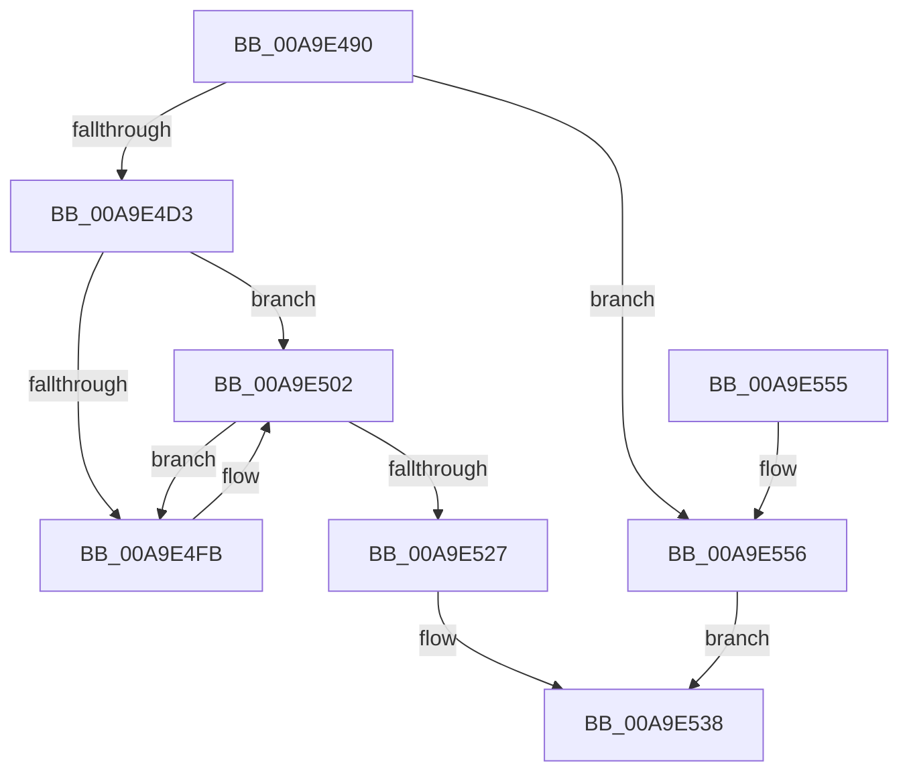

# PiSwAddPdoAssociation

- RVA: `0x00A9E490`–`0x00A9E55D` (길이 `205` bytes)
- VA: `0x0000000140A9E490`
- 실행 섹션: `PAGE`
- PDB 이름 있음: `예`; PDB Function 태그: `아니요`
- unwind 정보 RVA: `0x0006B020`
- 디코드: `54`개 명령, `205/205` bytes 표시
- 미해석 바이트: `0` (있으면 어셈블리에 `.byte`로 보존)

> 이 문서는 커널 이미지의 기계어와 PDB 기호를 분석해 생성했습니다. 4번과 5번은 함수 원형과 자료형을 바이너리 사용 방식에서 추정한 C 해석이며 원본 소스 복구 결과는 아닙니다.

## 1. Dependencies

- 직접 호출 지점: **3**; 고유 호출 대상: **2**
- 직접 호출자로 확인된 함수: **1**
- RIP 상대 이미지 참조: **3**

### Outgoing calls
- `0x00A9E4C2` → [ExAllocatePool2](../../poolcode/B8/ExAllocatePool2_function_00B820F0.md) (function, `0x00B820F0`)
- `0x00A9E4D6` → [ObfReferenceObject](../../text/20/ObfReferenceObject_function_0020FA20.md) (function, `0x0020FA20`)
- `0x00A9E4DE` → [ObfReferenceObject](../../text/20/ObfReferenceObject_function_0020FA20.md) (function, `0x0020FA20`)

### Direct callers
- [PiSwGetChildPdo](../AC/PiSwGetChildPdo_function_00AC3544.md) at `0x00AC37AF`

### Static image references
- `0x00A9E514` → RVA `0x00F8AB98` (`.data`; read)
- `0x00A9E51B` → RVA `0x00F8AB90` (`.data`; read)
- `0x00A9E531` → RVA `0x00F8AB98` (`.data`; write)

## 2. Other-region calls and transfers

- 다른 실행 섹션으로 향하는 call: **3**
  - `0x00A9E4C2` → [ExAllocatePool2](../../poolcode/B8/ExAllocatePool2_function_00B820F0.md) (`PAGE` → `POOLCODE`)
  - `0x00A9E4D6` → [ObfReferenceObject](../../text/20/ObfReferenceObject_function_0020FA20.md) (`PAGE` → `.text`)
  - `0x00A9E4DE` → [ObfReferenceObject](../../text/20/ObfReferenceObject_function_0020FA20.md) (`PAGE` → `.text`)
- 별도 외부 분기/꼬리 이동을 확인하지 못했습니다.

## 3. Assembly (complete function range)

```asm
00A9E490  48 8B C4                        mov rax, rsp
00A9E493  48 89 58 08                     mov qword ptr [rax + 8], rbx
00A9E497  48 89 68 10                     mov qword ptr [rax + 0x10], rbp
00A9E49B  48 89 70 18                     mov qword ptr [rax + 0x18], rsi
00A9E49F  48 89 78 20                     mov qword ptr [rax + 0x20], rdi
00A9E4A3  41 56                           push r14
00A9E4A5  48 83 EC 20                     sub rsp, 0x20
00A9E4A9  49 8B F0                        mov rsi, r8
00A9E4AC  48 8B EA                        mov rbp, rdx
00A9E4AF  4C 8B F1                        mov r14, rcx
00A9E4B2  33 FF                           xor edi, edi
00A9E4B4  B9 00 01 00 00                  mov ecx, 0x100
00A9E4B9  41 B8 50 6E 70 57               mov r8d, 0x57706e50
00A9E4BF  8D 57 30                        lea edx, [rdi + 0x30]
00A9E4C2  E8 29 3C 0E 00                  call 0x140b820f0
00A9E4C7  48 8B D8                        mov rbx, rax
00A9E4CA  48 85 C0                        test rax, rax
00A9E4CD  0F 84 83 00 00 00               je 0x140a9e556
00A9E4D3  48 8B CD                        mov rcx, rbp
00A9E4D6  E8 45 15 77 FF                  call 0x14020fa20
00A9E4DB  48 8B CE                        mov rcx, rsi
00A9E4DE  E8 3D 15 77 FF                  call 0x14020fa20
00A9E4E3  49 8D 86 80 00 00 00            lea rax, [r14 + 0x80]
00A9E4EA  48 89 6B 20                     mov qword ptr [rbx + 0x20], rbp
00A9E4EE  48 89 73 28                     mov qword ptr [rbx + 0x28], rsi
00A9E4F2  48 8B 48 08                     mov rcx, qword ptr [rax + 8]
00A9E4F6  48 39 01                        cmp qword ptr [rcx], rax
00A9E4F9  74 07                           je 0x140a9e502
00A9E4FB  B9 03 00 00 00                  mov ecx, 3
00A9E500  CD 29                           int 0x29
00A9E502  48 89 03                        mov qword ptr [rbx], rax
00A9E505  48 89 4B 08                     mov qword ptr [rbx + 8], rcx
00A9E509  48 89 19                        mov qword ptr [rcx], rbx
00A9E50C  48 89 58 08                     mov qword ptr [rax + 8], rbx
00A9E510  48 83 C3 10                     add rbx, 0x10
00A9E514  48 8B 0D 7D C6 4E 00            mov rcx, qword ptr [rip + 0x4ec67d]
00A9E51B  48 8D 05 6E C6 4E 00            lea rax, [rip + 0x4ec66e]
00A9E522  48 39 01                        cmp qword ptr [rcx], rax
00A9E525  75 D4                           jne 0x140a9e4fb
00A9E527  48 89 03                        mov qword ptr [rbx], rax
00A9E52A  48 89 4B 08                     mov qword ptr [rbx + 8], rcx
00A9E52E  48 89 19                        mov qword ptr [rcx], rbx
00A9E531  48 89 1D 60 C6 4E 00            mov qword ptr [rip + 0x4ec660], rbx
00A9E538  48 8B 5C 24 30                  mov rbx, qword ptr [rsp + 0x30]
00A9E53D  8B C7                           mov eax, edi
00A9E53F  48 8B 7C 24 48                  mov rdi, qword ptr [rsp + 0x48]
00A9E544  48 8B 6C 24 38                  mov rbp, qword ptr [rsp + 0x38]
00A9E549  48 8B 74 24 40                  mov rsi, qword ptr [rsp + 0x40]
00A9E54E  48 83 C4 20                     add rsp, 0x20
00A9E552  41 5E                           pop r14
00A9E554  C3                              ret
00A9E555  CC                              int3
00A9E556  BF 9A 00 00 C0                  mov edi, 0xc000009a
00A9E55B  EB DB                           jmp 0x140a9e538
```

## 4. C-style interpretation (structured pseudocode)

```c
__int64 __fastcall PiSwAddPdoAssociation(__int64 a1, __int64 a2, __int64 a3)
{
    __int64 result;
    __int64 v_rbx;
    __int64 v_rdi;
    __int64 v_rsp;
    unsigned __int64 v_stack_p10;
    unsigned __int64 v_stack_p18;
    unsigned __int64 v_stack_p20;
    unsigned __int64 v_stack_p8;

    *(unsigned __int64 *)(v_rsp + 8) = v_rbx;
    *(unsigned __int64 *)(v_rsp + 16) = v_rbp;
    *(unsigned __int64 *)(v_rsp + 24) = v_rsi;
    *(unsigned __int64 *)(v_rsp + 32) = v_rdi;
    v_rsp = (v_rsp) - (32);
    v_rdi = 0;
    result = ExAllocatePool2(256, v_rdi + 48, (unsigned int)(0x57706E50ULL), a4);
    if (result == 0) goto loc_00A9E556;
    result = ObfReferenceObject(a2, v_rdi + 48, (unsigned int)(0x57706E50ULL), a4);
    result = ObfReferenceObject(a3, v_rdi + 48, (unsigned int)(0x57706E50ULL), a4);
    *(unsigned __int64 *)(result + 32) = a2;
    *(unsigned __int64 *)(result + 40) = a3;
    if ((*(unsigned __int64 *)(*(unsigned __int64 *)(a1 + 128 + 8))) != (a1 + 128)) {
        a1 = 3;
    }
    *(unsigned __int64 *)(result) = a1 + 128;
    *(unsigned __int64 *)(result + 8) = a1;
    *(unsigned __int64 *)(a1) = result;
    *(unsigned __int64 *)(a1 + 128 + 8) = result;
    v_rbx = (result) + (16);
    if ((*(unsigned __int64 *)(*(unsigned __int64 *)(v_rip + 5162621))) != (v_rip + 5162606)) goto loc_00A9E4FB;
    *(unsigned __int64 *)(v_rbx) = v_rip + 5162606;
    *(unsigned __int64 *)(v_rbx + 8) = *(unsigned __int64 *)(v_rip + 5162621);
    *(unsigned __int64 *)(*(unsigned __int64 *)(v_rip + 5162621)) = v_rbx;
    *(unsigned __int64 *)(v_rip + 5162592) = v_rbx;
loc_00A9E538:
    v_rsp = (v_rsp) + (32);
    return 0;
loc_00A9E556:
    goto loc_00A9E538;
}
```

## 5. (Beta) C Style

```c
int64_t PiSwAddPdoAssociation(void *Arg1, int64_t Arg2, int64_t Arg3)
{
    uint8_t *arg1 = (uint8_t *)Arg1;

    int64_t result;
    int64_t local_rbx;
    int64_t local_rdi;
    int64_t local_rsp;
    uint64_t v_stack_p10;
    uint64_t v_stack_p18;
    uint64_t v_stack_p20;
    uint64_t v_stack_p8;

    *(uint64_t *)(local_rsp + 0x8) = local_rbx;
    *(uint64_t *)(local_rsp + 0x10) = local_rbp;
    *(uint64_t *)(local_rsp + 0x18) = local_rsi;
    *(uint64_t *)(local_rsp + 0x20) = local_rdi;
    local_rsp = (local_rsp) - (32);
    local_rdi = 0;
    result = ExAllocatePool2(256, local_rdi + 48, (uint32_t)(0x57706E50ULL), a4);
    if (result == 0) goto loc_00A9E556;
    result = ObfReferenceObject(Arg2, local_rdi + 48, (uint32_t)(0x57706E50ULL), a4);
    result = ObfReferenceObject(Arg3, local_rdi + 48, (uint32_t)(0x57706E50ULL), a4);
    *(uint64_t *)(result + 0x20) = Arg2;
    *(uint64_t *)(result + 0x28) = Arg3;
    if ((*(uint64_t *)(*(uint64_t *)(arg1 + 0x80 + 0x8))) != (Arg1 + 128)) {
        Arg1 = 3;
    }
    *(void **)(result) = Arg1 + 128;
    *(void **)(result + 0x8) = Arg1;
    *(uint64_t *)(arg1) = result;
    *(uint64_t *)(arg1 + 0x80 + 0x8) = result;
    local_rbx = (result) + (16);
    if ((*(uint64_t *)(*(uint64_t *)(v_rip + 0x4EC67D))) != (v_rip + 5162606)) goto loc_00A9E4FB;
    *(uint64_t *)(local_rbx) = v_rip + 5162606;
    *(uint64_t *)(local_rbx + 0x8) = *(uint64_t *)(v_rip + 0x4EC67D);
    *(uint64_t *)(*(uint64_t *)(v_rip + 0x4EC67D)) = local_rbx;
    *(uint64_t *)(v_rip + 0x4EC660) = local_rbx;
loc_00A9E538:
    local_rsp = (local_rsp) + (32);
    return 0;
loc_00A9E556:
    goto loc_00A9E538;
}
```

### 관측된 메모리 오프셋

구조체 형식이 확인되지 않은 접근은 인자 기준의 오프셋으로만 기록했습니다.

| 기준 인자 | 오프셋 표현 | 폭 (bit) | 접근 |
|---|---:|---:|---|
| `Arg1` | `+ 0x8` | `64` | `R` |
| `Arg1` | `+ 0x80` | `64` | `R` |

## 6. Execution-region graph

[열기: 2D/3D 그래프와 함수 탐색 컨트롤 패널](../../../control-panel.html?section=page&rva=0x00A9E490&view=graph)

- 2D 그래프는 위에서 아래로 흐르고, 3D 그래프는 빈 공간을 드래그해 회전합니다. Shift+드래그는 이동, 휠은 확대·축소, 함수 노드 선택은 대상 보고서 이동입니다.

### Static fallback


