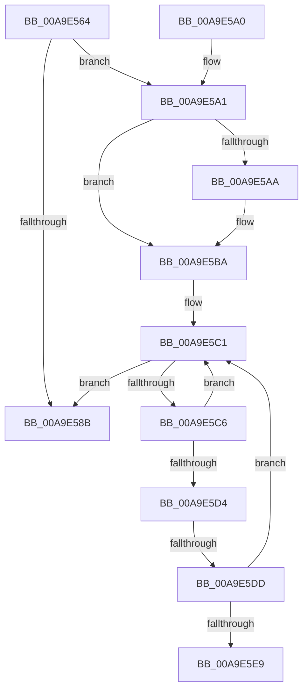

# PiSwCloseDescendants

- RVA: `0x00A9E564`–`0x00A9E5EE` (길이 `138` bytes)
- VA: `0x0000000140A9E564`
- 실행 섹션: `PAGE`
- PDB 이름 있음: `예`; PDB Function 태그: `예`
- unwind 정보 RVA: `0x000B05D0`
- 디코드: `38`개 명령, `138/138` bytes 표시
- 미해석 바이트: `0` (있으면 어셈블리에 `.byte`로 보존)

> 이 문서는 커널 이미지의 기계어와 PDB 기호를 분석해 생성했습니다. 4번과 5번은 함수 원형과 자료형을 바이너리 사용 방식에서 추정한 C 해석이며 원본 소스 복구 결과는 아닙니다.

## 1. Dependencies

- 직접 호출 지점: **2**; 고유 호출 대상: **2**
- 직접 호출자로 확인된 함수: **3**
- RIP 상대 이미지 참조: **2**

### Outgoing calls
- `0x00A9E57E` → [PiSwFindBusRelations](../8F/PiSwFindBusRelations_function_008F99A0.md) (function, `0x008F99A0`)
- `0x00A9E5B5` → [McTemplateK0z_EtwWriteTransfer](../../text/4D/McTemplateK0z_EtwWriteTransfer_function_004DEF6C.md) (function, `0x004DEF6C`)

### Direct callers
- [PiSwIrpCleanup](../73/PiSwIrpCleanup_function_0073AC10.md) at `0x0073AD0C`
- [PiSwProcessParentRemoveIrp](../8F/PiSwProcessParentRemoveIrp_function_008FCD6C.md) at `0x008FCEA4`
- [sub_00B49048](../B4/Unknown_function_00B49048.md) at `0x00B4904F`

### Static image references
- `0x00A9E5A1` → RVA `0x00EF012C` (`.data`; read)
- `0x00A9E5AE` → RVA `0x0001C750` (`.rdata`; read)

## 2. Other-region calls and transfers

- 다른 실행 섹션으로 향하는 call: **1**
  - `0x00A9E5B5` → [McTemplateK0z_EtwWriteTransfer](../../text/4D/McTemplateK0z_EtwWriteTransfer_function_004DEF6C.md) (`PAGE` → `.text`)
- call이 아닌 외부 분기/꼬리 이동: **2**
  - `0x00A9E5D7` → [sub_00B49048](../B4/Unknown_function_00B49048.md) (`tail-transfer`)
  - `0x00A9E5E9` → [sub_00B49048](../B4/Unknown_function_00B49048.md) (`tail-transfer`)

## 3. Assembly (complete function range)

```asm
00A9E564  48 89 5C 24 08                  mov qword ptr [rsp + 8], rbx
00A9E569  48 89 6C 24 10                  mov qword ptr [rsp + 0x10], rbp
00A9E56E  48 89 74 24 18                  mov qword ptr [rsp + 0x18], rsi
00A9E573  57                              push rdi
00A9E574  48 83 EC 20                     sub rsp, 0x20
00A9E578  40 8A EA                        mov bpl, dl
00A9E57B  48 8B D9                        mov rbx, rcx
00A9E57E  E8 1D B4 E5 FF                  call 0x1408f99a0
00A9E583  48 8B F8                        mov rdi, rax
00A9E586  48 85 C0                        test rax, rax
00A9E589  75 16                           jne 0x140a9e5a1
00A9E58B  48 8B 5C 24 30                  mov rbx, qword ptr [rsp + 0x30]
00A9E590  48 8B 6C 24 38                  mov rbp, qword ptr [rsp + 0x38]
00A9E595  48 8B 74 24 40                  mov rsi, qword ptr [rsp + 0x40]
00A9E59A  48 83 C4 20                     add rsp, 0x20
00A9E59E  5F                              pop rdi
00A9E59F  C3                              ret
00A9E5A0  CC                              int3
00A9E5A1  F6 05 84 1B 45 00 40            test byte ptr [rip + 0x451b84], 0x40
00A9E5A8  74 10                           je 0x140a9e5ba
00A9E5AA  4C 8B 4B 08                     mov r9, qword ptr [rbx + 8]
00A9E5AE  48 8D 15 9B E1 57 FF            lea rdx, [rip - 0xa81e65]
00A9E5B5  E8 B2 09 A4 FF                  call 0x1404def6c
00A9E5BA  48 83 C7 10                     add rdi, 0x10
00A9E5BE  48 8B 1F                        mov rbx, qword ptr [rdi]
00A9E5C1  48 3B DF                        cmp rbx, rdi
00A9E5C4  74 C5                           je 0x140a9e58b
00A9E5C6  48 8D 73 A0                     lea rsi, [rbx - 0x60]
00A9E5CA  48 8B 1B                        mov rbx, qword ptr [rbx]
00A9E5CD  8B 46 04                        mov eax, dword ptr [rsi + 4]
00A9E5D0  A8 01                           test al, 1
00A9E5D2  75 ED                           jne 0x140a9e5c1
00A9E5D4  40 84 ED                        test bpl, bpl
00A9E5D7  0F 84 6B AA 0A 00               je 0x140b49048
00A9E5DD  48 8D 86 80 00 00 00            lea rax, [rsi + 0x80]
00A9E5E4  48 39 00                        cmp qword ptr [rax], rax
00A9E5E7  75 D8                           jne 0x140a9e5c1
00A9E5E9  E9 5A AA 0A 00                  jmp 0x140b49048
```

## 4. C-style interpretation (structured pseudocode)

```c
__int64 __fastcall PiSwCloseDescendants(__int64 a1, unsigned __int8 a2)
{
    __int64 result;
    __int64 v_rdi;
    __int64 v_rsp;
    unsigned __int64 v_stack_p10;
    unsigned __int64 v_stack_p18;
    unsigned __int64 v_stack_p8;

    v_stack_p8 = v_rbx;
    v_stack_p10 = v_rbp;
    v_stack_p18 = v_rsi;
    v_rsp = (v_rsp) - (32);
    result = PiSwFindBusRelations(a1, a2, a3, a4);
    if (result != 0) goto loc_00A9E5A1;
loc_00A9E58B:
    v_rsp = (v_rsp) + (32);
    return result;
loc_00A9E5A1:
    if (((*(unsigned __int8 *)(v_rip + 4529028)) & (64)) != 0) {
        a4 = *(unsigned __int64 *)(v_stack_p8 + 8);
        a2 = v_rip - 11017829;
        result = McTemplateK0z_EtwWriteTransfer(a1, a2, a3, a4);
    }
    v_rdi = (result) + (16);
loc_00A9E5C1:
    if ((*(unsigned __int64 *)(v_rdi)) == v_rdi) goto loc_00A9E58B;
    if ((((unsigned __int8)((unsigned int)(*(unsigned int *)(*(unsigned __int64 *)(v_rdi) - 96 + 4)))) & (1)) != 0) goto loc_00A9E5C1;
    if ((*(unsigned __int64 *)(*(unsigned __int64 *)(v_rdi) - 96 + 128)) != (*(unsigned __int64 *)(v_rdi) - 96 + 128)) goto loc_00A9E5C1;
}
```

## 5. (Beta) C Style

```c
int64_t PiSwCloseDescendants(void *Arg1, uint8_t Arg2)
{
    uint8_t *arg1 = (uint8_t *)Arg1;

    int64_t result;
    int64_t local_rdi;
    int64_t local_rsp;
    uint64_t v_stack_p10;
    uint64_t v_stack_p18;
    uint64_t v_stack_p8;

    v_stack_p8 = local_rbx;
    v_stack_p10 = local_rbp;
    v_stack_p18 = local_rsi;
    local_rsp = (local_rsp) - (32);
    result = PiSwFindBusRelations(Arg1, Arg2, a3, a4);
    if (result != 0) goto loc_00A9E5A1;
loc_00A9E58B:
    local_rsp = (local_rsp) + (32);
    return result;
loc_00A9E5A1:
    if (((*(uint8_t *)(v_rip + 0x451B84)) & (64)) != 0) {
        a4 = *(uint64_t *)(v_stack_p8 + 0x8);
        Arg2 = v_rip - 11017829;
        result = McTemplateK0z_EtwWriteTransfer(Arg1, Arg2, a3, a4);
    }
    local_rdi = (result) + (16);
loc_00A9E5C1:
    if ((*(uint64_t *)(local_rdi)) == local_rdi) goto loc_00A9E58B;
    if ((((uint8_t)((uint32_t)(*(uint32_t *)(*(uint64_t *)(local_rdi) - 0x60 + 0x4)))) & (1)) != 0) goto loc_00A9E5C1;
    if ((*(uint64_t *)(*(uint64_t *)(local_rdi) - 0x60 + 0x80)) != (*(uint64_t *)(local_rdi) - 96 + 128)) goto loc_00A9E5C1;
}
```

### 관측된 메모리 오프셋

구조체 형식이 확인되지 않은 접근은 인자 기준의 오프셋으로만 기록했습니다.

| 기준 인자 | 오프셋 표현 | 폭 (bit) | 접근 |
|---|---:|---:|---|
| `Arg1` | `+ 0x8` | `64` | `R` |

## 6. Execution-region graph

[열기: 2D/3D 그래프와 함수 탐색 컨트롤 패널](../../../control-panel.html?section=page&rva=0x00A9E564&view=graph)

- 2D 그래프는 위에서 아래로 흐르고, 3D 그래프는 빈 공간을 드래그해 회전합니다. Shift+드래그는 이동, 휠은 확대·축소, 함수 노드 선택은 대상 보고서 이동입니다.

### Static fallback


