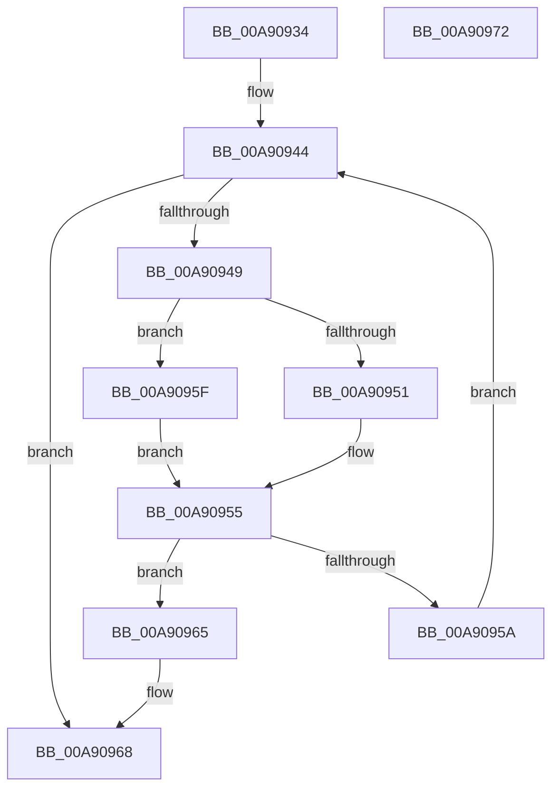

# PiSwFindPdoAssociation

- RVA: `0x00A90934`–`0x00A90973` (길이 `63` bytes)
- VA: `0x0000000140A90934`
- 실행 섹션: `PAGE`
- PDB 이름 있음: `예`; PDB Function 태그: `아니요`
- unwind 정보 RVA: `0x000DB714`
- 디코드: `22`개 명령, `63/63` bytes 표시
- 미해석 바이트: `0` (있으면 어셈블리에 `.byte`로 보존)

> 이 문서는 커널 이미지의 기계어와 PDB 기호를 분석해 생성했습니다. 4번과 5번은 함수 원형과 자료형을 바이너리 사용 방식에서 추정한 C 해석이며 원본 소스 복구 결과는 아닙니다.

## 1. Dependencies

- 직접 호출 지점: **0**; 고유 호출 대상: **0**
- 직접 호출자로 확인된 함수: **2**
- RIP 상대 이미지 참조: **0**

### Outgoing calls
- 직접 디코드된 call 명령이 없습니다.

### Direct callers
- [PiSwStopDestroy](../8F/PiSwStopDestroy_function_008FCA68.md) at `0x008FCB91`
- [sub_00B1C4F6](../B1/Unknown_function_00B1C4F6.md) at `0x00B1C656`

### Static image references
- 디코드된 RIP-relative 메모리 참조가 없습니다.

## 2. Other-region calls and transfers

- 다른 실행 섹션으로 향하는 call: **0**
- 별도 외부 분기/꼬리 이동을 확인하지 못했습니다.

## 3. Assembly (complete function range)

```asm
00A90934  45 33 C9                        xor r9d, r9d
00A90937  4C 8D 99 80 00 00 00            lea r11, [rcx + 0x80]
00A9093E  49 8B 03                        mov rax, qword ptr [r11]
00A90941  45 8B D1                        mov r10d, r9d
00A90944  49 3B C3                        cmp rax, r11
00A90947  74 1F                           je 0x140a90968
00A90949  4C 8B D0                        mov r10, rax
00A9094C  45 84 C0                        test r8b, r8b
00A9094F  75 0E                           jne 0x140a9095f
00A90951  48 8B 48 28                     mov rcx, qword ptr [rax + 0x28]
00A90955  48 3B CA                        cmp rcx, rdx
00A90958  74 0B                           je 0x140a90965
00A9095A  48 8B 00                        mov rax, qword ptr [rax]
00A9095D  EB E5                           jmp 0x140a90944
00A9095F  48 8B 48 20                     mov rcx, qword ptr [rax + 0x20]
00A90963  EB F0                           jmp 0x140a90955
00A90965  41 B1 01                        mov r9b, 1
00A90968  41 F6 D9                        neg r9b
00A9096B  48 1B C0                        sbb rax, rax
00A9096E  49 23 C2                        and rax, r10
00A90971  C3                              ret
00A90972  CC                              int3
```

## 4. C-style interpretation (structured pseudocode)

```c
__int64 __fastcall PiSwFindPdoAssociation(__int64 a1, __int64 a2, unsigned __int8 a3, int a4)
{
    __int64 result;

    a4 = 0;
loc_00A90944:
    if ((*(unsigned __int64 *)(a1 + 128)) == (a1 + 128)) goto loc_00A90968;
    if (a3 != 0) goto loc_00A9095F;
loc_00A90955:
    if ((*(unsigned __int64 *)(*(unsigned __int64 *)(a1 + 128) + 40)) == a2) goto loc_00A90965;
    goto loc_00A90944;
loc_00A9095F:
    goto loc_00A90955;
loc_00A90965:
loc_00A90968:
    a4 = (unsigned __int8)(-(1));
    result = (*(unsigned __int64 *)(*(unsigned __int64 *)(a1 + 128))) & (*(unsigned __int64 *)(a1 + 128));
    return result;
}
```

## 5. (Beta) C Style

```c
int64_t PiSwFindPdoAssociation(void *Arg1, int64_t Arg2, uint8_t Arg3, int32_t Arg4)
{
    uint8_t *arg1 = (uint8_t *)Arg1;

    int64_t result;

    Arg4 = 0;
loc_00A90944:
    if ((*(uint64_t *)(arg1 + 0x80)) == (Arg1 + 128)) goto loc_00A90968;
    if (Arg3 != 0) goto loc_00A9095F;
loc_00A90955:
    if ((*(uint64_t *)(*(uint64_t *)(arg1 + 0x80) + 0x28)) == Arg2) goto loc_00A90965;
    goto loc_00A90944;
loc_00A9095F:
    goto loc_00A90955;
loc_00A90965:
loc_00A90968:
    Arg4 = (uint8_t)(-(1));
    result = (*(uint64_t *)(*(uint64_t *)(arg1 + 0x80))) & (*(uint64_t *)(arg1 + 0x80));
    return result;
}
```

### 관측된 메모리 오프셋

구조체 형식이 확인되지 않은 접근은 인자 기준의 오프셋으로만 기록했습니다.

| 기준 인자 | 오프셋 표현 | 폭 (bit) | 접근 |
|---|---:|---:|---|
| `Arg1` | `+ 0x0` | `64` | `R` |
| `Arg1` | `+ 0x80` | `64` | `R` |

## 6. Execution-region graph

[열기: 2D/3D 그래프와 함수 탐색 컨트롤 패널](../../../control-panel.html?section=page&rva=0x00A90934&view=graph)

- 2D 그래프는 위에서 아래로 흐르고, 3D 그래프는 빈 공간을 드래그해 회전합니다. Shift+드래그는 이동, 휠은 확대·축소, 함수 노드 선택은 대상 보고서 이동입니다.

### Static fallback


